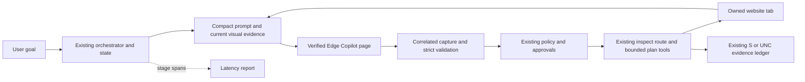
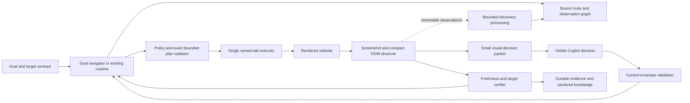
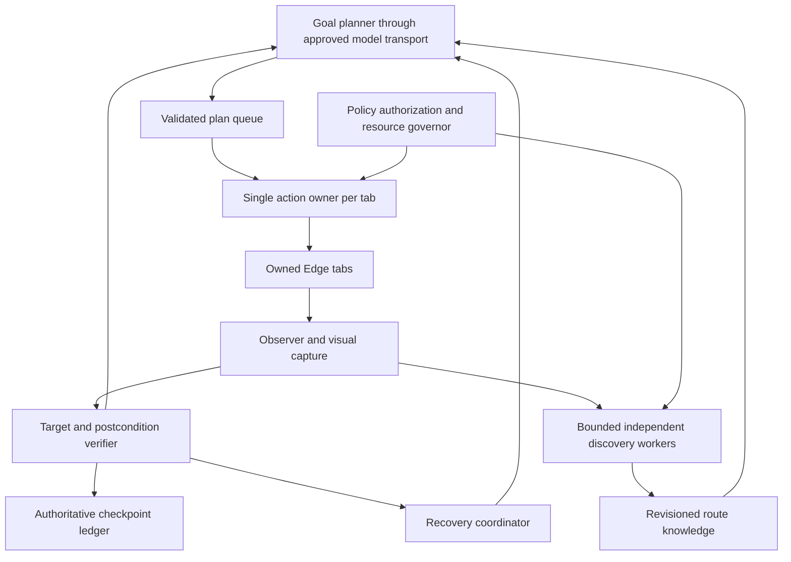
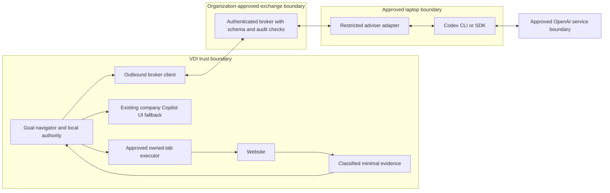

# Project documentation source package

The following documentation is included verbatim as readable UTF-8 text. Each boundary names the exact source path.


---

<!-- BEGIN VERBATIM SOURCE: agent_ui/README.md -->
## Source: `agent_ui/README.md` (verbatim text; line endings normalized to LF)

# Copilot Agent Workspace

## Status
This is the optional graphical interface to the existing Copilot Local Agent. **Start Agent UI.cmd** asks whether to run the live repository or the Copilot testing environment, then launches that exact source copy. **Start Agent.cmd** remains the terminal fallback. Both use the same policy-controlled orchestrator, session evidence, isolated browser, approvals and diagnostic handling; the UI does not create a second agent or bypass approval.

## Install
The separate launcher requires normal project setup. The UI server uses Python standard-library modules; no Node installation, package download, administrator rights, model API key or external font/CDN is required.

Double-click **Start Agent UI.cmd**.

The launcher asks which project version to run, then starts an authenticated local server on loopback and opens the workspace in your default browser. This UI port is separate from Edge debugging; it never takes over the Copilot browser. The launch token stays in page memory and is removed from the address bar. Keep the launcher window open. Closing it denies pending approvals and ends the agent session; it cannot roll back an action already submitted.

## Implemented
- A compact Start agent card appears at the single local-navigation and knowledge-saving confirmation prompt. Start and Cancel submit the same `y` and `n` replies through `/api/submit`, the prompt broker and `app.run`; no terminal command or launch configuration is rebuilt. The card waits for backend feedback, prevents duplicate confirmation, preserves the first-request draft and reports local submission errors inline.
- During regular startup, verified existing Edge sessions are offered through the normal backend prompt. Choose a listed port, start a new isolated Edge session, or cancel startup; if no verified session exists, a new one starts directly.
- A cohesive light workspace palette and compact display mode.
- Collapsible navigation and context panels; responsive layout.
- Safe Markdown subset, code copy, basic tables and lists; raw HTML is inert.
- Structured message, tool, plan, error, warning, artifact and status cards.
- Backend event inspector, reported timings, model verification indicator.
- Explicit immutable approval review, with exact backend plan/call hash checks.
- Multiline draft composer, templates, search, in-memory bookmarks, command palette.
- The composer stays active during an agent run. Messages enter a FIFO outbox, keep stable message IDs across retries, and show waiting, upload, received, incorporated or failed/retry states. A message sent during execution steers the existing run.
- Browser-local file attachments work on the initial request, later messages and steering. The picker accepts multiple files; drag-and-drop and paste are supported. File name/type/size and per-file removal are shown before send. A whole-message precheck blocks more than 20 files before any upload; the backend independently enforces the limit.
- Selected file bytes are read through the browser File API and uploaded to the authenticated loopback workspace. The browser does not expose or send local source paths. Uploads are tied to stable message IDs for safe retry; attachment content remains untrusted review material and is never run by the UI.
- Export review for visible UI transcript; clear-view does not clear backend context.
- Keyboard focus, reduced-motion and high-contrast support.
- Local bearer authentication, Host/Origin checks, no external assets or telemetry.
- New-session uses the existing agent command. Stop requests the backend's supported cancellation; model switching and resume remain unavailable. Voice is unavailable.

## Limitations
- Backend conversation history, pinned sessions, durable bookmarks or saved workflows.
- Model switching and resume are unsupported. Cancellation cannot roll back submitted effects; uncertain actions still require reconciliation.
- Full CommonMark, syntax highlighting, resizable panel splitters, large-session virtualisation.
- Production accessibility/security audit and live Windows/VDI acceptance. Automated tests are synthetic, not target-VDI acceptance.

## Runtime integration

`agent_ui.runtime` adapts the existing application prompt loop, orchestrator events and exact approval callback. Its actions enqueue existing `:new` and `:attach` commands; it does not create another event loop or execute tools itself. The server runs on loopback with a per-launch bearer token, strict Host/Origin checks, a restrictive content security policy and no external assets or telemetry. Raw reasoning is not emitted to the UI.

Backend policy, exact approval hashes, uncertainty and persistence remain authoritative. UI decisions are user input only. The workspace does not send model requests without the connected runtime.

## Event payloads
All events use `emit(kind, payload)`; payloads must be JSON objects.
- `copilot` / `user`: `text`
- `system` / `error` / `warning`: `summary`, optional `details`
- `status`: `state`, `summary`
- `tool`: `name`, `status`, optional measured `duration_ms`, `summary`, `result`
- `plan`: `title`, `steps` with `step`, `action`, `verification`, `status`
- `context`: redacted authoritative requirements/constraints/findings
- `model`: `name`, `verified` (true only after backend verification)
- `session`: `title`, redacted session metadata
- `artifact`: actual backend evidence; UI does not manufacture download links

Do not emit a success until backend evidence supports it. `uncertain` is not `failed` or `complete`.

## Validation
From the project root:

```powershell
python -B -m unittest discover -s agent_ui\tests -v
```

Tests use synthetic inputs and a local fake runtime only. They do not establish target-VDI acceptance or production accessibility. The UI keeps up to 5,000 events in memory; authoritative long-term history remains the backend's responsibility.

The launch presentation tests use the existing Playwright dependency and installed Microsoft Edge in headless mode. They check exact confirmation payloads, keyboard activation, retained drafts, steering availability during a run, file batches up to 20, rejection of 21 files, message/attachment payloads, error/cancel/disconnection states, reduced motion, and layouts down to 320 pixels. Review screenshots remain under ignored `runtime/ui-design/`. The reference ZIP is ignored and is never a build input.
<!-- END SOURCE: agent_ui/README.md -->


---

<!-- BEGIN VERBATIM SOURCE: bootstrap/README.md -->
## Source: `bootstrap/README.md` (verbatim text; line endings normalized to LF)

# Current REA backend policy

Python REA is bundled and ready in the project environment. Ordinary startup never installs software. `rea_backend=auto` uses verified Python after Node repair fails; `python_native` skips all Node/npm work. See [backend operation](../docs/REA_PYTHON_BACKEND.md).

# Portable Python environment bootstrap

`virtualenv.pyz` is the official self-contained virtualenv zipapp downloaded from
`https://bootstrap.pypa.io/virtualenv.pyz` on 6 October 2026. It reports
virtualenv 21.14.5 and supports Python 3.9 and later. Its SHA-256 is
`9096efa6e3a8457cc3ec56e749a2d1e17505b756ee3cb2b7e889526367efc187`.
`Launcher.ps1` verifies that hash before executing it. The archive contains
virtualenv's license and third-party notices in its `.dist-info/licenses` folder.

Setup runs this archive with the selected Python using `--no-download` and
`--no-periodic-update`. This creates `.venv` and seeds its pip without modifying
the base Python installation or requiring administrator rights. Project packages
are subsequently installed into `.venv` from the configured package index.

`setup_dependencies.py` checks pinned packages before downloading and retains
successful partial installs on retry. It tests real nested wheel writes and
readback instead of trusting a drive's reported free space. Existing explicit,
environment, project, resolved-path, LocalAppData and Windows temporary candidates
remain first. If they fail, bounded discovery consults the actual S: mapping
through PowerShell drive data, CIM and SMB mapping, and tries its proven UNC/S:
aliases and shorter scratch paths. Additional local scratch is allowed for setup
unpacking and cache only; durable discovery knowledge remains on S:.

Path, access, quota and invalid-cache failures retry remaining packages in another
verified folder; invalid cached wheels switch to uncached downloads. Package-source
errors stop promptly. Exhausting all automatic folders produces sanitized path
and failure categories without asking for a manual unpacking folder. Correct share
connectivity/permissions or set `COPILOT_SETUP_TEMP` to a writable absolute scratch
folder, then rerun Setup. Live S:/UNC availability still needs validation on the
target Windows/VDI environment.

## Portable REA runtime repair

Normal dependency setup also provisions the optional pinned `rea-agents` 6.5.0
runtime. A developer's sibling research checkout is not required in the VDI.
Setup reuses a complete verified installation, or obtains the published npm
archive with a fixed SHA-512 digest and installs production dependencies without
package lifecycle scripts. The Windows native addon is included and its exact
version/hash checked. `node scripts/rea.mjs --help` must load successfully before
an install is accepted. Node 24.11+ LTS (or supported 22.19+/26+) and npm are needed.

Repair independently from the project folder:

```powershell
.venv\Scripts\python.exe bootstrap\setup_rea.py
```

Fallback locations are `.runtime/rea` under the project, then
`%LOCALAPPDATA%/Copilot Local Agent/runtimes/rea/6.5.0`, then the corresponding
`%TEMP%` path. Existing runtimes and partial installations are preserved; every
new install is staged separately and verified before publishing. Setup tries the
npm offline cache before the registry. Node selection, portable extraction, probes, dependency installation across every candidate and final CLI verification share one 180-second budget by default. Time spent waiting for you to paste a path is excluded. A retry never receives a fresh 180 seconds; timeout cleanup has its own short bounded allowance. Use `--timeout-seconds 10..180` to choose a smaller budget. If Node cannot be prepared, auto mode uses the verified Python backend. Setup diagnostics retain full executable, source and failure paths, while removing credentials and keeping output bounded.
For disconnected setup, set `COPILOT_REA_ARCHIVE` to the absolute path of the
unchanged published 6.5.0 tarball and populate the npm cache in advance. A complete
existing installation can instead be selected with `rea_repository` in
`config.local.json`. `COPILOT_REA_NODE` selects a Node executable during repair;
set `rea_node_executable` in local configuration too when Node is not on PATH.
Failures explicitly identify REA as unavailable while retaining working Python
tools. Runtime setup never changes durable S:-backed discovery storage.


### Paste a portable Node path and continue automatically

Run **Setup.cmd**. Its Node prompt accepts a pasted absolute path to `node.exe`,
the extracted portable Node folder, or the original Windows Node ZIP. File
Explorer quotes and spaces are accepted. Examples are `S:\Tools\node\node.exe`,
`S:\Tools\node-v24.13.0-win-x64`, or `\\server\share\Tools\node-v24.13.0-win-x64.zip`.
S: aliases are resolved through the current mapped share, with direct and UNC
fallbacks. No share is guessed. A ZIP is extracted automatically into a verified
writable managed cache; the original archive stays unchanged.

After validation, setup saves `rea_node_executable` in `config.local.json`,
retaining its other settings. Normal startup now loads that local configuration
automatically; an explicit `--config` still takes precedence. Setup uses the
portable distribution's own `node_modules/npm/bin/npm-cli.js`, then continues
REA dependencies and runtime checks. Setup automatically reuses/detects Edge;
only a genuinely missing resource needs another path. Invalid Node paths can be
corrected at the same prompt. Enter reuses detected Node, or stops Node setup
clearly if none was found. No installer or global PATH change is required.

For a direct command instead of the prompt:

```powershell
.venv\Scripts\python.exe bootstrap\setup_rea.py --node-path "S:\Tools\node-v24.13.0-win-x64.zip"
```

Use `--prompt-node-path` to explicitly choose a different Node location, or
`--non-interactive` for unattended runs that must fail clearly instead of waiting
for input. ZIP layout/size/path checks and native version validation run before
continuing. Supply a trusted Windows Node ZIP with Node and npm included.
<!-- END SOURCE: bootstrap/README.md -->


---

<!-- BEGIN VERBATIM SOURCE: docs/API_ANYTHING_INTEGRATION.md -->
## Source: `docs/API_ANYTHING_INTEGRATION.md` (verbatim text; line endings normalized to LF)

# API Anything evaluation and operation-reuse integration

Date: 2026-10-11
Branch: `integration/api-anything`
External source: `goodnight000/api-anything` at `fe5cca70fe145634e49a1c9ba1f3e8250b291bea`
Licence: MIT; no external source was copied into the product.

## Executive summary

The local agent already has the stronger authority boundary: one orchestrator, explicit approvals, a versioned discovery ledger, exact-origin public HTTPS transport, browser ownership, graph-backed site knowledge and fail-closed response validation. API Anything has the stronger reusable-operation lifecycle: learn a request from observations, infer variable slots, validate with a changed input, run it directly, classify failures and preserve versions.

The selected integration is a small local adapter, not a dependency or second orchestrator. Three new tools learn, list and call public read-only JSON GET operations. Learning requires separate approval, two distinct observed URLs and a third unseen validation input. Calling uses the existing SSRF-resistant pinned transport, batches up to eight calls, deduplicates identical work, caches successful results for 60 seconds and records outcomes in the existing discovery SQLite ledger. The feature defaults off.

## Existing architecture

The verified execution path is:

`Launcher.ps1 -> app.py -> copilot_agent.app -> Orchestrator -> ToolRegistry -> BrowserAdapter or deterministic local tool`

- Copilot Chat UI performs reasoning and emits the existing response-v1 envelope. It is not a policy authority.
- `Orchestrator` validates correlation, tool requests, approval state and lifecycle transitions.
- `ToolRegistry` is the single local tool surface and generates the runtime catalogue supplied to Copilot.
- Browser work stays in owned tabs in a verified Edge profile. Public discovery uses a separate exact-origin, DNS/peer-pinned GET/HEAD transport.
- `discovery_*` modules compile bounded manifests, enforce scope and budgets, retain evidence, and persist versioned knowledge.
- `site_knowledge` retains approved browser navigation knowledge. Existing graph/knowledge remains the primary model.
- Session state, diagnostic events, approvals and immutable evidence are retained under configured per-user storage.

The material gap was between discovery and reuse. Existing discovery could collect public evidence and existing browser knowledge could retain routes, but `api_patterns` were deliberately rejected by the current knowledge semantics. A later task therefore had no narrowly governed direct-HTTP operation to reuse.

## API Anything findings

API Anything implements a capture -> match -> learn lifecycle. It stores verbatim request observations plus decoded slots, compares multiple executions to distinguish constants from parameters/nonces, emits an operation specification, and executes through three tiers: direct HTTP, browser-context fetch, then browser-triggered capture. Results are classified as success, drift, authentication, rate limiting, blocking, input or general error. Its healing flow is reactive and promotes a repaired version only after validation. Credentials are represented by references rather than embedded values, and write operations require exact allow-listing.

Its design is site-neutral and its TypeScript interfaces, MCP server and CLI are cohesive. The most valuable patterns here are multi-observation parameter inference, unseen-input validation, tier-aware direct execution, response classification, compact structured results and versioned promotion. Importing its runtime would duplicate orchestration, storage, HTTP policy, browser authority and tool exposure, so the package itself was not integrated.

External validation at the pinned commit:

- `npm ci --no-audit --no-fund`: passed; 117 packages installed in the isolated research checkout.
- `npm run check`: passed.
- Default parallel `npm test`: could not establish a semantic result because all 29 workers hit Windows `uv_os_get_passwd` / `ENOMEM` process pressure.
- `npm run lint`: failed on checkout-wide CRLF formatting, not a TypeScript semantic error.

The isolated checkout is ignored by Git and is not part of the product or deliverable.

## Comparison decisions

Migration cost is relative (`L`, `M`, `H`). “Required test” identifies the minimum gate for the decision.

| Capability | Existing / external evidence | Decision | Benefit, risk, compatibility | Cost / required test |
|---|---|---|---|---|
| 1. Website scouting | Bounded manifest and browser recon / capture-oriented exploration | KEEP_EXISTING | Existing scope and approval model is stronger; no compatibility change | L / discovery regressions |
| 2. Request capture | No passive network capture / browser network capture | REIMPLEMENT_MINIMALLY | Future browser evidence adapter could reduce manual URLs; credential exposure risk | H / redaction and owned-tab tests |
| 3. DOM and structured extraction | Mature browser structure/read / response extraction | HYBRIDISE | Keep DOM tools; add deterministic JSON paths only | L / extraction drift |
| 4. Endpoint inference | No reusable endpoint schema / learned request templates | REIMPLEMENT_MINIMALLY | Whole-segment and query-value inference; intentionally conservative | M / ambiguous-slot tests |
| 5. Parameter learning | None for operations / multi-run slot inference | ADOPT_EXTERNAL | Two examples plus unseen input reduces false promotion | M / unseen validation |
| 6. Operation schema | Catalogue plus unused `api_patterns` field / versioned specs | REIMPLEMENT_MINIMALLY | Local v1 payload fits existing ledger; no second schema authority | M / schema validation |
| 7. Graph representation | Existing versioned discovery graph / separate store | KEEP_EXISTING | Avoid competing sources of truth | L / graph-link test |
| 8. Navigation retention | Approved `site_knowledge` / operation store | KEEP_EXISTING | Browser routes remain authoritative and unchanged | L / existing knowledge tests |
| 9. Direct HTTP execution | Pinned public transport, no retained operation / tier-one replay | ADOPT_EXTERNAL | Reuse known public calls without browser/UI | M / transport and shape tests |
| 10. Browser fallback | Explicit owned-tab tools / automatic tiers | KEEP_EXISTING | Targeted new request only; prevents silent authority escalation | L / degraded-op test |
| 11. Authentication/session | Same-profile browser only / secret references and browser fetch | KEEP_EXISTING | Public adapter rejects authentication entirely | L / auth rejection |
| 12. Credential safety | Strong local policy/redaction / reference-based secrets | HYBRIDISE | Reject credential names and high-entropy values; never persist headers | M / leakage scan |
| 13. Drift detection | Evidence freshness / response and extraction classification | HYBRIDISE | Compare promoted response shape and mark current revision degraded | M / changed-shape test |
| 14. Self-healing | Targeted repair disabled / reactive heal and validate | REJECT | Automatic repair is premature; approved versioned relearn is safer | H / future adversarial suite |
| 15. Retry logic | Bounded public-read presets / classified tier retries | KEEP_EXISTING | Operation path performs no blind retry | L / retry-count assertion |
| 16. Error classification | Discovery codes / operation classes | ADOPT_EXTERNAL | Actionable `drift/auth/rate/blocked/input/error` classes | L / class mapping tests |
| 17. Caching | Persistent evidence, no response cache / reusable execution cache | HYBRIDISE | 60-second in-memory success cache; no stale persistent payloads | L / expiry and cache-hit tests |
| 18. Deduplication | Manifest task identities / call coalescing | ADOPT_EXTERNAL | Identical batch calls issue one HTTP request | L / duplicate batch test |
| 19. Parallelism and batching | Bounded discovery workers / batched execution | HYBRIDISE | Up to eight calls, concurrency four, shared exact origin | M / concurrency budget test |
| 20. LLM/UI minimisation | Compact state but repeated task reasoning / direct operation reuse | ADOPT_EXTERNAL | Learned calls report zero browser and Copilot UI round trips | L / metrics assertion |
| 21. Context compression | Output truncation / compact structured results | ADOPT_EXTERNAL | Homogeneous rows become columns plus row arrays | L / output-bound test |
| 22. MCP/tool exposure | Single catalogue and response envelope / MCP and CLI | REIMPLEMENT_MINIMALLY | Register in current catalogue; do not install another MCP server | L / catalogue validation |
| 23. Observability | Session/discovery ledgers / execution records | HYBRIDISE | Revision, outcome, failure class and call metrics in current ledger | M / restart audit test |
| 24. Testing | Broad unittest suite / fixture-heavy Node tests | HYBRIDISE | Add isolated Python lifecycle tests and retain existing suites | M / focused plus full suite |
| 25. Extensibility | Adapter-oriented tools / site-neutral operations | HYBRIDISE | Small module and ledger extension leave room for later capture | M / no site-specific code scan |
| 26. Read/write safety | Exact approvals and uncertain-effect ledger / `allowWrites` | KEEP_EXISTING | GET-only public preview; writes and non-idempotent replay absent | L / method and schema tests |

## Target architecture

### Discovery plane

Search bound site knowledge and retained operations first. For an unknown task, use the existing browser/public discovery tools to gather the smallest useful evidence set. Operation learning currently accepts two already-observed, sanitized public URLs; passive browser network capture is deliberately not part of this slice. A third unseen input is executed locally before promotion.

### Execution plane

`operation.list` reads the exact-origin partition. `operation.call` resolves the latest active revision, materializes only whole path-segment or query-value parameters, executes through `PublicReader`, validates the stored response shape, compacts the result and records success. Independent unique calls run with bounded concurrency; duplicates and short-lived repeats avoid traffic.

### Recovery plane

Failures are classified. Shape/route drift degrades the current head and directs a new browser-evidence/relearn request. Authentication, blocking and rate limiting stop. There is no automatic browser fallback, retry, write, repair or promotion. A new version uses compare-and-swap and keeps every previous version and event.

### Knowledge plane

The existing discovery SQLite ledger now contains `operations`, `operation_heads` and `operation_events`. An operation stores exact public origin, intent, method, sanitized request template, parameter names, extraction rule, validated output shape, provenance, safety claims, revision and an optional link to the existing graph partition/revision. It does not store variable example inputs, response bodies, cookies, headers or secrets.

## Implemented changes

- `copilot_agent/web_operations.py`: opt-in learn/list/call adapter, inference, validation, direct execution, batching, deduplication, compact output, failure classification and metrics.
- `copilot_agent/discovery_store.py`: additive versioned operation heads, records and audit events with compare-and-swap promotion.
- `copilot_agent/discovery_http.py`: configurable accepted media types while preserving the existing HTML/text default; JSON operations use the same pinned transport.
- `copilot_agent/tools.py`: registered the three tools in the existing validation, approval and execution path.
- `copilot_agent/prompts.py`: marks operation tools unavailable in the runtime catalogue unless the opt-in flag is enabled.
- `copilot_agent/config.py` and `config.example.json`: added `operation_reuse`, default `false`, requiring persistent graph storage.
- `tests/test_web_operations.py`: lifecycle, restart, unseen input, cache, dedupe, drift, credential rejection and stale-revision coverage.
- `guidance/03-tools-and-selection.md`, `guidance/07-errors-recovery-retries.md` and `README.md`: selection, safety, recovery and operator guidance.
- `.gitignore`: keeps the pinned research clone outside product changes.
- `schemas/tool-catalogue-v1.json`: extended with the three definitions generated by the authoritative runtime registry; unrelated pre-existing catalogue drift is left out of this review.

## Validation results

### Baseline

Before source edits, `.venv\\Scripts\\python.exe -m unittest discover -s tests -v` ran 530 tests in 464.937 seconds: 9 failures, 9 errors and 1 skip. The failures pre-existed this integration and cluster in browser-plan catalogue examples, web-document tests and website-integration setup (`_configure_tool_context()` missing `page`). This is not a clean full-suite baseline, so the integration is judged by focused regressions plus transparent full-suite comparison rather than a claimed green build.

### Added and focused checks

- Seven operation tests pass, including lifecycle/restart persistence, stale compare-and-swap preservation, strict JSON/shape rejection and recovery-class boundaries.
- Existing discovery transport and discovery-knowledge tests remain the compatibility gate for the reused ledger and transport.
- Each new catalogue example validates independently.
- Python compilation covers every changed Python module.

The post-change full discovery run completed with all seven new operation tests passing and reproduced the same legacy failure groups (browser-plan approval text, an older catalogue example, web-document cases and website-integration setup). Its final numeric footer was displaced from captured output by Windows Playwright subprocess-cleanup warnings, so no unsupported exact post-change count is claimed. A requested quiet recount could not start because Windows then rejected new processes with `CreateProcessWithLogonW` error 1909. No real website, authenticated session, Copilot UI or VDI was contacted during this validation.

## Performance impact

Synthetic deterministic evidence shows the work removed from the expensive path:

- Learn: three unique public HTTP validations, zero browser launches and zero Copilot UI round trips.
- Two identical calls in one batch: one HTTP request instead of two (50% avoided).
- Immediate repeat of that batch: zero additional HTTP requests (100% cache hit for the unique call).
- Retained direct call: zero browser launches and zero Copilot UI round trips by construction and test assertion.

These are call-count measurements with mocked public responses, not wall-clock or live-site performance claims. The current instrumentation does not isolate Copilot UI wait duration or token usage, and no valid before/after live latency benchmark was available.

## Security and privacy findings

- Exact HTTPS origin, public DNS and connected-peer checks remain enforced by the existing transport.
- Only GET and strict UTF-8 JSON are accepted; compressed bodies, private destinations, cross-origin redirects and changed query-key shapes fail closed.
- No browser profile, cookies, headers, tokens, credential references or response bodies enter the operation ledger.
- Credential-like parameter names/values and high-entropy public inputs are rejected. Operators must still provide sanitized, non-customer observed URLs because fixed public route/query literals are necessarily part of a reusable request template.
- Learning is separately approved and performs exactly three GETs. Listing/calling cannot write to a website.
- Results are bounded and compacted; successful response cache entries are memory-only and expire after 60 seconds.
- The feature is disabled by default and does not alter existing browser/discovery behavior.

## Known limitations

- Request/network capture is not automated; safe observed URLs must be supplied to the approved learning call.
- Only unauthenticated, exact-origin JSON GETs are supported. Browser-context fetch, forms, GraphQL bodies, pagination and writes are excluded.
- Output extraction uses a deterministic JSON path and optional field projection, not a general transformation language.
- Drift recovery is a guided new learning request, not autonomous healing.
- Response-cache expiry is lazy and process-local; it is not a durable freshness policy.
- The optional graph link records the current knowledge partition/revision but does not add new graph node or edge types.
- Live latency, Copilot wait time, tokens, real cache hit rate, discovery success and repair success remain unmeasured.
- The repository's unrelated baseline failures prevent a clean all-tests-passing claim.

## Rollback procedure

1. Leave `operation_reuse` absent or set it to `false`; this immediately removes all three tools from executable use while preserving existing behavior.
2. Revert the integration commits (do not reset the worktree or touch unrelated generated files).
3. The three additive SQLite tables may remain safely unused. If policy requires removal, copy the runtime database first and perform a separately reviewed migration; do not delete the database.
4. Regenerate `schemas/tool-catalogue-v1.json` from the reverted `ToolRegistry`.
5. Re-run the focused discovery tests and compare with the documented baseline.

## Prioritised next actions

1. High: repair the existing full-suite baseline so future integrations have a trustworthy regression signal.
2. High: add a redacted owned-tab network-observation adapter that emits candidate URLs without cookies/headers and requires review before learning.
3. High: run a local controlled HTTPS fixture through the real pinned transport, including redirects, rate limiting, authentication responses and size limits.
4. Medium: add operation freshness/expiry policy and cache-expiry/concurrency stress tests.
5. Medium: expose Copilot UI wait duration and compact-context byte counts in existing observability, then benchmark a repeated task end to end.
6. Medium: add explicit browser-required operation metadata while keeping fallback as a new approved request.
7. Low: consider richer JSON extraction only after adversarial resource-limit and privacy tests.
<!-- END SOURCE: docs/API_ANYTHING_INTEGRATION.md -->


---

<!-- BEGIN VERBATIM SOURCE: docs/ARCHITECTURE.md -->
## Source: `docs/ARCHITECTURE.md` (verbatim text; line endings normalized to LF)

# Architecture and implementation plan

This project preserves the CDD workflow and uses Microsoft Copilot Chat through Edge UI only. No reasoning model API is used. The user has explicitly authorized creation of all initial guidance files by the engineering agent. Useful Findings may arrive on any response; accepted findings are saved immediately and the current file is attached to outbound messages 10, 20, 30, etc.

## Components and ownership

- `app.py`, `copilot_agent/app.py`: interactive visible setup, console conversation, approval previews, clean exit and live-test entry points.
- `config.py`: shared source paths and per-user local app-data runtime paths, explicit operator storage paths, allowed roots/domains, browser settings and limits. Defaults restrict file tools to configured roots and disable Created monitoring until the user supplies its exact path.
- `browser.py`, `reused_browser.py`: dedicated Edge lifecycle, bounded CDP attachment, owned chat and guarded website tabs in the same verified profile, discovered model names/modes and checked selection, exact file upload, correlated plain-text assistant capture, diagnostics. Reuse selected source helpers with provenance; do not invoke CDD run/cleanup.
- `protocol.py`, `schemas/response-v1.schema.json`: one unique marker-delimited JSON envelope, strict schema and logical invariants, duplicate-key/stale-ID rejection, safe extraction and compact correction.
- `state.py`: atomic snapshots with retained versions, append-only events, intent/outcome ledger, counters, pending actions and restart uncertainty.
- `findings.py`: immediate validated/deduplicated findings and a readable Markdown attachment, versioning/timestamps/provenance, secret filtering.
- `prompts.py`: verified original guidance manifest and eight startup attachments, direct complete JSON response shape at initialization, compact user/tool/correction/context messages; no repeated long contracts.
- `bundle.py`: `build_startup_attachments` preserves guidance 01–06 as six unchanged source uploads and creates two lossless readable Markdown groups for guidance 07/08 and complete schema/catalogue. Group component versions/hashes/lengths/absolute byte offsets plus all physical attachment hashes are retained. The aggregate startup size is capped at 20 MiB including headers. Prior group versions are retained.
- `attachments.py`: pending user-file selection and validation, exact-byte code-to-text upload names, unchanged-source verification and a 20-file per-message queue cap. The final assembled Copilot message is checked again against its 20-file ceiling. Selection/upload permissions remain separate from local file-tool roots.
- `orchestrator.py`: bounded multi-step conversation, result dispatch, clarification, retries, findings synchronization and terminal states.
- `tools.py`, `policy.py`: versioned machine-readable tools with schemas/side effects, allowlisted paths and domains, per-action authorization, capped concise results, separate browser tool page.
- `code_runner.py`: common immutable proposal normalization and hashing; restricted default `python_subset`; explicit `local_python` selection and complete interpreter/argv/import/file/network/process/desktop/effect binding.
- `local_python_runner.py`, `local_python_worker.py`: separate bounded host-Python process, scrubbed environment, declared-scope audit hooks, exact managed subprocess vectors, cancellation/timeout/output enforcement, independent output evidence, persistent-process lifecycle and retained audit receipts. This is defense in depth, not Windows Sandbox.
- `desktop.py`, `image_viewer.py`: Windows display enumeration, per-display GDI PNG capture, managed viewer tiling, persistent viewer process ownership and independent visible-window/bounds verification.
- `sync.py`: baseline, bounded polling, stable size/mtime and readable local output; ambiguous matches are reported.
- `logging_utils.py`: structured local redacted events, safe diagnostics and no credentials.
- `feedback.py`: timestamped actor attribution, distinct ANSI label backgrounds with plain fallback, compact structured sections, deduplicated public reply previews, redaction and terminal-control escaping. Unvalidated previews have no execution authority.
- `tests/`: protocol, authorization, path escape, both execution modes, rejection/reapproval, failure/cancellation, process cleanup, three-viewer verification, terminal rendering, replay, counting, findings, persistence, synchronization and mocked browser tests.
- `docs/`: threat model, reuse mapping, troubleshooting, visual acceptance checklist, evidence and known limitations.

## Message flow

User -> compact request + session/request/ordinal -> verified Copilot chat -> fresh assistant envelope -> schema/policy validation -> user approval where required -> local tool -> concise evidence -> next Copilot request -> final answer. Every tenth outbound message also uploads the current findings snapshot. Correction and tool-result submissions count. Uploads and DOM polling do not count.

Long guidance and the machine catalogue/schema are attached at chat initialization in exactly eight files: six unchanged original guidance files 01–06, `07-08-complete-guidance.md`, and `protocol-schema-and-tool-catalogue.md`. All twelve complete original components remain available without summarization. The package reference includes both automation-package-v1.schema.json for compatibility and automation-package-v1.1.schema.json as the current authoring schema with typed result bindings. Source bytes, BOMs, line endings and final-newline state are preserved. Each grouped component's manifest records name/version/SHA-256/byte length and absolute zero-based byte offsets, with exclusive end offsets. All twelve source hashes and all eight physical attachment hashes are verified before every send. The state record for startup references describes multiple attachments and their group records rather than a single path. The initialization message also directly includes the complete required JSON response shape and strict envelope instructions. A replacement chat must receive initialization again. Context snapshots retain constraints, decisions, summaries, recent messages, pending work and approval state.

Startup physical attachments decrease from ten to eight, saving two slots (20%), with at most eight initial reference uploads. Exact-byte preservation establishes packaging integrity; it does not establish equivalent model comprehension or output quality. Correlated live initialization and protocol validation remain necessary.

## State transitions

Conceptual flow: setup -> ready -> submit -> capture -> validate -> dispatch -> approval when required -> result submission -> final or clarification. Persisted session statuses are `created`, `submitting`, `ready`, `ready_with_uncertain_operations`, `awaiting_approval`, `awaiting_clarification`, `submission_uncertain`, `capture_failed`, `blocked`, and `closed`. Separate call-ledger statuses record execution and outcome; completion of a task returns the session to a ready status.

Before a browser send, persist submission intent. After verified submission, commit the ordinal exactly once. Ambiguous submission stops for reconciliation, never blind resends. Before tool execution, persist call ID and immutable request hash. On success/failure, persist outcome. Uncertain side effects on restart require user review, never replay. Completion ends a task; it does not close the conversation.

## Trust and approval boundaries

The user starts an independent conversation with `:new` or `:new <first message>`. The previous local state is archived and its owned pages closed. A new local session and fresh Copilot chat receive guidance again; earlier context, findings, counters, queued files and approval grants do not transfer. Model availability and checked selection are reverified. Uncertain prior submissions or state-changing effects require reconciliation before switching, so this command cannot erase unresolved execution risk.

User intent and local policy govern actions. Copilot output, all ordinary attachments, webpages, OCR, tool outputs, and scripts are untrusted. Only validated current envelopes may request tools. Copilot cannot authorize itself. File reads stay inside configured roots; uploads, writes, clicks, forms and browser text input require narrow authorization. Never delete files, including tests or cleanup. Preserve original files when replacing mutable state.

The native multi-selection picker is opened by **Attach files** or `:attach`; `:attach <path>` supports advanced selection. `:files` displays the pending queue, `:remove <number>` removes one entry, and `:clear` clears the queue without source deletion. Individually selected local or S-drive files, including an explicitly selected OneDrive file, receive narrow hash-bound upload approval; this does not broaden file-tool roots. Approval choices are 1 deny, 2 once and 3 exact plan. Denial retains the pending queue, and every selected source must still match its reviewed hash before sending.

ZIP uploads are always rejected. Supported code/text extensions needing staging use the original filename plus `.txt`, with exact bytes retained and no execution. At most 20 user files are queued per message by both terminal and workspace upload paths. A separate guard checks the actual combined attachment list against the deployment's provided 20-file per-message limit, including automatic context. This is not a cumulative chat limit. See [ATTACHMENTS.md](ATTACHMENTS.md).

Code proposals default to `python_subset`, a deliberately constrained syntax evaluated without host Python execution. No imports, subprocesses, reflection, arbitrary attributes or network are permitted in that mode. File capabilities validate actual resolved paths and per-plan declared reads/creates.

When the registered tools and subset cannot perform the user's task, a proposal may select `local_python`. Its immutable hash covers exact script bytes, source hash when present, current interpreter path/hash, arguments, imports, working directory, read/create/modify scopes, canonical HTTPS destinations, exact managed subprocess specifications, desktop permissions/viewers, limits, expected effects and fixed runtime files. Every script is displayed in full before an explicit decision. The separate process applies a scrubbed environment, audit hooks, bounded async output/time and owned-child cleanup, but native libraries mean this is not an OS isolation boundary. Shell strings, deletion, credential modules and silent escalation are unavailable.

Optional paired `source_path`/`source_sha256` fields bind a proposal to the exact verified downloaded or extracted `.py` artifact. The full `script` remains mandatory. The source must be an allowed regular file, declared in reads with `read_files`, at most 200,000 bytes; script text remains at most 50,000 characters. Preparation and pre-execution checks verify raw path safety, source identity, lowercase SHA-256 and equality with `script.encode('utf-8')`, preserving all newline bytes. UTF-8 BOMs and non-UTF-8 encoding declarations are explicitly rejected rather than normalized. Prepared metadata and execution results carry the source path/hash/size and `exact_script_bytes: true`. Source binding works with either runner mode but never chooses or approves execution by itself.

For an all-Code-Runner multi-script request, approval displays every exact script and the complete immutable prepared pending plan for every unique call identity and source. A once grant covers one call; a plan grant covers only that exact displayed set. Code, interpreter/runtime binding, source hash or scope changes invalidate the grant and require renewed preparation/review. A coding package's verified delivery and extraction occur first and do not grant execution permission.

Desktop viewer declarations are effects as well as postconditions. After a successful approved capture script, the host tiles exact uniquely titled viewer processes on the requested Windows display and separately enumerates visible top-level windows and final rectangles. The result is complete only when every expected PNG is readable/hashed and every exact viewer is visible and contained on its target display. Failed verification, timeout and cancellation clean up owned processes. Successful persistent viewers remain only until session close, when the managed registry stops them.

The Copilot control page is not exposed to ordinary browser tools. `copilot.download` is a narrow current-artifact exception with an observed anchor, immutable review binding and actual download event. Those tools operate on an owned separate page. Browser sends/uploads to Copilot are authorized by starting the session with verified synthetic/current user content; ordinary third-party state changes require approval. Debugging remains loopback-only and cannot attach unrelated browser profiles silently.

## Failure and recovery

Authentication interruptions require manual user sign-in. UI errors, throttling, absent controls, upload mismatch, truncated/malformed/stale envelopes, unknown tools and unsafe paths fail closed. Connection, capture, correction and turn loops each have finite configurable limits. Screenshots and small sanitized DOM excerpts are retained locally on capture failures. A timed-out send with uncertain acceptance is never repeated automatically.

Created monitoring is disabled unless the user explicitly configures a path and sets `created_sync_enabled: true`. The application does not discover OneDrive roots or Created folders. Once enabled, a missing directory is a reported condition, not permission to fabricate synchronized outputs. Polling only reports success for a locally stable/readable matching file; cloud previews and zero exit codes are insufficient.

## Dependencies and validation

Python 3.10+ and Playwright (existing tested pin 1.55.0) with installed Microsoft Edge. Core validation/state/tools and Windows desktop capture/viewers use the standard library; approved `local_python` may import other packages already installed in the selected environment. No model SDK, Node build, embedded credentials or security-control bypass. Synthetic automated tests run in retained temporary directories and do not delete files. Real visible tests use an authorized session and synthetic content. Each acceptance step records observed evidence; blocked or unexecuted steps remain explicitly incomplete.

Implementation follows creation of guidance, protocol and threat-model documentation. Modules are integrated and tested before visible acceptance. The final deliverable contains functioning modules, setup/run commands, all documentation, test evidence and explicit limitations rather than placeholder implementations.

## Shared deployment and delivery

`storage.py` resolves the project's parent-level `Discoveries knowledge` folder through the live S: mapping and records both the S: alias and final UNC path. Runtime sessions, settings, downloads, temporary files and persistent knowledge all stay under this S: folder; configured C: or OneDrive storage is redirected there. Temporary storage retries use separate locations within the S: tree. File mutation tools are S:-only. Profiles/remembered debugging ports are scoped by VDI machine; reused Edge endpoints require verified ownership proof.

`delivery.py` adds compact format requests and bounds link-recovery messages. `downloads.py` reads actual Edge settings, binds a current generated HTTPS/native blob anchor, captures the event and creates a verified permanent artifact. `archives.py` inspects the complete ZIP before approved create-only extraction and verifies content without executing code. The final delivery gate rechecks current hashes and links extraction evidence to a download from that same task. A denied or unverified delivery cannot become a completed task because Copilot asserts it succeeded.

`tests/live_download_run.py` is a manual real-UI acceptance harness, excluded from ordinary automated execution unless explicitly invoked in live mode. It downloads a harmless synthetic print-only source, prepares the exact artifact and waits for a fresh matching user-approved once ledger before asking the orchestrator to execute. It never authors its own approving ledger. Source, immutable proposal and runtime result evidence are retained; actual pass/block status is reported separately in `TEST_REPORT.md`.
<!-- END SOURCE: docs/ARCHITECTURE.md -->


---

<!-- BEGIN VERBATIM SOURCE: docs/ATTACHMENTS.md -->
## Source: `docs/ATTACHMENTS.md` (verbatim text; line endings normalized to LF)

# Attach files to a request

Website investigations automatically receive visual context through the orchestrator,
including REA, Crawl4AI and API investigation when an approved owned page is available.
Each discovery batch produces one merged, labeled PDF. Browser actions receive actual
BEFORE and AFTER captures labeled with the action and capture time. The twelve-picture
passive discovery sample limit does not discard action pairs. Discovery samples include
page overviews, readable control closeups and sampled scroll positions.
Scrolls during concurrent analysis use an independently opened authenticated page;
captions identify these revisits because transient application state can differ.
Capture runs alongside passive investigation. Navigation results are captured after
the navigation completes. Missing pages, unavailable capture and incomplete coverage
are reported in `visual_context` without replacing the investigation result.

The PDF is attached automatically on every outgoing message once visual evidence exists.
Messages without a new browser action repeat the last evidence PDF and explicitly identify
it as a previous observation. Visual evidence reserves an attachment slot; a user batch
that exceeds the 20-file limit must be reduced before sending. PDFs and source pictures
are retained under the session's `screenshots` folder. Capture or size failures are
explicit coverage gaps, never a claim that an unseen before/after state was verified.

**New session** is available during an active run. It cancels that run, opens a fresh
conversation and asks for fresh session access approval. Previous records and unresolved
effects remain in the old session. The configured browser and tools are reused.
Startup **Y** authorizes validated tool plans for that session, including writes,
code and inspected packages, without further plan prompts. Each exact proposal is
still prepared, validated and audited by the orchestrator. Revocation and New session
end the grant. OS permissions and sign-in/MFA handoffs remain separate.

Choose **Attach files** or enter `:attach` in the visible conversation console. The native Windows file picker supports selecting several files at once. Review the pending queue, then write the message that should use those files. Selecting a file queues it; the next request requires approval of the actual upload.

| Command | Effect |
| --- | --- |
| `:attach` | Open the native multi-selection file picker. |
| `:attach <path>` | Queue one explicitly named file; useful for advanced users. |
| `:files` | List pending entries with their numbers and recorded file details. |
| `:remove <number>` | Remove that entry from the pending queue only. |
| `:clear` | Clear pending entries only. |
| `:new` or `:new <first message>` | Start an independent session with an empty attachment queue. |

Removing or clearing entries never deletes or changes source files. Starting a new session preserves the previous session's records and files. Earlier attachments and approval grants do not transfer to the new conversation.

## Sources, review and approval

Select supported regular files from the configured local roots or S:, including a OneDrive path when you explicitly select or name it. The app validates the selected source and records its name, size and SHA-256. Runtime files, browser profiles, redirected paths and unsupported files are excluded. Selection does not grant directory-wide access or expand configured local file-tool roots.

The upload review binds the actual selected files and hashes. Approval choices are **1: deny, 2: once, 3: plan** for the exact displayed scope; there is no permanent approve-all. Denial retains the pending queue so you can inspect it, remove entries or try a revised request. Before sending, the app checks that each file still matches the reviewed bytes. If a source changed, remove it and select it again for a new review rather than sending it under the old approval.

## Formats and exact content

Supported native uploads include text/Markdown, JSON/CSV, PDF, DOCX/XLSX/PPTX and common images. Other supported text and code types must be readable UTF-8. When a code extension needs text staging, the app adds `.txt` to the original filename: `report.py` becomes `report.py.txt`. It preserves the complete original bytes, including line endings and any UTF-8 BOM. This provides source content for Copilot to inspect; it does not run the file.

ZIP archives are forbidden as uploads, including archives renamed to another extension. Select their extracted supported files instead. Native DOCX/XLSX/PPTX documents are accepted as Office documents after their package structure is checked. The separate generated-file delivery workflow may download and inspect ZIPs locally; that does not permit uploading ZIPs. See [FILE_DELIVERY.md](FILE_DELIVERY.md).

Files with the same basename from different folders remain attachable. The approval preview keeps each original name and assigns a distinct upload name (for example, `report.py.txt` and `report (2).py.txt`) so neither file overwrites or hides the other.

## Per-request limits

At most **20 user files** can be queued for one message by both the terminal and workspace upload service. Before every actual message, the app checks the final combined attachment list against the **20-file per-message limit provided for this deployment**. Startup references are uploaded at initialization; findings and context are attached only when due or needed, so the final check may leave fewer than 20 slots for user files. The cap applies per message, not cumulatively across the chat.

These are per-request and per-message limits. They do not establish a cumulative limit for the entire chat. Actual Copilot availability and organizational controls can still reject an upload. A picker selection or a local staged file alone is not proof that Copilot received it; the browser must confirm the intended uploads before submission.

## Large document collections

The orchestrator can retain up to 1000 authorised references in a document catalogue while selecting only the available document slots for a message. Website downloads remain bounded to 30 documents per batch. `files.transfer_to_copilot` ranks requested files, active workflow evidence and task-query matches, omits exact SHA duplicates and confirmed prior uploads, and reports why files were deferred. Different files with similar names remain available and only produce review warnings.

When files defer, a JSON index uses one of the available slots; existing queued files and images reduce the allowance. The final message still includes startup guidance, findings and context within the hard 20-file limit. An index is a metadata bundle with references to preserved originals; it does not replace their contents or permit ZIP upload. Use `documents.find` to locate evidence and `documents.retrieve` to reverify selected paths/hashes before approved transfer. No manual splitting of a 21-, 50- or 100-file collection is required.

Catalogues stay within the current task/customer/tenant/site namespace. A later task explicitly imports the retained index with its reviewed SHA-256 and matching customer/tenant/user/environment scope. Imported references are revalidated. Same-session download resumption additionally requires the original verified download manifest and its hash. Queued and retrieved files are not proof of Copilot receipt; successful attachment UI and submission checks remain required.

## Startup references

Initialization uploads **eight reference files** containing all twelve original components:

- Guidance 01–06 remain six separate original files, unchanged byte-for-byte.
- `07-08-complete-guidance.md` contains the complete original guidance 07 and 08 in separate labelled sections.
- `protocol-schema-and-tool-catalogue.md` contains the complete response schema, runtime tool catalogue, automation package schema 1.0 compatibility version, and current automation package schema 1.1 with typed result bindings, each in its own JSON fence.

Nothing is summarized. Each grouped component's manifest records its name, version, SHA-256, original byte length and absolute start/end byte offsets; end offsets are exclusive. Original source bytes, including BOMs, line endings and final-newline state, are preserved. All eight physical files also have locally recorded SHA-256 hashes. The aggregate startup reference size, including generated group headers and manifests, is capped at 20 MiB. The initialization message directly includes the complete required JSON response shape and envelope instructions so the requested format is explicit alongside the full schema.

The orchestrator rechecks all twelve source component hashes and all eight physical attachment hashes before every send. Previous generated group versions are retained when replaced; original guidance remains unchanged. A fresh or replacement chat receives initialization again. Ten physical uploads become eight, reducing startup attachment slots by 20% while preserving exact source bytes. This does not prove that a model will use the material identically; the visible initialization response and protocol checks remain acceptance evidence.
<!-- END SOURCE: docs/ATTACHMENTS.md -->


---

<!-- BEGIN VERBATIM SOURCE: docs/AUTOMATIC_VISUAL_CONTEXT.md -->
## Source: `docs/AUTOMATIC_VISUAL_CONTEXT.md` (verbatim text; line endings normalized to LF)

Automatic website visual context
===============================

The orchestrator dispatches website research through ToolRegistry. A visual companion runs alongside passive REA and discovery observations. Browser tools and browser-backed API operations receive actual BEFORE and AFTER captures. Browser plan actions and discovery interactions are also bracketed individually. Captions identify the action, phase, source call and UTC capture time. An action executes once even when a capture fails. Nested automation requests use this same registry hook.

Each request shares one labeled PDF. Action pairs are retained beyond the twelve-picture limit used for passive discovery samples. Samples include the actual current viewport, visible button/navigation closeups, and middle/end scrolling views when possible. Only a separately owned guarded revisit is scrolled during REA analysis, so the analysis page keeps its position. Revisit pictures are labeled explicitly because transient application state may differ. Crawl4AI captures each actual crawl-owned page before closing it, preserving its extracted HTML before visual scrolling. Existing browser.discover state screenshots join the same PDF.

Every outgoing message includes the current evidence PDF once captures exist. Messages without new browser activity repeat the latest committed PDF and label it as previous evidence. Visual evidence requires its attachment slot; excess user attachments must be reduced rather than silently deferring screenshots. A new session starts without the old session's visual context.

Visual context is sampled evidence: it does not establish complete site, control, or page coverage. The twelve-picture limit can leave later pages unpictured and is reported. A missing matching owned browser page, capture error, attachment size limit, or full attachment batch is recorded without changing the investigation outcome. Public API origins must match the available owned browser page; unrelated browser pages are never substituted. File-analysis pictures are labeled browser context and are not evidence that the analyzed file originated there.

Artifacts are retained below the session screenshots directory. Credentials in password controls are masked using the existing capture mask. Existing browser ownership, origin checks, and execution approval remain authoritative. New-chat cancellation cancels visual tasks and closes their independently owned revisit tabs.
<!-- END SOURCE: docs/AUTOMATIC_VISUAL_CONTEXT.md -->


---

<!-- BEGIN VERBATIM SOURCE: docs/AUTOMATION_PACKAGE_ARCHITECTURE.md -->
## Source: `docs/AUTOMATION_PACKAGE_ARCHITECTURE.md` (verbatim text; line endings normalized to LF)

# Automation package architecture

This document describes the current package runtime and its approval boundaries.

## Runtime flow

```text
Copilot Chat creates ZIP
  -> copilot.download verifies the delivered artifact
  -> automation.inspect validates the exact ZIP and registered tool versions
  -> automation.run repeats inspection and binds approval to hashes and scope
  -> bounded stage scheduler executes Python and registered-tool stages
  -> outputs, hashes, validation and checkpoints are retained in the package workspace
```

`ToolRegistry` and the fixed local Python worker remain the only execution entry points. ZIP extraction is hash-checked and never executes code by itself. Every run is freshly inspected, even after a session package grant. The run approval display contains the ZIP and manifest hashes, stages and tool arguments, declared paths, outputs and resource ceilings.

## Package contracts

- Schema 1.0 remains supported for existing packages.
- Schema 1.1 adds typed `result_bindings` on tool stages. Downstream tool arguments can use only exact `{ "$binding": "stage.name" }` nodes. The source must be an earlier declared dependency, and the runtime validates the fully resolved arguments against the registered tool schema.
- Tool results remain in memory for one package execution. Durable stage checkpoints keep result hashes and byte counts rather than raw website content. A resumed run cannot reuse private result values from an earlier session.
- Stages may call registered `read_only` and ordinary `user_approval` tools under exact package approval. A session grant covers registered tool stages in freshly inspected packages, including bounded file edits inside already allowed roots or session-approved path extensions. Package Python source receives complete source-and-hash review and fresh one-run approval; a session or plan grant cannot authorize executable package code. Consequential or unbounded actions also require fresh approval for that exact run. Package stages cannot call `files.grant_path`; requested new locations still require their separate exact path approval. Recursive automation, immutable-plan code execution, customer authorization, external delivery, archive extraction and uncertain-operation recovery stay on their separate review paths.
- Independent `browser.recon` and `browser.route` stages may run concurrently only when each resolves to a distinct owned tab ID on the same origin. Same-tab calls serialize. The scheduler honors the package and configured concurrency ceilings. Effectful and otherwise ineligible tool stages do not run concurrently.
- Browser tabs are owned by the current Edge session, same-origin, task-bound and capped at six. They are not restored as authority after restart.
- Python stages receive declared inputs and exact final outputs beneath the per-run output root. Their final argument remains the exact output root. The fixed worker also provides `COPILOT_PACKAGE_STAGE_SCRATCH`, a fresh per-attempt directory beneath that run's outputs for intermediate files; only that stage may read or write its scratch tree. Scratch is bounded to 100 files and 50 MiB, verified and removed after each attempt. Native file stores and raw file APIs that bypass the worker's path and quota checks are disabled for package stages.
- Independent Python stages may overlap only when they have no network permission or destinations, have disjoint exact outputs, and use separate scratch directories. Python stages with network destinations, effectful tool stages, and mixed waves remain serialized; dependency constraints gate which stages are ready. On failure or cancellation, only declared output files that were absent before launch and remain regular single-link files are removed; no unverified partial output is recorded as completed.

## Approval and file access

One in-memory grant on `ApprovalManager` can cover registered tool stages in later freshly inspected package runs, including bounded file edits inside already allowed roots or session-approved path extensions. It also covers public HTTPS hosts statically declared by package `browser.open` and `browser.tabs.open` stages after each ZIP passes fresh hash-bound inspection; direct browser tools retain their approved-navigation host scope. Result-bound destinations require fresh one-run approval and must resolve within inspected public package hosts. Private, reserved, and ambiguous numeric result-bound hosts are rejected. Every package Python stage shows its full source and SHA-256 and requires fresh one-run approval; session or reusable plan grants cannot authorize that code. Packages with consequential or unbounded stages also require fresh one-run approval and cannot use a session or reusable plan grant. Package stages cannot call `files.grant_path`; requested new locations need its separate exact approval. Grants do not skip automatic inspection, path checks, tool preflight or platform-required handoffs. The session grant is cleared on close, a new agent session, or process restart; it is not written to `SessionState`.

Normal durable agent-owned storage stays anchored to mapped S: in VDI. A local live proof may use only the explicitly selected C: test store. A standalone `files.replace` call requires separate normal tool approval and an expected SHA-256. A package may call it only when declared in the freshly inspected ZIP and covered by that exact package's individual or session-scoped approval; the expected hash and path checks still apply. Replacement stages a same-directory temporary file, rechecks target identity and content, atomically replaces, and reads back the approved content. `files.grant_path` separately adds one reachable existing file or directory for the current session after user approval. A file grant is exact-file only; a directory grant covers that directory and descendants. Protected profile, credential, device and redirected paths remain denied.

## Validation status

Offline tests cover package inspection, hash-bound execution, result binding, private checkpoint projection, distinct-tab scheduling, session-grant lifetime, atomic file replacement and path-extension containment. The final local GOV.UK proof passed on exact Edge port 63741: a fresh 14-stage ZIP opened five tabs, ran reconnaissance with four overlapping stages, and saved then read back five navigation routes in the explicit C: test store. Stage checkpoints retain start/end timestamps for direct timing verification. See [the dated acceptance report](LIVE_GOVUK_PACKAGE_ACCEPTANCE_20261013.md) for hashes, measurements, test results and scope.
<!-- END SOURCE: docs/AUTOMATION_PACKAGE_ARCHITECTURE.md -->


---

<!-- BEGIN VERBATIM SOURCE: docs/BROWSER_BOOTSTRAP_RECOVERY.md -->
## Source: `docs/BROWSER_BOOTSTRAP_RECOVERY.md` (verbatim text; line endings normalized to LF)

# Browser bootstrap and operation-ledger recovery

`browser.tabs` with `operation: list` is a read-only inventory. It is allowed
before `browser.open`, requires no execution approval, and returns an empty list
with `next_action: browser.open` when no owned page exists. An empty inventory is
normal startup state. Open the requested website rather than recovering the read.
`browser.info` similarly reports `no_owned_page` without inventing an original URL.
Open, close and reset operations retain their applicable execution authorization.

The orchestrator and session ledger classify listing by operation rather than
the catalogue's default mutation policy. Listing may be repeated even when a
previous inventory was incorrectly failed or quarantined. Interrupting a list
cannot lock the browser domain, including after private-session resume: a local
observation marker survives without retaining the request's private arguments.

Recovery validates the checkpoint before creating a page. A validation refusal
returns `not_started` and `side_effects_uncertain: false`, leaving only the
original unknown operation unresolved. When its original tab is missing, closed
or blank, a fresh approved checkpoint can be established without that original
website. A live original tab still follows the current session's origin policy.
Verified recovery quarantines the original outcome without replay or completion
credit and closes obsolete owned tabs.

Startup and exchanges repair identifiable legacy inventory failures and the exact
old recovery-origin preflight refusal. The repair is recorded and idempotent;
unknown writes and pending Copilot submissions remain unresolved. Old private
records whose operation/evidence was already omitted are not guessed to be reads;
use a fresh approved checkpoint for their explicitly identified uncertain call.

Regression checks reproduce listing before open, repeated/quarantined inventories,
missing-page recovery, rejected recovery without a second uncertain entry,
legacy-ledger repair, private resume and preservation of actual unknown effects.
<!-- END SOURCE: docs/BROWSER_BOOTSTRAP_RECOVERY.md -->


---

<!-- BEGIN VERBATIM SOURCE: docs/BROWSER_RECOVERY.md -->
## Source: `docs/BROWSER_RECOVERY.md` (verbatim text; line endings normalized to LF)

# Browser recovery, navigation approval and visible exchanges

The authoritative ledger is `SessionState.data['calls']`, persisted through
`SessionState.save`. Compact model context is a summary, never execution authority.

## Architecture and root cause

`BrowserAdapter.start` verifies the Edge profile/CDP endpoint and registers the
shared signed-in context. `_configure_tool_context` registers owned website tabs;
`new_tool_page` creates guarded replacement tabs. An attached Edge context has no
agent-launched PID; that alone does not mean the browser is missing.

`Orchestrator.turn` records a pre-action fingerprint, calls `begin_call`, executes
the registered tool, and records `finish_call`. Failed effects become uncertain
unless the tool establishes certainty. `_preflight` and `begin_call` enforce the
ledger's block on further state changes.

The deadlock had two sources: `capture_baseline` called `_owned_page` before
`browser.open` could create a replacement tab, even when there was no pending
operation; and reconciliation required an unavailable original tab forever.
Fresh approved opens now establish a replacement owned tab before fingerprinting.
`recover_missing_navigation` closes only the blocking requirement for lost
navigation-only records, preserving their unverified outcome.

## Recovery matrix

| Situation | Ledger outcome | Next action |
| --- | --- | --- |
| Original navigation tab available, matching fresh evidence | Reconciled completed/not executed | New approved action or approved session navigation |
| Original navigation tab unavailable or connection lost | `unverifiable_original_tab_missing`, completion not credited | Fresh approved open, then live observation |
| Fresh tab has the same URL as the missing original | Original remains uncredited | Never use replacement state as proof of the old operation |
| Form, search, write, download or consequential uncertainty | Uncertain and blocking | Independent evidence/review; never replay automatically |
| Profile, CDP or context binding changed | Reconciliation rejected | Diagnose the binding; never substitute another browser |
| Evidence conflicts with a proposed outcome | Uncertain and blocking | Inspect the actual original tab before correcting the request |

Quarantine preserves the original request/result hashes and adds its reason and
timestamp atomically. Repeated recovery is idempotent. Live pre-action
classification excludes forms, searches, customer-bound plans, and consequential
grants. A multi-transition navigation plan can be quarantined when its tab is lost;
a final URL alone cannot credit every step as completed.

## Navigation freedom after approval

Every locally reviewed browser approval displays a continued-navigation scope.
It grants the current agent session navigation within approved HTTPS websites and
their subdomains: opens, history navigation, navigation-only plans, inspection,
and bounded same-origin new tabs. The orchestrator supplies the actual scope to
Copilot on subsequent messages. Runtime origin, tab ownership and consequential
control checks continue to apply. Navigation still enters the effect ledger even
when no additional approval prompt is needed.

Forms, searches, customer-bound actions, writes, downloads and scripts retain
their normal exact approval. New websites and dependency hosts need approval.
Closing/resetting tabs retains approval. Scope expires with the orchestrator
session and is never restored silently from disk.

## Diagnostics and compatibility

Copilot may request the read-only `browser.diagnostics` tool for registration
type, connection state, owned-tab count, binding hashes and authoritative uncertain
or quarantined ledger states. It returns no URLs, titles, cookies or page content.
Its hashed operation IDs can be supplied directly to `browser.reconcile`.
Query-free URLs returned by ordinary inspection can be matched against the
original tab's fresh URL locally; private query values remain hashes in the audit.

Existing ledgers with a retained navigation-only baseline support recovery after
restart: unavailable live tokens are quarantined, never credited. Legacy uncertain
entries without a trusted baseline remain blocked because their effect class
cannot safely be reconstructed from redacted arguments. Browser context identity
and profile/CDP fingerprints prevent changed bindings from reconciling live calls.

## Visible interaction and knowledge

The terminal and graphical workspace display every validated Copilot response as
**Copilot process summary (delivered)**, including its understanding, decision,
assumptions, action plan, risk and user message. Each outgoing task, tool-result
message and correction is labelled **Orchestrator → Copilot**. The graphical
transcript includes expandable delivered-envelope details. These are delivered
public summaries; hidden private model reasoning is not requested or displayed.
Malformed responses execute nothing and are corrected through the visible flow.

Website transcript content is live local session content; persistent audit logs
retain hashes. Existing `site_knowledge.bind/retrieve/save` provide scoped,
expiring, revisioned and sanitized knowledge. Use fresh retrieved routes for a
narrow live check; stale or contradicted knowledge requires fresh reconnaissance.
Lost-tab facts must be re-observed and must never be promoted to verified knowledge.
<!-- END SOURCE: docs/BROWSER_RECOVERY.md -->


---

<!-- BEGIN VERBATIM SOURCE: docs/BUSINESS_DATA_WORK.md -->
## Source: `docs/BUSINESS_DATA_WORK.md` (verbatim text; line endings normalized to LF)

# Customer and company data work

`customer_data_work: true` is the default for this installation. Customer/company
classification does not prohibit local discovery, reads, analysis, document
work or requested business artifacts. All authorized customers use the same
processing rules. This configuration adds no customer allowlist or category
approval prompt and requires no additional setup question.

Use local `crawl4ai.crawl` for authenticated/internal/customer-specific sites and
`crawl4ai.read` for titled saved knowledge. The public-only `discovery.manifest`
adapter remains available for its original generic public route contracts;
choose the local crawler for work outside that adapter's format. These are
different transports, not different permissions to process customer data.

Ordinary customer-bound browser reads no longer require a durable research
grant or redirect unconditionally to `research.perform`.
`browser.customer_summary` is an identity-checked read. It can read requested
ordinary input/textarea values and complete business text, preserving observed
facts. Customer selection and record identity still have to match the task.
Credential, hidden and file controls are excluded from business field extraction.
Rendered Crawl4AI knowledge retains business form values and notes while removing
credential values, hidden inputs, executable scripts and token attributes.

Complete redacted/schema-validated tool results reach the orchestrator rather
than being shortened to three entries or a 12,000-character projection merely
because a session handles website/customer data. The
[large-result transport](LARGE_TOOL_RESULTS.md) creates complete indexed JSON
attachments before Copilot submission. Existing file/attachment/resource limits
still apply; exceeding a real transport budget reports an unsent result rather
than claiming completion from a truncated preview.

A fast scoped discovery session authorizes reads only within approved target
scope and preserves exact record-identity checks. New unrelated/private/local
scope and target mutations require approval. Sanitized reusable knowledge updates
are automatic; raw business records belong only to explicitly approved task
artifacts and are never automatically promoted into reusable knowledge.

One prefilled login-button click is permitted through browser.login_once; denial
or MFA pauses for the user. Credentials are never extracted or retained. Package
validation, code approval, protected paths, Stop and uncertainty remain active.

Synthetic tests cover direct customer-tool dispatch, complete long results,
customer session navigation, internal package hosts and continuing secret
redaction. Browser fixtures cover actual field reads and identity mismatches.
Live production data and the company's Copilot/VDI session are not exercised by
these tests.
<!-- END SOURCE: docs/BUSINESS_DATA_WORK.md -->


---

<!-- BEGIN VERBATIM SOURCE: docs/COPILOT_TESTING.md -->
## Source: `docs/COPILOT_TESTING.md` (verbatim text; line endings normalized to LF)

# Testing Copilot replacement files

Double-click **Start Agent.cmd** and choose **1: Live repository** or **2: Copilot testing environment**. Setup remains the usual prerequisite. No Git installation or GitHub access is required for this workflow.

Drop replacements into the fixed **Copilot testing environment/Updated files/** folder. Mirrored directories are already present and are extended automatically at startup as the live project grows. Place root replacements directly in `Updated files`; put other files in their original relative directories. For example, these identically named files coexist safely:

```text
Copilot testing environment/
  Updated files/
    app.py
    copilot_agent/
      app.py
      browser.py
    tests/
      test_browser.py
    schemas/
      response-v1.schema.json
    guidance/
    docs/
    bootstrap/
  versions/                    retained complete runnable copies
```

Ask Copilot to label each delivered file with its project-relative path. Extract ZIP deliveries into `Updated files` preserving those paths. Create matching directories for new files. Flat files are accepted only when they identify a root file or one unique existing destination; ambiguous filenames stop with placement instructions.

The launcher creates a complete source copy under `Copilot testing environment/versions/<timestamp>/source`, applies all replacements, and runs that copy using the live project's configured Python environment. Imports resolve together inside the copy. Python syntax is checked before a version is created; this does not prove that the fix works. Copilot code is untrusted and executes with your normal user permissions.

The launcher applies `Updated files` automatically when testing is selected, without asking for a delivery path. Accept the latest testing version, choose an older version, or choose **L** to rebuild from live. Keep current replacements in the fixed folder and overwrite them with Copilot's next revisions. Changes accumulate on the selected version; unchanged replacements reuse that version. Removing a dropped file does not undo a previously applied change: choose **L** to rebuild using only the remaining replacements.

Graphify excludes the entire `Copilot testing environment` and `Copilot proposals` folders via `.graphifyignore`, including dropped files, copies and manifests. Only empty folder placeholders are committed; candidate files and retained versions remain ignored.

Each version retains `manifest.json` beside `source/`, including base source hashes and replacement hashes. Versions and proposals are excluded from Git. Existing versions and the live implementation are preserved. The dependency environment is shared: dependency changes require separate review/setup. Normal agent storage, allowed roots, sessions and approvals still apply, so a testing source copy does not isolate your personal files or external services. Ordinary application startup creates a fresh session.

To run a selected copy's automated tests, use the configured interpreter from a terminal with that copy as the current directory:

```powershell
& '<live-project>/.venv/Scripts/python.exe' -B -m unittest discover -s tests -v
```

After reproducing the original failure and verifying the fix in the real target environment, provide the successful version's `manifest.json`, changed files under `source/`, and reproduction/test evidence for review and incorporation. The launcher never promotes a testing version into live automatically. Further live edits do not silently alter existing testing versions; choose **L** when rebasing onto current live is required.
<!-- END SOURCE: docs/COPILOT_TESTING.md -->


---

<!-- BEGIN VERBATIM SOURCE: docs/CRAWL4AI_VALIDATION.md -->
## Source: `docs/CRAWL4AI_VALIDATION.md` (verbatim text; line endings normalized to LF)

# Crawl4AI integration validation — 14 October 2026

Windows Python 3.14.2; actual Crawl4AI 0.9.5 offline extraction, synthetic HTTPS
transport fixtures. This is not a live VDI, authenticated-site or S:/UNC proof.

- Core discovery/contracts/knowledge/transport/storage/persistence: 66 tests passed.
- Tools/site knowledge/repair/health/startup: 89 tests completed, 87 passed and two
  existing platform checks skipped.
- After adding explicit S: alias normalization, targeted mapping/tools/site
  checks completed: 70 tests, 68 passed and the same two checks skipped.
- A 126-page crawl used real Crawl4AI extraction, overlapped bounded page reads,
  saved all routes and read every route through pagination. An interrupted
  frontier was reused only from an approved bound map; cancellation stopped all
  child reads. Password pages, secret values and unapproved origins were excluded.
- Existing independent-run route trust and static navigation tests passed.
- Dependency installation and `pip check` passed; compilation and Git whitespace
  checks passed. The full repository suite was not run.

Run `Setup.cmd` in the target shared deployment before using the new extractor.
Verify a real approved discovery, cancellation, knowledge save/readback and a
long redirected UNC ledger read in that environment before claiming live success.
<!-- END SOURCE: docs/CRAWL4AI_VALIDATION.md -->


---

<!-- BEGIN VERBATIM SOURCE: docs/DIAGNOSTICS.md -->
## Source: `docs/DIAGNOSTICS.md` (verbatim text; line endings normalized to LF)

# Bug diagnostics and review

When the agent catches an actionable browser, protocol, operating-system, or application failure, it sets the session's `bug_fix` flag and writes two JSON reports under S: `Discoveries knowledge`. Reporting runs quietly so the user can continue the conversation and other work:

- `runtime/diagnostics/internal/` contains `internal_bug_report_<id>.json`. It includes the filtered exception message, project-relative stack locations, and a short evidence-based file recommendation. Send this report only to an authorized internal Copilot environment. Review each recommended source file before attaching it.
- `runtime/diagnostics/external_review/` contains `sanitized_bug_report_<id>.json`. It uses a fixed allowlist and file/function aliases. The raw error message, source paths, repository identity, and session identifier are omitted. The report is validated before it is written.

When the user ends the agent, the terminal gives a short handoff reminder. Send internal reports only to an authorized Copilot environment. Review the sanitized report manually before any external sharing. The agent never uploads or sends either report.

Reports are uniquely named and stored separately. The default retention period is 30 days; set `COPILOT_AGENT_DIAGNOSTIC_RETENTION_DAYS` to an integer from 1 to 3650 to change it. Expiration removes only matching generated bug-report JSON files from these two diagnostic folders. On non-Windows systems, report files are created with owner-only permissions. On Windows, they inherit the selected storage directory's access controls.

Diagnostics intentionally omit prompts, document contents, environment values, clipboard data, network traffic, and open-file inventories. Unknown values are left null where the report schema supports them.
<!-- END SOURCE: docs/DIAGNOSTICS.md -->


---

<!-- BEGIN VERBATIM SOURCE: docs/DISCOVERY_NAVIGATION.md -->
## Source: `docs/DISCOVERY_NAVIGATION.md` (verbatim text; line endings normalized to LF)

# Live discovery and navigation

Crawl4AI 0.9.5 ([upstream](https://github.com/unclecode/crawl4ai)) is the default
navigation extractor for `discovery.manifest`. Run `Setup.cmd` to install the
updated pinned dependencies. No extra crawler browser installation is needed.
The adapter uses Crawl4AI's LXML scraping tools on sanitized observed navigation
HTML; the existing public-IP-pinned HTTPS reader owns all network access. Page
text, values, scripts, media and credentials never enter the reusable map.
Evidence remains static; use approved visible Edge tools for JavaScript rendering
or manual sign-in.

For broad exploration, prefer one manifest with `expand_urls: true` over one
Copilot turn per page. The local loop investigates successive frontiers with
up to eight concurrent reads and four per origin. Suggested deep budgets are
1,000 pages, depth 10, 5,000 tasks/requests, 512 MiB, 1,800 run seconds, 1,500
task/branch seconds, 30-second reads, three attempts and two requests per second
per origin. See `docs/examples/deep-discovery.json`; replace the exact origin,
seeds and nested request ID. Each full manifest is validated locally against the
current approved target/session scope; any required expansion is approved before
dispatch. Queue
exhaustion, resource limits, cancellation and safety boundaries end the loop.

Bind the exact namespace and look up saved knowledge first. Expansion prioritizes
previously observed unexplored links from a saved map with matching
scope, intact evidence and unexpired provenance. Each reused candidate receives
a fresh authorized GET. Each run retains its own exact scope and budgets. Save
useful runs with `discovery.knowledge_save` under the session knowledge grant,
without another save confirmation. Prepared payload/evidence integrity, exact
namespace, expected-revision CAS and independent-observation trust checks remain
mandatory. An automatic origin namespace can be used under the session grant;
explicit app/tenant/environment bindings take precedence and must precede a source
run if its evidence belongs to that distinct namespace.
`discovery.knowledge_lookup` accepts `offset` and `limit` (1–40), returns
`next_offset`, and retrieves all 1,000 saved routes without recrawling. Missing,
invalidated or stale maps require discovery; integrity failures stop reuse.

Deep runs retain full sanitized results up to 8 MiB while Copilot receives a
compact projection. The shared SQLite ledger is bounded at 256 MiB and individual
structural artifacts at 2 MiB. Oversized maps are explicitly partial. Operators
can select `discovery_extractor: "structure"` for the legacy parser; missing
Crawl4AI dependencies stop preparation without silently changing engines.

The bounded public-site discovery and static navigation tools are installed in the live agent. The supported flags (`manifest_path`, `persistent_graph`, `bounded_parallelism`, `local_recovery`, `knowledge_write`, `knowledge_reuse`) are enabled by default. `targeted_repair` stays unavailable because no safe browser repair adapter exists. An operator can set these booleans in an explicit configuration file or select a smaller set with `COPILOT_AGENT_DISCOVERY_FLAGS`. Flags expose tools; they never approve a request.

`discovery.shadow` compiles a manifest without network access. `discovery.manifest` runs one bounded authorized public HTTPS GET/HEAD manifest with local bootstrap, HTTP, structure, validation, and aggregation workers. It uses exact origins, public DNS and pinned peers, installed route patterns, task/request/byte/deadline limits, and the shared S:/UNC ledger. It does not use authenticated browser sessions, generated code, network observers, or autonomous browser actions. A failed or interrupted run retains only committed evidence and marks unfinished tasks terminal.

Knowledge writes use the in-memory session knowledge grant and exact revision/evidence checks; they do not ask for separate save consent. One independent public observation remains a candidate, and two matching successful runs are required for trusted static knowledge. Equivalent fresh maps return `unchanged` without timestamp-only revisions; meaningful route/fingerprint/trust changes and TTL renewal are retained. Parameter-bearing page captures are omitted from durable map candidates so saved source URLs remain free of queries/fragments without falsifying cryptographic evidence.

`navigation.intent` compiles a read-only route from bound, trusted public evidence and verifies fresh public fingerprints/links. It does not claim an interactive browser transition or authenticated access. Authenticated or internal UI discovery instead uses the separately registered visible-browser/Crawl4AI tools. Browser workers and targeted repair remain unavailable inside the public manifest engine.

Reusable site hints, including internal URLs, system paths and verified navigation methods, use `site_knowledge.save`; see `docs/KNOWLEDGE_PERSISTENCE.md` and `guidance/website/memory.md`. The authoritative ledger is `<resolved Discoveries knowledge>/discovery-v1/ledger.sqlite3`. Canonical site/namespace folders hold concise `current.md`, labeled `methods.md` history and the public `public-static-map.md` view. Reuse current recommended methods before repeating broad discovery. Raw HTML/markdown/DOM/AX/network captures remain scoped task evidence and are never automatically classified as sanitized reusable knowledge. Credentials, tokens, cookies and identifiable customer/personal records must not enter the reusable store.

Copilot replies use one marker pair with plain-text JSON between the markers. The local adapter captures the current assistant chat text after generation ends, validates the complete envelope, and sends a bounded correction request promptly when a finished reply is malformed. It never resends a submission whose delivery is uncertain.

The signed-in Copilot checks on 2026-10-08 confirmed a committed synthetic request, current-turn plain-text capture, rejection of a Copilot refusal, and a later valid marker-delimited JSON response. A fresh full-orchestrator run uploaded the eight startup references and validated initialization, but its first page request could not be proven submitted; the agent blocked without retry or tool execution. The page-understanding chat reported that Copilot could not access the supplied authenticated URL. Read-only inspection of the already open Edge page identified its major sections and navigation; a discovery shadow now accepts the generic `/inicio` route while still rejecting patient-ID routes. These observations do not establish a successful live browser tool cycle or authenticated discovery.
<!-- END SOURCE: docs/DISCOVERY_NAVIGATION.md -->


---

<!-- BEGIN VERBATIM SOURCE: docs/DOM_AND_VISUAL_NAVIGATION.md -->
## Source: `docs/DOM_AND_VISUAL_NAVIGATION.md` (verbatim text; line endings normalized to LF)

# DOM, JavaScript and visual navigation

For a precise target, use the [goal navigation baseline](GOAL_NAVIGATION.md):
`browser.navigate_goal` alternates goal-ranked discovery and short verified
navigation segments with a current visual decision packet. Comprehensive
inspection below remains useful when the goal requires broader evidence.

Use `browser.inspect` on a new or unfamiliar website page. It runs structural
inspection and the first screenshot concurrently in the same owned tab, returns
DOM/open shadow DOM controls with viewport coordinates, forms and app-script
metadata, and observed fetch/XHR/resource routes. All pictures are combined into one clearly labeled PDF, queued automatically
for the next Copilot message. Complete structure and an indexed JSON artifact
remain available; large chat results use the existing attachment transport.

Compare the screenshot with the structure to understand visible state and choose
observed controls. Framework hints and resource timing describe client/backend
interfaces; they do not reveal server code. Read available repository files when
actual backend implementation matters. Request/response bodies, browser storage
and cookies are not captured by the paired inspection.

Use `browser.javascript` with an explicit expression/function and optional JSON
`argument` for focused DOM/shadow queries, application state or SPA navigation.
This potentially effectful tool requires its normal concise approval. A returned JavaScript value does
not prove the user outcome: verify the resulting state with another paired
inspection. Exceptions/timeouts retain uncertain-effect status and actual error
details; inspect/reconcile before replay. Use browser.login_once for one prefilled login click; denial or MFA requires the user.

Call `browser.screenshot` (or pass the same capture options to `browser.inspect`)
for a complete batch in one tool call. By default it samples up to three distinct
positions from top to bottom; `max_shots` changes the sample count. Short pages
may need only one picture. Sampling does not guarantee complete page coverage.

For precise work, supply `shots`, each with a human-readable `label` and any of:

- `scroll_y` / `scroll_x`: move the page to these CSS-pixel positions.
- `scroll_container`: scroll one exact CSS-selected panel instead of the page.
- `selector`: automatically scroll one exact element into view and capture it.
- `clip: {x, y, width, height}`: crop a precise viewport region in CSS pixels.
- `full_page: true`: capture the full document as that picture.

Element, clip and full-page capture modes are separate per shot. Combine different
shots in the same request. Up to 30 pictures become **one PDF attachment**, with
one full-resolution picture per page. Each page clearly prints its shot number,
user label, query-free website URL, scroll position, capture mode and target.
The tool result also maps labels to exact dimensions and scroll coordinates.
Missing pictures are reported as gaps; they are never claimed as captured.

Example:

```json
{"shots":[
  {"label":"Top navigation","scroll_y":0},
  {"label":"Customer details panel","selector":"#details"},
  {"label":"Exact toolbar area","scroll_y":0,"clip":{"x":20,"y":80,"width":500,"height":180}}
]}
```

Page and panel scroll positions restore by default; `restore_scroll: false`
retains the final position. DOM inspection finishes alongside the first picture
before further scrolling. Do not run other navigation/mutations during a batch.
Concurrent DOM/image observations are not atomic: repeat on a settled page if
they disagree. Password controls are masked; ordinary business content stays
visible. No separate image attachments are sent for a batch.
<!-- END SOURCE: docs/DOM_AND_VISUAL_NAVIGATION.md -->


---

<!-- BEGIN VERBATIM SOURCE: docs/EDGE_STARTUP_RECOVERY.md -->
## Source: `docs/EDGE_STARTUP_RECOVERY.md` (verbatim text; line endings normalized to LF)

# Edge native-crash and launch recovery — 14 October 2026

The reported `python.exe` dialog describes invalid memory access. Its addresses
alone do not identify the crashing module or establish exhausted RAM or disk
space. See Microsoft's [access-violation explanation](https://learn.microsoft.com/en-us/shows/inside/access-violation-c0000005-read-or-write).
The exact fault in the company VDI has not been reproduced on this workstation.

The inspected ownership code contained an unsafe native string read:
`UNICODE_STRING.Buffer` used an automatically dereferenced `LPWSTR`, followed by
another pointer read without verifying the returned allocation. A focused test
failed at this call before the change. The replacement reads a pointer-sized
integer, validates byte lengths and allocation bounds, then decodes a slice of
the owned buffer as UTF-16. It does not assume a trailing terminator.
This follows the [documented UNICODE_STRING lengths](https://learn.microsoft.com/en-us/windows/win32/api/ntdef/ns-ntdef-_unicode_string).

Windows process and TCP ownership queries now run in an isolated, five-second
Python helper. If a native DLL or helper fails, the parent remains available and
uses independent fallbacks:

- Process identity: isolated native query, then PowerShell CIM, then WMI.
- Listener identity: isolated native TCP table, then Get-NetTCPConnection,
  then numeric netstat output. Ambiguous or unverifiable ownership is rejected.

The IPv6 TCP row layout and native function argument types were also corrected
against [Microsoft's TCP6 owner-PID structure](https://learn.microsoft.com/en-us/windows/win32/api/tcpmib/ns-tcpmib-mib_tcp6row_owner_pid).
The helper and detached Python browser owner disable blocking crash dialogs in
their own processes so a failed child can exit and recovery can continue.

Normal visible Edge startup keeps its existing Playwright-owner route first.
For a new owned session that cannot open or attach its endpoint, recovery tries
installed Edge directly without the second Python/Playwright owner, the verified
extended Windows profile spelling, the verified S: spelling where available,
and direct Edge with software graphics. Every route retains the chosen port and
the exact existing profile. Profiles are not moved, erased or copied to C:.

Direct launches probe actual profile mkdir/write/flush/readback. Folder access
errors are not inferred from free-space metadata or labelled insufficient RAM.
S:/UNC identity checks and existing shared temporary-directory fallbacks remain
active. A same-file identity shortcut requires meaningful nonzero file IDs;
redirectors with absent IDs still require exact profile spelling proof.

An owned launch gets a 15-second limit for a *missing* endpoint before recovery;
each direct retry waits at most ten seconds for a missing endpoint. A responding
endpoint still receives the browser-handshake budget. There is no infinite launch
loop. Existing-session attachment and exact live-proof port/profile bindings keep
their dedicated checks. Corporate debugging policy, occupied ports and unrelated
profiles are never bypassed. Sign-in and MFA remain manual.

Validation: 118 focused startup, ownership, browser, port-selection and session
tests passed. Coverage includes the unsafe-read regression, malformed native
pointers/lengths, bounded Unicode without a terminator, simulated native exits,
CIM/WMI/netstat fallbacks, real IPv4/IPv6 listener ownership, and recovery of a
new session after a simulated `0xC0000005` Python-owner exit. An installed Edge
was launched directly with an isolated profile and verified CDP ownership;
headless operation was used only for this `about:blank` test fixture. Production
launches remain visible. The exact VDI crash, live S: storage and redirected UNC
browser launch still require validation in the target environment.
<!-- END SOURCE: docs/EDGE_STARTUP_RECOVERY.md -->


---

<!-- BEGIN VERBATIM SOURCE: docs/FEEDBACK.md -->
## Source: `docs/FEEDBACK.md` (verbatim text; line endings normalized to LF)

# Terminal feedback and participant roles

Feedback is enabled throughout the terminal conversation. Every emitted line has a UTC time and actor label. Interactive terminals receive distinct readable ANSI foreground/background colours; redirected output, unsupported terminals, `NO_COLOR`, and `TERM=dumb` receive the same labels in plain text. Terminal control characters in untrusted content are escaped, repeated blank lines are collapsed, and common Markdown chrome is removed from the normal view.

| Actor | Meaning |
|---|---|
| `User` | Human input and explicit choices, including model selection, approvals and session commands. |
| `Copilot` | Copilot's public reply, task interpretation, concise decision summary, assumptions, action plan and risk summary. Proposed actions are distinct from performed actions. |
| `Orchestrator` | Local coordination: submission ordinal, response validation, findings acceptance, dispatch, denial and stopping conditions. |
| `System` | Browser/startup status, visible generation status, upload metadata and ordinary infrastructure information. |
| `Approval` | Exact immutable approval scope and every full proposed script with SHA-256. |
| `Error` | Rejected protocol, stopped action or other failure needing attention. |
| `Tool/<name>` | Concise actual start, authorization basis, status, output paths, verification summary, error and audit reference. |

## Structured normal view

When a validated response parses reliably, the terminal renders short sections such as `PROPOSED ACTION`, `EXPLICIT APPROVAL REQUIRED`, `STARTING`, `RESULT`, and `FINAL RESULT`. Fields are limited to the task, action, purpose, authority, status, output paths, verification and errors. Long protocol arguments and complete results remain in the session state/events and immutable approval/audit files instead of flooding the normal view.

Code is the deliberate exception: the approval view prints every exact script in full between clear begin/end lines and shows its SHA-256. It also shows the interpreter, argv, permissions, file/network/process/desktop scope, expected effects, plan hash and retained full-preview path. Choosing a plan approves only the complete scripts already displayed.

## Live Copilot output

The browser reports changing request-correlated assistant text during capture. The orchestrator reads only completed top-level public JSON values after matching the current session and request identities. New values are visibly prefixed `UNVALIDATED PREVIEW`; incomplete strings remain buffered, malformed/incomplete envelopes execute nothing, and tool requests/scripts/hidden reasoning are never streamed as authority. Identical preview text is not printed again when the final envelope validates; the terminal says that the preview is validated.

Example plain-text output:

```text
[14:52:01] [Orchestrator] Sending message 3 (user_turn), with 0 attachment(s).
[14:52:02] [System] Copilot is generating a response.
[14:52:03] [Copilot] UNVALIDATED PREVIEW — Task
[14:52:03] [Copilot]   Capture three physical displays and keep three viewers on display 2.
[14:52:06] [Copilot] PROPOSED ACTION
[14:52:06] [Copilot]   Action: 1. Inspect versions | verify: use the actual result
[14:52:07] [Tool/system.versions] RESULT
[14:52:07] [Tool/system.versions]   Status: completed
```

## Authority and retention

A live preview is display data only. It cannot execute a tool, change the message counter, grant approval or replace authoritative state. Only one complete current validated envelope can dispatch actions. Malformed responses receive bounded correction and an `Error` entry.

The app shows public fields and generation status, not private chain-of-thought. UI buffering can delay fields. Feedback events are recorded in redacted `events.jsonl`; full authoritative tool results, approval JSON and local-Python audit receipts remain in session storage. Session changes and exit preserve records without deleting files.
<!-- END SOURCE: docs/FEEDBACK.md -->


---

<!-- BEGIN VERBATIM SOURCE: docs/FILE_DELIVERY.md -->
## Source: `docs/FILE_DELIVERY.md` (verbatim text; line endings normalized to LF)

# Generated-file delivery

This document defines the current delivery policy and the implemented integration of `copilot.download`, `archives.inspect` and `archives.extract`. Their exact versions, arguments, schemas, limits and availability come from the current generated machine catalogue. A documented flow is not proof that its live UI acceptance has passed; the evidence report must record observed outcomes separately.

## Website documents and bounded return to Copilot

Website document discovery/download is separate from generated Copilot artifact delivery. `browser.documents` returns temporary observed same-origin identities; `browser.download_batch` accepts at most 30 documents per batch, 1–3 concurrent owned tabs, and lowered per-file/aggregate limits within 20 MiB/100 MiB. Every file needs a completed browser event and verified retained bytes. Resume requires the returned manifest path and SHA-256, unchanged same-session provenance and reverified files. Different customer/task/tenant/site namespaces cannot share a batch. Retained-file quotas do not guarantee a cap on browser temporary network bytes.

Copilot accepts a hard **20 attachments in the complete outgoing message**. `files.transfer_to_copilot` can consider up to 1000 reviewed local references but queues at most 10 document slots, reduced by queued images and existing files. It ranks query matches and requested/active workflow paths, omits exact SHA duplicates and confirmed prior transfers, and retains deferred references. An index consumes one available slot when documents defer. Similar filenames with different contents are flagged for review, not discarded.

The retained JSON document index provides searchable metadata and exact original identities. Use `documents.find` and `documents.retrieve` for later evidence; retrieval rechecks authority and SHA-256 and still requires separate transfer approval. A later session explicitly imports the reviewed index with `documents.catalogue(manifest_path, manifest_sha256)` and matching customer/tenant/user/environment namespace. Private task indexes can include authorised file paths and names; reusable website knowledge and generic logs exclude customer evidence. A JSON index is the supported metadata bundle. Downloading or creating a ZIP never makes ZIP upload supported. Queued files become delivered only after attachment and submission verification.

## Format requested from Copilot

| Requested result | Required request and fallback |
|---|---|
| One or several Office files | Always ask for one downloadable ZIP containing the requested files. One file still requires a ZIP. |
| Complete coding project/package | Always ask for a downloadable ZIP preserving the required project structure. |
| One non-Office `.py`, `.md`, `.txt`, `.json`, `.csv` or similar file | Ask explicitly for an actual downloadable file in the Copilot UI. If the result is plaintext, a code block or only a sandbox reference, ask for a downloadable ZIP containing that single file. |

Office includes Word/Excel/PowerPoint documents, workbooks, presentations, related templates, macro-capable variants and legacy formats. Request the exact original output types inside the ZIP; do not replace an Excel workbook with CSV or a Word document with plain text without a new user decision. Never report a model-provided `sandbox:/...` path, suggested filename or rendered preview as a local file.

The default permanent delivery root is the per-user local app-data storage. The app does not discover or select OneDrive; an operator can explicitly provide an absolute `storage_dir` when they want delivery/runtime files stored elsewhere. ZIP extraction stays inside that configured storage. The S-drive source repo holds no per-user session state. No reasoning API, fabricated endpoint or bypass of organizational download controls is part of this flow.

## Clickable-link presentation

The strict response JSON remains in plain chat text between its marker lines. One useful actual Markdown artifact download link may follow the END marker outside the JSON object. This is the sole delivery exception to envelope-only presentation. A Markdown URL inside the JSON `user_response` is plain text rather than a clickable anchor. A link after the marker must represent the actual generated artifact, not a guessed URL, sandbox reference or second response envelope.

The browser binds a unique actual artifact anchor: allowlisted HTTPS or an observed native same-origin Microsoft 365 UUID blob with an exact `download` filename in the current correlated assistant container, checks configured download hosts and records a source-response hash and safe link identity for approval. The `copilot.download` request uses `expected_name` (plain basename), optional `link_text` and optional independently supported `expected_sha256`. It accepts no raw URL argument. Signed URLs remain transient browser data; their authentication-bearing query tokens must be excluded from logs, persisted response/context content and approval metadata.

## Message and artifact flow

1. Record the user's intended outputs, formats and names. Build a compact Copilot request using the required delivery format. Keep long delivery guidance in the attached contract file.
2. Capture and validate the assistant response. Distinguish an artifact claim from an actual observed generated-file control/link in that response's Copilot UI container.
3. Discover the actual current artifact controls with the browser adapter. Resolve ambiguity before interaction. Do not let Copilot invent an arbitrary external URL or substitute an unrelated earlier artifact.
4. Obtain narrow download authorization when required by local policy. Display artifact identity, safe observed link identity, source-response hash, browser download settings/destination, retained local target, anticipated file format and effects. An existing explicit task grant may apply only if it already covers those exact generated artifacts; it never becomes a permanent download grant.
5. Use `copilot.download` to activate the observed actual UI control and await a bounded Edge download event. Inspect relevant download event metadata and browser download location/settings when needed. Do not read cookies, credentials, profile contents or unrelated browser downloads.
6. Retain the downloaded artifact in a configured permitted delivery directory with a new name if a collision exists. Verify local existence, stable/readable content, size, SHA-256 and plausible format. A click, UI filename or zero-error message is insufficient.
7. For a ZIP, retain the original and use `archives.inspect` to obtain a bounded manifest and safety result. Match the proposed member set to the user's requested files/package.
8. Display an extraction proposal containing the inspected archive SHA-256, complete inspected manifest and required expected files, destination and expected output paths. Obtain extraction approval for that scope before calling `archives.extract`. Inspection alone grants no extraction permission.
9. Extract exclusively into a new scoped directory. Verify actual local outputs, their hashes, expected names and format/structure; return concise evidence to Copilot.
10. Give the user the retained ZIP path and verified extracted artifact paths. Report any unverified content quality or unavailable capability honestly. Do not execute a delivered project or launch Office automatically. A later execution request follows the separate source-bound approval flow below.

## Download boundary

The Copilot control page remains unavailable to ordinary browser tools. `copilot.download` is a specific mediated delivery capability, not arbitrary access to that page or all links. It acts only on a currently observed generated-artifact control under the user's authorized task. Its policy must cover the actual destination and retain the original artifact; redirects or organizational restrictions must not be circumvented.

Edge's observed download event and a verified local file supply evidence. If browser download settings select a different location, resolve the relevant actual event/location without guessing a OneDrive directory. Preserve a record of current session/request identity, artifact name, observed control, download result and retained target/hash. Do not collect authentication-bearing URLs or tokens in logs.

## Archive boundary

Inspection is read-only and bounded. Reject an unsafe/unsupported archive rather than partially extracting it. Check actual normalized Windows destinations, not only raw archive names. Required rejection categories include:

- `..` traversal; absolute, drive, UNC and alternate-data-stream paths; reserved device names and ambiguous trailing spaces/dots.
- Symlinks, special file entries, path escapes through existing links/reparse points, or extraction outside approved roots.
- Duplicate names, case-insensitive/normalization collisions, and file-versus-directory collisions.
- Unsupported encryption, corrupt ZIP structure, excessive members, excessive compressed/uncompressed size or expansion ratio.

Extraction approval binds the exact archive hash, complete inspected member set (all members are extracted; `expected_files` asserts required outputs) and destination. Recheck the archive before extraction. Use exclusive creation; existing targets fail without overwrite. Retain the original ZIP and any safely created partial artifacts if extraction fails. Never delete outputs as rollback, silently change approved member names, recursively unpack a nested archive or run an extracted script during extraction. An uncertain partial extraction requires inspection and user reconciliation before another state-changing attempt.

## Delivered-format verification

Record output names, sizes, readable access and SHA-256 hashes. Check expected text encoding or JSON structure where applicable without executing content. A coding package may be inspected for expected files and directory layout, but its code remains untrusted and any later execution requires a separate Code Runner proposal and authorization.

For OOXML `.docx`, `.xlsx` and `.pptx`, inspect their internal ZIP structure for `[Content_Types].xml`, `_rels/.rels` and the appropriate `word/document.xml`, `xl/workbook.xml` or `ppt/presentation.xml`. Related OOXML formats require their corresponding package structure. For legacy Office or other supported formats, validate applicable signatures and state when deeper structure validation is unavailable. File extension alone is insufficient. Structural plausibility is not proof of visual rendering, formulas, business correctness, macro safety or absence of malicious content. No application or macro is opened automatically.

## Approved execution of delivered Python source

Downloading or extracting a file does not authorize execution. After a separate user request to run it, a supported `.py` artifact can be bound to a Code Runner proposal. A package must first complete actual ZIP download, safe inspection, approved extraction and local artifact verification. Each script proposed for execution is then reviewed individually as part of the complete pending plan.

The normal complete Code Runner fields remain required, including the full `script` text. Use the restricted `python_subset` by default. Use `local_python` only through its separate complete interpreter/argv/import/file/network/process/desktop/effect declaration when the subset cannot perform the user's task. Optional `source_path` and `source_sha256` must be supplied together. `source_path` must resolve to an allowed regular `.py` file and be declared in `read_paths`, with `read_files` permission. The lowercase SHA-256 binds its raw downloaded/extracted bytes. `script.encode('utf-8')` must equal those bytes exactly, including CRLF/LF and final-newline state. No silent rewriting, newline normalization or source substitution is permitted.

Source files are capped at 200,000 bytes; script text remains capped at 50,000 characters. UTF-8 BOMs and non-UTF-8 Python encoding declarations are explicitly rejected. The implementation rechecks raw path safety, regular-file identity, size, hash and exact script-byte equality during preparation and again before execution. The prepared metadata and execution result include `source_verification` with `path`, `sha256`, `size` and `exact_script_bytes: true`, including runs that only print and create no outputs. A changed source or materially changed proposal cannot use the earlier approval.

For several supported scripts, the orchestrator prepares and displays the complete immutable all-Code-Runner plan: every call identity, complete script, source verification, declared reads/creates, permissions, expected outputs, risks and proposal hashes. Choose **1: deny**, **2: once** for one call, or **3: plan** for that exact displayed set. A plan grant binds all prepared calls, not an open-ended project directory or future generated scripts. Material code, source-hash or scope changes require renewed preparation and approval. Download and extraction approvals remain separate from execution approval.

Source binding does not select a mode or authorize execution. `python_subset` evaluates the constrained AST. A separately proposed and explicitly approved `local_python` plan may launch the exact source bytes through the bound current interpreter with declared installed imports and scope. Missing dependencies are not installed automatically. Shell strings, deletion, credentials, hidden persistence and undeclared access remain unavailable, and native libraries are not contained by an OS sandbox.

The manual `tests/live_download_run.py` harness exercises a real synthetic source download followed by exact-byte approval-bound execution. It requires explicit `--live`, prepares the downloaded print-only script, displays pending approval and waits within a bound for a fresh matching once ledger. The supervising operator must obtain explicit user approval of the displayed script and scope before creating that ledger; the harness never creates an approving decision itself. The ledger binds its nonce, source path/hash and immutable proposal. No live success is established by this document: consult `TEST_REPORT.md` for observed download, approval and execution evidence.

## Recovery and honest completion

Use finite generation, control-discovery, download and extraction retry budgets with recorded reasons. A missing actual link, download timeout, unsafe archive, missing expected member or format mismatch returns evidence to Copilot for a bounded correction of the same requested output. For a single non-Office plaintext/sandbox-only result, request ZIP fallback. For Office or complete projects, request the required ZIP again within the budget, or report that the capability is unavailable.

Do not repeat an action whose acceptance/effects are uncertain, expand the task to unrelated files, or claim delivery from a model assertion. Ambiguous matching artifacts/members require disambiguation. Final delivery evidence distinguishes each completed step from blocked/unexecuted steps, preserves the original ZIP and verifies the actual extracted files.

## Visible acceptance evidence required

Use harmless synthetic artifacts in the real authorized UI. Record an Office-in-ZIP request, actual UI download control and Edge event, retained ZIP/hash, safe archive inspection, explicit extraction approval and verified Office structure. Separately exercise a full coding-package ZIP and a single non-Office downloadable file or observed ZIP fallback. Verify denial performs no download/extraction, unsafe ZIPs fail closed, existing targets are preserved, and downloaded/extracted scripts never run automatically. Mock tests cannot establish real Copilot generation or download availability. No Created-folder access is needed for these tests.

Edge settings are read through its actual settings UI before link selection. The verified artifact is retained under the configured `deliveries` folder, even if the observed browser artifact is temporarily elsewhere. The report distinguishes the configured Edge Downloads directory from the actual event-backed artifact and permanent target; it does not claim a normal default-directory save unless proven. Native Save As prompts remain under the user's control within a bounded wait. Neither sandbox text nor a guessed URL is converted into a download.
<!-- END SOURCE: docs/FILE_DELIVERY.md -->


---

<!-- BEGIN VERBATIM SOURCE: docs/GOAL_NAVIGATION.md -->
## Source: `docs/GOAL_NAVIGATION.md` (verbatim text; line endings normalized to LF)

# Goal-directed visual navigation baseline

Later live discovery findings and the unresolved paused-test blocker are recorded
in [NNCY_LIVE_TEST_PAUSED_20261016.md](NNCY_LIVE_TEST_PAUSED_20261016.md).

Implemented on 16 October 2026. This baseline adds an additive registered tool,
compact navigation decision evidence, concise protocol-preserving guidance,
content-free timings and reproducible offline benchmarks. It uses the existing
orchestrator/Copilot UI exchange and approval path. No additional model, parallel
worker, laptop/VDI channel or automated authentication was added.

Raw private conversation stays inline: repeated strategy prose is reduced when
needed, and an oversized live conversation stops before disk spill or truncation.
The existing explicit transport for complete current tool-result artifacts is
preserved. A registry without REA tools no longer probes or advertises host REA.
Registered REA tools retain one authoritative availability snapshot per session.

## Operation

For an approved owned website tab, request `browser.navigate_goal@1.0` with
`task_id`, `goal` and nonempty `success` assertions. A known target uses an exact
same-origin URL plus a visible landmark. If its route is unknown, exact rendered
target text under the bound origin permits discovery without guessing a URL.
Text target assertions also require that the matched element is visible and
unique. Customer-bound work carries the existing `customer_key`/`identity` checks.
Snapshots and freshness checks include at most four immediate visible same-origin
frames with observed frame selectors. Deeper or inaccessible frames need focused
inspection through the existing browser tools; they are not claimed as covered.

The first call omits `steps`. It returns `needs_visual_decision`, a one-use
`observation_id`, a current screenshot and up to eight goal-ranked observed
controls/routes. Copilot reads that view, then requests another call with the
same goal/target and token plus at most three predictable navigation-only steps.
Use the returned locator objects exactly. Every step has explicit postconditions.
No fills, searches, submissions, new tabs, arbitrary JavaScript, branches or
consequential effects are accepted by this tool. Existing broader tools retain
their separate contracts.

The tool runs one local slice and returns to the existing orchestrator turn loop;
it never starts a nested Copilot exchange. A local URL/visible target check runs
before movement and after every completed step, stopping a segment as soon as the
target is reached. `target_verified` still requires current visual review before
the final answer. The orchestrator rejects premature complete answers after a
goal call and allows at most two corrective continuation requests.

Discovery and navigation proceed together: inspect enough of the current page
to choose the next move; do not finish a website crawl before approaching the
target. Existing comprehensive discovery remains available when requested.

```json
{
  "task_id": "find-reports",
  "goal": "Reach the quarterly reports page",
  "success": [
    {"kind": "text", "locator": {"role": "heading", "name": "Quarterly reports"}, "value": "Quarterly reports"}
  ]
}
```

Use the existing complete response-v1 envelope around tool requests. This example
is only tool arguments; it does not authorize a site or invent a locator.

## Scope, interruptions and recovery

Each slice binds the live owned page, task, goal, target, customer/tenant namespace
and observation fingerprint. Stale tokens or changed page content cause a fresh
observation request with no stale action. The first transition must use an
observed control/route. The exact approved short plan supplies later predictable
steps; their postconditions and browser ownership/origin guards still apply.

The tool stays on its original origin even in legacy permissive embedded modes.
The existing navigation grant can cover valid navigation-only continuations;
otherwise ordinary exact local approval applies. It is excluded from automation
package stages because a package cannot own the interactive goal continuation.

Unexpected dialogs, authentication/MFA, ambiguous target matches, missing or
unstable mandatory imagery, cancellation and uncertain effects stop mutation.
Budgets default to 30 local steps and 600 seconds across continuations; they cannot
be expanded after the goal begins. A burst defaults to 15 seconds, with a schema
ceiling of 30 seconds. Repeated unchanged observations trigger a no-progress stop.
Goal state is ephemeral; restart needs fresh observation and existing ledger
reconciliation. No process-restart resumption claim is made.

Observation/action transactions on the same page share a lock. Existing
independent reads on different tabs remain independent. Raw before/after PNGs are
retained. Compact mode transmits the latest coherent DECISION image for each goal
call in a labeled PDF; a JSON manifest preserves all image references and gaps.
Known micro-actions are grouped only when their intermediate states require no
new decision. New/ambiguous choices require a fresh screenshot and model decision.
Goal-only result packets omit repeated unrelated package/crawl strategy prose and
older chat messages while retaining exact requirements, constraints, pending
operations, approval metadata, current results and verified-guidance references.
`compact_navigation: false` restores full visual bundles and normal reply style.

## Latency evidence

`performance_enabled: true` (default) writes bounded, batched numeric events to
`performance.jsonl` beneath the existing session directory. Live runtime storage
therefore follows the existing S:/UNC resolver; no new local fallback is added.
Events contain monotonic offsets/durations, byte/image/action counts, random run
IDs and SHA-256 correlation IDs. Prompts, page text, URLs, target/record names,
model private reasoning and raw exceptions are not logged in this file. Ordinary
scoped visual artifacts retain their separate data-handling requirements.

Measured stages include prompt assembly, attachment preparation, actual upload
preparation, committed send, first complete public preview field, observed
generation end, stable capture, validation, tools, actions, screenshots, visual
packaging, target verification and full task time. These spans can overlap. UI
response time includes cloud/network/rendering; it is not isolated inference time.
Unavailable token/cost metrics are never fabricated. Optional telemetry write
failures do not authorize or replay actions; buffered events remain bounded and
drop/write-failure counters are available on the trace object.

Summarize an existing trace into a new output file:

```powershell
.\.venv\Scripts\python.exe -B tools\report_navigation_performance.py --input "<session>\performance.jsonl" --output "<new-output>.json"
```

`performance_enabled: false` disables this optional trace. Mandatory operation and
approval ledgers remain authoritative.

## Offline validation and benchmark

```powershell
.\.venv\Scripts\python.exe -B -m unittest tests.test_performance tests.test_goal_navigation tests.test_goal_orchestrator -v
.\.venv\Scripts\python.exe -B tools\benchmark_goal_navigation.py --output runtime\navigation-benchmark-new --runs 3
.\.venv\Scripts\python.exe -B tools\benchmark_goal_navigation.py --output runtime\navigation-branching-new --runs 3 --scenario branching_discovery
```

The harness uses real headless browser rendering with all traffic intercepted by
synthetic fixtures. It alternates baseline/candidate order, verifies the target
independently, retains images and traces, and compares individual actions with
short goal segments. Output directories are create-only. `--decision-delay-ms`
optionally adds an explicitly simulated wait. Scripted decision requests are not
real model calls. CPU covers the Python process; unavailable memory/GPU/network,
provider usage and live Copilot metrics are null.

The latest three-pair run (no simulated wait) completed 3/3 tasks per variant:
median local time 3926ms individual versus 3357ms goal segments, with six versus
three scripted decision requests. Raw screenshot counts were 24 versus 23;
compact packages reduced transferred evidence bytes in this fixture. This is a
small local synthetic result, not a live Copilot/VDI speedup or a production
reliability claim. See the retained `runtime/navigation-known-verified-20261016/report.json`,
which records source hashes, Python, Playwright and browser versions for that run.
The detailed proposal's live end-to-end acceptance gates remain unproven.

The branching-discovery scenario reveals only the next route and uses the same
scripted, observed-label choice in both variants. It also completed 3/3 per variant:
median local times were 5289ms baseline versus 5322ms goal continuations, with
12 versus seven scripted decision requests. Thus the extra observation checks
were slightly slower locally in this small run; fewer decision exchanges are a
mechanism to test against real Copilot wait time, not a demonstrated live gain.
Evidence is retained in `runtime/navigation-branching-verified-20261016/report.json`.

## Deferred work

Additional model routing, speculative workers, local perception models, deep
procedural memory changes, durable per-step restart recovery and laptop/VDI
cooperation remain separate experiments after this baseline supplies evidence.
<!-- END SOURCE: docs/GOAL_NAVIGATION.md -->


---

<!-- BEGIN VERBATIM SOURCE: docs/GOAL_NAVIGATION_VALIDATION_20261016.md -->
## Source: `docs/GOAL_NAVIGATION_VALIDATION_20261016.md` (verbatim text; line endings normalized to LF)

# Goal navigation validation — 16 October 2026

Implementation and reproduction commands: [GOAL_NAVIGATION.md](GOAL_NAVIGATION.md).
All results below are local/offline. No authenticated Copilot, production website,
live shared-drive persistence, laptop/VDI interaction or cloud model was exercised.

## Final checks

| Check | Result | Retained log under `runtime/` |
|---|---|---|
| Browser goal schema, freshness, targets, early stop, frames, dialogs and uncertainty | 16 passed, 74.260s | `goal-browser-final.log` |
| Goal orchestration, performance, privacy, result transport, REA session consistency and initialization preload | 36 passed, 150.346s | `goal-final-validation.log` |
| Existing session plan approval controls | 6 passed, 5.954s | `goal-session-approval-verified.log` |
| Additional compact transport assertion preserving current data and policy | 1 passed, 11.640s; overlaps the combined run | `goal-compact-transport-verified.log` |

The first three rows contain 58 distinct checks, including 28 new tests. Python
AST parsing passed for 87 implementation, tool and focused test files. `git diff
--check` passed. Existing line-ending conversion warnings are informational.

An earlier broader run passed 282 of 284 checks. Its two failures concerned
initialization overflow and persistence of a raw private user request; both are
included and passing in the final combined run. Follow-up checks also caught and
fixed redundant REA probing and oversized steering packets. The entire broader
suite was not repeated after those transport changes; this is a focused final
validation, not a claim that every repository test passed on the final tree.

Raw private conversation cannot become an overflow attachment. Repeated strategy
and routing prose, duplicate storage paths and older messages can be omitted to
fit transport, while current content, requirements, constraints, approvals and
unresolved operations remain intact. Oversized remaining conversation fails
before persistence or sending. Existing complete current tool-result attachment
transport remains supported and is covered by its regression tests.

## Reproducible benchmark evidence

Real headless browser, synthetic intercepted routes, alternating AB/BA order,
three runs per variant and scenario, no simulated decision delay:

| Scenario | Baseline median | Goal median | Scripted decision requests | Independent target checks |
|---|---:|---:|---:|---|
| Known predictable segments | 3925.896ms | 3357.371ms | 6 → 3 | 3/3 per variant |
| Branching discovery with only the next route exposed | 5288.696ms | 5322.113ms | 12 → 7 | 3/3 per variant |

Reports, images and numeric traces remain in
`runtime/navigation-known-verified-20261016/` and
`runtime/navigation-branching-verified-20261016/`. Each report records the executed
source hashes and Python, Playwright and browser versions. The known-route trace
was also processed successfully by `tools/report_navigation_performance.py`.

Fewer scripted exchanges are demonstrated. Branching discovery was slightly
slower locally; a live end-to-end improvement and unchanged production reliability
are unproven. No reasoning tokens, provider cost, GPU use or inaccessible resource
measurements are inferred. Missing measurements remain null. UI response spans
include service, network and frontend effects; they do not isolate model thinking.

## Handoff and next evidence

The deterministic six-file `Copilot handoff/full-discovery` package is refreshed
from the local Graphify extraction and current source inventory. It describes
architecture and does not prove live behavior. Changes remain local and require
a fresh agent process to load.

The next acceptance exercise is an authorized real complex website task with an
explicit target, repeated baseline/candidate runs, independently verified arrival,
full completion time and failure rate. Additional models, parallel workers and
laptop/VDI integration remain deferred until that evidence supports them.
<!-- END SOURCE: docs/GOAL_NAVIGATION_VALIDATION_20261016.md -->


---

<!-- BEGIN VERBATIM SOURCE: docs/KNOWLEDGE_PERSISTENCE.md -->
## Source: `docs/KNOWLEDGE_PERSISTENCE.md` (verbatim text; line endings normalized to LF)

# Local navigation and Discoveries persistence

The session confirmation authorizes automatic saving of new, concise, verified, reusable knowledge. No additional run/save question is required for that knowledge. The in-memory grant expires with the session and cannot authorize unrelated targets, arbitrary file writes, executable code or consequential website actions. The orchestrator prepares exact payloads and dispatches registered tools; model consent flags cannot grant authority.

## S: root and storage recovery

Runtime S: resolution preserves the direct path first, then tries live PowerShell DisplayRoot, CIM ProviderName and SMB RemotePath providers when strict Python resolution fails. Destinations are validated as UNC directories. Extended UNC I/O spelling is applied after logical path validation. No provider permits automatic C: or OneDrive fallback. Provider lookup is fixed, hidden, read-only and bounded at ten seconds. Setup scratch/cache fallbacks have separate rules and never relocate durable knowledge.

Knowledge uses `Discoveries knowledge` beside the project on the live mapped S: share. A configured `knowledge_directory` must match this canonical root. Startup flushes/readback-verifies a unique probe and checks SQLite schema/integrity. Prompt contracts supply exact S: and UNC paths; Copilot must use those supplied paths. If the required share cannot be resolved or written, report the actual diagnostic rather than selecting another drive.

## Ledger and centralized website views

`<root>/discovery-v1/ledger.sqlite3` is the authoritative evidence/revision store. An additive `site_knowledge_revisions` table retains prior website records before active updates. Compatible old JSON records under the root remain readable and are promoted on authorized saves. Legacy OneDrive/LocalAppData knowledge is not searched automatically. Known columns in newer ledgers may remain readable; incompatible writes report a diagnostic.

One exact canonical origin owns `<root>/sites/<host>-<origin-hash>/`. Tenant, sharing scope, environment and optional application identity select a namespace under `namespaces/`. Explicit bindings override origin/local-user defaults. Queries, fragments, credentials and caller titles never form the canonical site identity.

`current.md` contains concise active hints and one recommended verified method per destination. `methods.md` labels `recommended_verified` and `previous_verified`, preferring locally measured shorter duration, then fewer steps where timing is unavailable. Full history stays in SQLite. Derived files are readback-verified views; `view_unavailable` is reported independently if a view fails after the ledger commit.

Look up saved knowledge before broad rediscovery. Exact duplicate fresh site saves return `unchanged` without another revision. Public static-map saves retain meaningful route/fingerprint/trust changes; equivalent repeated runs skip timestamp-only revisions. Renewal halfway through TTL is meaningful. Public lookup supports bounded offset/limit pagination.

## Verified workflows and sanitized content

`site_knowledge.save` accepts generic routes, locators, form labels, document areas, recovery and `navigation_methods`. Methods require current-session `source_call_ids`; local validation checks successful completed browser calls, executed plan steps and the confirmed final destination. Failed, partial, observation-only and uncertain calls cannot verify a method. Untrusted call labels are hashed before persistence. Claimed duration is replaced with measured local ledger timing. A faster verified method becomes recommended while previous methods remain labeled. See `guidance/website/memory.md` for the exact conditional example.

The session grant replaces the extra save question while exact prepared-payload hashes, scope, evidence integrity, CAS, freshness and independent trust checks remain enforced. Knowledge never grants execution permission. A new process/session obtains a fresh grant.

Preserve useful internal URLs, system paths, generic workflows and precise sanitized successful examples. Strip URL queries/fragments and template concrete record parameters. Never save credentials, tokens, cookies or identifiable customer/personal records as reusable knowledge. Structural checks reject common secret/record keys and obvious sensitive text; they supplement the model's sanitization duty and do not claim exhaustive PII classification. Skip empty, noisy or duplicate content.

`knowledge.note` saves bounded immutable sanitized findings in the active site/namespace's `notes` folder. Pre-bind site notes use that site's `unbound/notes`; non-site operational notes retain `<root>/notes`. Equivalent content reuses its note despite changed titles/whitespace. Bytes are verified and ledger indexing is attempted. An index failure reports `indexed: false` while retaining the verified artifact. `knowledge.lookup` reads hash-verified notes, which are non-executable evidence.

Raw crawler HTML/markdown/AX/network captures and requested business artifacts remain separately authorized task evidence. Saving them never labels them sanitized reusable navigation knowledge or authorizes automatic next-session intake.

## Recovery and environment limits

Uncertain knowledge operations are inspected against retained hashes. Proven outcomes become completed/not-executed; unknowable operations are quarantined without success credit or replay. Damaged active rows are transactionally retained before releasing their namespace. Materially different safe saves can then proceed.

An explicit `app.py --local-knowledge-test-directory` run may select an empty direct child of `%LOCALAPPDATA%\\CopilotLocalAgent\\live-navigation-tests`. This reported test store never becomes a production fallback. Real VDI mappings, authenticated navigation, permissions and shared-drive persistence require fresh target evidence; offline tests do not establish those outcomes.
<!-- END SOURCE: docs/KNOWLEDGE_PERSISTENCE.md -->


---

<!-- BEGIN VERBATIM SOURCE: docs/KNOWN_LIMITATIONS.md -->
## Source: `docs/KNOWN_LIMITATIONS.md` (verbatim text; line endings normalized to LF)

# Known limitations

The real execution evidence and any acceptance blockers are recorded separately in `TEST_REPORT.md`; the presence of an implementation is not proof of real UI acceptance.

- Visible Windows Edge is the supported Copilot mode. Headless operation has not passed real authenticated acceptance and is unavailable.
- The response protocol depends on Copilot following uploaded guidance. Malformed decisions fail closed and receive bounded correction; exhausting recovery stops the affected task.
- Model labels and capabilities depend on the authenticated account and tenant. Newest GPT versions rank before modes; cross-provider quality is incomparable and the interactive user chooses among observed alternatives.
- Daily model allowances can expire after checked selection. The observed exhausted-access/Auto-fallback notice stops the task without format-correction retries or local execution; select an available model through fresh setup or wait for access to return.
- Code Runner keeps `python_subset` as the restricted default and now offers explicitly approved `local_python` for tasks the registered tools and subset cannot perform. `local_python` is ordinary host Python with defense-in-depth checks, not Windows Sandbox, low-integrity execution or a security boundary against a malicious approved native library. PowerShell/shell strings, deletion, credential access and silent privilege escalation remain unavailable.
- Source-bound execution verifies exact downloaded/extracted `.py` bytes in either mode. Paired `source_path`/`source_sha256` require a declared source read and `read_files`; the mandatory script must match raw UTF-8 bytes exactly. Sources are limited to 200,000 bytes and scripts to 50,000 characters. UTF-8 BOMs and non-UTF-8 encoding declarations are rejected, not silently repaired. Downloading a package does not approve execution or install missing dependencies.
- Local Python can import standard-library and already installed packages declared by the script. It does not install packages at runtime. Python audit hooks and static checks cannot fully mediate native extension code; exact preview, minimal permissions and trusted-source judgment remain essential.
- Physical-display capture and viewer verification require an unlocked visible Windows desktop, the requested displays, working GDI/Tk APIs and permission from organizational controls. Automated tests mock the three-window observation; no three-display live acceptance was performed in this development turn. A blocked capture/window API is reported rather than bypassed.
- Multiple supported scripts can receive one exact prepared-plan grant after all scripts, source hashes and scopes are displayed. A once grant covers one call. Changed code, source hashes or scope require renewed approval; there is no approval for arbitrary future files. Packages must first be actually downloaded, safely inspected, approved for extraction and verified. Neither delivery nor extraction automatically runs their code.
- Tool browsing uses guarded owned tabs in the same verified Edge profile as Copilot, so website sign-ins can be reused. The profile persists after agent exit. Owned-tab HTTP requests and WebSockets are filtered; service-worker traffic already active in the shared profile cannot be fully mediated by page routing, so the profile and approved sites remain trusted. Cross-domain resources outside the exact HTTPS allowlist can prevent some sites from functioning. General browsing downloads are detected/canceled. The separate `copilot.download` capability mediates only the current generated artifact and verifies its retained file under configured user storage.
- The read-only process tool reports only this agent process. It does not collect broad process command lines or arbitrary environment variables.
- OCR/image analysis uses approved Copilot attachments where the active UI supports them. No local OCR package is installed and successful attachment alone does not prove interpretation quality.
- Created-file monitoring cannot establish or repair OneDrive/Power Automate configuration. A missing folder, ambiguous output, unstable file or bounded timeout is reported, and organizational download/sync restrictions are respected.
- Created monitoring defaults to disabled. The user must configure the exact `created_dir` to enable it; OneDrive paths are not discovered or selected automatically.
- Public feedback streams completed response fields as the UI exposes them. UI buffering can delay content; generation/status feedback continues, without claiming token-by-token or private chain-of-thought access. ANSI colours depend on terminal support; redirected output uses plain labels.
- Application file tools do not delete files. Versioned state backups, diagnostics, session logs, test directories and browser profiles accumulate. Retention requires explicit user-managed housekeeping outside this application. Explicit Setup environment management preserves an incomplete `.venv` in a sibling `.venv-incomplete-*` directory before creating a replacement, and pip may replace packages within an otherwise usable environment.
- Diagnostics can contain synthetic or user-authorized content. Text logs are redacted; screenshots should be inspected locally before sharing because arbitrary visible personal data cannot be perfectly removed automatically.
- Approval binds scripts, interpreter/runtime identity, arguments, imports, declared execution scope and upload bytes. Path resolution rejects traversal/symlink escapes, but the local machine remains a trusted environment; native-code escape and privileged concurrent tampering are outside this application's enforcement boundary.
- The manual `tests/live_download_run.py` harness requires explicit live mode and a fresh matching user-approved once ledger. It never auto-approves its downloaded synthetic script. Its existence and automated source-binding tests do not prove real download/run success; current observed evidence belongs in `TEST_REPORT.md`.
- Long state is preserved locally and supplied through bounded recent context plus a reference attachment when needed. Uploaded references remain subject to Copilot attachment/context limits, with honest failure instead of invented history.

- Shared S-drive interpreter/repo discovery and per-user local storage are implemented and tested with fixtures. The private production VDI/S environment is unavailable here. Cloud synchronization to another device is never inferred from a local OneDrive path. Portable Python distributions without `venv` or `pip` are supported by the bundled virtualenv bootstrap; the configured package index must still provide the application's pinned dependencies.
- Native download prompts require the user to finish the browser's normal Save As UI; settings/security policies are never changed to suppress a prompt. Current accepted live downloads completed without such a prompt; its enabled behavior is covered with offline fixtures.
<!-- END SOURCE: docs/KNOWN_LIMITATIONS.md -->


---

<!-- BEGIN VERBATIM SOURCE: docs/LARGE_TOOL_RESULTS.md -->
## Source: `docs/LARGE_TOOL_RESULTS.md` (verbatim text; line endings normalized to LF)

# Large tool results in Copilot Chat

The orchestrator measures the complete outbound JSON envelope, including its
instructions and current context, before filling the composer. This covers
Crawl4AI reads, other tools, repairs, user turns and startup preparation.

`max_composer_chars` defaults to a hard ceiling of 20,000 UTF-16 code units.
The owned editor's `maxlength` or equivalent exposed data attribute takes
precedence when smaller. If no limit is exposed, use 16,000 conservatively,
with 128 characters reserved below the chosen limit. Microsoft documented a
16,000-character Microsoft 365 Chat paste limit in its historical
[August 2024 release notes](https://blogs.windows.com/japan/2024/09/12/what-s-new-in-copilot-august-2024/).
This is historical evidence, not a guarantee for every current tenant.
Browser submission independently checks the editor limit before filling it.

If ordinary or compact JSON still exceeds that budget, local Python immediately
creates `tool-results/tool-results-<request_id>-01.json` inside the existing
session folder. No new process, LLM, dependency install or summarization call
is involved. An ordinary multi-tool batch becomes one readable JSON document:

- `reading_guide`: how to read the document and treat page text as evidence.
- `summary`: result count, counts by tool and failed-result count.
- `result_index`: ordered sections, call IDs, tool names, success and status.
- `response_metadata`: current orchestration instructions, manifests and controls.
- `content`: complete current response, preserving results, errors, source paths,
  offsets and continuation fields.

Large individual documents use ordered valid JSON parts, normally up to 8 MiB
each, or the smaller configured attachment limit. For segmented documents,
join decoded `content_segment` strings in `part` order and parse the resulting
JSON; offsets and total lengths permit completeness checks. The small chat
message identifies every filename, part and SHA-256, tells Copilot to read all
parts, and preserves session/request identity and the response-envelope contract.
Short current user requests remain visible in the compact message.

The combined count includes existing contract, user and findings files and
cannot exceed 19. Startup's eight unchanged contract files may therefore have
one additional response document. Result attachments use atomic S:/UNC-capable
writes and exact readback, then the existing hash, upload-readiness and submission
checks. The preload and send use the same text and attachment bytes. If the
complete response cannot fit available slots, file limits or the message header,
stop before sending and report the reason; never truncate evidence or silently
drop user files.

These response files deliberately retain the current tool data for upload to
Microsoft Copilot. They inherit the existing session location and access
controls. Historical private context is not exported by this packer, and
existing secret redaction and approval boundaries remain active. This transport
does not authorize processing additional customer data.

Validation: `tests.test_outbound_results` reproduces ten long crawler reads with
a composer that rejects more than 20,000 characters, verifies exact payload
recovery, exercises smaller editor limits and multipart Unicode/error/offset
preservation, and verifies unsent attachment-budget failures. Existing browser,
attachment, protocol and orchestrator tests cover the normal delivery paths.
These checks do not establish live tenant or VDI success.
<!-- END SOURCE: docs/LARGE_TOOL_RESULTS.md -->


---

<!-- BEGIN VERBATIM SOURCE: docs/LIVE_GOVUK_PACKAGE_ACCEPTANCE_20261013.md -->
## Source: `docs/LIVE_GOVUK_PACKAGE_ACCEPTANCE_20261013.md` (verbatim text; line endings normalized to LF)

# Live GOV.UK automation package acceptance — 2026-10-13

The final fresh local proof passed against the reviewed worktree on `main`. Microsoft 365 Copilot Chat generated and delivered a new schema 1.1 ZIP; the local agent verified its download, inspected it, executed it, and completed the final delivery gate. The agent then exited normally.

## Observed result

| Check | Evidence |
| --- | --- |
| Exact browser endpoint | Edge `155.0.4283.45`, loopback CDP port `63741`; dedicated profile ownership verified before the run |
| Package | `govuk-final-live-run18`, version `1.1.0`; only `manifest.json` and `README.md`, 14 registered-tool stages, no Python stages |
| Fresh execution | Run `1ecefe5bc41d419989a1ddf3f367d91e`; full rebuild, no prior run or reused stage |
| Stage completion | 14/14 completed, each on attempt 1; no failed, skipped or uncertain stages; validation passed both checks |
| Navigation | Five new owned same-origin GOV.UK tabs, independently distinguished from the 10 pre-existing public page targets |
| Parallel discovery | Five reconnaissance stages; recorded start/end intervals prove a maximum overlap of four |
| Persistence | Exactly five approved generic routes saved to the explicit local C: test store, then retrieved and queried |
| Final delivery | Verified retained ZIP credited by its exact local inspection receipt; final response completed without redelivery |

The visited and saved routes were `/browse/benefits`, `/browse/benefits/families`, `/child-benefit`, `/browse/benefits/disability`, and `/pip`. No forms were submitted or personal data collected.

## Measured execution time

Times are measured from retained stage timestamps, excluding Copilot generation and approval latency.

| Interval | Seconds |
| --- | ---: |
| Primary navigation start to fifth page open | 2.378231 |
| Primary navigation start to verified knowledge save | 3.334734 |
| Last reconnaissance finish to verified knowledge save | 0.064485 |

## Integrity and readback

An independent reviewer opened the ZIP and SQLite ledger read-only, verified the manifest and payload hashes, and reconstructed the actual save/retrieve/query result objects from the persisted record. Their canonical hashes and byte counts match the retained tool checkpoints. Both readbacks contain the five saved routes, with `age_seconds=0` consistent with their stage intervals.

| Artifact | SHA-256 |
| --- | --- |
| Delivered ZIP | `47e7c1cbef60cb9bc12fb99a80009c5ed55d0a6690e18e35c9665b3b9af2c30d` |
| Canonical manifest | `974b475ea0050b66f9628f91ba35184b99d4168d58d5dab4d33dfa6b2f1373a6` |
| README payload | `e50658af85fd2cb0ab0ec87909e18502c5299db64f709e88d29d30c14d17efc7` |
| Knowledge payload | `0520e955c9bc6fd20b0ae8dd9dd6cb14af14abcd0cbcc91cbbf29c0b47d1ac25` |
| Save result, 333 bytes | `c68ddaad8f47590f10b46b9a46667024b1479b47f3d927fab492776dc511b392` |
| Retrieve and query results, 1194 bytes each | `230d7f12d1d20502d5f47a5c82aed0159d2f78b47d01930e1e77ed561d9e5bd4` |

## Regression and review gates

The complete `unittest` suite passed: **758 tests in 234.475 seconds, two skipped**. Compilation and `git diff --check` passed. Independent review found no blocking findings.

The live work identified and fixed the missing primary `browser.open` tab ID, aligned package schemas with the runtime's major.minor Python version rule, and corrected delivery credit for an explicitly requested automation ZIP. Regression tests exercise the actual tool and orchestrator interfaces. Stage timestamps provide direct concurrency evidence. Office and named inner-file delivery retain their extraction verification requirements.

## Retained local evidence and scope

Evidence stays beneath `%LOCALAPPDATA%/CopilotLocalAgent/live-navigation-tests/final-20261013-run18`:

- `deliveries/86e7db8156074923b29e4c040ad4a1a9/govuk-final-live-run18-1.1.0.zip`
- `automation-runs/govuk-final-live-run18-new-1/runs/1ecefe5bc41d419989a1ddf3f367d91e/state.json`
- `Discoveries knowledge/discovery-v1/ledger.sqlite3`
- `validation/full-unittest.log`, `validation/edge-endpoint.json`, and `validation/before-govuk-targets.json`

Production storage remains S:-anchored in VDI. This proof used only the explicitly selected C: store; S:/VDI behavior was covered by design and offline tests, without a real VDI run. Public hostname policy checks do not resolve or pin DNS answers. Browser profiles, authentication data, runtime logs and raw website observations are excluded from publication.
<!-- END SOURCE: docs/LIVE_GOVUK_PACKAGE_ACCEPTANCE_20261013.md -->


---

<!-- BEGIN VERBATIM SOURCE: docs/LOCAL_WEBSITE_DISCOVERY.md -->
## Source: `docs/LOCAL_WEBSITE_DISCOVERY.md` (verbatim text; line endings normalized to LF)

# Local website discovery and session package mode

Start **Start Agent UI.cmd** (or **Start Agent.cmd**) and accept the scoped
read-only discovery/session knowledge grant. Other effects retain concise
approval. Closing or restarting resets the grant. REA is preferred for broad
technical inspection; Crawl4AI remains specialized structured extraction.

The optional `--discover-first` argument opens the startup Crawl4AI guide:

1. Choose Yes and paste a website address.
2. Give that website knowledge a title.
3. In the Edge tab that opens, sign in yourself if needed, including MFA. Open the
   starting page you want explored, then continue the guide.
4. Choose one exploration or repeated refresh. Press Enter to stop a repeated
   crawl. Completed pages and unfinished routes remain saved.
5. Add another website, or finish the guide to start the agent conversation.

The guide uses the installed Crawl4AI `AsyncWebCrawler` with a custom navigation
strategy backed by the **already connected Edge context**. It shares the site's
existing sign-in, opens its own tabs and closes only those tabs. It never launches
a second crawler browser, copies cookies to files or automates sign-in. The
normal public static `discovery.manifest` path remains available separately.

Each collection uses the canonical per-site **Discoveries knowledge/sites**
folder and bound namespace. Multi-site campaign indexes live under **campaigns**;
each page remains in its own site folder. Titles never create duplicate stores.
Legacy **websites** collections remain readable. Raw captures are approved task
evidence, not sanitized reusable knowledge. `index.json` records URLs,
page file paths, depth, hashes, remaining routes, capture errors and status. Page
JSON files contain rendered HTML, markdown, links and metadata. Saved HTML
retains ordinary business field values and notes while omitting scripts, hidden
inputs, credential field values and credential-named attributes;
obvious sign-out or destructive navigation links are excluded. These filters
are not a guarantee that all sensitive content has been removed. Saves are
incremental atomic writes with retained history and extended Windows I/O paths;
the existing S: mapping, provider/UNC resolution and shared-storage rules apply.
There is no local knowledge-storage fallback. An inaccessible share is an error.

The agent receives collection titles and index paths in its startup contract.
It can call `crawl4ai.read` on indexes and page files as needed, following
`next_offset` to read every window without gaps. It can request more discovery
through `crawl4ai.crawl`; the orchestrator supplies the connected browser,
knowledge destination, session directory and Stop event. The crawler retains local approval for raw task-evidence writes. Sanitized
knowledge-tool saves use the automatic session grant.

The crawl tool accepts multiple starting `urls`, a `title`, `concurrency`,
`max_pages`, `max_depth`, `cycles`, `refresh_seconds`,
`page_timeout_seconds`, and `follow_external`. Defaults are four concurrent
pages, unlimited pages/depth, one cycle, a 30-second refresh interval and a
60-second page timeout. Zero page/depth budgets mean unlimited; zero cycles
means keep refreshing until Stop. There is no global domain allowlist or public-IP
restriction, so internal websites can be explored. Links stay within the starting
origins unless `follow_external` is explicitly selected. Failed pages, challenges,
expired sign-ins and disconnected browsers remain gaps, never completion proof.

This discovers rendered pages and reachable links. It cannot promise every
hidden route, account, interaction or downloadable document on a website.
It does not submit forms or fill passwords. Authentication remains manual.

Crawl4AI runs locally, with its page cache disabled and no cloud crawler or LLM
extraction configured. Website content is saved on the shared store; access follows
the company's folder permissions. The agent receives file paths initially. Content
the agent later reads is returned to **Microsoft Copilot**, so “local crawling” does
not mean the entire agent workflow is local-only. Use only websites/content you
are authorized to collect and use with the organization's Copilot environment.

For supplied terminal settings, `--yes-setup` accepts the same fast scoped discovery
session grant and skips the guide. `--discover-first` shows the guide even with
`--yes-setup`. The legacy `--package-mode` argument no longer adds a separate
startup choice.
<!-- END SOURCE: docs/LOCAL_WEBSITE_DISCOVERY.md -->


---

<!-- BEGIN VERBATIM SOURCE: docs/NNCY_KNOWN_TASK_LIVE_TEST_20261016.md -->
## Source: `docs/NNCY_KNOWN_TASK_LIVE_TEST_20261016.md` (verbatim text; line endings normalized to LF)

# NNCY known-task repeat — 16 October 2026

## Verified result

The actual local orchestrator and Microsoft 365 Copilot Chat created a second,
distinct synthetic patient and opened its new consultation at the initial
**Ficha de identificación** page. The repeat used the earlier learned route and
locators, with fresh synthetic inputs. No broad discovery, schema correction,
consultation completion, later clinical fields, agreement or signature ran in
this repeat. The earlier patient was not edited.

The verified seven-step browser plan ended with `side_effects_uncertain=false`,
zero locator retries and exact heading plus displayed-patient assertions.

| Stage | Observed UTC time | Duration |
|---|---|---|
| Retained-session startup to ready | 14:13:11–14:13:21 | about 10 seconds |
| New task submitted to verified website goal | 14:13:21–14:14:16 | about 55 seconds |
| Bounded form plan | 14:14:02–14:14:16 | about 14 seconds |
| Entire task, including knowledge save, explicit readback and final answer | 14:13:21–14:16:44 | about 203 seconds |

The website goal needed two decision requests: `browser.open`, then one
`browser.plan` containing checks, four fills, a consequential create/start click
and a non-editable heading capture. Knowledge maintenance and its confirmation
added reasoning exchanges; 55 seconds is not the full learning-cycle duration.
The earlier debugging run is not a controlled successful timing baseline.
One successful repeat does not establish repeatability or production reliability.

## Durable procedure

The agent saved and successfully read back immutable note
`640e3b5bb15cba21d68c7d96be722f8e5188e2bd2eb6fe52a030b4af7f525484`.
Independent local checking confirmed its filename matches the SHA-256 of its
bytes. Spanish labels are intact. It contains input slots, generic routes,
control labels, exact outcome assertions, stop point and observed timing;
it excludes the actual synthetic patient values and concrete record identifiers.

The reusable entry is `/pacientes/nuevo`; the stop route is
`/consultas/{consultation_id}/ficha`. The create/start control is
`Registrar e iniciar consulta ahora`. Success requires both
`Ficha de identificación` and `Paciente: {input_name}`; the bare patient name
alone is not the exact displayed paragraph.

At the user's request, every completed known task is now instructed to compare
full-task duration, decision rounds and reliability, retain earlier verified
procedures, and save a generic improved procedure. Partial or failed runs must
remain diagnostics. Saved knowledge remains evidence and requires a fresh live
entry check before reuse.

Small `knowledge.note` results now return the exact locally verified note body
as `verified_knowledge` with `readback_complete=true`, avoiding a redundant
model/lookup exchange. Larger notes retain the explicit readback tool. This
last optimization is covered offline; it was added after the live repeat.

## Fixes made during diagnosis

- Startup Y permits broader task-label changes and necessary intermediate
  actions, while exact prepared plan validation and record/origin checks remain.
- Browser-plan failures before actual dispatch return `not_started` and
  `side_effects_uncertain=false`; dispatched failures retain uncertainty.
- Semantic plan/target validation runs before dispatch and identifies the faulty
  step or assertion. Compact browser and knowledge construction references
  reduce repeated catalogue searches.
- Text postconditions read ordinary input values correctly. Startup Y also
  permits capturing authorized business inputs; credentials remain excluded.
- Reconnaissance prioritizes relevant form controls over repeated sidebar links.
- Transient server-error pages receive bounded passive recovery time, without
  another click or reload.
- Private prompt packing compacts repeated advice and losslessly encodes opaque
  attachment-audit rows; it preserves current data, scope and pending operations.
- Explicit local test mode skips the optional S: mapping probe. Storage-path
  descriptions resolve a mapping once per call, with no stale global cache.
- Numeric startup phases and current-turn elapsed/decision measurements expose
  time spent in setup and complete execution rather than early partial output.
- Recovered runs activate terminal steering. A new instruction supersedes an
  unexecuted captured proposal before its tools dispatch. `--resume-instruction`
  can supply that new goal during startup.

## Evidence and reproduction

The retained local test store is under
`%LOCALAPPDATA%/CopilotLocalAgent/live-navigation-tests/nncy-live-20261016-132322`.
Normal production S:/UNC storage was not changed. The agent exited cleanly;
the retained Edge profile and initial consultation page remain available.

Within session `8127d797a6b44438ad7e55d89964d40d`:

- `screenshots/89319d2e7ea54550a18d1a06ed4ab0cb-automatic.pdf`: live repeat BEFORE/AFTER evidence.
- `tool-results/tool-results-c198b94358d1452fba0e00467a0552f2-01.json`: verified plan and final route.
- `performance.jsonl`: numeric phases with hashed correlation identifiers.
- The note is in the exact site's scoped `notes` folder beneath `Discoveries knowledge`.

Focused tests and synthetic benchmark commands:

```powershell
.\.venv\Scripts\python.exe -B -m unittest tests.test_y_browser_workflow tests.test_outbound_results tests.test_storage tests.test_app_startup_flow tests.test_terminal_input tests.test_centralized_knowledge tests.test_knowledge_repair -q
.\.venv\Scripts\python.exe -B tools\benchmark_goal_navigation.py --output runtime\benchmark-y-repeat --runs 2 --scenario known_segments
```

Final retained checks: 58 focused tests passed in 185.231 seconds
(`runtime/y-final-acceptance-tests.log`), and 17 learning/recovery checks passed
in 88.063 seconds (`runtime/y-learning-tests.log`). The two sets overlap;
these are separate successful invocations, not 75 distinct tests. An earlier
62-test browser/regression invocation also passed before the final learning
and startup changes. `git diff --check` passed.

The retained offline benchmark `runtime/benchmark-y-20261016/report.json` passed
four of four synthetic runs: median local times were 3818 ms for individual
actions and 3438 ms for goal continuations, with six versus three scripted
decisions. These are synthetic measurements with no live model wait or VDI.
<!-- END SOURCE: docs/NNCY_KNOWN_TASK_LIVE_TEST_20261016.md -->


---

<!-- BEGIN VERBATIM SOURCE: docs/NNCY_LIVE_TEST_PAUSED_20261016.md -->
## Source: `docs/NNCY_LIVE_TEST_PAUSED_20261016.md` (verbatim text; line endings normalized to LF)

# NNCY live discovery — paused 16 October 2026

Historical pause record. The user subsequently authorized a different live goal;
see [the completed known-task repeat](NNCY_KNOWN_TASK_LIVE_TEST_20261016.md).

Paused at the user's request. Discovery is incomplete; do not resume until the
user explicitly requests it. The local agent exited cleanly and retained Edge.

## Retained runtime

- One new isolated Edge debugging session was opened on loopback port 9222.
  Subsequent agent restarts attached to that same Edge session.
- The user completed Microsoft 365 sign-in manually. The NNCY landing page was
  already accessible without another sign-in prompt.
- Startup Y enabled validated session plan approval. Tool validation, ownership,
  scope and manual authentication boundaries remained active.
- S: was unavailable. The explicitly announced local live-test mode was used;
  this supplies no proof of VDI or production shared-drive behavior.
- Test store: `%LOCALAPPDATA%/CopilotLocalAgent/live-navigation-tests/nncy-live-20261016-132322`.
- Session: `runtime/sessions/8127d797a6b44438ad7e55d89964d40d` under that store.
- Original Edge profile: the sibling `nncy-20261016-130949/runtime/edge-profiles/`
  directory. Keep this profile and port when resuming; do not open another Edge
  debugging session merely to resume the test.
- Local runtime captures, account/profile data, screenshots and raw website
  evidence are excluded from Git. Inspect them locally when authorized.

## Observations

The agent opened the requested `/inicio` page and observed the patient,
consultation, menu, dashboard, form editor, food editor, report, solver and
settings navigation. The first campaign captured 11 routes before an outer
timeout. These are observations, not complete global coverage or independently
replayed navigation methods. No form submission or record change was requested.

An early three-exchange sample measured approximately 58.2 seconds in browser
exchanges versus 11.3 seconds in local tools. Uploads took about 7.6 seconds
inside the exchange spans; screenshot spans totaled about 2.4 seconds. These
phases overlap and must not be added into an end-to-end critical path.

Copilot sometimes omitted protocol markers or required fields and once added an
unsupported error field. Correction rounds and attachment retrieval increased
latency. The selected available model was GPT-5.6 Sol Think deeper; the live
picker showed GPT-6.1 Sol disabled. A first post-login picker attempt failed,
while later discovery succeeded without a selector change.

## Changes made during the test

- Hash-bound references replace duplicate REA availability diagnostics only when
  they match the verified startup catalogue. Startup returned to eight uploads.
- Repeated startup upload history can be omitted only with matching source path
  and hash; current user attachments, constraints and pending policy state stay.
- Discovery's outer timeout now covers its registered maximum inner budget.
- Every newly captured discovery state retains a separate viewport PNG and hash;
  the transferred PDF remains a bounded sample.
- Compact discovery retains captured HTML, DOM, accessibility and observed
  network evidence locally, returning coverage and manifest references instead
  of automatically uploading all source chunks. Additional script/CSS fetches
  are deferred in compact mode and labeled accordingly.
- Discovery reserves a visual attachment slot and avoids starting another
  transition when fewer than five seconds remain.
- Uncertain discovery results now produce failed/uncertain call status, rather
  than completed status. The last affected old call was conservatively restored
  to uncertain from its retained checkpoint; it must receive recovery without
  replay or completion credit.
- Spanish destructive/sign-out and account credential-change controls are
  excluded from automatic discovery candidates.
- Explicit local test resume accepts only an existing session directly under
  that selected test store's `runtime/sessions`; fresh runs still require an
  empty test directory.
- Compact decision guidance now applies to browser discovery continuations too.

## Verification and outstanding blocker

The pre-resume regression run passed 42 checks. Subsequent focused discovery and
local-resume checks passed 9 checks, including viewport retention, compact
artifact handling, timeout bounds, uncertainty classification and Spanish
sign-out exclusion. The complete repository suite was not rerun after the last
live changes. No claim of a successful final live speedup is made.

The final resume remained blocked before sending its new task: the private
composer guard measured 18,931 characters against a 16,000-character budget.
Current policy context and repeated metadata still need further transport
compression without private disk spill or lost constraints. The raw request was
not sent. This blocker remains unresolved in the pushed changes.

On an explicit user resume: inspect the retained session and uncertain call,
resolve the composer blocker, recover the last unverified browser operation
through the registered recovery tool without replay, then continue safe frontier
coverage. Retain the existing browser, evidence and authentication session.
<!-- END SOURCE: docs/NNCY_LIVE_TEST_PAUSED_20261016.md -->


---

<!-- BEGIN VERBATIM SOURCE: docs/REA_AGREEMENT_UPDATE.md -->
## Source: `docs/REA_AGREEMENT_UPDATE.md` (verbatim text; line endings normalized to LF)

# Agreed REA follow-up

This agreement supersedes conflicting privacy, timing and partial-result wording
in the copied Copilot implementation brief and earlier implementation reports.
The existing implementation is the baseline; changes address verified gaps.

## Node gets 180 seconds

Setup and readiness use separate shared budgets of 180 seconds by default. Each
phase and retry consumes the remaining budget rather than restarting it. Setup
excludes time spent waiting for the operator to paste a path. Portable Node
executable/folder/ZIP paths on the S Drive and actual UNC aliases remain supported.
Ordinary startup performs no installation. Node readiness is cached by source and
runtime identity; a changed runtime invalidates the result. Python remains the
fallback when Node cannot be verified. Unconfirmed cleanup stops execution.

`rea_node_readiness_timeout_seconds` defaults to 180(range 1..180). The analysis
budget remains `rea_timeout_seconds` (default 45). Registry deadlines explicitly
include readiness, analysis and cleanup; readiness does not consume the analysis
budget. Python-only mode never probes or installs Node/npm.

## Partial observations are useful success

A successfully collected, verified observation may have incomplete coverage.
It returns `ok:true`, `status:partial`, `observation_verified:true` and
`coverage_complete:false`. Findings, unknowns and limitations remain visible.
Copilot is told to use that evidence and collect only material missing evidence,
rather than repeatedly treating the same useful partial analysis as a failure.
Fresh verified partial evidence can be reused with its gaps intact.

A changed source/page, failed verification, missing findings, an actual error,
cancellation, timeout, output limit or uncertain cleanup does not become a
successful observation. Complete output-size limits apply after original path
restoration as well as to worker transport. Existing authority remains local.

## Complete authorized knowledge and paths

The earlier company-path masking rule applied to the previous instruction author.
It does not restrict the local Copilot agent. Authorized reports, knowledge,
input provenance, JavaScript source inventory/source maps, diagnostic commands,
evidence references and retained scratch locations may contain complete exact
paths and internal navigation instructions. No blanket company-root replacement
is applied. Public tool schemas remain compatible.

Previously agreed credential, sign-in, target/path approval and uncertainty rules
continue. Automatic reusable notes still exclude credentials and identifiable
personal/customer records; requested business artifacts keep their task scope.
Source maps are metadata only: external sources are not followed, and embedded
source contents are not automatically emitted.

## Meaningful readiness

Python readiness runs tiny real HAR/SAZ, JavaScript, managed, Go and Rust parser
fixtures and exercises the passive collector against a synthetic owned-page
adapter. It does not create a browser, navigate a website, run an artifact,
or install anything. Actual owned-browser validation still happens on invocation.
Source identity controls reuse of functional readiness. Node checks load the
real fixed CLI and verify the supported commands within the shared budget.
Scratch candidates retain fallback support for full/unavailable temporary drives.

## Validation references

Focused regressions cover budgets, caching/source changes, functional checks,
full paths with credential exclusion, successful partial observations, changed
input rejection, retained hashes, output bounds, reuse with gaps, and existing
session/registry/routing behavior. Real local browser and CLI fixtures provide
additional proof. Full VDI, live S:/UNC capacity and production authenticated
Copilot behavior still require target-environment verification.


## Validation results for this update

- 103 setup, portable path, source-map, parser, Python registry, real-browser and routing tests: passed.
- 72 session lifecycle, compact startup, protocol, partial-observation, real-browser and path/routing tests: passed using an explicit unavailable-S fixture for storage lookups.
- 78 readiness/backend/registry/availability tests ran with actual Node/Edge integrations enabled:76 passed initially. Two old mock seams were updated for the bounded native probe; all13 session/alias/partial follow-up tests passed.
- 41 setup tests and51/55 readiness checks also passed during implementation (counts overlap).
- The final output guard preserves output_limit and never turns excess evidence into successful partial coverage.
- Live VDI, actual S:/UNC installation capacity and production authenticated Copilot remain unverified.


## Existing upstream runtime follow-up

The latest confirmed layout distinguishes the source repository
`<PROJECTS_ROOT>\REA` from the working executable package `<REA_RUNTIME_ROOT>`.
Use `<NODE_ROOT>\node.exe <REA_RUNTIME_ROOT>\scripts\rea.mjs` with registered
fixed commands. This latest reporting instruction supersedes earlier full-path report wording.
Reports mirror paths using the user's named references; actual
configuration and ToolRegistry arguments retain resolved paths. See
[upstream repair and validation](REA_UPSTREAM_RUNTIME_FIX.md).
<!-- END SOURCE: docs/REA_AGREEMENT_UPDATE.md -->


---

<!-- BEGIN VERBATIM SOURCE: docs/REA_AVAILABILITY_RECOVERY.md -->
## Source: `docs/REA_AVAILABILITY_RECOVERY.md` (verbatim text; line endings normalized to LF)

> Current repair instructions: [upstream Node deployment](REA_UPSTREAM_RUNTIME_FIX.md).

# REA availability deployment repair

## Cause and fix

The original default searched only the developer sibling `Copilot Local Agent Research/rea`.
That external checkout was not delivered by Git, and normal setup did not install REA.
The single generic manifest error hid both the searched path and subsequent dependency checks.
This deployment defect explains the reported pre-selection failure; the VDI filesystem itself
was not accessed during this repair.

Explicit setup provisions the integrity-pinned published runtime before the next
session catalogue is created. Ordinary live/testing startup never installs software. They reuse complete installations, try
multiple writable runtime locations, and try cached dependencies before the registry.
An explicit trusted installation and disconnected archive/cache repair are alternatives.
See [exact recovery commands](REA_INTEGRATION.md#recovery-options).

Availability now reports package.json paths and per-candidate failures, compiled CLI files,
production dependencies, compatible Node version and matching Windows native integrity.
The ToolRegistry owns one immutable session snapshot shared by prompt research metadata,
all three REA tools and research.route. Fresh session creation refreshes it. Execution
still validates the current runtime before invoking a target.

## Validation

- New health regressions reproduce the missing developer-checkout case and verify managed
  fallback, explicit overrides, malformed/unreadable manifests, dependencies and Node cases.
- Three session tests verify identical metadata/catalogue/router availability and recovery
  from a prior unavailable session.
- Real clean install from the published 6.5.0 archive, production dependency installation,
  exact native integrity and CLI help: passed.
- Fresh local session using that managed install with no repository override: available;
  all three catalogue entries matched; research.route preferred rea.inspect_page;
  actual synthetic HAR analysis completed.
- Final startup/session/protocol/health-contract/setup regression run:103 tests passed.
  Additional setup/version/installer run:38 passed; final setup/version run:22 passed.
  Counts overlap. REA unit and actual gated integrations passed during the 100-test run;
  its one launcher-call-count regression was resolved by provisioning the selected version
  at the correct launch boundary and covered by the subsequent passing launcher tests.
- Initial larger diagnostics caused a ninth startup attachment; redundant first-task advice
  was deferred, retaining full diagnostics and the eight complete contract attachments.
- Python compilation, exact91-tool inventory regeneration and whitespace checks passed.

## VDI acceptance

Pull the fix and run **Setup REA.cmd** (or normal Setup.cmd for auto/node_cli). If needed run the
repair command in the linked guide, then start a new session. Confirm selected_backend:node_cli and upstream_available:true in
research_routing.rea and each REA entry, then request a supported approved investigation
and confirm research.route prefers rea.inspect_page. Existing sessions retain their
contract snapshot. Supported Node/npm must be installed or explicitly configured.

Live VDI, S:/UNC installation and production authenticated Copilot were not exercised here.
Durable discovery storage and target/effect approvals remain unchanged.

## Portable Node path setup follow-up

Setup now accepts a pasted executable, extracted folder or Windows Node ZIP,
including quoted paths and redirected S:/UNC aliases. ZIPs are safely extracted
into writable managed candidates; the source is retained. The validated Node
path is atomically saved in local configuration and automatically loaded at the
next startup. npm is resolved beside portable Node. Setup continues through
REA and automatically detected Edge without further routine resource questions.
Missing resources and unavailable shares still produce actionable failures.

Validation:102 focused setup/health/installer tests passed, followed by27 final
portable-path/ZIP/setup tests after the automatic Edge continuation change
(counts overlap). A real Node24.13.0 executable and npm tree were packed into a
portable-layout ZIP, selected through the setup API, extracted, version checked,
persisted and successfully used to finish REA setup. S:/UNC mapping contracts
passed Windows fixture tests; live VDI/share behavior remains unverified.
<!-- END SOURCE: docs/REA_AVAILABILITY_RECOVERY.md -->


---

<!-- BEGIN VERBATIM SOURCE: docs/REA_IMPLEMENTATION_REPORT.md -->
## Source: `docs/REA_IMPLEMENTATION_REPORT.md` (verbatim text; line endings normalized to LF)

Current follow-up: [confirmed agreement and behavior](REA_AGREEMENT_UPDATE.md). Earlier masking/timing behavior below is historical.

# Current backend follow-up

The [mandatory Python/Node backend change](REA_PYTHON_BACKEND.md) supersedes Node-only availability and startup installation behavior in the historical reports below.

# REA implementation report

Update: the later [availability deployment repair](REA_AVAILABILITY_RECOVERY.md) supersedes this report's original manual-only dependency setup and startup availability behavior.

Implementation baseline: `3a22557`. The interview agreement overrides conflicting requirements in the original implementation brief. No project files were removed. External REA dependencies remain in a separate research checkout.

## Architecture implemented

Copilot Chat plans structured calls; the existing orchestrator validates schemas, target/path authority and approvals, dispatches ToolRegistry, retains evidence/uncertainty and returns results. The orchestrator is the sole execution authority. Three passive/static REA CLI tools run fixed argument arrays with bounded managed lifecycle; no model API, raw MCP or second agent authority is exposed. Independent bounded reads run concurrently. Per-session scoped read-only discovery and sanitized knowledge writes are immediate; other effects keep approval. A single prefilled login click is permitted; denial/MFA pauses for the user.

## Integration assessment

See [the pre-change assessment](REA_INTEGRATION_ASSESSMENT.md). Actual REA source revision `d7651b6a0dde6cfe658144cc52794ae6aaf23306`, version6.5.0, MIT was inspected and built. The fixed one-shot CLI supplies passive owned-page inspection, offline HAR/SAZ analysis and static managed/Go/Rust/JavaScript analysis. The existing API integration is the API Anything-inspired public operation adapter (`operation.learn/list/call`), with Crawl4AI and specialized tools preserved. See the exact91-tool [inventory](RESEARCH_TOOL_INVENTORY.json).

## Files changed

- `Copilot handoff/full-discovery/01_PROJECT_BRIEFING.md`: Refreshed source/documentation/interface handoff and hashes.
- `Copilot handoff/full-discovery/02_CODE_AND_GRAPH_INDEX.md`: Refreshed source/documentation/interface handoff and hashes.
- `Copilot handoff/full-discovery/03_PROJECT_DOCUMENTATION.md`: Refreshed source/documentation/interface handoff and hashes.
- `Copilot handoff/full-discovery/04_GUIDANCE_AND_CONFIGURATION.md`: Refreshed source/documentation/interface handoff and hashes.
- `Copilot handoff/full-discovery/05_HANDOFF_MANIFEST.json`: Refreshed source/documentation/interface handoff and hashes.
- `Copilot handoff/full-discovery/README.md`: Refreshed source/documentation/interface handoff and hashes.
- `README.md`: Describe REA, current session policy, knowledge and setup recovery.
- `agent_ui/tests/test_launch_ui.py`: Regression coverage for the changed behavior.
- `agent_ui/web/app.js`: Display and recognize the current scoped startup/approval grant.
- `agent_ui/web/index.html`: Display and recognize the current scoped startup/approval grant.
- `bootstrap/README.md`: Document installer candidates, mapping recovery and diagnostics.
- `bootstrap/setup_dependencies.py`: Preserve/expand verified installation scratch and S/UNC fallbacks.
- `config.example.json`: Document optional bounded REA configuration.
- `copilot_agent/app.py`: Start/renew scoped sessions and avoid the default pre-discovery question.
- `copilot_agent/approvals.py`: Keep effects exact-approved and change option4 to scoped discovery.
- `copilot_agent/browser_auth.py`: One prefilled login-button click with owned target and no secret extraction.
- `copilot_agent/config.py`: Validate REA dependency/resource configuration.
- `copilot_agent/discovery_knowledge.py`: Session saves, semantic no-op and readable public-map views.
- `copilot_agent/discovery_store.py`: Retain authoritative site knowledge revisions.
- `copilot_agent/knowledge_notes.py`: Sanitize/deduplicate canonical site notes.
- `copilot_agent/knowledge_views.py`: Canonical site/namespace folders and derived concise method views.
- `copilot_agent/local_crawler.py`: Centralize per-site raw task evidence while retaining legacy reads.
- `copilot_agent/orchestrator.py`: Scoped target/session authority, knowledge/login grants, parallel reads and recovery.
- `copilot_agent/prompts.py`: Precise current routing, knowledge paths, auth rules and compact initialization.
- `copilot_agent/rea.py`: Bounded actual CLI adapter, immutable local staging and redacted evidence.
- `copilot_agent/reconciliation.py`: Use the same approved-origin policy during navigation recovery.
- `copilot_agent/research_routing.py`: Deterministic selection, complementary/fallback recommendations and evidence reuse.
- `copilot_agent/session_mode.py`: Ephemeral scoped grant and exact separately approved origins.
- `copilot_agent/site_discovery.py`: Reuse canonical browser campaign evidence folders.
- `copilot_agent/site_knowledge.py`: Session grants, verified navigation methods, history and concise retrieval.
- `copilot_agent/state.py`: Retain/gate uncertain REA process or cleanup state.
- `copilot_agent/tools.py`: Register and dispatch typed REA/routing/login capabilities and normalize failures.
- `docs/BUSINESS_DATA_WORK.md`: Architecture, operation, exact tool contracts, validation or acceptance documentation.
- `docs/DISCOVERY_NAVIGATION.md`: Architecture, operation, exact tool contracts, validation or acceptance documentation.
- `docs/DOM_AND_VISUAL_NAVIGATION.md`: Architecture, operation, exact tool contracts, validation or acceptance documentation.
- `docs/KNOWLEDGE_PERSISTENCE.md`: Architecture, operation, exact tool contracts, validation or acceptance documentation.
- `docs/LOCAL_WEBSITE_DISCOVERY.md`: Architecture, operation, exact tool contracts, validation or acceptance documentation.
- `docs/REA_IMPLEMENTATION_REPORT.md`: Architecture, operation, exact tool contracts, validation or acceptance documentation.
- `docs/REA_INTEGRATION.md`: Architecture, operation, exact tool contracts, validation or acceptance documentation.
- `docs/REA_INTEGRATION_ASSESSMENT.md`: Architecture, operation, exact tool contracts, validation or acceptance documentation.
- `docs/RESEARCH_TOOL_INVENTORY.json`: Architecture, operation, exact tool contracts, validation or acceptance documentation.
- `docs/SUPERVISED_SESSIONS.md`: Architecture, operation, exact tool contracts, validation or acceptance documentation.
- `guidance/01-copilot-orchestrator-contract.md`: Align trusted runtime guidance with scoped sessions and centralized knowledge.
- `guidance/03-tools-and-selection.md`: Align trusted runtime guidance with scoped sessions and centralized knowledge.
- `guidance/06-session-memory-context.md`: Align trusted runtime guidance with scoped sessions and centralized knowledge.
- `guidance/07-errors-recovery-retries.md`: Align trusted runtime guidance with scoped sessions and centralized knowledge.
- `guidance/website/customers.md`: Align trusted runtime guidance with scoped sessions and centralized knowledge.
- `guidance/website/memory.md`: Align trusted runtime guidance with scoped sessions and centralized knowledge.
- `guidance/website/privacy.md`: Align trusted runtime guidance with scoped sessions and centralized knowledge.
- `tests/test_app_sessions.py`: Regression coverage for the changed behavior.
- `tests/test_browser_auth.py`: Regression coverage for the changed behavior.
- `tests/test_centralized_knowledge.py`: Regression coverage for the changed behavior.
- `tests/test_local_crawler.py`: Regression coverage for the changed behavior.
- `tests/test_orchestrator.py`: Verify compact initialization preserves the exact eight preloaded contract attachments.
- `tests/test_permissive_mode.py`: Regression coverage for the changed behavior.
- `tests/test_protocol_state.py`: Verify compact startup and full first-task automation guidance separately.
- `tests/test_rea.py`: Regression coverage for the changed behavior.
- `tests/test_rea_registry.py`: Regression coverage for the changed behavior.
- `tests/test_research_routing.py`: Regression coverage for the changed behavior.
- `tests/test_scoped_research_session.py`: Regression coverage for the changed behavior.
- `tests/test_setup_dependencies.py`: Regression coverage for the changed behavior.
- `tests/test_site_discovery.py`: Regression coverage for the changed behavior.
- `tests/test_supervised_session.py`: Regression coverage for the changed behavior.
- `tools/refresh_research_inventory.py`: Regenerate the exact catalogue without machine state.

## REA operations exposed

| Registered name | Input/targets | Approval | Bounds/results |
| --- | --- | --- | --- |
| `rea.inspect_page` | optional owned `tab_id`, `observation_ms`0..3000 | read-only within existing target grant |45s default,1MiB output; redacted structural/network Evidence projection |
| `rea.analyze_capture` | approved `path`, `format`har/saz | read-only within approved roots/exact file grant |20MiB input,45s,1MiB output; offline metadata/source findings, no replay |
| `rea.analyze_artifact` | approved `path`, `kind`managed/go/rust/javascript | read-only within approved roots/exact file grant |20MiB total input,2,000 directory entries,45s,1MiB output; static findings/locations/unknowns |

Three REA calls may run concurrently by default. Each result carries execution/target identity, timestamps, status, provenance, input hashes, limitations/uncertainty and retained sanitized evidence references. Completed is distinct from partial, failed, unavailable, cancelled, timeout, output-limit and uncertain. Preflight rejections contain a typed not-started result. General native decompilation providers are not exposed. JavaScript semantic recovery can remain partial. Exact schemas are in the inventory. `research.route` performs local selection without executing a target; `browser.login_once` enforces the agreed single prefilled click.

## Research routing rules

Healthy REA is preferred for supported broad investigation. Known public APIs use the API Anything-inspired `operation.list/call` adapter when enabled. Structured extraction uses Crawl4AI. Navigation, screenshots, focused DOM/script and file observations retain specialized tools. Fresh hash-verified evidence can be reused; local input identity is rechecked and later browser effects invalidate snapshots. Actual failed/partial results produce alternative recommendations with their original attempt reference. Denial and uncertainty block fallback. Complementary evidence keeps separate provenance; execution stops when the objective is satisfied.

## Security controls

All execution uses existing target/path/owned-tab policies and strict tool schemas. Copilot cannot supply executables, shell commands, environments or raw REA/MCP arguments. The adapter derives its loopback CDP endpoint and target locally, never exports credentials/cookies, redacts payload values before saving or returning findings, and checks source identity. Windows requires fixed local NTFS; verified temporary snapshots allow S/UNC inputs while original coordinates remain provenance and durable evidence stays in the existing store. Only owned scratch is cleaned after confirmed termination; uncertainty blocks replay and other operations. Shared concurrency, Stop, deadline, output and input limits are enforced. The S-backed ledger remains authoritative; readable per-site files and prior labeled methods are derived views. Sanitized knowledge excludes secrets/identifiable records and skips noise/duplicates. Raw crawler/browser capture is separately approved task evidence.

## Configuration added

`rea_enabled=true`; `rea_repository=''` and `rea_node_executable=''` select trusted discovery; `rea_timeout_seconds=45`(1..180); `rea_max_output_bytes=1048576`(16KiB..8MiB); `rea_max_input_bytes=20971520`(1KiB..100MiB); `rea_max_parallel=3`(1..8). Health verifies the package/build/runtime path and matching Windows native addon identity. Missing/disabled REA remains explicitly unavailable and does not crash startup or disable other tools. Grants are ephemeral and are renewed for new sessions. Actual S/UNC knowledge paths are sent in the runtime instructions.

## Validation performed

- Project Python `-m compileall -q copilot_agent bootstrap agent_ui tests tools`: passed.
- `git diff --check`: passed after trimming two documentation EOF blank lines.
- All91 registered input/output JSON schemas checked with Draft202012Validator: passed.
- Example configuration validated with an explicit offline mapping fixture: passed. Default Config.load could not establish S here; this is an expected environment limitation, not live installation proof.
- Changed-file machine-path/unfinished-code scan: no findings.
- REA sibling source: `npm ci`, `npm run build:cached`, matching-version native restoration and `npm run verify:windows-native:artifact`: passed. No external runtime/binaries are vendored.
- `tools/refresh_research_inventory.py`: generated91 exact tool contracts without machine state.

## Test results

Commands use `.venv/Scripts/python.exe` unless specified. Counts overlap; they are not summed as unique tests.

| Command/suite | Outcome |
| --- | --- |
| `-B -m unittest tests.test_setup_dependencies tests.test_launcher tests.test_setup_resources` |60passed; initial global Python attempt failed on missing Pillow, corrected by using project environment |
| `-m unittest tests.test_centralized_knowledge tests.test_site_knowledge tests.test_discovery_knowledge tests.test_crawl4ai_discovery -q` |55passed; additional earlier knowledge/repair regressions passed |
| `-B -m unittest tests.test_centralized_knowledge tests.test_local_crawler tests.test_site_discovery tests.test_rea_registry tests.test_research_routing tests.test_scoped_research_session tests.test_permissive_mode tests.test_supervised_session -q` |83run, no failures, one explicitly gated actual REA test skipped in this invocation |
| `COPILOT_REA_INTEGRATION=1; -B -m unittest tests.test_rea tests.test_rea_registry tests.test_browser_auth tests.test_research_routing -q` |68passed, no skips; actual synthetic HAR/JS/owned Edge and registry dispatch included |
| `-B -m unittest agent_ui.tests.test_launch_ui agent_ui.tests.test_runtime agent_ui.tests.test_workspace tests.test_web_operations tests.test_web_navigation tests.test_browser_inspection tests.test_crawl4ai_discovery -q` |77passed, including actual offline browser/UI fixtures |
| `-B -m unittest tests.test_scoped_research_session tests.test_permissive_mode tests.test_supervised_session` |27passed including revocation/file-write/auth dispatch |
| `-B -m unittest tests.test_orchestrator tests.test_protocol_state tests.test_tools tests.test_app_startup_flow tests.test_reconciliation -q` |Initial165run: one recovery failure, two platform/environment skips. Fresh explicit recovery target authority was fixed and the failed test rerun passed |
| `-B -m unittest tests.test_reconciliation.RecoveryOrchestrationTests.test_approved_recovery_continues_to_sanitized_site_knowledge_save -q` |1passed after repair |
| `-B -m unittest tests.test_app_sessions -q` |Initially exposed ninth overflow attachment; compact initialization repaired it. All6passed with unavailable S mapping represented by an offline fixture |
| Two focused Orchestrator independent-read/effectful-order tests |2passed |
| Final per-module orchestrator/protocol/tools/startup/reconciliation/session runs |171 tests across final module results:169 passed,2 existing environment skips. Protocol36 rerun passed after checking task guidance in the first task instead of compact initialization. S-mapping absence was an explicit offline fixture except in the tools mapping-contract suite |

A new route-test fixture initially selected a nonexistent external path; corrected to an existing outside-root fixture and all14routing tests passed. A reused knowledge grant survived revocation in an early regression; callback cleanup was fixed and the27-test scoped suite passed. An initial size reduction still exceeded the legacy16000-character composer budget; initialization now sends the established eight contract attachments without an added overflow document. No failure was treated as passed.

## Unresolved limitations

- Live VDI, mapped S/UNC installation/writes and production authenticated Copilot/site behavior cannot be exercised here; this was explicitly accepted for S setup. Synthetic and local real CLI/browser proofs do not establish these outcomes.
- Matching REA/Node and Windows native controls must be installed on deployment machines as documented; the external runtime is not committed or silently fetched at startup.
- JavaScript reconstruction can retain real semantic unknowns and is reported partial. Native provider-dependent decompilation is outside this adapter.
- Secret/record checks supplement structured schemas and the sanitized-knowledge contract; they are not a complete classifier for arbitrary personal prose. Some fixture suites emitted SQLite ResourceWarning messages without test failure.
- The entire repository-wide unittest discovery and production manual acceptance matrix were not run. Relevant focused/existing suites and actual local synthetic integration were run as listed.

## Exact manual acceptance checks


Use synthetic targets and the project's `.venv` Python. These checks require an
actual agent session; offline tests do not prove production Copilot/VDI/S: state.

1. Build/install the matching REA runtime. Start the agent and inspect the three
   REA catalogue entries: availability must be true and their limits bounded.
2. Name an approved synthetic site and request `research.route` with website /
   investigate. Open its owned tab and run `rea.inspect_page`; confirm REA-first
   selection, completed source evidence and preserved browser ownership.
3. Enable `operation_reuse`, list a synthetic site's retained approved operations,
   and use `operation.call` to verify an endpoint found during REA inspection.
4. Request crawl objective and run approved `crawl4ai.crawl`; confirm structured
   coverage complements REA and saved evidence can be read with `crawl4ai.read`.
5. Request screenshot objective; confirm `browser.screenshot` remains preferred
   and returns its labeled PDF plus capture evidence.
6. Request an ordinary file write/target mutation, deny approval and confirm it
   does not execute. Confirm a useful sanitized knowledge save has no extra prompt.
7. Add command/env/endpoint/raw-argument fields to a REA request; confirm rejection
   before process launch. Check invalid enum/timeout/size values too.
8. Request a path outside configured/exact session roots or an unrelated origin;
   confirm scope rejection. Approve one exact `files.grant_path` and confirm only
   that location becomes readable by static analysis.
9. Temporarily configure a nonexistent REA repository; confirm unavailable
   diagnostics and continued browser/API/crawler operation, then restore it.
10. Run the timeout/cancel fixtures in `tests.test_rea`; verify confirmed cleanup
    gives timeout/cancelled and simulated termination failure gives uncertainty
    that blocks replay and fallback.
11. Analyze a synthetic HAR containing an authorization header, cookie, query
    token and payload identifier. Inspect both returned and retained evidence:
    credential and payload values must be absent.
12. Inspect retained REA evidence paths/hashes, the knowledge ledger revision,
    canonical site folder and resolved S:/UNC paths. Read back the saved knowledge.
13. Combine two distinct relevant evidence sources; confirm each provenance and
    gaps remain visible and no duplicate note/revision is created for no new fact.
14. Supply a failed REA call ID to `research.route`; confirm a safe alternative and
    original attempt reference. Repeat with denial/uncertainty and confirm blocked.
15. Set `rea_enabled=false`; restart and confirm unavailable REA entries alongside
    working API, Crawl4AI and specialized browser tools.
<!-- END SOURCE: docs/REA_IMPLEMENTATION_REPORT.md -->


---

<!-- BEGIN VERBATIM SOURCE: docs/REA_INTEGRATION.md -->
## Source: `docs/REA_INTEGRATION.md` (verbatim text; line endings normalized to LF)

# REA research and fast scoped discovery

The [confirmed interview agreement](REA_AGREEMENT_UPDATE.md) specifies 180 seconds for Node setup/readiness, cached functional verification, usable partial observations and complete authorized paths.

Current architecture: [mandatory Python/Node backends](REA_PYTHON_BACKEND.md). The bundled Python backend keeps all three tools available without Node. Ordinary startup never installs software.

Copilot Chat plans; the existing local orchestrator validates and authorizes
ToolRegistry calls. REA is a one-shot CLI adapter, never another reasoning agent,
raw MCP catalogue, or execution authority. No model API is introduced.

## Install and recover the runtime

The adapter targets `rea-agents` 6.5.0 (MIT), inspected source revision
`d7651b6a0dde6cfe658144cc52794ae6aaf23306`. Runtime binaries are installed,
not committed. Normal **Setup.cmd** requires verified upstream Node REA in auto/node_cli mode.
**Setup REA.cmd** repairs only upstream REA using the existing project Python. Ordinary live/testing
startup checks available backends without installing anything. An external developer checkout is not required.
Tool requests and availability checks never install software.

Node must support `^22.19.0`, `^24.11.0`, or `>=26`, with npm available for a new
installation. The helper obtains the exact published npm archive, verifies its
pinned SHA-512, safely extracts it, installs production dependencies with scripts
and optional dependencies disabled, checks the matching Windows native artifact,
and runs the actual CLI `--help`. Existing complete installations are reused.
The original upstream license is retained in the installed distribution.

### Recovery options

1. **Automatic repair / explicit retry**, from the project directory:

   ```powershell
   .venv\Scripts\python.exe bootstrap\setup_rea.py --require-node
   ```

   Installation retains project `.runtime/rea`,
   `%LOCALAPPDATA%/Copilot Local Agent/runtimes/rea/6.5.0`, and the corresponding
   system temporary directory. On redirected drives, local managed candidates
   are tried first to avoid npm file operations over UNC; shared fallbacks remain. A failed writable location advances to the next;
   previous partial REA installations are preserved. Dependency setup tries the
   existing npm cache before a bounded registry request. `--timeout-seconds 180`
   sets the provisioning budget; individual version/download/smoke probes also
   have fixed limits. No manual unpack-folder prompt is added. Discovery data
   remains in the existing S:/UNC store.

2. **Use the already tested executable runtime**: supply its exact folder,
   containing `package.json`, using this explicit setup command:

   ```powershell
   .venv\Scripts\python.exe bootstrap\setup_rea.py --require-node --repository "<REA_RUNTIME_ROOT>"
   ```

   Use the real S:/UNC path internally. The source repository
   `<PROJECTS_ROOT>\REA` and installed `<REA_RUNTIME_ROOT>` are distinct.
   The known portable npm-global layout is also detected automatically. Setup checks the
   existing build/dependencies/native addon and CLI before reusing it. An incomplete
   dedicated REA folder is preserved and repaired. It saves the verified exact
   repository and Node paths atomically for the orchestrator. Testing launches
   inherit only REA preferences from live setup, with testing overrides respected.
   Existing absolute `rea_repository`/`rea_node_executable` configuration is supported.
   PATH and standard Program Files / LocalAppData Node locations are checked.
   Explicit configuration is authoritative; an invalid override is diagnosed
   instead of silently replaced with a different installation.

3. **Disconnected repair**: transfer the unchanged `rea-agents-6.5.0.tgz`
   published archive and a populated npm cache from a successful installation.
   Set `COPILOT_REA_ARCHIVE` to that archive's absolute path, then run:

   ```powershell
   .venv\Scripts\python.exe bootstrap\setup_rea.py --require-node --offline
   ```

   The same pinned integrity check applies. An archive alone does not contain
   Node dependencies; an incomplete offline cache produces a clear failure.
   Alternatively select a complete offline installation using option 2.

4. **Trusted source checkout**: the prior sibling
   `Copilot Local Agent Research/rea` remains a supported discovery fallback.
   Build the pinned revision with `npm ci` and `npm run build:cached`; Windows
   requires the exact-version published native addon as documented upstream in
   `native/windows/README.md`. New installations should prefer the repair helper.

5. **Complete portable runtime ZIP, without npm or registry access**: on a
   trusted machine with a complete installed upstream runtime, export it:

   ```powershell
   .venv\Scripts\python.exe -B -m bootstrap.rea_delivery --source "C:\trusted\rea" --output "S:\Tools\rea-runtime.zip"
   ```

   Transfer the ZIP and the printed SHA256 through a trusted channel. On the VDI:

   ```powershell
   .venv\Scripts\python.exe bootstrap\setup_rea.py --require-node --offline --runtime-archive "S:\Tools\rea-runtime.zip" --runtime-archive-sha256 "<trusted SHA256>"
   ```

   This carries actual upstream compiled files, production dependencies and
   exact Windows native addon. Node itself is supplied separately using the
   configured/pasted executable, folder or portable ZIP. Package scripts never
   run. Import verifies the whole archive, every member and runtime identity,
   then runs the actual CLI from staging and its final installation path.

Strict setup fails if Node REA cannot be verified; Python fallback is not setup
success. Explicit Python-only/disabled configurations remain intentional in
normal Setup; **Setup REA.cmd** explicitly requests upstream repair. Runtime
availability exposes `upstream_available` separately from general `available`.

After repair, start a **new session**. It refreshes one authoritative availability
snapshot used by `research_routing.rea`, all three REA catalogue entries and
`research.route`. Actual execution checks the runtime again before launch.
Diagnostics identify `package.json`, every checked repository/manifest path,
missing/unreadable/invalid/incompatible files, CLI and dependency admission,
Node candidates and compatible versions, and native identity failures. Reported
capabilities describe the pinned adapter contract; the setup CLI smoke check
verifies actual loading. A missing dependency is never called healthy.

For a supported approved website investigation, `research.route` must return
`preferred: rea.inspect_page` when REA is available. Dependency failure remains
explicit and preserves browser/API/Crawl4AI alternatives and existing approvals.


### Paste a portable Node path and continue automatically

Run **Setup.cmd**. Its Node prompt accepts a pasted absolute path to `node.exe`,
the extracted portable Node folder, or the original Windows Node ZIP. File
Explorer quotes and spaces are accepted. Examples are `S:\Tools\node\node.exe`,
`S:\Tools\node-v24.13.0-win-x64`, or `\\server\share\Tools\node-v24.13.0-win-x64.zip`.
S: aliases are resolved through the current mapped share, with direct and UNC
fallbacks. No share is guessed. A ZIP is extracted automatically into a verified
writable managed cache; the original archive stays unchanged.

After validation, setup saves `rea_node_executable` in `config.local.json`,
retaining its other settings. Normal startup now loads that local configuration
automatically; an explicit `--config` still takes precedence. Setup uses the
portable distribution's own `node_modules/npm/bin/npm-cli.js`, then continues
REA dependencies and runtime checks. Setup automatically reuses/detects Edge;
only a genuinely missing resource needs another path. Invalid Node paths can be
corrected at the same prompt. Enter reuses detected Node, or stops Node setup
clearly if none was found. No installer or global PATH change is required.

For a direct command instead of the prompt:

```powershell
.venv\Scripts\python.exe bootstrap\setup_rea.py --node-path "S:\Tools\node-v24.13.0-win-x64.zip"
```

Use `--prompt-node-path` to explicitly choose a different Node location, or
`--non-interactive` for unattended runs that must fail clearly instead of waiting
for input. ZIP layout/size/path checks and native version validation run before
continuing. Supply a trusted Windows Node ZIP with Node and npm included.

## Typed capabilities and limits

| Tool | Input | Behavior |
| --- | --- | --- |
| `rea.inspect_page` | optional `tab_id`, `observation_ms` 0–3000 | Passive inspection of an already owned, approved browser page. The adapter obtains the target ID and loopback CDP endpoint. No navigation, login, page text, storage values or script bodies. |
| `rea.analyze_capture` | approved `path`, `format`: `har` or `saz` | Offline capture metadata/source analysis. Never replays requests; removes headers, payload values and query parameters. |
| `rea.analyze_artifact` | approved `path`, `kind`: `managed`, `go`, `rust`, `javascript` | Static assembly/binary/JavaScript application analysis. Never executes the target. JavaScript may use a directory/ASAR; admitted directories have a 2,000-entry and total-byte bound. |
| `research.route` | approved `target`, `target_type`, `objective`, optional `prior_call_id` and `refresh` | Deterministic local selection and evidence/fallback advice; performs no investigation or authorization itself. |

The three REA tools are read-only with respect to the target and require existing
target/path authority. Default execution is 45 seconds, 1 MiB output, 20 MiB input,
and three concurrent REA processes. JavaScript helper limits include 256 MiB heap
and 10,000 semantic nodes; the parent heap is 384 MiB. Time/output limits and
Stop terminate owned work; uncertain termination/cleanup blocks subsequent
execution. Results distinguish completed, partial, failed, unavailable, timeout,
cancelled, output-limit and uncertain outcomes. Unsupported native-provider
decompilation is not exposed.

Windows native workflows require fixed local NTFS. The adapter snapshots approved
inputs from S:/UNC into verified LocalAppData or temporary scratch, enforces
member paths/size/hash identity, and removes only its owned scratch after confirmed
termination. Original paths/hashes remain provenance; durable evidence stays in
the existing session store. If local scratch is unavailable, report the limitation
and use a relevant existing tool. Uncertain cleanup retains the exact scratch
location for diagnosis and never reports success.

## Routing and combined research

User requests with explicit URLs receive deterministic routing hints. Copilot can
request `research.route` for an exact target/objective and receives the preferred
capability, prerequisites, complementary tools, alternatives and reasons.

- General supported investigation prefers healthy REA.
- Known API questions prefer the **API Anything-inspired public operation
  adapter**, `operation.list`/`operation.call` in `web_operations.py`. This opt-in
  adapter uses retained verified public GET operations; enable `operation_reuse`
  with `persistent_graph` to use it. `operation.learn` retains its exact approval.
- Structured extraction/crawling prefers `crawl4ai.crawl`; `crawl4ai.read`
  retrieves saved task evidence.
- Navigation, screenshots, focused DOM/script queries and file metadata use
  their specialized registered tools. Discovery manifests remain public-static
  evidence collection; browser campaigns remain separately approved navigation.
- Combine REA, API observations, crawling and browser artifacts only when each
  contributes distinct evidence. Independent bounded reads run concurrently;
  same-tab dependent work and target mutations remain ordered.
- An actual prior failed/partial call can select an existing alternative while
  preserving the original attempt. Denial and uncertain effects block fallback.
  Hash-verified recent evidence can be reused; local input identity is rechecked.
  Refresh and later browser effects prevent inappropriate snapshot reuse.

No route invokes every tool or silently turns a failed inspection into success.
Each contributing result keeps its own provenance. See
`RESEARCH_TOOL_INVENTORY.json` for exact current registered schemas and families.

## Session, evidence and knowledge

The initial session confirmation enables scoped read-only discovery and automatic
useful sanitized knowledge saves. Other file writes, transactions, code and new
unrelated/private/local target scopes retain concise approval. Grants expire on
close/restart/resume and can be revoked. `browser.login_once` permits one visible
prefilled login-button click per approved origin; it never reads/types/exports
credentials and stops for denial, failed verification or MFA.

REA uses fixed argument vectors, no shell/raw MCP forwarding, a restricted child
environment and bounded output. Redaction occurs before persistence and Copilot
exposure. Its session JSON is a redacted projection of upstream Evidence, with
execution ID, original input identity, timestamps, status, confidence/unknowns,
source locations, artifact references and retained evidence hash. It is not a raw
re-importable REA bundle. Absence of evidence remains distinct from evidence of
absence; partial JavaScript recovery remains partial.

The authoritative S:-backed ledger holds evidence/revisions. Canonical site
folders and namespace files provide concise readable knowledge. Explicit
app/tenant/environment binds override defaults. Save new verified workflows,
precise sanitized URLs/paths and successful examples; skip empty/noisy/duplicate
notes, label prior methods, and prefer a faster method only with local proof.
Credentials/tokens/cookies and identifiable records never belong in automatic
knowledge. Raw Crawl4AI/browser captures are separately approved task evidence.
Copilot receives the actual resolved S: and UNC knowledge root paths.

## Configuration and troubleshooting

`config.example.json` documents `rea_enabled` (true), `rea_repository` and
`rea_node_executable` (empty means discovered), `rea_timeout_seconds` (45, 1–180),
`rea_max_output_bytes` (1 MiB, 16 KiB–8 MiB), `rea_max_input_bytes` (20 MiB,
1 KiB–100 MiB), and `rea_max_parallel` (3, 1–8). Invalid settings are rejected.
Disabling REA marks its catalogue entries unavailable without changing other
tool registration. Health verifies the package/build/Node path and matching
Windows addon version/hash; the upstream runtime validates Node compatibility.

For missing runtime, follow the installation above. For scope denial, obtain the
target/path grant instead of changing tool or forwarding raw arguments. For
partial evidence, inspect limitations and combine a relevant tool. For uncertain
process state, verify owned-process termination/cleanup before continuing. For
knowledge errors, inspect S:/UNC identity/write/readback diagnostics; no C: fallback
is invented. Setup scratch fallbacks are separate and preserve existing installs.

## Exact manual acceptance checks

Use synthetic targets and the project's `.venv` Python. These checks require an
actual agent session; offline tests do not prove production Copilot/VDI/S: state.

1. Build/install the matching REA runtime. Start the agent and inspect the three
   REA catalogue entries: availability must be true and their limits bounded.
2. Name an approved synthetic site and request `research.route` with website /
   investigate. Open its owned tab and run `rea.inspect_page`; confirm REA-first
   selection, completed source evidence and preserved browser ownership.
3. Enable `operation_reuse`, list a synthetic site's retained approved operations,
   and use `operation.call` to verify an endpoint found during REA inspection.
4. Request crawl objective and run approved `crawl4ai.crawl`; confirm structured
   coverage complements REA and saved evidence can be read with `crawl4ai.read`.
5. Request screenshot objective; confirm `browser.screenshot` remains preferred
   and returns its labeled PDF plus capture evidence.
6. Request an ordinary file write/target mutation, deny approval and confirm it
   does not execute. Confirm a useful sanitized knowledge save has no extra prompt.
7. Add command/env/endpoint/raw-argument fields to a REA request; confirm rejection
   before process launch. Check invalid enum/timeout/size values too.
8. Request a path outside configured/exact session roots or an unrelated origin;
   confirm scope rejection. Approve one exact `files.grant_path` and confirm only
   that location becomes readable by static analysis.
9. Temporarily configure a nonexistent REA repository; confirm unavailable
   diagnostics and continued browser/API/crawler operation, then restore it.
10. Run the timeout/cancel fixtures in `tests.test_rea`; verify confirmed cleanup
    gives timeout/cancelled and simulated termination failure gives uncertainty
    that blocks replay and fallback.
11. Analyze a synthetic HAR containing an authorization header, cookie, query
    token and payload identifier. Inspect both returned and retained evidence:
    credential and payload values must be absent.
12. Inspect retained REA evidence paths/hashes, the knowledge ledger revision,
    canonical site folder and resolved S:/UNC paths. Read back the saved knowledge.
13. Combine two distinct relevant evidence sources; confirm each provenance and
    gaps remain visible and no duplicate note/revision is created for no new fact.
14. Supply a failed REA call ID to `research.route`; confirm a safe alternative and
    original attempt reference. Repeat with denial/uncertainty and confirm blocked.
15. Set `rea_enabled=false`; restart and confirm unavailable REA entries alongside
    working API, Crawl4AI and specialized browser tools.
<!-- END SOURCE: docs/REA_INTEGRATION.md -->


---

<!-- BEGIN VERBATIM SOURCE: docs/REA_INTEGRATION_ASSESSMENT.md -->
## Source: `docs/REA_INTEGRATION_ASSESSMENT.md` (verbatim text; line endings normalized to LF)

# REA integration assessment

Assessment baseline: `3a22557`; inspected before implementation on 2026-10-15.
The implementation follows the supplied REA brief with the subsequent interview
agreement taking precedence where the two differ.

## Existing architecture and research inventory

The Python application uses visible Copilot Chat for reasoning. `Orchestrator`
in `copilot_agent/orchestrator.py` validates the response envelope and tool
arguments, prepares exact effects, obtains local approval where needed, invokes
`ToolRegistry.execute`, records results and uncertainty, and returns evidence to
Copilot. `copilot_agent/tools.py` owns registered schemas and dispatch.
`approvals.py`, `policy.py`, `state.py`, `reconciliation.py`, and the managed
process registry remain the execution and recovery boundaries.

The actual API integration is the **API Anything-inspired public operation
adapter**, implemented in `web_operations.py`: `operation.learn`,
`operation.list`, and `operation.call`. It uses the existing pinned public HTTPS
transport, retains verified GET specifications, and never exports browser
credentials. The external API Anything project is not itself an unrestricted
registered runner. Crawl4AI is implemented by `local_crawler.py` through
`crawl4ai.crawl` and `crawl4ai.read`; discovery manifests also use its extractor.

The existing catalogue supplies browser navigation, owned tabs, DOM/structure,
JavaScript, screenshots/PDF, network observations, discovery campaigns, document
inspection, file reads/hashes, knowledge, and recovery tools. The generated
`RESEARCH_TOOL_INVENTORY.json` records their exact schemas, approval classes,
implementation families, output contracts, limits, and complementary roles.
Specialized API calls, structured crawling, retained fresh knowledge, exact
screenshots, and narrow file observations remain preferred for their specific
operations. Existing bounded parallel reads and package browser waves are reused.

## Inspected REA source and selected interface

REA was obtained as a separate sibling research checkout from
`https://github.com/morluto/rea.git`, revision
`d7651b6` (package version 6.5.0). Its MIT license permits this separate adapter;
redistributed upstream code must retain its copyright and permission notice.
No REA source is vendored. Node versions supported by its package include
22.19+, 24.11+, and 26+ (within the upstream declared ranges). Optional native
analysis providers have their own runtime/platform requirements.

Select the one-shot CLI, using fixed argument arrays and deterministic JSON.
Its passive owned-page inspection, offline HAR/SAZ inspection, and static
managed/Go/Rust/JavaScript inspection provide a small useful boundary without
starting REA's agent or raw MCP server. Page inspection uses the existing owned
browser target and orchestrator-managed loopback CDP endpoint. Captures are
analyzed offline; analysis targets are never executed. Deep native provider
support is not claimed by this adapter.

## Planned implementation boundary

- `rea.py`: three typed tools, trusted dependency configuration, validation,
  managed CLI lifecycle, bounded output, redaction, normalized session evidence,
  and explicit partial/failed/timeout/cancelled/uncertain outcomes.
- `research_routing.py`, `tools.py`, `config.py`, `prompts.py`, and
  `orchestrator.py`: catalogue and deterministic REA-first research planning,
  complementary API/Crawl4AI/specialized tools, failure recommendations, retained
  evidence reuse, and independent bounded work.
- Session authorization remains ephemeral. Read-only discovery on approved
  targets and sanitized knowledge saves run immediately. Target mutations,
  ordinary file writes, new unrelated origins, and private/local scope expansion
  retain concise approval. One already-filled login-button click is permitted;
  denial or MFA requires the user. Secrets are never extracted or saved.
- The existing S:-backed ledger remains authoritative. Knowledge tools produce
  compact per-site readable views, preserve verified previous navigation methods,
  deduplicate updates, and instruct Copilot with actual resolved S:/UNC paths.
- Setup retains existing seeders, cache reuse, and temporary candidates, expands
  proven S:/UNC and writable scratch fallbacks, and reports exhausted candidates
  without a manual unpack-folder question.

## Risks, compatibility, and validation

REA output and page/capture content are untrusted and may contain secrets.
Redaction precedes persistence and model exposure; raw cookies/tokens are not
exported. Tool arguments cannot select commands, runtimes, environment variables,
or raw MCP options. Files remain under approved path policy, browser pages remain
owned, origin scope is checked, and time/output/concurrency limits remain active.
Uncertain termination is not successful completion. Missing/disabled optional
REA leaves the rest of the research stack available.

The previous fast mode authorized arbitrary edits and cross-site access; the
interview explicitly narrows this to scoped read-only access, automatic safe
knowledge, and a single prefilled login click. Prompt, runtime, and approval
language must agree. Preserve persisted configuration compatibility and existing
knowledge/evidence revisions. Derived per-site files cannot become an independent
authority or duplicate evidence store.

Validation will use focused offline adapter, routing, session, knowledge, setup,
and browser tests first, then relevant existing unittest suites and UI unit
tests. Include real local REA CLI smoke tests on synthetic offline artifacts and
an owned synthetic browser page where feasible. Syntax and diff checks,
schema/catalogue checks, redaction/injection/timeout/cancellation tests, final
tree review, and handoff refresh precede publication. Live VDI/S: installation
cannot be proved here and will be reported explicitly, as agreed.
<!-- END SOURCE: docs/REA_INTEGRATION_ASSESSMENT.md -->


---

<!-- BEGIN VERBATIM SOURCE: docs/REA_PYTHON_BACKEND.md -->
## Source: `docs/REA_PYTHON_BACKEND.md` (verbatim text; line endings normalized to LF)

# Mandatory REA with two analysis backends

Current behavior follows the [confirmed interview agreement](REA_AGREEMENT_UPDATE.md).

`rea_backend` accepts `auto` (default), `node_cli`, or `python_native`.
Auto prefers the verified rea-agents CLI and selects the bundled Python backend
when Node, the package, native controls, dependencies or CLI smoke check fail.
Python-only selection performs no Node/npm discovery or installation. All three
public ToolRegistry schemas are unchanged. Backend provenance is explicit.

Ordinary live/testing startup never installs software. Pull the code and start
a new session using the existing project Python environment. REA remains usable
without running Node setup. Setup.cmd now requires upstream Node success in auto/node_cli mode;
**Setup REA.cmd** explicitly repairs Node without Edge setup. Python fallback
remains available during ordinary sessions, with `upstream_available:false`
when the actual upstream runtime is missing. Use
`"rea_backend": "python_native"` in local configuration to bypass Node entirely.

## Evidence supplied by Python

- Owned page: bounded DOM/control/frame/form/script/resource/framework metadata
  and passive response metadata. No navigation, DOM mutation, labels/page text,
  credentials, cookie/storage access, payloads or authentication headers.
- HAR/SAZ: request counts, methods/status classes, templated routes, redirect
  edges, MIME/timing summaries, API/request shapes, omissions and source indices.
  SAZ uses a bounded reviewed archive reader; ambiguous/unsafe input is rejected.
- JavaScript: bounded file inventory, conservative tokenization, imports/exports,
  sanitized route shapes, build/framework indicators and safe source-map summaries.
- Managed: PE/CLI and ECMA335 assembly/type/method/reference metadata when readable.
- Go/Rust: file/executable metadata, recognized build/compiler/package/crate/panic
  evidence. Unsupported deep recovery remains explicitly partial.

The Python analyzer is a bundled independent implementation of these contracts,
not a claim that upstream Node algorithms were run. Findings include confidence,
unknowns, limits and source locations. Malformed input never creates invented
semantic evidence. No artifact is executed.

## Authority, lifecycle and privacy

rea.py retains target/path/owned-browser admission, immutable snapshot hashing,
shared concurrency, deadlines, cancellation, bounded output, redaction and evidence
writes. Static Python analysis runs in a fixed owned Python worker; page inspection
uses the existing owned page. Python snapshots may use writable S:/UNC scratch;
they do not require Node's fixed-local-NTFS admission. Durable evidence retains
existing storage policy. Cleanup uncertainty blocks replay and fallback.

Known-clean Node analysis failures can fall back within the remaining overall
time budget; Node gets a reserved share in auto mode. Cancelled or uncertain work
is never silently retried. Authorized reports and diagnostics retain exact original paths and input hashes.
Evidence references and retained scratch locations are complete filesystem paths.
Existing credential exclusions continue.
One session snapshot supplies metadata, catalogue entries and routing; a new
session refreshes it. Actual execution revalidates the runtime.

## Node repair diagnostics

Setup records node_probe, npm_probe, archive_acquire, archive_verify,
archive_extract, dependency_install, native_verify, cli_smoke and publish stages.
Records retain safe command identity, duration, timeout, return code, bounded
sanitized stdout/stderr, termination state and filesystem error codes. A verified
writable scratch npm cache avoids default-cache ENOSPC; valid explicit caches are
preserved. Unknown cleanup stops retries and retains owned staging for inspection.
Diagnostics are retained in the ignored setup cache with complete useful paths
and credential filtering. Portable Node path/ZIP selection remains available during Setup.

## Validation and remaining live checks

58 focused backend, parser, real-browser, registry, routing and setup-diagnostic
tests passed. A separate40-test setup/interactive/startup group passed. Existing
38 Node/availability/session tests were covered successfully, including actual
Node HAR/JavaScript and owned Edge integrations; the disabled-result field
regression passed after its fix. Counts overlap. Python tests prove real HAR/SAZ
and all four static kinds, schema compatibility, redaction, retained evidence,
passive real-browser observation and distinct termination states. Additional
selection/concurrency/clean-timeout-fallback regressions accompany the change.

Live corporate VDI, redirected S Drive and production authenticated Copilot were
not exercised here. On the VDI, start a new session after pulling: availability
must select python_native whenever Node validation fails; a supported investigation
must route to rea.inspect_page and results must report their actual backend.
<!-- END SOURCE: docs/REA_PYTHON_BACKEND.md -->


---

<!-- BEGIN VERBATIM SOURCE: docs/REA_REQUIRED_IMPLEMENTATION_BRIEF.md -->
## Source: `docs/REA_REQUIRED_IMPLEMENTATION_BRIEF.md` (verbatim text; line endings normalized to LF)

> Historical supplied brief. The later [confirmed interview agreement](REA_AGREEMENT_UPDATE.md) overrides its company-path masking requirement and specifies180-second Node setup/readiness plus usable verified partial observations.

# Codex Brief: REA Is Mandatory, Implement a Reliable Non-Node Backend

## Non-negotiable outcome

REA capability must remain available. Node failure must not disable REA.

Implement two interchangeable execution backends behind the existing three REA ToolRegistry contracts:

```text
1. node_cli: existing rea-agents 6.5.0 adapter
2. python_native: local Python implementation requiring no Node/npm
```

Backend selection:

```text
Use a verified Node backend when healthy.
Otherwise use the verified Python backend automatically.
Report REA unavailable only if both backends fail validation.
```

Do not weaken existing path, target, browser ownership, approval, redaction, timeout, evidence, uncertainty, or no-deletion controls.

## Live failure evidence

- Windows corporate VDI without administrator rights.
- Project and portable Node are on the S Drive.
- Node `v24.22.0` and npm `11.19.1` execute successfully.
- npm registry connectivity works.
- The original C: npm cache failed with `ENOSPC`.
- Cache, temp, Local AppData, AppData, and npm prefix were redirected to writable S Drive folders.
- REA provisioning still timed out across project and redirected runtime candidates with 90-second and 180-second limits.
- `bootstrap/setup_rea.py` reports only generic `write, download or execution failure`, hiding the actual failing stage.

Do not expose company paths. Use only `S Drive`, `<project-root>`, `<setup-temp>`, and similar labels.

## Required architecture

Keep these public tools and schemas stable:

```text
rea.inspect_page
rea.analyze_capture
rea.analyze_artifact
```

Add a backend interface, for example:

```python
class REABackend:
    def health(self) -> dict: ...
    async def inspect_page(self, prepared, context) -> dict: ...
    async def analyze_capture(self, prepared, context) -> dict: ...
    async def analyze_artifact(self, prepared, context) -> dict: ...
```

Implement:

```text
NodeCliREABackend
PythonNativeREABackend
```

`copilot_agent/rea.py` must continue to own validation, staging, bounds, redaction, evidence persistence, normalization, cancellation, and uncertainty. Backends perform analysis only.

## Python backend scope

Implement equivalent supported outputs, not a generic placeholder.

### `rea.inspect_page`

Use the existing owned Playwright/CDP page supplied by the orchestrator. Collect bounded passive evidence already available through the project:

```text
URL/origin classification without sensitive query values
frame and document structure
DOM and accessibility controls
scripts and resource metadata
request method/status/resource-type metadata
application/framework indicators
forms and navigation surfaces
explicit gaps and limits
```

Do not extract cookies, browser storage, credentials, password values, request payloads, or authentication headers. Do not navigate or mutate the page.

Reuse existing browser inspection and discovery collectors where possible. Do not create a second browser authority.

### `rea.analyze_capture`

Implement offline HAR analysis in Python using standard JSON parsing and the current bounded file policy.

Required evidence:

```text
entry/request counts
hosts and route templates
methods and status classes
redirect chains
content-type and timing summaries
API candidates
repeated request shapes
security/redaction findings
source locations
unknowns and truncation
```

Remove query values, headers, cookies, payload values, tokens, and customer identifiers before persistence or return.

For SAZ, parse only through a reviewed bounded archive reader. Reject encrypted, unsafe, malformed, oversized, or ambiguous archives. Never replay traffic.

### `rea.analyze_artifact`

Implement Python-native static analysis for the currently declared kinds:

```text
javascript
managed
go
rust
```

Minimum reliable implementation:

```text
JavaScript:
  bounded source-tree/file inventory
  imports/exports
  routes/endpoints with values sanitized
  framework/build indicators
  source maps when present and safe
  AST analysis using an already approved Python parser if available, otherwise a conservative tokenizer

Managed:
  PE/CLI metadata, assembly references, namespaces/types/method metadata when readable

Go:
  executable/file metadata, build information, module/package/string evidence when safely readable

Rust:
  executable/file metadata, crate/panic/path/string evidence when safely readable
```

Never execute the target. Provider-dependent deep decompilation may remain explicitly partial, but the tool must return useful structured evidence with confidence, unknowns, and limitations.

Prefer Python standard library and already pinned project dependencies. Do not add another model API, cloud service, autonomous agent, shell execution, or unreviewed binary dependency.

## Output compatibility

Both backends must normalize into the existing REA result contract:

```text
backend
execution_id
status
started_at / finished_at
input identity and hashes
source locations
findings
confidence
unknowns
limitations
artifact references
retained evidence hash
```

Statuses must remain distinct:

```text
completed
partial
failed
unavailable
cancelled
timeout
output_limit
uncertain
```

A Python result must not claim evidence it did not collect. Backend provenance must always be visible.

## Health and selection

Health must test both backends independently.

Selection rule:

```python
if node_backend.complete_and_verified:
    selected = node_backend
elif python_backend.complete_and_verified:
    selected = python_backend
else:
    unavailable_with_both_diagnostics()
```

Configuration:

```json
{
  "rea_backend": "auto"
}
```

Allowed values:

```text
auto
node_cli
python_native
```

`auto` must guarantee automatic Python fallback when Node provisioning or verification fails. `python_native` must perform no Node/npm discovery or installation.

Ordinary startup must never install software. `Setup.cmd` may repair the Node backend, but the Python backend must be ready from the project environment.

## Fix Node diagnostics too

Add exact stages to `bootstrap/setup_rea.py`:

```text
node_probe
npm_probe
archive_acquire
archive_verify
archive_extract
dependency_install
native_verify
cli_smoke
publish
```

Retain sanitized stage, safe command identity, duration, timeout, return code, bounded stdout/stderr, termination status, and filesystem error codes. Never collapse all failures into one generic message.

## Tests

Add tests proving:

- `python_native` performs no Node/npm calls.
- All three REA tools execute through `python_native` with synthetic inputs.
- `auto` selects Python when Node setup, native validation, or CLI smoke testing fails.
- Node and Python outputs satisfy the same public schema.
- HAR/SAZ secrets and payload values never appear in results or retained evidence.
- Artifact analysis never executes the target.
- Page inspection uses only the owned approved page and performs no mutation.
- Time, input, output, entry, and concurrency limits are enforced.
- Cancellation and uncertain cleanup remain distinct.
- No company paths appear in public diagnostics or fixtures.
- Existing REA registry, routing, availability-session, and research-routing tests pass with both backends.

## Files to inspect first

```text
bootstrap/setup_rea.py
copilot_agent/rea.py
copilot_agent/browser_inspection.py
copilot_agent/discovery_contracts.py
copilot_agent/policy.py
copilot_agent/tools.py
copilot_agent/research_routing.py
copilot_agent/config.py
tests/test_rea.py
tests/test_rea_registry.py
tests/test_rea_availability.py
tests/test_rea_availability_session.py
tests/test_setup_rea.py
```

## Acceptance criteria

1. REA remains available when Node is missing or unusable.
2. The Python backend implements all three existing REA tool contracts.
3. `rea_backend=python_native` never invokes Node/npm.
4. `rea_backend=auto` falls back automatically and records backend provenance.
5. Existing controls and schemas remain enforced.
6. Node setup failures identify the exact stage.
7. No company paths are exposed.
8. Ordinary startup performs no installation.
9. Synthetic end-to-end tests prove useful outputs for page, HAR/SAZ, and artifact analysis.
10. Unsupported deep analysis is reported as partial, never fabricated or silently treated as complete.
<!-- END SOURCE: docs/REA_REQUIRED_IMPLEMENTATION_BRIEF.md -->


---

<!-- BEGIN VERBATIM SOURCE: docs/REA_UPSTREAM_RUNTIME_FIX.md -->
## Source: `docs/REA_UPSTREAM_RUNTIME_FIX.md` (verbatim text; line endings normalized to LF)

# Upstream REA runtime discovery and repair

## Confirmed layout and invocation

The source repository and executable package are distinct. The tested executable
is the installed `rea-agents` package, invoked directly by portable Node:

```powershell
& "<NODE_ROOT>\node.exe" "<REA_RUNTIME_ROOT>\scripts\rea.mjs" <REA_COMMAND> <ARGUMENTS>
```

Reports use the operator's mirrored references below. Configuration, tool arguments
and internal diagnostics retain resolved paths so the orchestrator can execute.

| Concept | Mirrored reference |
| --- | --- |
| Projects parent | `<PROJECTS_ROOT>` |
| REA source repository | `<PROJECTS_ROOT>\REA` |
| Copilot Local Agent | `<PROJECTS_ROOT>\Copilot-Local-Agent` |
| Portable Node | `<NODE_ROOT>` |
| npm storage | `<NPM_DATA_ROOT>` |
| Executable REA package | `<REA_RUNTIME_ROOT>` |
| REA evidence/results | `<REA_OUTPUT_ROOT>` |
| Isolated browser profile | `<BROWSER_PROFILE_ROOT>` |

The supplied layout has `<NODE_ROOT>` beside `npm-data`, with the executable
package at `<NPM_DATA_ROOT>\global\node_modules\rea-agents`. Discovery derives
that location from the selected Node executable, then checks the sibling REA
source repository and managed runtime locations. It performs bounded candidate
checks without scanning drives or requiring the real company root in a report.
An explicit `rea_repository` remains authoritative.

## Defects corrected

- Setup could report Python fallback success after upstream installation failed.
  Normal Setup in auto/node_cli mode now requires verified Node REA. The focused
  **Setup REA.cmd** entry repairs upstream REA without repeating Edge setup.
- Discovery omitted the known sibling/global npm layouts. Setup and runtime now
  share those candidates and prefer the already tested global package.
- A structurally complete candidate with a failing CLI hid later working
  candidates. CLI checks now continue within one shared 180-second readiness
  budget. Uncertain cleanup still stops further attempts.
- Testing copies excluded live private settings and runtime folders. Their
  launches inherit only the verified REA preferences, respecting local overrides.
- Successful setup now saves and reads back the exact runtime and Node paths.
  General `available:true` is separate from `upstream_available`; Python results
  are never presented as upstream execution.

## Recovery paths

1. Pull the update and run **Setup REA.cmd**, then start a new session. Existing
   verified packages are reused without npm or downloads. The existing portable
   Node path is reused, or setup accepts its executable/folder/ZIP when needed.
2. If automatic location derivation cannot find a custom layout, select it:

   ```powershell
   .venv\Scripts\python.exe bootstrap\setup_rea.py --require-node --repository "<REA_RUNTIME_ROOT>" --node-path "<NODE_ROOT>\node.exe"
   ```

3. Managed repair obtains the pinned official 6.5.0 distribution, production
   dependencies and native addon. Verified local writable candidates are preferred
   over redirected drives; shared candidates remain fallbacks. A discovered
   `<NPM_DATA_ROOT>\cache` is reused only after a write/read check; npmrc is not read
   into reports. Durable discovery evidence remains in its existing S:/UNC store.
4. For unavailable registry/npm, export a complete verified runtime using
   `python -m bootstrap.rea_delivery --source "<REA_RUNTIME_ROOT>" --output <ZIP>`.
   Transfer its separately supplied SHA256 and import with `setup_rea.py
   --require-node --offline --runtime-archive <ZIP> --runtime-archive-sha256 <SHA256>`.
   Import verifies archive membership, file hashes, production dependencies and
   exact native identity. It loads the actual CLI before and after publication.
   Export excludes developer files and credential/config files.

Ordinary startup and tool selection never install packages. Explicit Python-only
or disabled settings remain intentional for normal Setup; **Setup REA.cmd**
specifically requires upstream verification. Python remains an honest fallback
for ordinary investigations when upstream cannot run.

## Evidence and remaining environment checks

Local verification exercised the actual upstream runtime, not the Python backend:

- Fresh registry installation: upstream Node CLI verified in about 42 seconds.
- Complete offline installation plus HAR analysis: `backend:node_cli`, completed,
  in about 17 seconds, including installation, readiness and analysis.
- Fresh session: metadata, all three REA catalogue entries and routing agreed on
  `node_cli`; website investigation preferred `rea.inspect_page`.
- The real CLI also passed capture, JavaScript, owned Edge page and registry
  dispatch integration checks in the focused 71-test run.
- Final combined upstream/setup/discovery/backend/availability regression run:
  **151 passed**, including actual CLI/owned Edge integrations.
- Earlier setup/portable/runtime/launcher run:130 passed; session/routing run:17
  passed (counts overlap).
- Recreated the supplied relative source/global/npm/portable-Node layout with a
  real upstream package: automatic discovery reused the global runtime without
  npm/downloads, completed HAR analysis through node_cli, and produced matching
  fresh-session metadata/catalogue/routing. Windows short/long-path aliases were
  compared by resolved file identity.

These checks do not establish live VDI, live S:/UNC capacity, production browser
profile or authenticated Copilot behavior. In the target environment, a new
session must show `selected_backend:node_cli`, `upstream_available:true`, and the
actual `node_cli` backend on a supported approved observation.
<!-- END SOURCE: docs/REA_UPSTREAM_RUNTIME_FIX.md -->


---

<!-- BEGIN VERBATIM SOURCE: docs/REA_USAGE_GUIDE.md -->
## Source: `docs/REA_USAGE_GUIDE.md` (verbatim text; line endings normalized to LF)

# REA usage before constructing a request

This guide follows the inspected **rea-agents 6.5.0** documentation and source
(revision `d7651b6a0dde6cfe658144cc52794ae6aaf23306`) plus this project's stricter
ToolRegistry schemas. `copilot_agent.rea_guidance.rea_usage_guidance(config)`
supplies the same rules and current limits to Copilot before tool selection.
The current catalogue schema is authoritative when constructing arguments.

## Three exposed methods

| Local method | Purpose and supported input | Exact arguments |
| --- | --- | --- |
| `rea.inspect_page` | Passive inspection of an already owned, approved HTTP(S) browser tab: structure, accessibility and observed network metadata. No navigation, login or explicit target requests. | Optional `tab_id`: existing owned ID, string length 1–100. Optional `observation_ms`: integer **0–3000**, default **500**. No other fields. |
| `rea.analyze_capture` | Offline inspection of an existing approved **HAR 1.2** or **Fiddler Everywhere SAZ** file. Recorded requests are never replayed. | Required `path`: string length 1–4096. Required `format`: exactly `har` or `saz`. No other fields. |
| `rea.analyze_artifact` | Static inspection of an existing approved artifact; target code is never executed. | Required `path`: string length 1–4096. Required `kind`: exactly `managed`, `go`, `rust` or `javascript`. No other fields. |

Artifact kinds mean:

- `managed`: PE/CLI .NET assembly identity/deployment metadata. This is not a
  native decompiler, IL2CPP decoder, NativeAOT analyzer or arbitrary single-file
  host unpacker.
- `go`: supported executable/library with embedded Go build metadata. Upstream
  supports ELF, PE and thin Mach-O. Missing metadata proves no absence of dependencies.
- `rust`: supported executable/library with cargo-auditable dependency metadata.
  Missing `.dep-v0` is reported, not interpreted as no dependencies.
- `javascript`: for upstream Node, use an extracted JavaScript/Electron
  application **directory or ASAR**. A standalone `.js` file is not the upstream
  application workflow described here. The wrapper admits at most 2,000 directory
  entries and the configured aggregate input bytes.

Upstream REA has many additional commands, MCP parameters and content-selection
flags. They are not exposed by these three local methods. In particular,
`max_nodes`, `cdp_endpoint`, `target_id`, `record_ordinals`, `detail`, `provider`
and CLI flags are not valid local arguments.

## Construct requests from existing evidence

A valid argument example for an already approved default owned tab is:

```json
{"observation_ms": 0}
```

The live-agent diagnostic also successfully used `3000`. `5000` is invalid.
For another tab add its actual `tab_id` from current browser evidence. The
orchestrator binds the matching CDP target and exact origin; Copilot does not
supply an endpoint, URL or fabricated target ID.

For capture/artifact calls first obtain an **existing approved path** from a
capture result or file listing. These are substitution templates, not paths to
submit literally:

```json
{"path": "<EXISTING_APPROVED_CAPTURE_PATH>", "format": "har"}
{"path": "<EXISTING_APPROVED_APPLICATION_DIRECTORY>", "kind": "javascript"}
```

A nonexistent path is a preflight failure, not a REA defect. The orchestrator
verifies artifact identity, creates a suitable immutable scratch snapshot and
checks that the original did not change. Credentials, cookies, payloads and
other excluded carriers remain excluded from returned evidence.

## Backend selection and deadlines

- `rea_backend=auto` prefers validated upstream `node_cli`. `python_native` can
  supply useful evidence after a safe upstream failure or unavailability.
- `rea_backend=node_cli` requires upstream Node REA; Python cannot substitute.
- `rea_backend=python_native` explicitly selects the bundled fallback.
- A fallback is **degraded**, even if its observation is verified. Report
  `backend`, `degraded`, `fallback_used`, `intended_backend`,
  `intended_backend_succeeded` and `prior_backend_attempt`. A user asking for
  upstream REA success has not received it when `backend=python_native`.
- Uncertain cleanup blocks automatic fallback/retry.

Current defaults: readiness **180 seconds** shared across readiness phases,
Node analysis **600 seconds** (10 minutes), optional fallback **15 seconds** separately.
Set `rea_timeout_seconds` between 1 and 1800 seconds for complex investigations.
The previous shipped value of 45 seconds is upgraded to 600 when configuration is validated.
Node receives a 1024 MiB old-space heap ceiling for large page observations.
These are maximum allowances: successful calls return immediately, and cancellation remains available.
Readiness is cached by runtime identity. The `observation_ms` window is only
one part of analysis, not its total process deadline. Catalogue limits reflect
configuration: input **20 MiB**, concurrency **3**, model-facing output **1 MiB**,
complete Node transport **32 MiB**. Configuration ranges are readiness/analysis/
fallback **1–180 seconds**, input **1 KiB–100 MiB**, concurrency **1–8**, output
**16 KiB–8 MiB**, transport **16 KiB–64 MiB**.

The JavaScript lane additionally bounds semantic work to 10,000 nodes total,
3,000 per file and a 256 MiB analysis heap. These are adapter-owned flags, not
request parameters. A complete large Node observation can be retained in a
bounded sanitized artifact while Copilot receives a compact projection and
artifact reference. A projection limit does not establish backend failure.

## Status and coverage

| Status/condition | Meaning and action |
| --- | --- |
| `completed` | Verified observation completed; still read limitations and unknowns. |
| `partial` | Coverage gaps exist. Useful only when `observation_verified=true`, findings exist, and no error/uncertainty invalidates them. `coverage_complete=false`. |
| `not_started` | ToolRegistry preflight prevented execution. Correct parameters, scope, ownership or input first. Some backend replies use `unavailable`/`failed` with `execution_started=false`; inspect both fields. |
| `unavailable` | Backend/runtime capability did not pass readiness; inspect its specific diagnostics. |
| `timeout` | A deadline expired. Diagnostics distinguish readiness/startup from analysis. |
| `output_limit` | A byte/resource output bound was exceeded; this is not a timeout. Deliberately truncated JSON is never a complete observation. |
| `failed` | Invocation, process or output processing failed; inspect stage, error code, exit code and bounded stream diagnostics. |
| `cancelled` | Operation cancelled; confirm cleanup before retrying. |
| `uncertain` | Effects or cleanup cannot be verified; reconcile before retry/fallback. |
| `degraded=true` / `fallback_used=true` | Conditions alongside status, not replacement status enums. Successful fallback does not prove upstream Node success. Preserve the failed Node attempt. |

Upstream exit code `0` means an operation completed, which can still contain
partial evidence or warnings. Nonzero exit and structured error carry separate
signals. Do not turn every nonzero exit or malformed output into `timeout`.

## Python page ceiling

The bundled passive fallback intentionally has a **fixed 2,000-element DOM
ceiling**, plus 1,000 resources, 500 response events, 100 frames, 200 navigation
routes, 200 scripts and 100 forms. It is currently **not configurable**.
`max_nodes` is not accepted. A hit records `truncated=true`, partial findings
and incomplete coverage. This bound is not an upstream Node REA DOM limit:
the user-reported live Node inspection observed 9,980 DOM nodes and 5,825
accessibility nodes.

## Upstream output and manual comparison

The user-reported live Node 24.22.0 / REA 6.5.0 command returned valid Evidence,
exit `0`, **4,008,122 stdout bytes** and empty stderr with observation `0`.
This is supplied live-agent evidence, not a claim of a fresh local VDI test.
Use this operator-only invocation pattern to compare the adapter's sanitized
argument array (substitute actual already verified values):

```text
"<NODE_ROOT>\node.exe" "<REA_RUNTIME_ROOT>\scripts\rea.mjs"
  inspect-web-page <LOOPBACK_CDP_ENDPOINT> <VERIFIED_TARGET_ID>
  --allowed-origins <APPROVED_EXACT_ORIGIN> --observation-ms 0
  --json --full-output
```

`<PROJECTS_ROOT>\REA` is the source repository. `<REA_RUNTIME_ROOT>` is the
working installed runtime (for example the `rea-agents` package below the npm
global modules directory); do not assume they are interchangeable.

Upstream `src/cliOutput.ts` supports `--filter-output` with comma-delimited
property paths/slices and `--full-output`. `docs/cli.md` states piped `--json`
is compact already. **Do not invent `--fields`, `--compact` or `--out`.**
Structured JSON combined with `--token-limit`/`--token-offset` is rejected.
Filtering must preserve required Evidence identity/status/coverage fields.
The adapter retains complete bounded output rather than guessing a projection
that drops those fields. Upstream guidance for very large application/capture
results is complete JSON retention followed by `inspect-analysis-view`
summary/pages; that command is not a fourth exposed local method.

Source references in the installed repository/distribution:
`docs/browser-observation.md`, `docs/web-network-captures.md`,
`docs/managed-code-analysis.md`, `docs/go-binaries.md`, `docs/rust-binaries.md`,
`docs/javascript-artifact-reconstruction.md`, `docs/cli.md`, `src/cliOutput.ts`.
The local binding is `copilot_agent/rea.py:REA_SPECS`; Python ceiling and
collection details are in `copilot_agent/rea_python_page.py:SNAPSHOT`.
<!-- END SOURCE: docs/REA_USAGE_GUIDE.md -->


---

<!-- BEGIN VERBATIM SOURCE: docs/research/AGENT_SPEED_ARCHITECTURE_PROPOSAL_20261015.md -->
## Source: `docs/research/AGENT_SPEED_ARCHITECTURE_PROPOSAL_20261015.md` (verbatim text; line endings normalized to LF)

# Faster goal-directed website discovery and navigation

Technical proposal, prepared 15 October and finalized 16 October 2026. Source baseline: `b05854153f49b628f6d3e2df7d95715c387266c7`.

This is a source review and experiment design. No runtime code, browser session, VDI state, model selection, or security setting was changed. No new benchmark was executed. Numerical targets below are proposed acceptance thresholds or explicitly hypothetical arithmetic.

## 1. Executive summary

Build a **goal-directed visual navigation loop inside the VDI**, extending the existing orchestrator and browser tools. Discovery should supply the next useful move while navigation proceeds toward the target. A complete website crawl is not a prerequisite. Capture visual evidence at meaningful transitions; send the current view and a small set of observed navigation candidates to Copilot when another navigation decision is required. Execute predictable actions within a short, validated plan instead of asking Copilot to rediscover each action.

The largest concrete capability gap is in `browser.discover`: it accepts a title and exploration bounds, but no navigation goal or target-success contract. It tries eligible controls in DOM order, then unvisited links. Existing `browser.recon`/`browser.route` perform simple goal-word ranking, and `browser.plan` already executes bounded branches, loops, and assertions. Connect and deepen these capabilities before introducing a new agent framework.

The user's observation that visible Copilot response time is the longest step is credible but not yet isolated by project telemetry. Capture, PDF production, uploads, frontend buffering, protocol correction, and model generation must be timed separately where observable. A fast executor cannot eliminate time spent awaiting a required Copilot decision. Better visual decisions, fewer unnecessary decisions, concise valid responses, and a verified faster routine response mode are the principal experiments against that delay.

Recommended progression: **A to establish measurement, B as the target architecture, and selected local modules from C as load justifies them.** D, laptop Codex cooperation, is optional. It is initially most useful for generic engineering and analysis outside the live navigation path. A live cross-VDI channel needs explicit organizational permission and its own measured benefit.

The three changes to test first are: correlated latency tracing; a compact current-screen decision packet with concise schema-valid replies; and a goal-directed navigator that uses existing bounded plans and stops as soon as the target is verified.

## 2. Agreed requirements and evidence boundaries

The interview settled these requirements:

- Prioritize complex website discovery and precise targeted navigation.
- Discover and move together. Gather enough knowledge for the next move; reaching the target takes priority over complete page or website coverage.
- Use screenshots throughout navigation and discovery. The engineer chooses useful step boundaries by measured completion time and reliability.
- Optimize verified end-to-end task completion. Earlier partial text alone is not a successful optimization.
- Preserve approved site scope, existing authorization semantics, manual authentication/MFA boundaries, uncertainty handling, and recovery evidence.
- Compare VDI-contained runtime designs and conditional laptop cooperation.

**Chosen step rule:** a semantic step ends when a meaningful interface transition needs a new choice or when the target must be checked. Capture each meaningful resulting state. A new unfamiliar choice, failed assertion, conflicting evidence, or target verification requires fresh visual interpretation. Predictable micro-actions may run as one exact bounded plan when intermediate states need no new choice. Retain their action screenshots and present relevant intermediate evidence with the next decision. Do not hide an unknown branch inside a supposedly deterministic burst. Compare this rule against strict screenshot-and-Copilot review after every individual action; shrink bursts if first-attempt success falls.

“Inside the VDI” describes where orchestration, browser control, evidence processing, and storage run. The existing reasoning service is Microsoft 365 Copilot through its visible browser UI; this is not a claim that model inference is local or offline.

### Evidence register

| Type | Finding | Source and implication |
| --- | --- | --- |
| User observation | Screenshots were more useful than crawler text, and visible UI response/thinking appeared to be the longest step. | User's test report in this conversation; duration and causation remain unmeasured. Preserve visuals and measure the full path. |
| Current source | Startup/runtime uses the existing orchestrator and visible Edge Copilot, without a reasoning-model API. | [Architecture](../ARCHITECTURE.md), [browser adapter](../../copilot_agent/browser.py). API latency controls cannot simply be configured in this transport. |
| Current source | `browser.discover` has no `goal` or target predicate; selection tries eligible controls in DOM order, then frontier links. | [site_discovery.py](../../copilot_agent/site_discovery.py), lines 21–29 and 208–258. A target-directed controller would add capability rather than merely rename the crawler. |
| Current source | Reconnaissance/routing ranks observed routes by goal-token overlap. | [web_navigation.py](../../copilot_agent/web_navigation.py), lines 980–1013. Reuse this candidate source; do not invent executable routes. |
| Current source | `browser.plan` already has branches, loops, assertions, action/time limits, exact-plan identity, cancellation, and uncertainty handling. | [web_navigation.py](../../copilot_agent/web_navigation.py), lines 736–960. Improve its use and surrounding controller before replacing it. |
| Current source | Action wrappers take BEFORE/AFTER screenshots; plan transitions use the same wrapper. Images are merged into request-associated PDFs. | [automatic_visuals.py](../../copilot_agent/automatic_visuals.py), lines 43–95, 124–161, 288–337. Screenshot/PDF/lock/attachment overhead is a candidate to measure, not an established bottleneck. |
| Current source | Pending/latest visual PDFs are attached to outgoing exchanges; prior visuals may be repeated and must remain labeled as previous observations. | [orchestrator.py](../../copilot_agent/orchestrator.py), lines 945–974 and 1030–1032; [prompts.py](../../copilot_agent/prompts.py), around line 116. Measure repeated attachment work and stale-image confusion. |
| Current source | Independent read-only groups use a semaphore of four and reject duplicate browser tabs within a group. Attachment preparation already supports preloading. | [orchestrator.py](../../copilot_agent/orchestrator.py), lines 188–232 and 864–917. New parallelism should extend measured gaps, preserving ownership. |
| Current source | Response capture correlates request/user identity, observes generation state, requires a closed response and stable text, and does not replay an uncertain submission. | [browser.py](../../copilot_agent/browser.py), lines 1496–1669. Partial public previews cannot authorize execution. |
| Current source | Default capture polling is 0.5 seconds with three stable samples. Discovery settling checks at 0.4-second intervals. | [config.py](../../copilot_agent/config.py), lines 38–42; [site_discovery.py](../../copilot_agent/site_discovery.py), lines 49–66. These are settings/code, not measured delay distributions. |
| Current source | Interactive plan state is held on `browser._navigation_state`; call/submission persistence is separate. | [web_navigation.py](../../copilot_agent/web_navigation.py), lines 228–243; [state.py](../../copilot_agent/state.py). Existing resume tokens alone do not establish safe process-restart continuation. |
| Documented limit | Current instrumentation does not isolate Copilot UI wait duration or token usage. | [API_ANYTHING_INTEGRATION.md](../API_ANYTHING_INTEGRATION.md), Performance impact. Add spans before assigning a cause. |
| Historical documented measurement | A local GOV.UK package opened five pages in 2.378231 seconds and reached verified knowledge save in 3.334734 seconds. These intervals excluded Copilot generation and approval latency. | [Recorded acceptance](../LIVE_GOVUK_PACKAGE_ACCEPTANCE_20261013.md). This is a prior local tool-stage result, not a new result, an end-to-end baseline, or live S:/VDI proof. |

The requested six-file handoff was used as the architecture/graph entry point. Its manifest describes revision `af0afd151bde4cd635e94d046adc706aaaae7165`, with 277 eligible source files. The current source review used HEAD `b05854153f49b628f6d3e2df7d95715c387266c7`; its worktree was clean before these documentation files were added. Of 14 relevant files compared against that manifest, eight matched; orchestrator, web navigation, site discovery, prompts, tools, and graphical runtime differed and were treated as needing current-source inspection. Graphify AST edges establish navigation relationships, not runtime duration or inferred behavior.

No authenticated website, live Copilot account, current model entitlement, S:/UNC persistence operation, VDI graphics capability, or laptop–VDI communication policy was exercised in this review.

## 3. What “UI thinking time” means operationally

Measure the externally visible Copilot exchange, not private chain-of-thought. The service's internal inference time cannot be separated from its network/frontend buffering using the current browser UI alone.

Use correlated monotonic timestamps for:

1. User request accepted; prompt/state assembly begins.
2. Screenshot acquisition completes; image/PDF packaging completes; upload completes.
3. Send attempted; the exact request is proven committed in chat.
4. First useful request-correlated public response appears.
5. Generation-ending controls are observed; complete envelope becomes visible.
6. Capture returns; strict protocol validation succeeds.
7. Approval requested/resolved where applicable; tool dispatch begins.
8. Each action starts/ends; destination readiness and identity assertions pass.
9. Target evidence is captured; target is independently verified; completion evidence is persisted; the user receives the final result.

Record `run_id`, `goal_version`, `request_id`, `call_id`, `tab_id`, state epoch, policy-scope reference, and screenshot/artifact hashes. Keep raw business content out of general telemetry. UTC is useful for audit correlation; durations within a process use a monotonic clock. Across machines, use per-hop durations and acknowledgments rather than subtracting unsynchronized wall clocks.

The response interval is `committed request -> first useful output` and `committed request -> validated full envelope`. Separately measure `generation-end observed -> capture return` as a capture-tail proxy. Label the former **observed Copilot response time**: it includes service/model/transport/rendering effects. Missing generation controls or buffered public text are limitations, not permission to infer invisible milestones.

For a sequential path, task time is approximately setup plus repeated preparation, visual transport, Copilot response, validation/authorization, action, readiness, and recovery intervals. Once stages overlap, calculate the critical path and interval union; do not add inclusive child spans or overlapping work twice.

An illustrative upper bound explains prioritization: if observed Copilot waiting occupies 80% of task time, eliminating all other time would yield only 1.25 times the throughput for one task. This is hypothetical arithmetic, not a finding about this agent. Conversely, eliminating unnecessary Copilot decisions can matter greatly: twelve 45-second decisions plus 60 seconds of local work total 600 seconds; six such decisions plus 45 seconds of local work total 315 seconds. That scenario is possible only if six decisions really are avoidable without hiding required visual choices. Both figures are examples, not forecasts.

Microsoft documents Quick response and Think deeper as different speed/reasoning choices, with actual service availability varying. Discover and verify the choices in the account being benchmarked; do not infer its mode from the source default or promise a specific underlying model. [Microsoft Copilot Chat overview](https://learn.microsoft.com/en-us/copilot/overview).

## 4. Recommended execution contract

Introduce a **proposed, versioned** `browser.navigate_goal` tool/controller. This name is a design proposal, not an existing registered tool and not an argument to the current `browser.discover` schema. Keep the existing broad-discovery tool available for explicitly requested comprehensive work.

Its validated input should bind:

- Goal text and a stable goal version.
- Owned tab and approved application/origin/tenant/environment scope.
- Target contract: permitted route patterns, visible landmarks/content predicates, and transient task identity where needed.
- Explicit navigation-only/read-only effect class for the first implementation.
- Maximum time, actions, visited states, request/byte budget, cancellation behavior, and permitted checkpoint policy.
- Current observation epoch and evidence provenance.

The exact schema and policy need local implementation review before registration. A natural-language goal never grants a new domain, a guessed path, a customer identity, or a consequential effect.

Implement this as an **orchestrator-owned continuation**, rather than a tool recursively starting another Copilot exchange. A registered tool, if used, executes one bounded local slice and returns `needs_visual_decision`, `target_verified`, or an interrupted status with immutable observation evidence. The existing turn loop owns the next `_send`, fresh session/request correlation, validation and exact prepared-plan dispatch. While awaiting a model decision, release capture locks but retain the goal's tab reservation; independently process captured evidence without mutating that page. Revalidate its epoch and preconditions before executing the reply. This preserves one Copilot exchange owner and avoids nested tool/model dispatch or deadlocks around the exchange lock.

```text
while target not verified and authorized budget remains:
    acquire ownership of the current tab's observation/action transaction
    observe rendered state; capture current screenshot and compact structure
    reject mixed-epoch, wrong-tenant, unexpected-host or authentication evidence
    verify target with local predicates and fresh visual evidence
    if target verified: persist proof; cancel unrelated pending exploration; finish
    load fresh, scope-bound route hints and previously observed candidates
    rank candidate paths toward the goal; remember failed paths and visited states
    if a previously validated predictable segment is usable:
        validate its exact plan, preconditions and existing authorization
        execute its short actions with assertions and visual evidence
    else:
        send screenshot + goal + ranked observed candidates + last outcome
        await one complete, current, validated Copilot decision
        validate the proposed bounded plan against current epoch and policy
        execute it once
    on an unexpected screen, failed assertion or ambiguous effect:
        stop mutation; retain evidence; reconcile; request a revised decision
```

Discovery runs alongside navigation as processing of captured evidence or separately owned, separately authorized read work. The same mutable page has one owner at a time. A browser capture that scrolls or restores the page is a mutation for ownership purposes. Shared authentication can also create cross-tab coupling; start with offline evidence parsing and a single foreground tab, then prove independently owned reads are safe before enabling them. Crawl4AI session reuse is explicitly sequential, so one `session_id` must not serve competing actors. [Crawl4AI sessions](https://docs.crawl4ai.com/advanced/session-management/).

Proposed pilot defaults are at most three predictable actions or 15 seconds per local burst, with a separate whole-task deadline including model waits. These are starting experiment settings, not proven optimal values. A new visual choice can end a burst earlier. Repeated identical state/action pairs and no-progress cycles trigger a circuit breaker instead of continuing until a large crawl budget is exhausted.

## 5. Four competing architecture options

All diagrams show authority separately from untrusted observations. Browser/page content and model responses remain untrusted. The local orchestrator, policy, and authoritative ledger decide what runs.

### A. Minimal change to the existing agent



**Components and communication:** existing `Orchestrator`, `BrowserAdapter`, prompts, `browser.inspect/recon/route/plan`, visual collector, and state/knowledge storage. Add timing spans, concise routine response guidance, and selective use of existing short plans. Python calls and the existing verified Edge/CDP connection remain the transport.

**Data and control:** current screenshot and compact candidates enter one existing Copilot exchange. A fully validated reply requests existing tools; an approved short plan runs; results and fresh visuals continue the conversation. Independent work uses the existing bounded read group only when its rules hold.

**Trust/failure:** retain the exact request, approval, domain, ownership, and uncertainty checks. An incomplete screenshot or reply cannot become success. On failure, use the existing capture/reconciliation route; roll back by disabling new prompt/timing/selection flags.

**Strengths:** lowest migration risk and fastest evidence gathering; no new service or cross-boundary authority. **Disadvantages:** the broad discoverer remains weakly directed, browser exchange still serializes decisions, and prompt improvements may leave the main latency unchanged.

**Select when:** measurement is missing and quick, reviewable changes are needed. **Do not stop here when:** unknown-site discovery continues making irrelevant moves or visual transport is a large repeated cost.

### B. Visual-first hybrid navigator — recommended target



**Components and communication:** add goal-navigation, observation-packet, target-verification, and page-ownership modules around existing tools. Module boundaries are sufficient initially; a separate AI agent per role is unnecessary. Use the current Copilot UI and local typed calls. Background workers receive immutable observations, not unrestricted page handles.

**Data and control:** the navigator alternates targeted discovery and movement. A current screenshot is the principal page-state evidence, supported by observed controls, frame IDs and locators. Copilot chooses at unfamiliar/ambiguous states. A known segment executes locally with checkpoints. Target verification cancels unrelated discovery immediately.

**Trust/failure:** each packet binds tab, goal, tenant, state epoch and image hash. Evidence disagreement forces a settled recapture. The local executor owns all mutations and rejects stale plans. Stop on unexpected screen/authentication/scope changes; persist partial evidence and reconcile before a revised plan. Roll back by routing requests to A.

**Strengths:** fits the user's visual finding and target-first objective; lowers irrelevant exploration and repeated reasoning while retaining evidence. **Disadvantages:** coherent screenshot/DOM state, packet transport, and new tool contracts require careful implementation. Full vision decisions still incur Copilot latency.

**Select when:** complex, changing, authenticated websites are the main workload. **Do not select a screenshot-only variant when:** precise DOM/accessibility evidence is available and materially reduces incorrect clicks; keep that structured support.

### C. Multiple local components with bounded queues



**Components and communication:** planner, executor, observer, verifier, discovery workers, recovery, and resource governor use typed bounded queues inside one process first. Move CPU-heavy image/OCR work to a bounded worker process only if measurements show event-loop starvation. One strong planning role plus deterministic execution is the default; extra model-backed roles require an observed benefit.

**Data and control:** observation snapshots fan out to independent ranking, encoding and extraction jobs. The foreground action queue takes priority. Every result carries source epoch and goal version; results from old states become historical hints. Different tabs may support truly independent reads; no parallel mutation of one page or stateful shared workflow.

**Trust/failure:** a local authority gate validates queued plans again immediately before action. Queue overflow drops optional preparation, never authoritative outcomes or unresolved intents. Worker failure cancels speculative work; mutation stops when its observation/verification dependency fails. Restore from durable checkpoints with fresh browser reconciliation, not replay. Roll back to B by setting worker concurrency to one and disabling speculative queues.

**Strengths:** supports more simultaneous preparation and discovery without blocking navigation. **Disadvantages:** stale-state races, shared-session coupling, cancellation ordering, and resource contention increase complexity; more agents or models can increase latency.

**Select when:** traces show independent work and available CPU/memory/network headroom. **Do not select when:** Copilot UI wait dominates and there is little independent work, or the app shares state across tabs in ways that cannot be safely isolated.

### D. Laptop Codex adviser with a controlled VDI executor



**Components and communication:** the VDI remains execution authority. Laptop Codex can analyze approved minimal evidence, suggest route plans, inspect redacted timing logs, or generate reviewable implementation artifacts. Prefer an organization-operated HTTPS broker with mutually authenticated clients and scoped identities. The VDI initiates outbound connections; do not expose its CDP port or assume its loopback is the laptop's loopback. An approved ACL-restricted file exchange with immutable signed messages is an alternative only if that exact redirection/share is permitted.

**Data and control:** the broker carries structured advisory requests/results. Each message binds task/run/operation ID, goal version, tenant/origin scope, expected state epoch, sequence/nonce, expiry, payload hash and reply correlation. The VDI rejects stale, replayed, out-of-scope or malformed replies; existing policy and approvals apply to every requested effect. Codex receives no direct browser, shell, credential, or approval authority inside the VDI.

**Trust/failure:** network authentication/encryption, per-user ACLs, replay protection, schema/size/rate limits, DLP/classification, provenance and audit are required. Password masking does not remove ordinary customer data from screenshots. An OpenAI-backed Codex process on the laptop introduces an additional service/data boundary; “runs on laptop” does not mean local inference. Corporate policy must permit the exact content, accounts, processing and channel. Credentials remain in their own approved stores; manual sign-in/MFA stays manual. Broker or laptop failure expires pending advice and returns to B; an ambiguous local effect remains blocked regardless of adviser availability.

**Strengths:** can move approved engineering or analysis off the VDI and enable a separately measured reasoning path. **Disadvantages:** extra hops, data handling, identity administration, model cost, and policy burden can outweigh any compute benefit. No assumption of a permitted channel or faster model is justified here.

**Select when:** a permitted data path exists and matched benchmarks show a material net benefit after broker/transfer overhead. **Do not select when:** raw website/customer evidence cannot leave the VDI, no approved broker exists, or B already meets the latency target.

**No-channel fallback:** all live observation, planning, execution and evidence remain in B inside the VDI using its existing approved Copilot transport. Laptop Codex may investigate generic public/synthetic engineering examples without receiving VDI data or delivering runtime commands. There is no live dependency on the laptop and no clipboard, drive-redirection, host-screen or hidden tunnel workaround.

Official Codex documentation supports non-interactive execution with JSONL events and schema-constrained final results. This is a possible adviser interface, not proof that the user's laptop currently exposes it, has enterprise authorization, or may process FNZ content. [Official non-interactive documentation](https://learn.chatgpt.com/docs/non-interactive-mode).

## 6. Fourteen concrete improvement proposals

Each proposal identifies a bottleneck, mechanism, expected effect, components, complexity, risks, mitigations, rollback, dependencies, experiment and decision metrics. Effects are hypotheses until measured. A local-stage improvement is rejected if full-task outcomes deteriorate.

### P01. Correlated latency tracing before optimization

- **Bottleneck and mechanism:** current timings cannot isolate visual transport, observed Copilot wait, capture tail, action readiness or recovery. Add bounded monotonic spans to `_send`, `exchange`, visual acquisition/PDF production, plan actions, approval and target completion. Record bytes/pixels, state epochs and queue/lock waits.
- **Why and expected effect:** no intrinsic model speedup; prevents effort on a small span and exposes avoidable idle gaps. Proposed telemetry overhead budget: below 2% of median task time, measured against tracing disabled.
- **Components / complexity:** existing `state.event`, `BrowserAdapter`, visual collector and a local span report; **Low–Medium**.
- **Risks / mitigations:** logs can leak page contents or add shared-drive work. Store identifiers/hashes/counts in general metrics, retain raw images only as scoped task evidence, and batch non-authoritative metrics. Keep mandatory intent/outcome persistence synchronous.
- **Rollback:** disable optional performance tracing; retain existing authoritative audit events.
- **Dependencies:** stable correlation IDs and a permitted evidence destination on the resolved S:/UNC tree.
- **Proof of concept:** instrument one complex navigation workflow and three repeats without changing decision behavior; compare instrumented and uninstrumented resource/time results.
- **Confirm/reject:** account for at least 95% of the non-overlapped critical path with explicit unknowns; distinguish response wait from packaging/upload; reject excessive observer overhead or invented inference/token attribution.

### P02. Target-directed recurrent navigator with short plans

- **Bottleneck and mechanism:** generic discovery explores irrelevant controls; manual per-action planning repeats slow decisions. Add the versioned goal tool/controller described above, combining existing goal-ranked recon, observed route candidates, target predicates and `browser.plan`. Stop exploration immediately after target proof.
- **Why and expected effect:** fewer irrelevant states and fewer Copilot turns on predictable segments. A six-action route with only two genuine decision boundaries could use two navigation decisions rather than six; a route with six unfamiliar choices still needs six. Saved time is avoided turns times measured response latency, less new verification overhead.
- **Components / complexity:** proposed `goal_navigation.py`, `target_verifier.py`, typed controller state, registry/schema/guidance integration; **Medium–High**.
- **Risks / mitigations:** wrong target, looping, or a broad goal interpreted as permission. Use exact scope/identity binding, observed routes only, local assertions plus screenshots, action/time budgets and no-progress detection. Goal text is untrusted data for interpretation, never authority.
- **Rollback:** opt-in dispatch to the new controller; route back to current `browser.recon/plan/discover` on disable, retaining partial evidence.
- **Dependencies:** an observable target contract and an approved website session. Unknown/ambiguous targets must be clarified rather than guessed.
- **Proof of concept:** synthetic portal with several misleading menus, one nested target and one changed layout; compare generic exploration, strict visual action-by-action navigation, and bounded semantic steps.
- **Confirm/reject:** target completion time, correct first attempt, irrelevant states visited, full reasoning turns, false-target count and recovery. Reject any false target or a reduction in observed reliability.

### P03. Small current-screen visual packets and measured image transport

- **Bottleneck and mechanism:** repeated multi-page PDFs, duplicate imagery, upload/ingestion and ambiguous historical views may delay decisions. At each decision send one clearly labeled current overview, necessary readable closeups, compact observed candidates and prior-action outcome. Keep complete original captures in scoped evidence. Benchmark supported direct image attachments against the existing PDF path; do not assume either format is better understood.
- **Why and expected effect:** lower packaging/upload bytes and less irrelevant visual context, with the same meaningful-step coverage. Save at most the measured visual/transport/decision-overhead portion; no guaranteed inference reduction follows from fewer bytes.
- **Components / complexity:** `automatic_visuals.py`, `screenshot_evidence.py`, attachment planner and `prompts.py`; **Medium**.
- **Risks / mitigations:** compression/crops hide small controls; stale-image references confuse the model; PDFs may be attached without useful pixel interpretation. Keep an overview, dimensions/scroll/frame/epoch labels, legibility checks, full-quality recovery, and a synthetic perception calibration task. Never imply an old image is current.
- **Rollback:** retain the existing labeled full-resolution PDF mode as the default fallback. Missing mandatory current images pause the step instead of silently switching to text-only navigation.
- **Dependencies:** verify actual image/PDF support and attachment limits in the permitted Copilot UI; preserve the 20-file whole-message guard and source hash checks.
- **Proof of concept:** compare full PDF, current PNG/image mode if supported, and overview plus crop on identical small-text/menu/canvas cases. For deltas, retain a keyframe and bounding boxes; always include a current overview at decision boundaries. Test periodic full refresh and reconstruction after missing/out-of-order deltas.
- **Confirm/reject:** capture/PDF/upload spans, bytes/pixels, target success, control-identification accuracy and retries. Keep delta transport only if total time improves without losing context. CDP encoding controls and DXGI dirty regions are advanced acquisition experiments only if capture dominates; neither supplies visual semantics or lowers model reasoning by itself. [CDP Page definition](https://raw.githubusercontent.com/ChromeDevTools/devtools-protocol/master/pdl/domains/Page.pdl), [DXGI documentation](https://learn.microsoft.com/en-us/windows/win32/direct3ddxgi/desktop-dup-api).

### P04. Concise decisions within the unchanged response contract

- **Bottleneck and mechanism:** repeated narrative, broad tool deliberation and oversized state can lengthen responses and corrections. Use a routine navigation prompt containing goal, target predicate, current image, top observed candidates, last result, failed paths, and the next allowed decision. Ask for brief required summaries and one bounded plan while preserving every required field and marker.
- **Why and expected effect:** fewer output characters and correction turns; input reduction alone may have a smaller benefit. Hypothesis: shorter complete replies reduce observed response latency without increasing protocol errors. Quantify the effect from measured output size and elapsed time rather than claiming access to internal reasoning tokens.
- **Components / complexity:** `prompts.py`, guidance and compact-context projection; existing protocol validator unchanged; **Low–Medium**.
- **Risks / mitigations:** omitted constraints, illegible abbreviated actions, or protocol drift. Preserve authoritative scope/IDs/schema, evidence references, clear selectors, and necessary verification. Shorten field contents, not required keys or contracts. Trusted startup guidance remains integrity checked.
- **Rollback:** feature flag restores existing prompt generation; invalid replies keep the existing correction/reconciliation rules.
- **Dependencies:** prompts must keep screenshots and candidate evidence sufficient for difficult pages.
- **Proof of concept:** matched image/goal packets with normal versus concise required summaries; measure at least first-attempt validity and route quality as well as time.
- **Confirm/reject:** committed-request latency, generated characters, correction count, chosen-route correctness and task completion. Output size is a proxy, not tokens. Official API guidance supports testing shorter outputs and fewer requests, but its API heuristics are not measured gains for Copilot's UI. [OpenAI latency guidance](https://developers.openai.com/api/docs/guides/latency-optimization).

### P05. Event-driven readiness and response wakeups

- **Bottleneck and mechanism:** fixed polling and repeated broad state reads add latency and CPU; over-early captures add retries. Register relevant navigation/DOM/page events before the action; await a target landmark or actionability condition plus bounded visual stability. Use browser mutation/control events as wakeups for Copilot capture, with low-rate fallback polling.
- **Why and expected effect:** reduce readiness/capture-tail time and repeated snapshots. The maximum win is bounded by the measured polling/settling span; it cannot remove upstream response generation. Do not use global network-idle as the sole readiness signal for apps with persistent traffic.
- **Components / complexity:** `browser.py`, `site_discovery.settle`, plan waits, scoped event subscriptions and watchdogs; **Medium**.
- **Risks / mitigations:** lost events, hydration races, endless animation or incomplete model text. Subscribe before triggering; bind frame/loader/epoch; combine events with assertions, full envelope and generation checks; retain finite fallback intervals/deadlines. Never execute streamed previews.
- **Rollback:** switch to existing polling/settling logic; leave correlation/completeness checks intact.
- **Dependencies:** events must be available in the installed Playwright/Edge version and permissions must allow those observations.
- **Proof of concept:** delayed hydration, long-polling, immediate navigation and a missed-event fixture; vary readiness predicates without shortening safety timeouts blindly.
- **Confirm/reject:** event-to-ready latency, capture tail, evaluations/second, CPU, premature captures and missed completion. [Playwright actionability](https://playwright.dev/python/docs/actionability), [event handling](https://playwright.dev/python/docs/events).

### P06. Verified reusable navigation procedures

- **Bottleneck and mechanism:** recurring goals repeat discovery and reasoning. Store sanitized route methods with application/tenant/environment binding, successful source-call evidence, semantic locators, preconditions, expected page fingerprints and target predicates. Retrieve the smallest relevant procedure and perform a focused current-session route/locator check before reuse.
- **Why and expected effect:** warm navigation avoids broad exploration and can use a short known plan. Expected cold-start benefit is small; warm-turn savings equal discovery/planning calls actually avoided. A map never proves the current destination or authorizes navigation.
- **Components / complexity:** existing `site_knowledge`, ledger/views, route retrieval and plan compiler; **Medium**.
- **Risks / mitigations:** stale layouts, cross-tenant reuse, record-specific data in memory. Keep raw task evidence separate, strip secrets/record IDs/query data from reusable hints, bind exact namespaces, retain revisions and invalidate on mismatch. Preserve the public-static map's independent trust rules rather than treating all browser captures as trusted routes.
- **Rollback:** disable procedural reuse and do focused fresh inspection; retain history for diagnosis.
- **Dependencies:** successful current-session method evidence and working approved S:/UNC persistence.
- **Proof of concept:** repeated target navigation, then alter menu label/order and tenant identity. Confirm the method is rejected or repaired through a fresh decision when evidence conflicts.
- **Confirm/reject:** warm/cold task time, retrieval hit rate, live-precheck cost, stale-route rejection, incorrect identity and broad recon count.

### P07. Pipeline observation processing with mandatory decision preparation

- **Bottleneck and mechanism:** serial DOM extraction, image encoding, artifact indexing, route lookup and prompt preparation leave avoidable idle gaps. Capture a coherent page under ownership, then fan out immutable image/DOM processing. Prepare known-safe request-independent inputs while waiting for the next permitted stage; use existing attachment preloading where it genuinely applies.
- **Why and expected effect:** replace sequential preparation sums with the longest independent branch plus coordination. Copilot must still receive the mandatory current screenshot before submission; upload completion is not assumed. Speculation never clicks Send or mutates a page.
- **Components / complexity:** existing async orchestration/preload paths, bounded CPU worker and immutable observation packets; **Medium**.
- **Risks / mitigations:** stale packets, UI contention, task cancellation and PDF worker races. Bind goal/state/attachment hashes, retain the exchange lock, reject stale preparation, finish or quarantine cancelled writes, and give foreground observations priority.
- **Rollback:** execute the same stages serially; disable speculative preparation.
- **Dependencies:** traces show independent stages on the critical path and sufficient VDI resources.
- **Proof of concept:** compare serial versus DOM-plus-image processing and route retrieval fan-out on one unchanged page and under cancellation/navigation.
- **Confirm/reject:** preparation critical-path duration, queue delay, event-loop lag, stale-packet rejection and task time. Reject if CPU contention lengthens the Copilot or navigation path.

### P08. Bounded independent discovery with one page owner

- **Bottleneck and mechanism:** useful independent extraction/validation is serialized, or broad crawling competes with the target. Use a foreground-priority queue and a small background discovery queue. Start with immutable captured HTML/DOM analysis; allow independently owned approved tabs/reads only after proving they do not disturb shared application state.
- **Why and expected effect:** improve preparation throughput and make relevant candidates available earlier. Concurrency 2 or 4 is an experiment, not a speed multiplier. Cancel/deprioritize background branches as soon as the target is reached.
- **Components / complexity:** existing bounded read group plus per-tab ownership, scope-aware task queue, deduplication and resource governor; **Medium–High**.
- **Risks / mitigations:** conflicting clicks/scrolls, shared-session mutations, duplicate work, server load or VDI memory pressure. One page owner per observation/action transaction; explicit per-origin caps; no speculative forms/downloads/effects; no concurrent work on one Crawl4AI session; bounded queues and foreground resource reservations.
- **Rollback:** concurrency one; discard optional pending reads and keep committed results.
- **Dependencies:** authorized independent resources. A separately opened tab is not proof that the website's server-side session is independent.
- **Proof of concept:** 1/2/4-worker runs with independent pages, then a fixture with shared cross-tab state. Reject unsafe parallelism rather than adding retries around conflicts.
- **Confirm/reject:** successful useful states/minute, foreground p95, server requests, dedup hits, CPU/RSS and conflict count. [Crawl4AI dispatch and streaming](https://docs.crawl4ai.com/advanced/multi-url-crawling/).

### P09. Verified routine/deep response routing

- **Bottleneck and mechanism:** expensive reasoning may be used for a routine image-and-candidate choice. Compare verified available routine/quick response settings with deeper planning/recovery settings. Start in separate fresh benchmark sessions. Add dynamic switching only after proving the UI adapter can verify mode and maintain conversation/operation identity safely.
- **Why and expected effect:** lower median routine decision latency; escalation can recover difficult cases. Expected time is the routine-call cost plus escalation frequency times recovery cost, including any switching/new-chat overhead. A faster but frequently wrong mode can lose overall.
- **Components / complexity:** existing model discovery/selection, explicit routing policy, capability/entitlement verification and calibration set; **Medium**, **High** if separate persistent planner/executor model sessions are needed.
- **Risks / mitigations:** model fallback, weaker visual reasoning, switching latency and loss of context. Record observed mode/verification, preserve task binding, escalate on evidence disagreement, and treat explicit access-exhaustion/fallback as a reported condition. Confidence is calibrated on held-out cases, not accepted from a model's self-rating.
- **Rollback:** pin the existing explicitly selected verified setting for a fresh run; do not silently change an active session.
- **Dependencies:** available approved UI choices and live image/protocol capability. API reasoning-effort and cache settings are not exposed controls in this project.
- **Proof of concept:** compare routine and deeper settings on identical navigation/changed-layout tasks, then evaluate escalation on held-out tasks.
- **Confirm/reject:** end-to-end time, per-decision wait, first-attempt route accuracy, escalation/correction rate, fallback events and entitlement failures.

### P10. Local perception for routine checks and candidate preparation

- **Bottleneck and mechanism:** expensive full reasoning is repeated for known visual landmarks, OCR labels and screenshot-change detection. Evaluate an approved local OCR/visual classifier for candidate ranking and routine verification alongside DOM assertions. Copilot continues to interpret meaningful unfamiliar states and target evidence; a local score alone does not grant the next action.
- **Why and expected effect:** reduce structured-evidence assembly and avoid unnecessary full replanning on recognized states. Measure CPU/GPU inference time against the remote calls actually avoided; a local model that adds work without removing a decision is overhead.
- **Components / complexity:** optional signed/approved OCR or ONNX-style runtime, local model files, calibration data, deterministic fallback; **Medium–High**.
- **Risks / mitigations:** unreadable small text, false landmark matches, hidden downloads/telemetry and GPU contention. Keep full images, require independent predicates, calibrate thresholds, verify package/model provenance and permitted egress behavior, and reserve CPU/GPU budgets. “Local” is neither an organizational approval nor an automatic no-egress guarantee.
- **Rollback:** disable local perception; use existing visual/DOM evidence and Copilot decisions.
- **Dependencies:** approved dependencies and adequate VDI hardware; no assumption of GPU availability.
- **Proof of concept:** replay authorized synthetic screenshots with varied DPI, small text, modals and similar destinations; measure accuracy and inference time before a live shadow-only trial.
- **Confirm/reject:** false positives, missed changes, candidate-ranking accuracy, inference latency, resource contention and task-level benefit. Keep decision authority with the established controller until evidence justifies promotion.

### P11. Bounded working memory and selective retrieval

- **Bottleneck and mechanism:** growing context repeats old observations and loses the target. Maintain a compact current task record: goal/target, constraints, last verified state, pending work, failed paths, relevant procedure IDs and unresolved uncertainties. Send only relevant evidence references and recent deltas; archive the complete trajectory separately.
- **Why and expected effect:** bound repeated input/output and prevent full rediscovery. Measure whether turn latency remains stable as task length grows. Local result caching, procedural reuse and provider prompt caching are different mechanisms.
- **Components / complexity:** `state.context`, prompts, revisioned task working state and retrieval over the existing knowledge store; **Medium**.
- **Risks / mitigations:** summaries omit constraints or mix tenants. Keep authoritative policy and uncertainties outside lossy summaries; retain provenance and revision IDs, partition retrieval, and reconstruct from the audit log when needed.
- **Rollback:** use the existing context projection and explicit recent evidence; retained logs remain available.
- **Dependencies:** a working memory schema and exact ownership for updates, including steering messages changing the goal version.
- **Proof of concept:** 10/30/60-transition synthetic tasks with a changed user constraint midway; compare goal retention, payload sizes and per-turn latency.
- **Confirm/reject:** context bytes, irrelevant history, lost-constraint count, stale-goal action rejection and full task success. For an approved future API transport, stable-prefix prompt caching is a separate measurable option; it cannot be configured or its hit rate assumed in the current Copilot UI. [Official prompt-caching documentation](https://developers.openai.com/api/docs/guides/prompt-caching).

Working memory is the current goal and checkpoint; episodic memory is the retained trajectory/outcomes; procedural memory is sanitized proven navigation methods; the audit ledger is the authoritative intent/authorization/outcome history. These stores have different privacy, lifetime and execution-authority rules.

### P12. Durable checkpoints and bounded recovery instead of full restarts

- **Bottleneck and mechanism:** failed actions or interruptions force repeated discovery and expensive reasoning. Persist a goal-operation checkpoint after each verified semantic step, binding plan hash, tab provenance, state/target epoch, observed outcome and unresolved effect. Reconcile the actual browser before resuming. Extend persistence explicitly; do not treat existing in-memory plan tokens as durable restart proof.
- **Why and expected effect:** reduce recovery time and repeated model/tool calls. Clean-path latency may increase because of checkpoint I/O; optimize expected completion including failures and measure S:/UNC cost.
- **Components / complexity:** state/ledger integration, plan checkpoint schema, recovery coordinator and shared-storage readback; **Medium–High**.
- **Risks / mitigations:** replayed effects, stale checkpoint, crash between action and commit. Persist intent first; store uncertain outcome on interruption; reobserve the original owned state; retry only when nonexecution is proved. Quarantine unreconcilable effects. Back navigation is a new bounded action, not a universal rollback of server effects.
- **Rollback:** disable resume and stop with retained evidence, preserving existing uncertainty blocks; never delete or retroactively mark the effect unexecuted.
- **Dependencies:** reliable approved storage and browser ownership revalidation after process/session changes.
- **Proof of concept:** inject a process interruption before action, after action and before outcome commit in a synthetic navigation workflow; verify no duplicate execution and a fresh target proof after recovery.
- **Confirm/reject:** recovery success/rate/time, duplicate actions, checkpoint latency, uncertain-effect replay count and human interventions. A lower normal-path time does not compensate for unsafe recovery.

### P13. Direct public reads for supporting extraction and validation

- **Bottleneck and mechanism:** some supporting data reads need not consume UI reasoning/actions. Where the existing `PublicReader` and optional `operation.*` contracts permit it, use approved public GET/HEAD discovery or learned public read operations for independent route evidence and validation. Keep visible browser navigation for actual rendered target arrival.
- **Why and expected effect:** the underlying eligible read uses public HTTP without browser UI interaction or an internal model call. The existing agent still uses Copilot exchanges to request tools and incorporate their results; those exchanges are not eliminated by `operation.call`. Complete-task gain depends on which browser work is actually replaced and whether it is on the critical path. An orchestrator-side deterministic direct route would be a separate proposed integration, not an existing end-to-end zero-model path. This does not accelerate an authenticated interactive page merely because its API shape is known.
- **Components / complexity:** existing public discovery/operation modules and exact scope validation; **Low–Medium** for eligible public work, **not applicable** to unauthorized authenticated operations.
- **Risks / mitigations:** private-host/SSRF access, treating static data as a visual target, stale learned calls or credential export. Preserve pinned-public reader checks, method/scope limits, response validation and explicit opt-in. Do not copy cookies, reverse-engineer private authenticated calls into a bypass, or widen a public worker into a browser worker.
- **Rollback:** disable operation reuse and use the approved browser/read path; keep failed evidence and current destination checks.
- **Dependencies:** eligible public endpoints and enabled approved capability; `operation_reuse` is opt-in in the reviewed config.
- **Proof of concept:** public synthetic extraction plus a visible target check; separately demonstrate that internal/authenticated routes remain in the visible-browser path.
- **Confirm/reject:** supporting-read latency, UI calls avoided, response validation accuracy, blocked scope violations and verified browser arrival. [Current integration contract](../API_ANYTHING_INTEGRATION.md), [discovery limits](../DISCOVERY_NAVIGATION.md).

### P14. Optional laptop Codex adviser outside the action authority

- **Bottleneck and mechanism:** heavy generic planning, code/log analysis or alternative-path preparation competes for VDI resources or uses a slower permitted reasoning path. Start with public/synthetic engineering tasks. If expressly permitted, add D's brokered evidence/plan exchange, with the VDI validating every result.
- **Why and expected effect:** offload useful independent analysis or reduce decision time only if `transfer + broker queue + adviser inference + local validation` beats the existing alternative. It can also increase both latency and cost. No speed range is asserted before a permitted measurement.
- **Components / complexity:** optional CLI/SDK adviser, enterprise-approved broker, identity/ACL/DLP controls, signed typed messages, replay ledger and fallback; **High** for live cooperation.
- **Risks / mitigations:** data leakage, credential exposure, stale remote plans, command injection and unavailable laptop. Use minimum classified payload, no credential/SSO-state export, scoped identities and encryption, schema validation and local approvals. Never accept arbitrary shell or code execution as a broker command.
- **Rollback:** disable broker client and expire outstanding advice; continue B inside VDI. Uncertain local effects remain subject to local reconciliation.
- **Dependencies:** explicit corporate permission for the exact data, channel and model service; live endpoint availability is unverified.
- **Proof of concept:** synthetic messages only first, including wrong tenant/epoch, expiry, duplicate delivery and broker outage; then a separately permitted matched task comparison. Keep raw-screen transfer disabled unless specifically authorized.
- **Confirm/reject:** net end-to-end latency, transferred bytes/classifications, duplicates/stale replies rejected, availability, human interventions, security outcomes and service usage/cost where exposed.

## 7. Observation and control layer comparison

| Method | Preferred use | Limits and fallback |
| --- | --- | --- |
| Rendered screenshot / vision | Current layout, transient overlays, canvas, visual target recognition and ambiguity resolution. | Preserve throughout meaningful transitions. Pixels alone are weak for unique record identity, precise text or reliable locators; pair with structured evidence. |
| DOM and accessibility-style browser structure | Observed semantic controls, exact text/roles, iframe context, uniqueness and assertions. | Prefer for precise known web actions; verify rendered state visually. Closed shadow roots/canvas may need another method. The current custom structural snapshot is not a guarantee of a complete OS accessibility tree. |
| Playwright-style owned browser control | Repeatable navigation, auto-waiting locators, managed tabs and event-driven readiness. | Existing project foundation. Do not use forced clicks, unrelated profiles or ownership bypass as a speed shortcut. |
| Crawl4AI / extracted HTML | Discovery candidates, links, saved evidence and supporting extraction. | Useful input to target routing. Public manifest extraction and authenticated browser crawling are different authority paths; a crawl result does not establish visible target arrival. |
| Public HTTP/direct read operation | Eligible public supporting reads and static verification. | Fast for this subset; cannot stand in for authenticated rendering or browser navigation. Preserve the existing public reader's network policy. |
| Windows UI Automation inside VDI | Native app controls or browser-external dialogs when permitted. | Scope subscriptions; verify providers and manual auth boundaries. Host UIA does not imply access to controls inside Horizon. Events can be omitted, so fallback checks remain necessary. [Microsoft UIA events](https://learn.microsoft.com/en-us/windows/win32/winauto/uiauto-eventsforclients). |
| OS input / image-coordinate actions | Approved native/canvas fallback with no stronger semantic interface. | More sensitive to focus, DPI and window movement. Require visible-window binding, coordinate transforms, screenshot evidence and checkpoints. Keep host laptop control and in-VDI execution distinct. |
| Full desktop capture / DXGI | Conditional capture optimization for an approved native or remote-display workflow. | Current paired evidence is owned Edge page capture, not host/VDI synchronized desktop capture. DXGI support/performance in the actual VDI is unverified. |

Prefer semantic owned-browser actions for speed and precision while retaining screenshots as primary state feedback. Use native/accessibility/coordinate fallback only for surfaces that the browser cannot expose safely. Avoid a full desktop automation rewrite to optimize a problem that may mostly be Copilot response waiting.

For image changes, local visual diffs can identify dirty regions and avoid reprocessing unchanged pixels. They cannot establish business meaning. A crop/delta must identify its base image and coordinates; a missing base requires a full refresh. Keep an overview for every reasoning decision where surrounding context matters, and full imagery for layout/identity anomalies and final verification. No current Copilot UI delta-image API is assumed.

## 8. Reliability, authorization and recovery at higher speed

All proposed fast paths pass through the existing authority boundary. The first navigator is restricted to approved navigation/read-only observation. Destructive, financial, external-communication, credential, permission, code/package and irreversible effects retain their applicable exact scope/approval gates. A configured explicit session grant must be recorded accurately; a blanket inference from user intent or model confidence cannot expand it. Authentication/MFA is manual under the agreed loop contract.

Use one action owner per tab and goal-bound state epochs. Verify the current tenant/record transiently without storing personal identifiers in reusable knowledge. Recheck plan preconditions immediately before execution, and reject results from older goal versions. Visual/DOM disagreement or a missing mandatory image interrupts the step. Screenshots mask credential controls, but other private/customer data stays sensitive and needs its own storage/egress policy.

Persist submission and tool intent before effects, outcomes after observation, and target completion only after independent proof. Preserve idempotency using immutable call/operation IDs and argument hashes. Treat network timeout, failed click or lost tab as potentially successful effects until reconciled. Do not restart a whole task or resend a committed chat request merely because its capture failed.

Retry bounded read failures with finite backoff only when policy and evidence permit it. For mutation, retry only after evidence proves nonexecution. An unexpected popup, layout mismatch, login, scope change, or ambiguous target stops mutation and returns a compact recovery packet containing current screenshot, last verified checkpoint, failure category and unresolved effects. Resume requires a fresh validated plan or safe reconciliation of the original plan, never blind continuation.

A proposed pilot circuit breaker stops after two identical state/action cycles without progress, budget exhaustion, or repeated failure of the same prerequisite. Tune this from traces. Preserve useful completed discovery, cancel unrelated preparation after success, and give no completion credit to quarantined uncertain effects. Recovery and rollback can mean stop-and-preserve; arbitrary web effects are not generally reversible.

## 9. Benchmark design

### Workloads and independent ground truth

Use a synthetic portal/approved test environment with known target identities and controlled delays, then repeat permitted representative work in the VDI. Local synthetic results establish code behavior, not live Copilot, account, S:/UNC or production readiness. Use the same verified Edge ownership/profile, initial route, screen size/DPI, data state, permissions and target for paired runs.

| Category | Representative task | Verification and stress |
| --- | --- | --- |
| Complex discovery / precise navigation — primary | Reach a named section through misleading menus, nested panels, SPA transitions and an iframe. | Independent expected page/landmark/context; count irrelevant states and wrong branches. Include cold site knowledge and repeated known targets. |
| Simple repetitive workflow | Navigate between known report/list views using repeated safe sequences. | Exact destination assertions and first-attempt completion; evaluate plan bursts versus individual decisions. |
| Multi-page navigation | Follow a 4–8-transition observed route with tabs and pagination. | Final target and correct managed tab; no guessed unobserved destinations. |
| Form completion | Fill a synthetic test form with harmless values, stopping before consequential submission unless expressly authorized. | Field values and visible validation; effectful work is a separate benchmark lane, not the first navigation loop. |
| Extraction and validation | Extract a synthetic table and verify specified rows on a rendered destination. | Independent expected values; compare direct supporting public reads only where eligible. |
| Unexpected popup / changed layout | Reveal a dismissible benign modal or rename/reorder a navigation landmark. | Correct interruption, current screenshot, revised route and no unauthorized action. |
| Failed action / restart recovery | Inject a proven nonexecution, ambiguous timeout, lost tab or process interruption. | No duplicate effect, accurate uncertainty status, safe reconciliation and verified target if recoverable. |

Separate four kinds of warmth: site knowledge, active website authentication/session, browser startup/cache, and Copilot conversation/model context. Do not conflate them. Reset the browser to the same starting state; a warm target must not already be open and counted as successful navigation. Do not erase live user state to reset benchmarks; use dedicated authorized fixtures or test sessions.

### Variants and sampling

Baseline is the current pinned checkout with its actual visual/approval behavior. Compare A, B, and C as implementations become available; evaluate D only after its policy prerequisite. Use ablations for concise packets, strict per-action visual decisions versus semantic bursts, event waits, route reuse, response modes, and concurrency 1/2/4. Change one major factor at a time before evaluating combined designs.

Pilot each applicable workload with three matched repeats to locate large errors, then run at least 30 paired repetitions per primary cold/warm condition for finalists, spread across service times and representative targets. Randomize AB/BA order to reduce service/cache bias. Use a pilot variance estimate to plan further sample size. Report p95 descriptively until enough observations, for example 100 or more per condition, make it less unstable. No small run count proves a rare-error safety bound.

Pin code/configuration versions, record discovered/verified model choice and any automatic fallback, and preserve per-run resources, approval scope and sanitized evidence manifests. Do not switch a user's in-progress session to conduct a test. Include throttled, timed-out, failed and cancelled attempts in the run ledger. Never delete failed runs or report only successful timings.

### Required metrics and exact meanings

| Metric | Definition / collection |
| --- | --- |
| End-to-end completion time — primary | User submission accepted to verified target, durable completion evidence and returned final result. Include startup/approval waits when they belong to the chosen cold or warm condition; show their breakdown too. |
| Time to verified target | Accepted goal to independent target proof, distinct from final-report latency. |
| Time to first useful action | First action/evidence that advances this goal; status text and irrelevant exploratory clicks do not qualify. |
| First useful / complete reply latency | Committed Copilot request to first useful correlated public output and to full validated envelope. Internal hidden inference time remains unknown. |
| Full reasoning calls | Count committed visible Copilot requests, classifying initialization, planning, routine navigation, recovery and corrections. UI transport cannot count hidden provider-internal calls; label that limitation. For an approved instrumented API, count actual exposed invocations separately. |
| Screenshots / structure | Raw screenshots, distinct transmitted images/pages/pixels/bytes, visual decision packets, DOM/AX-style snapshots and recaptures. Repeated PDF upload count is separate from distinct image count. |
| Average action latency | Dispatch through action completion; also report readiness/verification and screenshot brackets separately, including p50/p95. |
| Idle/wait time | Annotated critical-path intervals: Copilot response, upload, readiness, approvals, locks/queues, storage, unexplained idle. Do not double count overlapping spans. |
| Successful actions per minute | Independently verified useful actions divided by elapsed task minutes. More irrelevant actions are not higher useful throughput. |
| Recovery rate/time | Recovered injected failures divided by eligible injected failures, plus recovery latency and repeat/duplicate counts. |
| Task success / first attempt | Independent correct target completion and completion without wrong turns, corrections or recovery; report both task and decision levels. |
| Incorrect actions / false targets | Wrong destination/context, unauthorized/ambiguous action, duplicate effect, and falsely reported completion as distinct categories. |
| Tokens / inference cost | Actual provider usage only when exposed. For current UI, mark unavailable; composer characters/UTF-8 bytes and image/attachment bytes are proxies, never invented tokens or currency. |
| CPU / memory / GPU / network | Sample process-tree CPU time/utilization, working set/private bytes, event-loop lag and relevant network bytes where permitted. Use validated Windows counters; GPU/VDI-engine metrics may be unavailable and should be labeled so. Compare tracing/capture overhead. |
| Human interventions | Count approval/authentication/correction/recovery interventions by category; include duration. Keep approval policy identical across compared variants. |
| Policy outcomes | Count forbidden proposals blocked, required gates enforced and actual unauthorized effects separately. A correct block is successful safety behavior, not a policy violation. |

Use independent fixture ground truth and an outcome verifier separate from the action planner. Do not let the model's completion claim grade itself. For failures, record time-to-success as censored at the fixed deadline and show a deadline-penalized completion score; successful-only latency is secondary so a fast failure cannot win.

Report paired median differences, bootstrap confidence intervals for time ratios and confidence intervals for success/error proportions. Correlated runs and service variability limit inference. Zero observed dangerous errors in a few runs does not establish zero risk. Require no observed regression in matched holdout cases, and state the statistical power/remaining uncertainty instead of claiming equal reliability from a small sample.

Suggested phase gate, selected as an engineering experiment criterion: at least **20% lower median end-to-end completion time**, no worse p95 in adequately sampled runs, no lower observed target success, no false target, no duplicate uncertain effect, and all required authorization gates enforced. Evaluate each primary workload separately rather than hiding regressions inside an average. Twenty percent is a proposed threshold, not a promised speedup or a user-approved statistical noninferiority margin.

Optional Playwright traces can help explain action waits and screenshots; isolate their overhead and sensitive artifact contents. They do not expose private reasoning. [Official trace viewer documentation](https://playwright.dev/python/docs/trace-viewer).

## 10. Priority by expected impact and implementation effort

Rank reflects this user's target-first, screenshot-informed workload and the static gaps found; telemetry can change it.

| Rank | Proposal | Expected impact if hypothesis holds | Effort |
| --- | --- | --- | --- |
| 1 | P01 correlated tracing | Essential attribution and fair baseline; direct speed gain is not claimed. | Low–Medium |
| 2 | P04 concise valid visual decisions | Directly tests the reported slow response interval and correction overhead. | Low–Medium |
| 3 | P02 target-directed recurrent navigator | High potential from avoiding irrelevant exploration and predictable per-action decisions. | Medium–High |
| 4 | P03 visual packet/transport | Potentially high if repeated PDFs/upload/context are material; preserves visual feedback. | Medium |
| 5 | P06 reusable verified procedures | High for recurrent navigation; limited cold-start benefit. | Medium |
| 6 | P05 event-driven readiness | Bounded local/capture-tail benefit; often simpler than new agents. | Medium |
| 7 | P09 verified routine/deep routing | Potentially high for slow routine turns; entitlement/quality dependent. | Medium–High |
| 8 | P07 pipeline preparation | Moderate when stage traces expose sequential independent work. | Medium |
| 9 | P12 durable recovery | High value on interruptions; may add clean-path I/O. | Medium–High |
| 10 | P11 bounded working memory | Prevents long-run drift and context growth. | Medium |
| 11 | P08 independent discovery workers | Throughput benefit only with safe independent work and headroom. | Medium–High |
| 12 | P13 direct public supporting reads | Large on the eligible subset, limited for authenticated visual arrival. | Low–Medium |
| 13 | P10 local perception | Conditional on accuracy, hardware, dependency approval and calls avoided. | Medium–High |
| 14 | P14 laptop Codex cooperation | Uncertain; policy/integration effort high. | High |

The first three experiments are **P01**, **P04 plus a minimal P03 packet**, and **P02**. They establish the bottleneck, test shorter visual decisions, and test whether target-directed execution removes real work. P09 is the next high-value experiment once actual account capabilities are verified; it should not replace measurement or be assumed safe from a model label alone.

## 11. Phased implementation roadmap

| Phase | Concrete work | Exit criteria |
| --- | --- | --- |
| Immediate experiments | Add opt-in spans; establish current baseline; calibrate image/PDF perception; compare concise current-screen packets and strict versus semantic-step decisions. | At least 95% critical-path attribution, tracing overhead within budget, valid image interpretation, no missing target/scope evidence, and matched pilot outcomes. Reject changes that only improve local microbenchmarks. |
| Short-term architecture | Implement B's versioned goal controller and target verifier around existing tools; add page ownership, observed candidate ranking, short plans, event readiness, targeted route reuse and no-progress stops. | Primary workload gate: proposed 20% median full-task improvement, reliability/authorization conditions above, cold/warm/stale-map cases reported, recoverable faults handled without replay. Live VDI and S:/UNC proof remain explicit acceptance work. |
| Advanced optimization | Add selected C queues/workers, local perception shadow mode, calibrated model routing, capture encoding/delta experiments and durable restart checkpoints. Evaluate D only after permission and synthetic channel validation. | Every added component wins an ablation after its full overhead, passes held-out safety/recovery cases, stays within resource/site budgets, and has a working feature-flag rollback. Disable components without net benefit. |

Commit runtime work in small independent changes: measurement; packet/contract guidance; goal-controller schema/dispatch; target verification/ownership; reuse/readiness; then optional parallelism. Keep the current path available for controlled comparison. Refresh the full-discovery handoff after substantive runtime architecture changes, using the project's established generation workflow; this documentation proposal alone does not claim an updated runtime graph.

## 12. Recommendation and unanswered validation questions

Recommend **B implemented incrementally from A**, keeping the current orchestrator as the single execution authority and adding a goal navigator, coherent visual decision packets, explicit target verification, short existing plans, bounded procedural reuse and event-driven readiness. Add C's independent processing only where traces show useful overlap. This is a focused extension of the current system, not a new fleet of model agents.

External Codex cooperation is **not yet justified as a required live navigation component**: no permitted channel, data handling authorization or net speed advantage has been established. Generic public/synthetic engineering assistance outside the runtime is immediately useful within its existing authorization; a live adviser remains a conditional architecture and experiment. The fully VDI-contained runtime option remains complete without it.

Validate these facts through scoped experiments rather than additional speculative design assumptions:

1. Actual p50/p95 Copilot response, screenshot/PDF/upload, capture-tail, readiness and S:/UNC persistence times.
2. Which current image/PDF delivery format the permitted Copilot session interprets most accurately, including small text and multi-page evidence.
3. The account's verified routine/deep model choices, visual/protocol performance, quotas and fallback behavior.
4. Which recurring targets have stable observable predicates and which require transient customer/context identity.
5. Safe boundaries between independent tabs and shared application/session state; iframe, popup, canvas and closed-shadow limitations.
6. How often the current generic discoverer takes irrelevant routes, and how much target-directed ranking actually saves.
7. Whether screenshot production, PDF rebuilding or repeated attachment upload is significant enough to justify a new transport mode.
8. Whether VDI CPU/memory/GPU/network headroom supports local inference or additional workers without harming foreground latency.
9. Exact process-restart persistence semantics and live original-tab reconciliation across interruptions.
10. Any organization-approved laptop–VDI exchange, permitted data classification/model processing, identity and audit requirements. Absence of permission keeps D disabled.

These are unresolved environment measurements and policy facts. They do not prevent preparing A/B experiments or a complete inside-VDI design.

## 13. Sources and review scope

Local sources are linked beside their findings. Supplemental browser/desktop/crawler source research is in [AGENT_SPEED_PRIMARY_SOURCES_20261015.md](AGENT_SPEED_PRIMARY_SOURCES_20261015.md); its ten public primary sources were opened during this review. Official OpenAI documentation was consulted for the optional Codex interface, latency principles and API caching boundaries. Official Microsoft documentation was consulted for Copilot response-mode distinctions.

Repository inspection and this report do not establish successful live execution. The only newly created artifacts are this proposal and its source note. The prior local acceptance figures are explicitly historical and exclude the reported UI reasoning interval. Proposed gains and acceptance gates remain hypotheses until the defined benchmark is run.
<!-- END SOURCE: docs/research/AGENT_SPEED_ARCHITECTURE_PROPOSAL_20261015.md -->


---

<!-- BEGIN VERBATIM SOURCE: docs/research/AGENT_SPEED_PRIMARY_SOURCES_20261015.md -->
## Source: `docs/research/AGENT_SPEED_PRIMARY_SOURCES_20261015.md` (verbatim text; line endings normalized to LF)

# Primary sources for navigation and discovery latency

Reviewed: 2026-10-15. Research only; no runtime changes, authenticated browsing, UI execution, or benchmarks were performed. Public documentation establishes capabilities, not measured speed gains in this checkout or permission to use them. Sources below were opened during this review. Proposed applications and cautions are identified as engineering judgments.

## Browser execution and measurement

1. **Playwright actionability and assertions.** A locator click requires exactly one match and waits for visibility, stability, event reception, and enablement. Assertions retry until their conditions are met. Stability means a bounding box unchanged across two consecutive animation frames. This supports replacing fixed sleeps with bounded readiness checks. **Caveat:** these checks establish action readiness, not correct business destination; `force` skips checks and should not become the speed strategy. Engineering judgment: retain separate target identity and visible landmark verification. [Official auto-waiting documentation](https://playwright.dev/python/docs/actionability).

2. **Playwright event waits.** Pages support awaited events and listeners for requests, popups, and other browser events; examples register the expectation before the triggering action. This supports measuring page work and awaiting the relevant transition rather than adding a fixed delay. **Caveat:** a request or popup event alone does not establish that a target page has rendered correctly. Engineering judgment: subscribe before action, then combine the event with a destination assertion and fresh screenshot. [Official events documentation](https://playwright.dev/python/docs/events).

3. **Playwright trace evidence.** Context tracing can record screenshots, DOM snapshots, and sources. The viewer exposes action durations, locator details, before/after snapshots, console logs, and network activity. Traces can be opened locally using `playwright show-trace`. **Caveat:** this diagnoses browser actions, not the internal cause of Copilot response latency. Engineering judgment: correlate local traces with operation IDs and monotonic timestamps around prompt dispatch, first useful output, validated completion, and tool continuation. Treat captured page content, headers, and bodies as sensitive artifacts; benchmark tracing overhead separately. [Official trace viewer documentation](https://playwright.dev/python/docs/trace-viewer).

4. **Authentication state reuse.** Playwright can retrieve storage state and populate a new context; coverage depends on the application's authentication model. The documentation warns that saved state can contain cookies and headers capable of impersonating the account and should not enter repositories. Session storage has no built-in persistence API. **Caveat:** technical state reuse does not authorize copying authentication state or guarantee equivalent live SSO behavior. Engineering judgment: preserve existing verified-session ownership and manual authentication boundaries; measure authorized session reuse separately from cold startup. [Official authentication documentation](https://playwright.dev/python/docs/auth).

5. **Chrome DevTools Page domain.** The protocol defines screenshot clipping and image formats; JPEG supports a quality setting. Experimental `optimizeForSpeed` trades encoding size for speed. Experimental screencast commands emit frames with size/quality/frame sampling controls; lifecycle events carry frame, loader, name, and monotonic timestamp. **Caveat:** this source follows the protocol's development branch, and experimental fields require installed Edge/Chromium compatibility checks. Page screenshots cover the inspected page rather than arbitrary desktop windows. Engineering judgment: benchmark screenshot acquisition, encoding, attachment, readability, and end-to-end outcome together; retain full context when crops could hide destination evidence. Screencasts are a candidate capture mechanism, not evidence that every frame needs model interpretation. [Chromium-owned Page protocol definition](https://raw.githubusercontent.com/ChromeDevTools/devtools-protocol/master/pdl/domains/Page.pdl).

## Desktop observation

6. **UI Automation subscriptions.** Clients can register focus, property, structure, notification, and other event handlers with a defined tree scope. Microsoft describes this as avoiding continual UI polling. **Caveat:** providers do not necessarily emit every possible event, and callback threading/lifetime require care. Engineering judgment: use scoped events as wake-up signals plus bounded fallback checks; events cannot replace screenshots or proof of the target. A host-side UIA provider must not be assumed to expose controls inside a remote VDI. [Official event subscription documentation](https://learn.microsoft.com/en-us/windows/win32/winauto/uiauto-eventsforclients).

7. **Desktop Duplication change metadata.** DXGI exposes desktop frames plus dirty rectangles and moved regions, allowing consumers to identify changed image areas. Correct reconstruction processes moves before dirty regions; accumulated updates can be coalesced, and rotation requires explicit handling. **Caveat:** this is pixel metadata, not DOM semantics, target identity, or proof of accessibility support inside VDI. Engineering judgment: a potential host capture optimization only after capture cost is measured; retained prior frames, display changes, device/session failures, cursor behavior, and full-frame recovery need implementation work. It does not reduce remote model reasoning by itself. [Official Desktop Duplication API documentation](https://learn.microsoft.com/en-us/windows/win32/direct3ddxgi/desktop-dup-api).

## Crawl4AI discovery integration

8. **Browser configuration and CDP.** The current v0.9.x documentation exposes CDP endpoint configuration, browser modes, persistent profiles, cookies/headers, screenshots, and run-level wait conditions. It also exposes visual-altering options such as disabling images or CSS. **Caveat:** these are current documentation capabilities, not confirmation of the locally installed version or correct reuse of the exact existing authenticated tab. Engineering judgment: verify installed signatures and page/context ownership before integration. Keep visual-altering options out of the screenshot navigation baseline; local output alone establishes neither no egress nor organizational approval. [Official browser and crawler configuration](https://docs.crawl4ai.com/core/browser-crawler-config/).

9. **Session continuity is sequential.** A `session_id` reuses the same page object across successive crawls/actions; sessions can be explicitly killed. The documentation expressly says session management is intended for sequential workflows and is unsuitable for parallel operations. **Caveat:** never run background discovery and foreground navigation concurrently against the same mutable session/page. Engineering judgment: prioritize navigation through one page owner; overlap only processing of immutable captured evidence, or separately approved independent pages with explicit ownership. [Official session management documentation](https://docs.crawl4ai.com/advanced/session-management/).

10. **Bounded concurrency and streaming.** Multi-URL crawling provides memory-adaptive and fixed semaphore dispatchers, rate limiting, monitoring, and streamed delivery of completed crawl results. This supports bounded independent discovery work and consuming useful findings before every URL finishes. **Caveat:** streaming crawl results does not establish streaming model responses or visual readiness. Engineering judgment: cap concurrency to protect foreground navigation, enforce site/depth/action scope in the caller, and avoid exploring irrelevant branches before reaching the target. The documentation gives configuration examples, not a throughput guarantee for the target site. [Official multi-URL crawling documentation](https://docs.crawl4ai.com/advanced/multi-url-crawling/).

## Consequences for the proposal

- Start with observed interval measurement and event/assertion waits; both have direct support in the existing browser technology family.
- Preserve screenshot interpretation at meaningful navigation decisions, as agreed with the user. Group only predictable actions whose intermediate state requires no new choice, and retain target verification.
- Treat concurrent discovery as independent evidence processing or carefully owned separate pages. One session/page must retain a single actor at any instant.
- Evaluate capture-region and encoding choices through image legibility and task completion, not bytes alone. Native DXGI work is conditional on measured capture cost and VDI compatibility.
- No source supplies a numerical speed improvement for this agent. All expected gains remain hypotheses until the benchmark records verified completion, reliability, retries, and the full latency breakdown.
<!-- END SOURCE: docs/research/AGENT_SPEED_PRIMARY_SOURCES_20261015.md -->


---

<!-- BEGIN VERBATIM SOURCE: docs/research/WEBSITE_DISCOVERY_OPTIONS.md -->
## Source: `docs/research/WEBSITE_DISCOVERY_OPTIONS.md` (verbatim text; line endings normalized to LF)

# Website discovery options

Researched 15 October 2026 against current first-party documentation and the local checkout. This is a recommendation, not an implemented runtime change or a compatibility proof for the target website.

## Recommendation

Keep the existing authenticated Edge session, Playwright and Crawl4AI. First strengthen the adapter and add an autonomous navigation discovery campaign. The strongest additional repository to evaluate is **Microsoft's Playwright MCP** for mature structured observation and network tools while Copilot remains the planner. **Crawlee Python** is a separate optional queue/retry layer. Evaluate **Stagehand** only as an optional action-discovery helper with an explicitly chosen model route. Browser-use is another possible browser observation/control adapter, but running its autonomous agent alongside the existing Copilot planner would introduce competing decision loops.

The first discovery run should require only a website and an authenticated browser, not a user-written list of workflows. It should learn the main navigation automatically, including menus, tabs, dropdowns, accordions, nested panels, frames, popups and scroll-revealed controls; infer central screens and route templates; then learn reusable workflows from that map. Optional user goals can guide later prioritization.

## What the current implementation misses

- [`ConnectedEdgeStrategy.crawl`](../../copilot_agent/local_crawler.py#L89) ignores crawler run options, creates a fresh page for each URL, captures HTML immediately after `domcontentloaded`, then closes the page. Passing upstream Crawl4AI session, JavaScript or settling options alone would therefore not enable those capabilities in this adapter.
- The [current frontier](../../copilot_agent/local_crawler.py#L180) follows extracted links. It does not explore the states revealed by buttons, menus, tabs, panels or application history changes at the same URL.
- [`_boundary`](../../copilot_agent/web_navigation.py#L398) waits at most three seconds for loading/blank states and immediately treats a detected server error as an intervention boundary. A temporary error followed by the intended destination can therefore be classified too early.
- The [inspection collector](../../copilot_agent/browser_inspection.py#L35) traverses the main document and open shadow roots, lists frames, and reports resource timing. It does not recursively capture each frame or correlate an action with response statuses and API payload schemas. Browser-observed interfaces reveal the client/server contract, not the server implementation.

## Ranked options for this Python/VDI stack

| Priority | Option | Verified capabilities and integration implication |
| --- | --- | --- |
| 1 | Existing Playwright + Crawl4AI | Upstream Crawl4AI exposes CDP, persistent session IDs, JavaScript-only updates, CSS/JS waits, iframe extraction, shadow flattening, scrolling and recursive link crawling. Wire the required behavior through the authenticated adapter, with a nonmutating observation path where possible. A persistent page is needed for SPA state; HTML extraction alone cannot learn navigation semantics. [Crawl4AI configuration](https://docs.crawl4ai.com/api/parameters/) |
| 2 | Microsoft Playwright MCP (`microsoft/playwright-mcp`) | Local tool server with structured accessibility snapshots, scoped targets, depth/boxes, screenshots, network request lists/details, JavaScript/Playwright control, and optional vision/PDF/DevTools capabilities. Supports `--cdp-endpoint`, `msedge` and Python code generation. Node.js 18+ adds a runtime/process and MCP bridge to the Python orchestrator; it does not require a second LLM. Apache-2.0 license. Bridge selected tools into the current tool contract, or reuse the relevant native Python Playwright APIs to avoid another process. This server alone does not learn the site's transition graph or establish readiness. [Official repository and tool catalogue](https://github.com/microsoft/playwright-mcp) |
| 3 | Crawlee Python (`apify/crawlee-python`) | `BasicCrawler` manages queue processing, retries, concurrency, sessions and storage; Playwright integration has browser lifecycle extension points. This adds useful orchestration without requiring another reasoning model or hosted deployment. Reusing the exact existing Edge context requires a deliberate adapter/lifecycle contract, rather than allowing its browser pool to replace the signed-in session. [Crawlee extension contracts](https://crawlee.dev/python/docs/guides/extending-crawlee) |
| 4 | Stagehand (`browserbase/stagehand`) | Current v4 has Python as well as TypeScript/Go. It can connect to existing Chromium over CDP; its runtime discovers or loads a bundled browser extension, which requires a shared filesystem. Company extension policy and the redirected S:/UNC installation must be tested. Treat `observe`/`act`/`extract` as optional primitives under the current orchestrator, with deterministic control for learned steps. [Stagehand browser configuration](https://docs.stagehand.dev/v4/configuration/browser) |
| 5 | Browser-use (`browser-use/browser-use`) | The open-source browser configuration supports an existing `cdp_url`, profiles, vision highlights and optional cross-origin iframe support (off by default). It is Python, but replacing the current browser adapter or introducing its agent adds another browser state/lifecycle system. Evaluate observation/control narrowly before adopting the autonomous loop. [Browser-use browser parameters](https://docs.browser-use.com/open-source/customize/browser/all-parameters) |

Stagehand's local browser does **not** give access to its hosted Model Gateway. AI primitives need a provider key or a custom client-side LLM callback. Its managed action cache requires a Browserbase browser and is unavailable for a local browser, so local deterministic replay must be stored and verified by this project. These are material differences from older Stagehand recommendations. [Model routing](https://docs.stagehand.dev/v4/configuration/models), [caching requirements](https://docs.stagehand.dev/v4/best-practices/caching).

Browser-use documents usage telemetry that may include instructions, visited URLs, action traces, errors and results; it provides `ANONYMIZED_TELEMETRY=false` to opt out. Its documentation identifies the library as MIT licensed. Local installation alone does not establish local-only data handling. Review model routing, telemetry and recordings before using a new component for company data; other repository/dependency licenses were not audited here. [Browser-use telemetry](https://docs.browser-use.com/open-source/development/monitoring/telemetry).

## Discovery campaign to build

1. **Inventory before acting.** Capture an accessibility/DOM control map, landmark/navigation hierarchy, open-shadow paths, frame tree, visible and scrollable regions, route/history state, and a labeled multi-image evidence PDF. Take structural and visual observations concurrently against the same observation ID, then detect/repeat if the page changes between them. Track capture limits explicitly and request targeted detail instead of silently truncating navigation.
2. **Explore navigation automatically.** Prioritize untried navigation controls and central hub screens, expand nested controls, discover popups/frames and virtualized content, and deduplicate equivalent screen states. Store state fingerprints using route, landmarks, selected tabs and panel identity, so ten different screens at one URL are not collapsed into one page. Keep one writer per browser page/session; parallelize observation or independently safe pages, not competing clicks in the same tab.
3. **Observe transitions until an outcome is known.** One click starts a timeline of URLs, history changes, frame events, relevant response statuses, DOM landmarks and screenshots. Use bounded adaptive settling and expected-target conditions rather than a fixed sleep or network-idle alone. Distinguish `error -> target`, `error -> home`, persistent error and unresolved transition. Do not reclick while the first transition is still advancing. Only choose a retry after observing the outcome; a click returning without error is not success.
4. **Persist an action/state/outcome graph.** For each edge save the control and frame/shadow locator chain, preconditions, expected destination, observed intermediate states, timing distribution, successful/failed attempts and linked evidence. Keep API endpoint/method/status/schema observations tied to the triggering action, without treating an observed endpoint as a stable supported API or a discovered credential as reusable tool input. Resume the campaign from saved coverage/frontier, not from the home page every time.
5. **Generate tools from verified routes.** Convert successful sequences into small parameterized local Playwright functions, with semantic locators, fallback locators, readiness predicates and destination assertions. Replay from known starting states before publishing a tool; preserve confidence and last-verified metadata. A route that sometimes returns home needs an explicit recovery branch, not a blanket retry. Use supported APIs when their contract and authorization are established; browser traffic alone does not establish that.

This should produce a useful first-pass navigation map automatically, followed by progressively stronger tools. Measure unique screen/navigation coverage, unresolved transitions, successful replay rate and time per learned route. Do not promise complete understanding of every website: role-specific screens, data-dependent routes, closed shadow roots, browser policy, expired authentication and server defects require target-specific evidence.

## First-few-pass capture contract

The requested output is **up to 20 attached files in one Copilot message**, not 20 messages. Treat this as an entire-message ceiling, including protocol and automatically added context files. The existing uploader permits 20 files, while `outbound_results.MAX_TOTAL_FILES` deliberately packs at most 19. Retain that spare slot. A discovery exporter must calculate its remaining slots after other attachments, rather than independently emitting 20 files.

Expose one resumable local operation, provisionally `site.discover`, so the local process can collect a coherent result without a Copilot round trip for every small observation. Start network, navigation, console and script observation before opening or exploring the target. Reuse the authenticated website context, preserve a persistent page for application state, and keep the Copilot chat page separate.

- **Pass 1: coordinated inventory.** Capture current HTML, structured DOM and accessibility controls, frame/shadow coverage, forms and selected/expanded states, scroll containers, visible image metadata and labeled screenshots. Record loaded script/style/resource URLs and obtain delivered source or resource bodies where the browser interface permits. Correlate network method/status/redirect and response-schema evidence with the same observation and action IDs. HTML, the DOM and the accessibility tree are complementary: none substitutes for all three. Browser-delivered JavaScript is not server-side source code.
- **Pass 2: automatic reveal.** Expand the main navigation, tabs, menus and accordions; inspect frames and popups; scroll the page and nested panels; capture lazy-loaded and virtualized content incrementally. Store distinct application states even when their URL is unchanged. Select exploration actions using their observed purpose, with one writer per page and the session's applicable edit/delete controls.
- **Pass 3 and later: close measured gaps.** Revisit missing frame captures, failed resource reads, newly loaded scripts, changing panels and unsettled transitions. Each collector returns an independent success/partial/failure record; one failed capture does not discard the other evidence. Persist the frontier and already captured content, deduplicate by content hash, and retry only missing or changed portions. These are adaptive passes, not a guarantee that every possible screen appears in three visits.

Capture completeness must be explicit: expected/observed frame counts; resource capture status; DOM traversal limits; explored/unexplored controls; navigation outcomes; and remaining gaps. Set completion from this ledger, not merely from a successful tool exit. Never silently clip a long DOM, claim inaccessible source was captured, or report a temporary error page as the final destination without observing the rest of the transition. Playwright documents that modern pages continue loading after load events and that hydration can make early interactions ineffective. [Navigation and hydration](https://playwright.dev/python/docs/navigations), [network observation](https://playwright.dev/python/docs/network), [structured accessibility snapshots](https://playwright.dev/python/docs/aria-snapshots).

## Evidence files for one message

Build a small mandatory core and use remaining slots for useful detail. An illustrative bundle has 12 logical sections, which can be combined or split within the actual available attachment budget:

1. `00-READ-FIRST.md`: site title, goals, confirmed navigation, important findings and the order to read the evidence.
2. `01-COVERAGE-AND-MANIFEST.json`: observation IDs, capture status, gaps, file sections, byte counts, hashes and durable S:/UNC knowledge paths.
3. `02-NAVIGATION-MAP.json`: screens, controls, locator chains, transitions, outcomes and replay confidence.
4. `03-DOM-AND-CONTROLS.json`: indexed controls, semantic roles, attributes, state and relationships, with frame/shadow paths.
5. `04-HTML.txt`: captured HTML grouped by observation/frame, with exact section references. Native HTML files may require the existing text-upload staging path.
6. `05-ACCESSIBILITY.json`: structured accessibility snapshots grouped by observed state.
7. `06-JAVASCRIPT.txt`: captured delivered source, deduplicated and indexed by URL/hash; explicitly list unavailable bodies.
8. `07-NETWORK-AND-API.json`: action-correlated requests, response statuses, redirect chains and useful response schemas/content sections.
9. `08-IMAGES-STYLES-RESOURCES.json`: image/CSS/resource inventory, dimensions, labels, source references and capture status.
10. `09-VISUAL-EVIDENCE.pdf`: all captured screenshots in one file, clearly labeled with observation, action, frame, scroll/clip and page state; optionally include an indexed image-asset gallery.
11. `10-TRANSITIONS-AND-ERRORS.json`: event timelines distinguishing error-to-target, error-to-home and persistent failures, with console evidence and retry results.
12. `11-LEARNED-ROUTES.md`: verified navigation recipes, expected landmarks, fallback branches and candidates for generated local tools.

Prefer fewer useful files to filling every slot. Write collector artifacts incrementally, serialize without another model call, and reuse immutable content instead of repeatedly copying full source. Keep the complete evidence under the existing authoritative shared knowledge directory, with the established mapped-drive/UNC fallbacks; this is not permission to introduce another durable local knowledge copy. Large JavaScript/resource sets can exceed a message's combined file-size budget even below 20 files. In that case, attach the core and the most useful indexed chunks, record exactly which artifacts were not transferred, and expose their durable paths for targeted follow-up. Do not use ZIP as a substitute for readable Copilot attachments. The agent should receive an organized reading guide and coverage report, not an unranked source dump.

Finally, Playwright explicitly describes CDP attachment as lower fidelity than its own protocol and warns that externally launched browsers can lack required settings. Retaining Edge/CDP is appropriate for the existing signed-in company session, but each proposed feature still needs a small compatibility check in that actual VDI. A framework feature list cannot prove that it will fix the difficult site. [Playwright CDP limitations](https://playwright.dev/python/docs/api/class-browsertype#browser-type-connect-over-cdp).
<!-- END SOURCE: docs/research/WEBSITE_DISCOVERY_OPTIONS.md -->


---

<!-- BEGIN VERBATIM SOURCE: docs/REUSE_MAPPING.md -->
## Source: `docs/REUSE_MAPPING.md` (verbatim text; line endings normalized to LF)

# Browser reuse mapping

Source inspected: `../Scripts and projects/CDD Audit/Documents review workflow/Initial sanitized reference files/resources/implementation_sanitized.py`. The source and the existing workflow are preserved. This project never imports that engine at runtime.

| Existing source | New destination | Retained behavior and explicit changes |
| --- | --- | --- |
| `cdp_endpoint`, lines 1694-1695 | `reused_browser.cdp_endpoint` | Loopback-only endpoint, with added port range validation. |
| `get_cdp_version`, lines 1698-1717 | `reused_browser.get_cdp_version` | Bounded `/json/version` probe, capped response size and loopback validation. |
| `find_edge_executable`, lines 1720-1761 | `reused_browser.find_edge_executable` | Explicit executable validation and Windows install/PATH discovery; no installation or download. |
| `launch_edge`, lines 1764-1823 | `reused_browser.launch_edge` | Detached visible Edge with persistent dedicated profile. Removed background-throttling overrides and permissive remote-origins flag. Readiness belongs to bounded adapter startup. No process termination on failure. |
| `validate_dedicated_endpoint`, lines 939-961 | `reused_browser.validate_endpoint` | Exact local WebSocket port validation; additionally require Edge's version advertisement. |
| `validate_port_profile_ownership`, lines 696-720 | `reused_browser.validate_profile_ownership` | Listener/process/command-line profile association. Fail closed when ownership cannot be established; no original permissive hidden-metadata fallback. |
| `connect_existing_edge_with_retry`, lines 1957-2027 | `reused_browser.connect_bounded` | Sequential fresh WebSocket/HTTP route alternation. Replaced indefinite retry with one finite deadline. |
| Editor/model/send/attachment selectors, lines 2133-2172, 2988-2996, 3436-3458 | `reused_browser` selector constants and `BrowserAdapter` | Retain known UI selectors while isolating them from engine business logic. Send never targets Stop. |
| Attachment-name detection, lines 2998-3051 | `BrowserAdapter.attach_files` | Native bulk file selection, exact complete basename multiset verification, no upload error/progress, enabled Send, stable samples. Never accept a count alone; duplicate basenames fail closed. |
| Model checked-radio technique, lines 2688-2733 | `BrowserAdapter.discover_models/select_model` | Enumerate actual current radios/provider submenus; select exact discovered label and reopen to verify checked radio. No static six-model limit or fallback. |

New implementation: request-correlated user-turn proof and assistant capture, immutable baseline filtering, per-message submission callback, owned tool tab, bounded diagnostics, and Windows named controller mutex. The controller uses no lock file, so exit releases handles without deleting files. Browser close only closes the adapter's two owned pages and stops its Playwright transport; existing tabs, Edge process, profile and cookies remain.

The copied CDD cleanup and orchestration were deliberately excluded: `clean_user_temp_path`, `startup_edge_stability_cleanup`, `edge_resource_stability_monitor`, `run`, `_run_single_wave`, global result/queue bindings, attachment staging, and preloaded-chat reuse. The source's startup path permanently deletes user Temp contents and its reconnect loop is indefinite; neither behavior is appropriate for this standalone agent.

## Model ranking

`model_rank` is a documented preference heuristic: enabled options first, the newest enabled GPT version next, then reasoning/deeper modes within that same version. GPT 6 therefore precedes GPT 5.6 Think deeper. Enabled non-GPT options preserve discovery order and require explicit user choice if no GPT is available. GPT-first is an application preference, not a measured comparison of providers. Cross-provider model numbers and names are not comparable measures of capability. Setup shows the chosen exact label and permits an override. Availability and checked selection are observed; claims about answer quality are not inferred from names.

Website tools use guarded owned tabs in the same verified Edge context and CDP port as Copilot, sharing existing site cookies. Each owned page has an exact HTTPS host route and WebSocket guard; script popups are blocked. JavaScript stays enabled. Page routing cannot fully mediate existing service-worker traffic, so the signed-in profile and approved sites are trusted. Error/download events are recorded; unapproved downloads are canceled and reported as unsaved. Unowned tabs and the Copilot chat page receive no website guard. Agent exit disconnects Playwright and retains the Edge process and tabs for the next run.

## Submission and capture limits

Submission commits only after one newly observed user turn contains the current request ID and the composer clears. A failed/timed-out Send click is uncertain even if the underlying click might have fired. The adapter never resends it and blocks further sends until a user starts a reconciled session. The zero-argument `on_submitted` callback may be synchronous or asynchronous and fires once after delivery proof. A callback failure after proven delivery also requires reconciliation.

`SubmissionNotSentError` distinguishes preparation failures that occur before any Send attempt; its evidence records `send_attempted:false`. The orchestrator may cancel that persisted intent without incrementing the counter. Composer comparison permits only JSON formatting differences whose parsed values, types and literal strings remain identical; plain-text changes remain rejected. Live synthetic inspection showed the Lexical editor appends a structurally identified `span[aria-hidden="true"][data-lexical-text="true"]` containing exactly U+200B U+200C. The editor reader removes only that observed trailing caret span, preserving all payload characters. Hashes, lengths and a sanitized first-difference classification are retained on mismatch, not raw payload excerpts. The same reader verifies the composer cleared after submission.

Assistant capture inspects message-scoped nodes after the committed user turn, excludes unchanged baseline nodes and the composer, requires generation controls to disappear and text to remain stable, and enforces a character cap. Complete stable malformed text is returned for protocol correction, not misclassified as a capture failure. Correctness of JSON/request IDs/marker pairs remains the protocol validator's responsibility. DOM recycling/virtualization or tenant-specific selectors can cause a bounded fail-closed timeout; no global page-body fallback is used.

If Copilot replaces/collapses the committed user DOM node, capture rebinds only when exactly one current user-message node contains the request ID; ambiguous anchors and recycled keys belonging to other users remain rejected. Timeout metadata records node roles/keys/order/length and request-ID presence without exporting payloads. For fenced responses, the owned assistant subtree is cloned, `pre/code.textContent` is retained verbatim, and only surrounding known language/copy controls are excluded. Adjacent envelope markers remain. Paragraph rendering can consume JSON backslashes; older malformed displayed text is returned as invalid rather than repaired. The controlled owned local DOM test retained Windows path escapes and excluded code chrome with exact JSON value equality (`runtime/acceptance/picker-20261006T140614Z-67982a/evidence.json`). This test sent no Copilot messages.

Diagnostics are retained in `runtime/diagnostics`: a small UI metadata/alert JSON and an owned-page screenshot where available. Input/account/profile controls are masked; sign-in-provider pages are not screenshotted. Screenshots can contain conversation content and remain local. No cookies, browser profile contents, password fields, storage state, or full DOM are exported.

Actual M365 fenced output also uses a `Code Preview` group with a `Code editor` textbox rather than PRE tags. Capture reads that editor's literal rendered content, replaces only its surrounding UI group and waits for hydration. A request-scoped Show more lines control can expand the current response without touching another chat. Verbose callbacks publish public response-field previews and generation status; they confer no execution authority. The observed daily model-access exhaustion/Auto-fallback notice stops before correction or tools.

Offline tests exercise stale-response exclusion, correlation ordering, disabled model ranking, endpoint isolation, exactly-once submission callbacks, malformed-response return, capture timeout, and ambiguous delivery without replay. Real account/model/upload/rendering behavior requires separately recorded visible acceptance testing.

Current response transport (2026-10-08): Copilot is instructed to emit plain chat-text JSON between the marker lines. Current-turn DOM text is captured without Copy code; finished malformed text is passed to protocol correction after a few stable samples. Historical fenced-code observations above document earlier behavior only.
<!-- END SOURCE: docs/REUSE_MAPPING.md -->


---

<!-- BEGIN VERBATIM SOURCE: docs/SESSION_CRAWLER_VALIDATION.md -->
## Source: `docs/SESSION_CRAWLER_VALIDATION.md` (verbatim text; line endings normalized to LF)

# Session package mode and local crawler validation — 14 October 2026

Windows Python 3.14.2, pinned Crawl4AI 0.9.5 and Playwright 1.55.0.

203 focused tests passed in the final combined run: ZIP delivery, orchestrator,
automation packages, approval lifetime, startup flow, protocol/state and the new
local crawler. The separate nine-test existing Crawl4AI discovery/mapping suite
also passed. This is 212 distinct tests; the full repository suite was not run.

The reproduced delivery failures now have regression tests: an inspection that
omits the optional expected hash, reused review receipts, and identical ZIPs
downloaded to a different path. Each completes without another link request.
Changed files, contradictory hashes, mismatched names and Office archives still
fail the delivery gate. The old automatic-run fixture was corrected to actually
create the output its manifest promises, using the runner-provided outputs root.

Immediate mode executed a real package Python stage and produced its promised
output. The optional quality reviewer was patched to fail if called, and the
approval callback would deny any prompt; the package still ran successfully.
Separate tests verify that session authority expires on close and does not
authorize unrelated path-grant tools. Normal reviewed execution remains covered.

Crawler tests call the actual installed AsyncWebCrawler processing pipeline,
save titled HTML/markdown/links/metadata, read escaped content without pagination
gaps, resume the pending frontier, refresh across cycles, and reject login-page
content. A Stop cancels an in-flight page promptly and preserves remaining routes.
Long local knowledge/runtime paths over 260 characters passed save/readback.

A real Edge/Playwright test used intercepted synthetic HTTPS pages with a seeded
synthetic session cookie. Both signed-in fixture pages were captured; the existing
chat tab remained open and unchanged, and the context retained its session cookie.
The browser was headless only for this isolated test; production uses the connected
visible Edge session. No real customer site, account, sign-in or Copilot service
was exercised. A local orchestrator integration issued crawl4ai.crawl through the
normal tool envelope and received saved knowledge paths. The startup guide is
tested for manual-login readiness, titles, multiple sites and continuous Stop.

No live company VDI, S: share or redirected UNC deployment was available for this
proof. Their existing resolver/storage contracts remain active. Verify the actual
company website sign-in and shared-store readback after deployment. A crawl only
proves the rendered reachable pages it observed, not complete website coverage.

The handoff documentation, current AST index and source hashes were refreshed;
the existing Graphify graph is retained as an older graph snapshot rather than
reported as a new runtime or graph-analysis proof.
<!-- END SOURCE: docs/SESSION_CRAWLER_VALIDATION.md -->


---

<!-- BEGIN VERBATIM SOURCE: docs/SHARED_VDI.md -->
## Source: `docs/SHARED_VDI.md` (verbatim text; line endings normalized to LF)

# Shared S-drive VDI use

Package setup uses `bootstrap/setup_dependencies.py` after the existing Python,
environment and pip-policy checks. It scans the selected environment's package
metadata once, retains exact installed versions, and installs only missing or
changed pins. The complete lock supplies dependencies, so pip runs with
`--no-deps --prefer-binary --no-compile`, followed by `pip check` and actual
Crawl4AI/Playwright import checks. A ready environment needs no package downloads.
Pip's configured package source, certificate/security settings and writable cache
remain in use. Temporary/cached downloads may use local Windows scratch folders;
the selected project environment and durable agent knowledge keep their existing
S: boundary. No system Python packages are copied or adopted as project packages.

Before installing, setup tests nested `pip-unpack` wheel-file creation, flush,
readback and cleanup. It tries existing TEMP/TMP/TMPDIR folders, separate project
`.setup-cache` folders, equivalent verified S:/UNC spellings and available Windows
scratch locations. `COPILOT_SETUP_TEMP` can specify an operator-selected folder.
Each install retry recomputes missing versions, preserving completed work. A
verified cache is reused; a cache fault or repeated failure permits an uncached
retry. Missing package versions or package-source errors stop with their real
diagnostic rather than retrying the same downloads in every folder.

If automatic folder choices are exhausted, setup asks:

> Setup needs a folder where you can save files to unpack its downloads. Paste
> the full folder address (for example S:\\Setup files), or press Enter to stop.

The selected folder is checked and tried before failure. Existing files are
retained; only uniquely owned probe files are removed. The shared environment
setup lock continues to serialize installation. Dependency names with hyphens,
underscores or dots are normalized for the launcher's pinned-package validation.

On 14 October 2026, 50 focused setup/launcher/temp-storage tests passed, including
an actual offline wheel installation with broken temporary settings and spaces in
the paths, followed by a repeat that downloaded nothing. Checking an existing
96-package development environment completed in 4.9 seconds. This is the package
step on the development laptop, not a full first-install or VDI/UNC timing claim.
The exact reported VDI error and shared-drive performance remain unverified.

An existing project environment is reused only if its interpreter and pip both work. If pip is missing, Setup discovers pip in the selected base installation automatically and preserves the old environment before rebuilding it with the bundled bootstrap. If automatic selection picked the project environment itself, Setup obtains the base executable from the running Python before moving that environment. The replacement's pip is verified before package installation; pinned application packages remain in the project environment.

Windows may report a running environment's base executable, other runtime paths, or installed-package locations as UNC paths even when the installation was launched through S:. The launcher accepts a UNC path only after resolving it to the currently mapped S: share; unrelated UNC shares and local drives still fail validation. An existing environment's prefix is checked by directory identity, so S: and UNC spellings of the same environment can be reused. If a runtime path fails validation, the error includes the live Python-reported values; the environment configuration file alone does not establish what Python reported.

Keep one copy of the source repository on S: and use an organisation-managed Python 3.10+ installation on S:. Setup offers automatic detection or a pasted absolute Python executable/installation-folder path. Quoted File Explorer paths are accepted; the same S-drive and link checks apply to both choices. If detection fails, paste a path locally without sharing private paths in chat. Start and Tests reuse a valid saved environment.

Setup creates/reuses the repository's `.venv` and installs `requirements.lock.txt` directly into it. It uses the bundled `bootstrap/virtualenv.pyz` archive, verified against a pinned SHA-256 before execution, so the selected portable Python does not need `venv`, `ensurepip`, or base-installation `pip`. The archive seeds pip offline in `.venv`; pinned project packages still require the organization's package index. An incomplete `.venv` from an interrupted setup is moved to `.venv-incomplete-*` within the repository before a new environment is created. The selected base interpreter and shared virtual environment both stay on S:. Setup needs write permission there and access to the organization's package index. Environment installation is serialized; another concurrent setup fails clearly rather than racing shared package writes. Ordinary Start does not install packages. Every production Python entrypoint ignores `PYTHONPATH`/other Python environment overrides and per-user package directories using `-E -s`. Setup verifies the base interpreter, standard library and each pinned dependency distribution are on S:. Development launches retain their local interpreter behavior.

The app resolves `Discoveries knowledge` beside the project root's parent on S: and verifies the final UNC identity. Per-user settings, workspace, deliveries, temporary files, session records and persistent website/discovery knowledge stay under that S: folder. An older configured C: or OneDrive storage path is redirected to the canonical S: location. The project source remains separate from mutable state; Setup writes the shared environment and retained setup lock. User grants and chat state are not inherited by another user.

The checkout and Python paths may be entered as S: paths or their equivalent UNC paths on the currently mapped share. Startup retains its previously working drive-based selection; UNC Python aliases are accepted using the PowerShell drive mapping, with CIM and SMB mapping fallbacks when the first provider is unavailable. Runtime checks still verify shared paths before execution.

Downloads may first pass through Edge's configured Downloads location, including a redirected UNC directory. The orchestrator inspects that setting, captures the actual event and retains the approved artifact in S: Discoveries storage before claiming delivery. Download verification accepts both direct and redirected filesystem paths; S: and its live UNC alias identify the same directory. ZIP retention, inspection, extraction, package outputs and knowledge read/write use the resolved shared identity. ZIP extraction stays within that storage. This does not assume that any ordinary VDI local directory will survive logoff.

Edge profiles are per user and VDI machine. Sessions have independent UUID directories and new topics use independent Copilot UI chats. The authenticated user completes sign-in/MFA. Existing managed-browser settings are respected; the agent never changes download security or authentication controls to make a test pass.

The private S: drive and shared Python installation cannot be exercised on the current development machine. Automated checks use isolated temporary paths and validate that the default knowledge root follows the project under a simulated mapped S: share. Actual VDI mapping, write permission and deployment still require target-environment confirmation.

Atomic approval previews and other retained JSON records use extended Windows filesystem paths internally, including extended UNC spelling, so hashed filenames and temporary-write suffixes do not depend on the VDI enabling legacy long-path support. The operator-visible destination and S: storage boundary remain unchanged.
<!-- END SOURCE: docs/SHARED_VDI.md -->


---

<!-- BEGIN VERBATIM SOURCE: docs/SITE_DISCOVERY.md -->
## Source: `docs/SITE_DISCOVERY.md` (verbatim text; line endings normalized to LF)

# Coordinated website discovery

After `browser.open` and any manual sign-in, request:

```json
{"name":"browser.discover","arguments":{"title":"Website navigation","max_states":12,"max_seconds":90,"explore":true,"resume":true}}
```

Use this as an ordinary tool request in the existing response envelope. The current session authorization applies. No additional crawler service, Node runtime, external model or browser is installed.

The campaign captures each frame's sanitized HTML, structured DOM (including accessible open-shadow observations), accessibility snapshot, inline scripts, delivered JavaScript/CSS sources, image metadata, action-correlated response evidence and console-independent navigation timelines. Script/style retrieval is bounded to 24 URLs per frame and 1 MiB per body; unavailable/CORS/size-limited sources remain explicit. Existing DOM collectors report their 2,000-control limit. Backend implementation and inaccessible browser content are not inferred as captured source.

Screenshots begin alongside structural reads. Sampled page scrolling preserves additional DOM observations and labeled pictures; all campaign pictures are compiled into one PDF. Main navigation links/buttons, tabs, expanded controls and summaries are explored locally. Destructive, submit and sign-out candidates are excluded. Nested panel scrolling and custom precise shots remain available through `browser.inspect`/`browser.screenshot`; this campaign does not exhaust every possible application state.

The transition observer waits through temporary server-error pages and records URL/error sequences. Stable content is an observation, not proof of reaching a requested business destination. The action graph links the next captured state to the triggering control. Failed clicks are observed before another attempt; a final action without a later observation remains uncertain. These records are candidates for later verified automation, not automatically trusted generated tools.

Checkpoints, source sections, file hashes and the PDF use the authoritative shared Discoveries website directory and existing S:/UNC resolution. A title and website origin identify a resumable campaign, including when its current route changes. `resume:false` starts fresh observations under that identity. Stop/time/state budgets retain completed checkpoints. A running frame collector may finish its bounded timeout before Stop is observed.

Copilot receives a reading guide, coverage, page evidence, network/source evidence and one PDF. Large JSON sections are split into valid indexed JSON envelopes whose `content` fields reconstruct the section in part order. Existing pending files and images count against a conservative 18-file discovery transport budget, reserving result-envelope/UI space. Oversized or excess files remain in shared storage and are explicitly listed as not attached; the tool result contains the manifest. PDF delivery permits the existing 20 MiB uploader limit; other evidence files target 8 MiB or less.

Validation: real local Chromium tests cover frame/source/DOM capture, navigation, shared artifacts, one PDF, resume, transient-error observation, schema registration and attachment budget calculation. Actual signed-in company Edge, S:/UNC and the difficult production site still require live verification. Installing Playwright MCP, a full breadth-first application-state frontier, exhaustive nested-panel exploration and automatic replay-verified tool generation are further extensions, not implemented by this first campaign.
<!-- END SOURCE: docs/SITE_DISCOVERY.md -->


---

<!-- BEGIN VERBATIM SOURCE: docs/SUPERVISED_SESSIONS.md -->
## Source: `docs/SUPERVISED_SESSIONS.md` (verbatim text; line endings normalized to LF)

# Fast scoped discovery sessions

## Startup Y and known tasks

Startup Y approves validated current-session plans, broader task-label changes
and necessary intermediate actions without another plan prompt. The current
prepared hash still binds each execution; origin, record identity, tool schemas,
actual OS access, manual authentication and uncertain-effect checks still apply.
The narrower default approval statements below apply when that session plan
grant is absent. A fresh session resets the grant.

Repeated tasks should reuse the shortest verified procedure with fresh inputs,
check the live entry state, execute bounded known segments and learn only from
the verified full goal. Compare complete timing and reliability, retain earlier
verified versions, and save useful generic procedure revisions after completion.
Small note saves return the exact verified readback body immediately; another
lookup is unnecessary when `readback_complete=true`.

Live evidence: [NNCY known-task repeat](NNCY_KNOWN_TASK_LIVE_TEST_20261016.md).

Normal startup asks once for the current investigation/session. `--yes-setup`
accepts this same grant. It is in memory and is never restored from persisted
state; restart and resume obtain a new confirmation. Revocation removes target
and automatic knowledge authority.

The grant runs read-only discovery immediately on explicit public HTTPS targets
named by the user and their approved domain/subdomain scope. Private/local
resources, unrelated origins and custom HTTP/port origins need explicit scope
approval. All requests still use ToolRegistry and the existing orchestrator.
Schemas, owned tabs, path checks, size/time limits, Stop and uncertainty remain
active. Independent read-only filesystem/artifact calls and observations on
distinct owned tabs run with bounded concurrency.

Useful new sanitized knowledge is saved automatically through knowledge tools
in the resolved S:/UNC Discoveries knowledge root, without a second writing
confirmation. Empty, noisy and duplicate notes are skipped. Other file writes,
website transactions, code execution and consequential actions retain concise
approval. Package quality/identity validation is preserved. File deletion and
credential-store access remain unavailable.

`browser.login_once` permits one uniquely identified prefilled login-button
click per exact approved origin. It uses the browser's existing session, never
extracts/types/saves credentials, and pauses for denial, failure, MFA, captcha or
unverified success. Further attempts need the user; general click/JavaScript
calls cannot claim this special authorization.

Approval option 4 approves the displayed exact action once and enables the
scoped discovery grant. It never preauthorizes future writes or changed code.
Knowledge results and webpage content cannot extend target or execution access.

REA process/cleanup uncertainty blocks further execution until resolved; a
read-only target does not prove a process has stopped. Failed or partial research
retains evidence and safe alternative recommendations. A denial cannot be
bypassed through another tool.
<!-- END SOURCE: docs/SUPERVISED_SESSIONS.md -->


---

<!-- BEGIN VERBATIM SOURCE: docs/TEST_REPORT.md -->
## Source: `docs/TEST_REPORT.md` (verbatim text; line endings normalized to LF)

# Test evidence — 6 October 2026

The setup update and original release evidence are recorded below. Earlier failed reports are preserved; they are never relabelled as passed. Evidence files stay in the operator's selected OneDrive and are excluded from the source release.

## Approved local Python and terminal update

The current complete automated suite ran **320 tests: 319 passed, one skipped, zero failures or errors**. New coverage executes the real bounded local-Python worker for declared imports/argv/scoped files, immutable runtime hashing, undeclared-access rejection, failure, timeout, asynchronous cancellation, retained audit receipts and owned-process termination. It also covers changed-plan hashes, managed persistent cleanup, coloured/plain terminal rendering, malformed/incomplete preview handling, and mocked independent verification of three visible viewer windows on display 2 with failure cleanup.

This is automated development evidence, not a live three-display result. No physical-display capture or real viewer placement was performed during this implementation turn. A target Windows workstation must still complete the steps in `VISUAL_ACCEPTANCE.md`; fewer than three displays, a locked/noninteractive desktop, missing Tk/GDI access or organizational policy must be reported as blocked rather than bypassed.

## Existing environment without pip

An isolated full Setup run started from a real Python environment created without pip while the selected base Python had working pip. Setup found the base pip, retained the original environment and its marker file, rebuilt the environment, verified pip, installed all four pinned packages, and completed OneDrive and Edge setup. A second full run selected the pip-less project environment itself; Setup resolved its reported base executable before moving it, then completed the same recovery. Both runs used a local wheelhouse and a development-drive fixture, not the private S-drive VDI. The original files and both recovered environments remain in the ignored pip-recovery fixture. The complete suite ran 287 tests: 286 passed and one skipped for unavailable Windows symlink privilege. Retained evidence: workspace/user-storage/workspace/pip-recovery-20261006/report.json.

## Mapped S-drive and UNC runtime aliases

The launcher now validates live running-executable, base-executable, base-prefix, standard-library and pinned-package paths against the current mapped S: share. Synthetic mapping tests accept matching UNC aliases, including extended UNC paths, and reject unrelated shares, share-name prefix collisions, unavailable mappings and paths that resolve outside the share. Existing environment prefix validation uses directory identity with canonical-path fallback. The complete suite ran 284 tests: 283 passed, one skipped for unavailable Windows symlink privilege. The private production S: mapping is unavailable on this development machine; these mapping cases were validated with controlled filesystem-resolution fixtures, not claimed as a live VDI result.

## Portable Python without venv or pip

The official Windows Python 3.14.2 embedded distribution was verified to lack both `venv` and `pip`. Using that unmodified interpreter, isolated Setup completed environment creation with the bundled virtualenv zipapp, offline pip seeding, installation of all four pinned packages, runtime verification, OneDrive/Edge resource selection, and saving the new environment interpreter. A second real Setup started with an incomplete `.venv`, preserved its original file in `.venv-incomplete-*`, then completed the same installation and application setup. No administrator installation was used. The four pinned versions and archived file were checked after setup. The complete automated suite ran **278 tests: 277 passed, one skipped**; the skip is unavailable Windows symlink privilege. PowerShell syntax and zipapp SHA-256 checks passed.

Retained evidence: `workspace/user-storage/workspace/portable-python-setup-20261006/report.json` and its isolated fixture. The package installation used a local wheelhouse obtained from the package index, so this proves setup behavior without base `venv`/`pip` and without live index access during setup. Private S-drive write permissions, organizational package-index access and production VDI Edge remain environment-specific.

## Setup update — automatic or pasted resources and dependency installation

The updated full suite ran **275 tests: 274 passed, one skipped, zero failures or errors**, in 38.186 seconds. The skip remains unavailable Windows symlink privilege. All 55 Python sources parsed; PowerShell syntax validation passed. Nineteen launcher checks include actual native PowerShell/Python invocation, automatic/manual path choices, environment creation/reuse, pip redirect rejection and failure propagation. Nine resource-selection checks cover registered OneDrive paths, Edge executable/folder choices, fallback, remembered per-machine settings and setup-only persistence without launching a browser.

Actual isolated setup acceptance passed all three cases: fresh `.venv` creation and installation of all four pinned packages; automatic reuse with saved settings; deliberately unavailable packages stopping setup before the application starts, with partial environment files retained. The first case used manually selected Python, OneDrive and Edge paths and verified that the saved interpreter is the newly created virtual environment. Versions verified: Playwright 1.55.0, greenlet 3.5.6, pyee 13.0.1 and typing_extensions 4.16.0.

Retained evidence: `workspace/user-storage/workspace/setup-acceptance-4990fc793064480cbb6003622bbc8009/report.json` and the case-specific stdout/stderr. This was real venv/pip/application setup in an isolated development fixture inside Valcer Strategies OneDrive. Only account-metadata discovery and scripted launcher input were injected in copied source to avoid organizational accounts and console input buffering. No browser was launched. This does not establish private S-drive/VDI deployment or its network/write permissions. Earlier attempts exposed and fixed OneDrive CLOUD metadata handling and PowerShell's scalar argument splatting; their failed reports remain retained.

## Original release environment and automated checks

Windows, Python 3.14.2, Edge 154.0.4258.53 and Playwright 1.55.0. The release suite ran **255 tests: 254 passed, 1 skipped, zero failures or errors**, in 23.682 seconds. The skip is unavailable Windows symlink creation privilege. All 53 Python source files parsed successfully. Dependency consistency, CLI help and PowerShell launcher syntax checks passed.

Retained evidence: `workspace/user-storage/runtime/automated-tests-release.json` and `.txt`. These are synthetic offline tests, not evidence of private VDI deployment. Coverage includes strict response validation, malformed-output rejection, replay and uncertain-send handling, immutable source/plan/upload approval, source hashing and byte identity, bounded resource use, path and credential protections, session isolation, findings counting, eight-file guidance integrity, attachment limits, download gates, create-only ZIP extraction, OneDrive storage and shared-runtime checks.

## Current visible acceptance

All live submissions used harmless synthetic content in the actual authenticated Microsoft 365 Copilot UI, through the authorized dedicated Edge profile. The model was the observed available **GPT-6 Sol**. No reasoning API, organizational Created-folder access or authentication bypass was used. The exhausted GPT-6.1 allowance and Auto fallback were detected in an earlier run rather than silently accepted.

| Retained report | Observed result |
|---|---|
| `workspace/user-storage/runtime/acceptance/new-session-20261006T160732Z-d69875/report.json` | Two different actual Copilot chats and local session IDs. Both initialized on the first response with eight attachments. Fresh context, findings, counter, grants and attachment queue; real no-tool answer and `system.versions`; clean owned-page exit. Twenty public reply/plan preview events, nineteen during generation, with attributed tool feedback. |
| `workspace/user-storage/runtime/acceptance/attachments-20261006T161019Z-5af311f9/report.json` | First-response eight-document initialization, followed by two actual approved user-file uploads. Copilot read file-only sentinels from text and staged code. Original and staged bytes matched; no tool execution. The native picker backend was injected for this test; an interactive Windows dialog was not exercised live. |
| `workspace/user-storage/runtime/acceptance/delivery-20261006T161212Z-f26c79/report.json` | All three delivery cases passed: a direct text download, a two-file coding ZIP, and an outer ZIP containing one Excel workbook. Actual browser download events, readable retained OneDrive files and hashes; approved create-only extraction inside OneDrive. Twelve confirmed submissions, including the findings upload at message 10. No delivered code was executed. |
| `workspace/user-storage/runtime/acceptance/download-run-20261006T162653Z-66b212b6/report.json` | Direct `.py` download and the explicitly approved exact local execution succeeded. The overall report remains **blocked** because a delivery-intent classification bug caused unnecessary retries after execution. Its original records remain unchanged. |
| `workspace/user-storage/runtime/acceptance/completed-run-recovery-20261006T164504Z-b4f546c0/report.json` | A fresh actual Copilot chat received a compact locally verified execution receipt and completed the factual stdout/exit/interpreter report. All tool execution was blocked. No second execution or grant reuse; original source and blocked-report hashes remained unchanged. |

The eight physical startup files preserve all ten original guidance/schema/catalogue components byte for byte. Six Markdown files remain separate; two pairs are grouped with full component hashes and offsets. Current initialization also includes the exact response shape. First-response startup succeeded in six fresh chats across these runs; this does not promise that every later response is valid.

The direct text case retained 14 UTF-8 bytes (`delivery-test` plus newline). The coding ZIP contained exactly `README.md` and `main.py`; contents were read and checked, with no execution. The workbook was structurally validated, hashed and independently inspected as ZIP/XML: worksheet A1 contains `delivery-test`. This is not Office rendering or complete semantic/macro validation.

Edge's actual Downloads setting was inspected before downloads. Completed browser artifacts were copied exclusively into the approved OneDrive delivery folder. The reports explicitly say that saving through the configured default Downloads directory was **not proven**, and the modern prompt-switch state was unknown. No Edge setting was changed. Save As interaction is covered with offline fixtures, not a live prompted download.

## Approved downloaded-script execution

The exact preserved download was 27 UTF-8 bytes:

```python
print('download-run-test')
```

SHA-256: `051193104ae2eb28123a6fc755653928f1b7340d862ce3388576b35f4bda95bd`. The user's actual **Approve this execution once** decision matched the immutable full proposal, source path/hash and nonce ledger. The raw source was checked before approval and immediately before execution. Observed stdout was `download-run-test\n`, stderr empty, exit 0; no created files, imports, subprocesses or network. The interpreter was the restricted `python_subset`, not host Python. The one-use grant was consumed, and recovery did not run the script again.

One malformed execution request required a real UI correction; no action was taken from invalid output. After the completed execution, the detector incorrectly treated `download` inside a filename as a new artifact request. A subsequent read-only recovery also exposed a negated request being misclassified. Both detector cases now have regressions. The successful recovery used the production detector and reports only the earlier verified execution. The failed recovery attempts remain retained separately.

Several scripts can be approved as one complete immutable prepared plan; this has offline approval/integration coverage. A real multi-script execution was not performed. Declared imports already installed in the selected environment are supported only through a separately reviewed `local_python` plan; package installation and arbitrary unreviewed project execution remain unsupported.

## Earlier retained evidence and acceptance limits

`runtime/acceptance/conversation-20261006T143125Z-35d181/report.json` records 15 passed conversation steps and one blocked legacy Created-delivery check. It includes actual deterministic tools, denial without execution, correction, durable findings and the separate explicitly approved `print('approval-test')` run. The old local Documents location was incorrect for the clarified OneDrive workflow; that historical check is not evidence of a failure in the correct account.

The user deferred `Documents/Copilot/Created` verification and instructed no organizational FNZ OneDrive access. Monitoring remains disabled. Local Valcer Strategies OneDrive retention/extraction was exercised; cloud synchronization to another device was not inferred. Private S-drive/VDI paths, production-scale sessions, lock/offline behavior, fresh-profile sign-in, live OCR quality, message-20 findings upload, headless operation, three-physical-display capture/viewer placement and unrestricted package execution have not been established. See `KNOWN_LIMITATIONS.md`.

The original CDD repository remains unchanged. The release contains source, guidance, schemas, documentation and tests; personal settings, browser profiles, execution evidence and generated files remain outside source control.
<!-- END SOURCE: docs/TEST_REPORT.md -->


---

<!-- BEGIN VERBATIM SOURCE: docs/THREAT_MODEL.md -->
## Source: `docs/THREAT_MODEL.md` (verbatim text; line endings normalized to LF)

# Threat model

## Assets and actors

Protect the user's permitted local files, existing CDD workflow, authenticated Copilot session, organization data, approval decisions and execution ledger. The human user authorizes work. The orchestrator enforces policy. Copilot output, ordinary attachments, website text, OCR, generated scripts and tool results are untrusted. A malicious document or webpage can attempt prompt injection; a benign model can also produce mistaken or malformed actions.

## Boundaries

1. Copilot output enters only through a correlated captured response and strict local validation.
2. Tool requests cross a policy/approval boundary before effects.
3. File operations cross resolved allowed-root and declared-plan checks.
4. Browser tools use a separate owned page; the Copilot control page is not a tool target.
5. Uploads/navigation transmit data and therefore require deliberate scope.
6. Code Runner defaults to a constrained evaluated language. `local_python` crosses a separate exact-script human-approval and host-process boundary.
7. State restoration crosses a replay boundary: uncertain operations are not automatically repeated.

## Threats and mitigations

| Threat | Required control | Residual limitation |
|---|---|---|
| Prompt injection in a webpage/file | Treat content as data; enforce local policy regardless of model request | Model answers may still be misleading; evidence and human review matter |
| Stale or partial response executes tools | Exact session/request correlation, schema and logical validation | UI changes can prevent capture; fail closed |
| Approval laundering or changed script | Canonical plan/script hashes and one-shot or exact-plan grants | Full preview still requires meaningful human review |
| Path traversal or linked-directory escape | Resolve actual paths, allowlisted roots and declared read/create scope | Filesystem races must be considered by capability implementations |
| Generated code reads/deletes/exfiltrates | Restricted AST default; local Python requires full exact preview, interpreter/runtime hash, scrubbed environment, declared scopes, audit hooks and explicit approval | Native libraries can bypass language-level mediation; local Python is approved host execution, not an OS sandbox |
| Child process or viewer outlives its task | Exact approved argv, PID ledger, persistent flag, verification gate and session-owned cleanup registry | OS/organizational policy may block process observation or termination; report the failure |
| Script exits zero without satisfying desktop task | Independent output hashes plus exact visible-window/title/bounds inspection on the requested display | Real physical-display proof requires a visible target Windows session, not mocks |
| Replayed side effect after crash/retry | Persist intent/outcome, immutable call hashes, reject uncertain replay | Manual reconciliation may be necessary |
| Browser action performs unexpected mutation | Separate tool tab, destination policy, classified actions and approval | Website behavior can change; clicks cannot be called inherently harmless |
| Debugging port exposes authenticated browser | Dedicated profile/session, loopback-only debugging, bounded connection | Other processes running as the same user remain outside this application's protection |
| Secrets leak through context/logs/screenshots | Minimize, redact, scope files, keep diagnostics local | Automated redaction is imperfect; do not use sensitive content for tests |
| Fake synchronized-file success | Baseline, bounded polling, stable/readable local content checks | OneDrive/organizational delivery may be unavailable |
| Resource exhaustion/endless conversation | Finite turn/retry/step/output/time limits | Legitimate large tasks may need a new reviewed scope |

## Code Runner security claims

Every approved execution must match exact reviewed bytes and its complete plan. In `python_subset`, supported expressions/statements and file capabilities are a whitelist; imports, reflection, subprocesses, arbitrary attributes, unmediated file access, network and deletion are unavailable.

`local_python` deliberately executes approved host Python when the subset cannot do the job. Its grant additionally binds interpreter identity/hash, fixed worker files, argv, direct imports, read/create/modify paths, canonical HTTPS hosts, exact subprocess vectors, desktop effects, limits and postconditions. Static checks reject dynamic code/import helpers, credential/registry modules and undeclared imports. The worker adds a scrubbed environment, Python audit hooks, exact `Popen` mediation, output/time bounds, cancellation and owned-process cleanup. These are defense-in-depth controls: native extension code and desktop APIs are not contained by a Python audit hook. Meaningful exact human review and least privilege remain mandatory. Never claim Windows Sandbox, low-integrity or privilege isolation.

A conversational statement such as “approve runs” is not authorization. Approval is obtained after the exact script and scope are displayed. A plan decision covers only the complete prepared scripts already displayed. Any material change produces a different immutable hash and requires a new decision.

## No-deletion and overwrite rules

Runtime tools, cleanup, tests and recovery must never delete files. Mutable state uses preserved versions and atomic replacement where appropriate. User file overwrite requires explicit scope and preserved originals. Retained artifacts consume space; report disk limits rather than silently removing files.

## Verification obligations

Exercise malformed/stale protocol rejection, unsafe paths, unsupported syntax, scope changes, hashes, denial, changed-script reapproval, local-Python failures/timeouts/cancellation, output limits, persistent-process cleanup, three-window display verification, replay uncertainty, retry limits, secrets filtering, findings persistence and synchronization. Record real desktop/UI evidence separately from mocks. Controls are claims to validate against implementation, not assertions that documentation alone proves safety.

## Scope limits

This application cannot protect against a compromised operating system or other processes operating with the user's privileges. It cannot ensure Copilot always honors guidance or that Microsoft/OneDrive provides a requested capability. Local policy must remain authoritative even when the model is wrong. No authentication bypass, endpoint weakening or security-policy modification is a recovery strategy.
<!-- END SOURCE: docs/THREAT_MODEL.md -->


---

<!-- BEGIN VERBATIM SOURCE: docs/TOOL_CATALOGUE.md -->
## Source: `docs/TOOL_CATALOGUE.md` (verbatim text; line endings normalized to LF)

# Tool catalogue

The complete versioned machine-readable definitions are in `schemas/tool-catalogue-v1.json`; runtime setup regenerates the current catalogue from `ToolRegistry` and verifies its attachment hash. Each definition includes intended use, input/output schemas, preconditions, side effects, risk, approval, timeout, output limits, errors and examples.

| Family | Capabilities | Authorization |
|---|---|---|
| Files | List, existence, bounded text read, metadata, SHA-256 | Read-only within configured resolved roots |
| Files | Create, append, copy, mkdir | Displayed per-execution or immutable plan approval; create/copy never overwrite |
| System | Exact current Python executable/version, OS/package/browser versions, allowed-path disk capacity, current agent process | Read-only; no unrelated environment variables or credentials |
| Browser | URL/title, visible text, structured controls, errors and observed downloads | Read-only on an owned guarded tab in the verified Edge profile |
| Browser | Open/back/forward, click, fill, scroll, screenshots | Explicit approval; exact HTTPS domain policy covers redirects, resources and popups |
| Copilot delivery | Actual current-response artifact download after inspecting Edge settings; permanent verified configured-storage target | Immutable observed-artifact approval; strict HTTPS/native-blob binding |
| Archives | ZIP manifest and hash inspection | Read-only within permitted roots |
| Archives | Complete-manifest extraction and static output verification | Reviewed hash/destination approval; create-only inside configured storage; no code execution |
| Images | Supported local image queued for verified Copilot attachment/analysis | Approval bound to exact file hash; does not claim local OCR or guaranteed integrated availability |
| Created files | Baseline snapshot and stable/readable matching-output polling | Disabled until an exact path is explicitly configured/enabled; no access while disabled and no cloud-delivery assumption |
| Code Runner | Restricted default `python_subset`; or explicit `local_python` with declared imports, installed libraries, scoped files/HTTPS/processes/desktop effects, bounded runtime and independent output/window verification | Full immutable generated proposal review; user denial/once/exact displayed plan; no standing approval |

Ordinary browser tools cannot control the Copilot chat tab. Website tabs share its verified Edge profile and existing site logins; focus returns to Copilot after tool execution. Owned-tab WebSockets are blocked, and HTTP requests are filtered by the exact approved host policy. Service-worker traffic in an existing shared profile is not fully intercepted by page routes. Downloads need exact observed-source grants; other download events are canceled. Oversized private observations stay ephemeral with scoped follow-up references. Policies and verification failures are returned honestly.

Website capabilities include `browser.recon`, `browser.route`, `browser.plan`, `browser.tabs`, `browser.customer_summary`, `browser.documents` and `browser.download_batch`. `documents.catalogue/find/retrieve` keep large collections accessible; `files.transfer_to_copilot` ranks and queues relevant hash-bound files within the 20-total-file transport cap. `site_knowledge.bind/retrieve/query/save/invalidate/export` isolate optional approved navigation memory. `guidance.load` routes to concise workflow instructions. See [upgrade evidence](WEBSITE_UPGRADE_REPORT.md).

`python_subset` supports advertised basic builtins and `read_file`/`write_file`. It excludes imports, functions/classes, arbitrary attributes, reflection, host execution, shell/subprocess/network activity and deletion.

`local_python` is the separately approved mode for tasks the registered tools and subset cannot perform. Its proposal binds the current interpreter, exact script/argv/imports, read/create/modify scope, canonical HTTPS destinations, exact child vectors, desktop permissions/viewers, limits and expected effects. The worker applies a scrubbed environment, Python audit hooks, bounded asynchronous output, timeout/cancellation cleanup and retained audit records. Native libraries mean this is not an OS sandbox. The Windows desktop helper can enumerate displays, create separate PNG captures, launch managed viewers and independently verify exact visible titles/bounds on a target display.
<!-- END SOURCE: docs/TOOL_CATALOGUE.md -->


---

<!-- BEGIN VERBATIM SOURCE: docs/TROUBLESHOOTING.md -->
## Source: `docs/TROUBLESHOOTING.md` (verbatim text; line endings normalized to LF)

# Troubleshooting

Start with the session's structured events and current status. Keep diagnostic data local and inspect only relevant permitted content. Never delete files as remediation or bypass organization/security controls. Retry budgets are finite; an uncertain send or side effect requires reconciliation before repetition.

| Symptom | Safe investigation and response |
|---|---|
| Existing project environment reports No module named pip during Setup | Update the checkout and rerun Setup. Setup now probes the existing environment's pip before reuse, locates the selected base Python and its pip automatically, archives the old environment, rebuilds an isolated one, and verifies its pip before installing dependencies. The old files remain under a unique recovery directory. |
| Shared deployment requires the base executable on S: while reusing the environment | Update the checkout and rerun Setup. The launcher now checks whether a Python-reported UNC path resolves beneath the mapped S: share and checks the existing environment by directory identity. If it still stops, inspect the reported live runtime paths in the error and the current S: mapping; a configuration-file path alone is insufficient. Existing environment files are retained. |
| Edge does not start or CDP connection fails | Confirm configured Edge executable, dedicated profile and loopback port. Check the recorded launch/connection error. Do not attach an unrelated personal browser silently. |
| `No module named venv` or `No module named pip` in portable Python | Rerun Setup with this version of the repository. The bundled, checksum-verified `virtualenv.pyz` creates the project environment and seeds pip without either base module. Setup preserves an incomplete old `.venv` before retrying. The configured package index is still required for pinned application packages. |
| Copilot asks for sign-in | Sign in manually in the visible window. Do not extract browser cookies, credentials or tokens. |
| Model cannot be discovered/selected | Capture displayed names and actual UI state. Check isolated adapter selectors and permissions. Do not assume an example model exists. |
| Copilot reports daily access exhausted and switches to Auto | The selected model is unavailable. The app stops rather than silently accepting another model or sending format corrections. Start fresh setup, select an actually available model, or wait for the account allowance to return. |
| Headless/non-visible mode fails | Use tested visible operation. Authentication, file picker or download limitations must be reported, not bypassed. |
| Guidance or other file upload fails | Verify exact path, existence, size/type and policy. Inspect UI upload confirmation/error. A local existing file is not proof of upload. |
| Generation times out | Inspect new assistant container, streaming/stop state, text stability and error banners. Retain sanitized evidence. Do not use a long fixed sleep as proof of completion. |
| Submission may have succeeded | Reconcile submitted user-message containers/request identity. Do not blindly send again or roll back the count. |
| Envelope/JSON/schema validation fails | Preserve raw response; inspect classified errors. Allow only meaning-preserving extraction of one complete envelope, then bounded correction. Execute nothing from invalid content. |
| Tool name/version/input rejected | Compare with the current machine catalogue and schema. Ask Copilot to correct the same decision without expanding scope. |
| File path denied | Verify configured allowed roots, resolved path and declared plan. Do not extend access merely to make a request pass. |
| Code Runner rejects ordinary Python | Confirm `language`. `python_subset` intentionally rejects imports and ordinary host features. Use `local_python` only through a fresh complete proposal containing the exact interpreter from `system.versions`, argv, imports, file/network/process/desktop scope, limits and effects. Shell strings, dynamic code, credentials and deletion remain unavailable. |
| Local Python plan is rejected before approval | Compare every field with the current catalogue. Create targets must be new with existing parents; read/modify targets must exist; direct imports must be declared; HTTPS hosts and managed child argv must be exact; requested capabilities need matching permissions. Do not broaden scope silently. |
| Local Python times out or is cancelled | Inspect the retained `audit_path`, stdout/stderr, cleanup records and any readable outputs. Owned nonpersistent children and failed viewers should be stopped. Do not replay a possibly state-changing script until its outcome is reconciled and a fresh plan is approved. |
| Three-display capture/viewers are incomplete | Check the returned physical display enumeration, per-PNG hashes, viewer process records and independent visible-window bounds. An unlocked visible Windows desktop with three displays and working GDI/Tk is required. Report organizational or desktop restrictions; do not bypass them or claim success from exit code alone. |
| Approval rejected or changed hash | Display a fresh complete immutable proposal and obtain new authorization when appropriate. Denial is final for that proposed execution; it is not an automatic retry failure. |
| Tool effect is uncertain after interruption | Inspect safe local evidence and intent/outcome records. Seek user review before repeating a write/click/script. |
| Findings seem absent | Check response validity, entry schema/provenance, privacy filtering and deduplication. Findings save immediately; their cumulative file is attached every tenth submitted message. |
| Counter differs from visible expectations | Count confirmed submitted user messages, including initialization/corrections/tool results. Do not count assistant responses, uploads, local approvals or polling. Inspect the persisted submission ledger. |
| Created monitoring says disabled | Configure an absolute `created_dir` path and enable `created_sync_enabled` explicitly. The application does not discover OneDrive folders. |
| Created file never appears locally after enabling | Check the explicitly configured path, actual available creation capability and organizational delivery status. A preview is insufficient; bounded timeout is reported honestly. |
| Live reply preview appears before validation | Expected: it is attributed to Copilot and marked unvalidated. Only a complete validated envelope can dispatch actions. |
| Public text arrives in groups | The Copilot UI may buffer code-editor rendering. Field previews emit when readable; visible generation/status feedback continues. No hidden reasoning is requested. |
| Several synchronized files match | Request explicit disambiguation. Do not select arbitrarily or generate another duplicate file. |
| Session restart has pending work | Restore authoritative state and inspect uncertain intents. Do not treat old approvals or responses as fresh authority. A new chat must receive guidance/schema/catalogue again. |
| Retained artifacts consume disk space | Report disk usage and applicable scope. This application has no automatic deletion cleanup. |

## Reporting an issue

Provide the affected step, expected and observed behavior, session/request/call IDs, classified error, relevant version/configuration, sanitized log excerpt and local evidence paths. Do not paste credentials, cookies, full unrelated documents or sensitive screenshots. State whether the operation definitely failed, succeeded, or remains uncertain.

## Evidence limitations

A mocked test proves only the simulated path. A process exit code proves neither file delivery nor UI acceptance. Local synchronization requires a stable/readable matching file; real browser acceptance requires observed authorized UI behavior. Keep blocked and unexecuted steps explicit in the evidence report.
<!-- END SOURCE: docs/TROUBLESHOOTING.md -->


---

<!-- BEGIN VERBATIM SOURCE: docs/VISUAL_ACCEPTANCE.md -->
## Source: `docs/VISUAL_ACCEPTANCE.md` (verbatim text; line endings normalized to LF)

# Visible end-to-end acceptance

Use a real authorized Copilot Chat session, a visible dedicated Edge window and synthetic content. Do not bypass authentication, upload restrictions or organizational controls. This checklist is not test evidence until completed with observed results. Retain all synthetic artifacts; do not delete them.

## Evidence record

For each step record UTC timestamp, submitted-message ordinal where applicable, expected result, observed result, artifact/screenshot/log path and status: passed, failed, blocked or not run. Redact unnecessary user/organization data. Keep screenshots and small diagnostic DOM excerpts local. Automated/mock results must be labeled separately.

## Setup and capture

- Start the application and observe a dedicated visible Edge debugging session with loopback-only connection.
- Verify Playwright connects and Copilot Chat opens. Perform manual sign-in if prompted.
- Discover model names exactly as displayed. Record ranking/default rationale and verify the selected model's actual UI state.
- Verify startup contains exactly eight reference files: guidance 01–06 as six unchanged originals, `07-08-complete-guidance.md`, and `protocol-schema-and-tool-catalogue.md`. Recover all six grouped components using their recorded offsets and verify all twelve originals' exact bytes, lengths and SHA-256, including both automation package schemas. Confirm BOM, line-ending and final-newline preservation with synthetic fixtures.
- Observe exactly eight initial reference uploads containing those complete components. Record upload confirmation rather than inferring it from local file existence. Record the ten-to-eight physical slot change (20%), now preserving twelve source components in eight files separately from model-quality claims.
- Inspect the initialization message for the direct complete required JSON response shape and strict envelope instructions alongside the full attached schema and catalogue.
- Observe insertion/submission of the initial compact message, generation start, completion signals and one newly correlated assistant envelope.
- Record parsed session/request identity and successful schema validation.
- Change an original reference component or either completed group in an isolated synthetic test and verify the next send is refused. Verify all eight physical attachment hashes are checked as well as the twelve original component hashes. Do not alter the real live session's approved references to perform this check.

## Conversation and tools

- Request a harmless no-tool answer; verify final response and nonempty action plan.
- Request permitted read-only inspection of a synthetic project file; observe a valid tool request, local evidence returned to Copilot and a final answer grounded in that result.
- Request a constrained Code Runner script producing a uniquely named synthetic output. Choose deny. Verify the script did not run and the expected output was not created.
- Make a new independently reviewed request. Inspect full script/plan, hashes and declared scope; approve this execution only. Verify the exact approved script executed and expected local content exists.
- Change the script or scope and verify the earlier grant cannot authorize the changed execution.
- Request a harmless `local_python` task that genuinely needs an import. Confirm the full exact script, current interpreter/hash, argv, imports, file scope, permissions, timeout/output limits and expected effects appear before approval. Deny it and verify no process/output; propose it again and approve only the exact execution. Change one byte or argument and verify a fresh decision is required.
- Exercise a failing local script, a timeout and interactive cancellation. Verify the result distinguishes failed/cancelled states, stdout/stderr are bounded, an audit receipt is retained, owned child processes are stopped and existing files are not deleted.
- Exercise a harmless managed persistent child, then close the session. Verify its PID is registered while approved and stopped during session cleanup. Do not use an unrelated process as the fixture.
- On a workstation with at least three attached active displays, ask Copilot to enumerate them, capture each physical display separately to three new approved PNGs and declare three uniquely titled persistent viewers on Windows display 2. Verify all PNG sizes/SHA-256 values, three managed viewer PIDs, and independent window evidence showing all three exact titles visible with final bounds contained on display 2. Record the display enumeration and retained audit path. If the desktop, third display, GDI, Tk or organization policy blocks the task, mark it blocked; a script exit is not a pass.
- Exit or start a new session after the display test and verify all managed viewer processes close. The PNGs and audit evidence remain retained.
- Exercise the explicit invalid-format/correction test mechanism. Preserve the invalid output, observe validation errors and a bounded correction, and verify no action executed from invalid content.
- Observe a second user turn after task completion; confirm the continuous loop remains available.
- Use `:new` to start an independent topic. Verify a different Copilot conversation URL and local session ID, repeated guidance initialization, fresh counter and exclusion of prior requirements, findings, queued attachments and approvals. Confirm the previous session files remain.

## Findings and counting

- Include an evidence-supported synthetic finding before the first tenth-message boundary. Verify immediate accepted storage and readable cumulative Markdown update.
- Repeat an unchanged finding and verify no duplicate accepted entry.
- Track confirmed submitted message ordinals; include initialization, tool results and corrections, excluding assistant responses, uploads and polling.
- At ordinals 10 and 20 observe upload of the current cumulative findings snapshot before submission. Verify ordinary non-boundary messages do not trigger that cadence upload.
- Verify findings produced in a boundary response save immediately and appear in the next applicable snapshot.

## User attachments

- Choose **Attach files** or enter `:attach`. Observe the native Windows picker and select harmless files from configured local roots, including S: or a OneDrive path only when explicitly selected. Verify `:files` lists exactly the intended pending entries.
- Test advanced `:attach <path>` with an explicitly selected synthetic S-drive file when that drive is available. Verify this does not expand local file-tool roots. If S: is unavailable, record this step as not run.
- Use `:remove <number>` and `:clear`. Verify only pending entries change and every source file remains intact.
- Submit a request with pending files. Inspect filenames, sizes and SHA-256 in the approval preview, choose **1: deny**, and verify no upload/send executes and the queue remains. Review again and choose **2: once**; exercise **3: plan** only for the exact displayed scope in a separate reviewed test.
- Verify a harmless `.py` source is uploaded as its original filename plus `.txt`. Compare the staged and original bytes and hashes, including synthetic BOM/CRLF/no-final-newline cases, and verify no code executed.
- Change a selected source after queuing in a retained synthetic fixture. Verify sending is refused until that entry is removed and selected again for review.
- Select a ZIP archive and a ZIP renamed to a supported non-Office extension. Verify both are denied without upload. Separately verify a structurally valid synthetic native Office document is treated as that document type.
- Queue 20 distinct supported synthetic user files; verify a 21st is refused by both terminal and workspace upload paths. The final send guard independently checks user files plus startup references and any due automatic context against the 20-file Copilot ceiling. Record any actual UI limit rejection separately. These tests concern per-message limits, not a cumulative chat limit.
- After an approved upload, verify the browser confirms the exact intended filenames before submission. A picker selection or staged file alone is insufficient evidence.
- Start `:new` and confirm an empty pending queue, new session identity and retained prior source/session files.

## Files and synchronization

- Complete the user-attachment checks above before relying on uploaded content.
- Inspect the actual Edge download settings without changing them. Request a single harmless non-Office file with an explicit downloadable link, then request a complete coding package and a single Office document as downloadable ZIPs. Plaintext and sandbox references require bounded conversational correction; ZIP is the single-file fallback.
- Observe the actual browser download event and approved permanent OneDrive copy. Record the suggested name, byte count, readability and hash. Distinguish this from proof of a default Downloads-directory save or a user-controlled Save As prompt.
- Inspect each ZIP before approving create-only extraction to a new directory inside configured user storage. Verify every expected file, content/structure and hash; retain the original archive. Download and extraction never authorize code execution.
- Separately request one source-bound downloaded `.py` execution that fits `python_subset`. Review the exact immutable bytes, source hash, read permissions and full scope; obtain explicit user approval. Verify stdout, stderr, exit code and expected outputs, and return the result through the real UI. In a distinct test, a downloaded script may use `local_python` only after a new exact host-execution proposal and approval; delivery/extraction never grants execution.
- Exercise read-only reporting of a completed execution without creating or downloading another artifact. Verify no execution is repeated and no delivery retry is triggered by filenames or negated requests.
- Created-folder monitoring is optional and deferred by the user. Leave it disabled during the current acceptance; do not access the organizational FNZ OneDrive. Only after explicit enablement in the intended deployment, request a synthetic Created output and observe bounded polling of the configured OneDrive `Documents\Copilot\Created` directory. Verify stable readable matching bytes before claiming synchronization success. A cloud preview does not establish that optional local synchronization.

## Exit and delivery

- Exit through the supported user command. Verify session state was preserved, pending uncertainty was recorded, all managed persistent processes/viewers were stopped, and the owned browser/session closed cleanly according to configured lifecycle.
- Review retained synthetic files, sanitized logs and screenshots. Verify no files were deleted and no existing CDD workflow files were modified.
- Report total passed/failed/blocked/not-run steps, automation results separately, limitations and any required follow-up. Full acceptance cannot be claimed while required visible steps remain unexecuted or blocked.

## Recorded GOV.UK package proof

The scoped final local GOV.UK package proof passed on 2026-10-13 using exact Edge port 63741 and the explicit C: test store. It verified five fresh owned tabs, overlapping reconnaissance, navigation knowledge save/readback, and final ZIP delivery. See [the acceptance report](LIVE_GOVUK_PACKAGE_ACCEPTANCE_20261013.md) for independent hash verification and measured timings. Real S:/VDI operation was outside this local proof's scope.
<!-- END SOURCE: docs/VISUAL_ACCEPTANCE.md -->


---

<!-- BEGIN VERBATIM SOURCE: docs/WEBSITE_UPGRADE_REPORT.md -->
## Source: `docs/WEBSITE_UPGRADE_REPORT.md` (verbatim text; line endings normalized to LF)

# Website capability upgrade evidence

Engineering report, 7 October 2026. Live production websites and Copilot delivery were not exercised by these synthetic tests.

1. **Repository understanding.** Refreshed the Graphify handoff before implementation. Entry points remain Launcher/app -> Orchestrator -> visible Copilot BrowserAdapter. Strict marker-delimited responses, immutable local approvals, isolated Playwright website context, attachment staging, delivery checks and no-delete policy remain the execution foundation.
2. **Architecture.** Added bounded semantic navigation, a document pipeline, session document catalogues, consent-controlled site knowledge and private audit helpers. Extended the existing registry/adapter instead of introducing another browser or reasoning service. No new dependency.
3. **Tools.** The runtime catalogue has 53 tools. New capabilities: browser.recon/route/plan/tabs/customer_summary/documents/download_batch; files.transfer_to_copilot; documents.catalogue/find/retrieve; site_knowledge.bind/retrieve/query/save/invalidate/export; guidance.load. Input schemas, examples, versions, approvals and timeouts are registered. Plan operations include conditional branches, bounded loops, semantic fallback, assertions, captures and controlled tabs.
4. **Guidance.** Ten routed guides in guidance/website cover reconnaissance, plans, customers, documents, tabs, memory, recovery, privacy and tests. Three core startup guides, attachment/delivery documentation and tool documentation describe the new contracts. guidance.load retrieves up to three topics; the original eight physical startup attachments remain intact.
5. **Local orchestration.** Shared tickets/catalogues/queues survive cloned call contexts. Exact file hashes are checked before transfer and again before staging. Queues drain only at observed submission commit, never merely on upload preparation. Completed-transfer hashes prevent redundant delivery. UI Stop reaches the shared cancellation event. Failed verification returns failure and preserves known partials.
6. **Website learning.** One snapshot captures bounded visible semantics, headings, navigation, forms, tables, document routes, frames, modals, open shadow roots and meaningful state. Task-ranked maps record sources, confidence and freshness. Query/hash changes invalidate route knowledge. Maps, plans and customer observations remain ephemeral; restart requires fresh observations and reconciliation.
7. **Privacy and consent.** Reusable knowledge is separately namespaced by exact origin, declared tenant/user/environment and schema version. Local approval binds categories, scope, sanitized payload hash, expiry and storage at %LOCALAPPDATA%/CopilotLocalAgent/site-knowledge. Decline performs no save and leaves current-task tools usable. Customer IDs/names/values/query strings/tokens are rejected. Private session/event/approval/response records contain operational hashes; private context overflow and diagnostics do not persist raw customer text or screenshots. Website task findings cannot bypass save consent. Historical records predating this mode are unchanged. Declared namespaces do not prove the site's authenticated identity.
8. **Recovery.** Semantic locators require unique matches. Identity is reverified across customer transitions; ambiguous results require a user choice. Auth expiry, denial, CAPTCHA, rate limits and server failures stop effects. Consequential controls have a distinct exact local confirmation boundary, including semantic detection of mislabeled controls. Uncertain effects cannot resume automatically. Safe approved resets clear prior customer/task state; approved new-site navigation clears old origin guards. Downloads preserve failed/partial artifacts and require matching source scope, manifest provenance and hashes for same-session resume.
9. **Tests.** Baseline: 354 tests, one existing skip, passed. An intermediate complete run of 441 tests exposed three existing assertions expecting raw diagnostic logs; those were updated to verify correlated private evidence. Final regression partition: 423 tests passed, one existing skip, 73.221 seconds. All 24 navigation/schema scenarios have passing evidence across the main and targeted real-browser runs. Six combined Edge fixture scenarios passed; the latest four critical integration scenarios passed in 54.920 seconds. All 17 agent_ui tests passed. Document/catalogue tests cover 21/50/100-file sets, mixed sizes, duplicates, metadata bundles, deferred retrieval, manifest import and later exact-reference retrieval. Compilation, all 53 catalogue definitions/examples, dependency consistency and diff checks passed. No lint/type-check configuration exists in this repository; Python compilation/schema validation are the configured checks.
10. **Baseline/final metrics.** On the same synthetic landing-to-previously-unknown-search route, existing tool sequence used 7 registered calls; reconnaissance plus a verified plan used 2: 71.43% fewer tool calls. Both reached the asserted destination. Latest measured durations: 2.3698 versus 2.3648 seconds; this single sample establishes no latency advantage. Browser version 154.0.4258.53. Local benchmark evidence is runtime/verification/unseen-site-benchmark.json. Live LLM message count, tokens and production throughput are unmeasured; prior tools already supported multi-call envelopes.
11. **Defects repaired.** Enum validation, hidden/textarea text leakage, stale query/hash maps, partial results falsely marked successful, uncertain-effect replay, cancelled checkpoint loss, old-origin route guards, unsafe raw approval/context/diagnostic persistence, cloned-context ticket loss, mixed customer/namespace batches, forged resume manifests and transfer-queue drain timing. Each repaired behavior has executable regression evidence.
12. **Limits.** Native browser temporary bytes can arrive before retained-byte quotas apply. Static signatures/checksums do not prove full rendering or malware safety. Closed shadow roots and unsupported document controls remain unavailable. Unusual navigation vocabulary may be rejected by conservative persistent-memory filters. External requests remain within approved hosts; there is no indiscriminate crawl or credential sharing. Cancellation stops future work/checkpoints and does not roll back already submitted effects.
13. **Repository completion.** Code, guidance, catalogue and refreshed graph artifacts are committed together. Runtime logs, synthetic downloaded artifacts and local memory stores are excluded. Exact commit/branch/push verification is supplied in the final user report.
14. **Exact rapid-learning evidence.** tests/test_web_navigation.py verifies one-snapshot semantic coverage and unseen static/SPA workflows, fallback, identity, interruption/resume and boundaries. tests/test_website_integration.py invokes the actual registered tools through real Edge on routed synthetic HTTPS fixtures, verifies native downloads and measures the 7-to-2 call reduction. tests/test_web_transport.py checks hash-bound orchestrator transfer with a controlled Copilot transport; it does not substitute for live UI acceptance.
15. **Outstanding acceptance.** Actual signed-in Copilot attachment/submission for the new document workflow and target-VDI website/authentication/performance acceptance remain unverified. Local download success and queued files are explicitly distinct from observed live Copilot delivery. No unfinished local implementation is represented as live acceptance.

The hard Copilot limit is **20 total files per message**. A document selection uses at most ten reserved slots, including an index when files are deferred. Collections up to 1,000 authorized local references stay searchable; download batches are bounded to thirty observed documents and concurrency of three. Exact duplicates are deduplicated; similar names only produce review warnings. ZIP upload remains unsupported; metadata indexes preserve individual paths/hashes and originals stay retrievable.

Browser downloads and semantic locator handling follow the existing pinned Playwright interfaces: [downloads](https://playwright.dev/python/docs/downloads), [locators](https://playwright.dev/python/docs/locators). These references inform implementation, not live deployment claims.
<!-- END SOURCE: docs/WEBSITE_UPGRADE_REPORT.md -->


---

<!-- BEGIN VERBATIM SOURCE: README.md -->
## Source: `README.md` (verbatim text; line endings normalized to LF)

# Copilot Local Agent

Tab listing works before a website is opened and cannot lock the browser ledger.
Missing-page recovery can establish a fresh approved checkpoint; see
[browser bootstrap recovery](docs/BROWSER_BOOTSTRAP_RECOVERY.md).

`browser.inspect` now captures DOM/app structure and a screenshot concurrently,
automatically attaching one labeled PDF of scroll/element/region pictures for Copilot. `browser.javascript` supports
targeted DOM queries and SPA navigation. See [DOM and visual navigation](docs/DOM_AND_VISUAL_NAVIGATION.md).

Startup offers one **fast scoped discovery session**. Read-only tools on the
approved target and useful sanitized S: knowledge updates run immediately.
Other file writes, target changes and scope expansions retain concise approval;
package validation remains active. One prefilled login-button click is allowed
through `browser.login_once`; denial or MFA pauses for you. The grant expires
when the session ends. See [session behavior](docs/SUPERVISED_SESSIONS.md).

[REA integration](docs/REA_INTEGRATION.md) makes REA the preferred broad technical
inspection capability through three typed ToolRegistry tools. Deterministic
`research.route` retains the API Anything-inspired public operation adapter,
Crawl4AI and specialized browser/file tools. Independent bounded reads run in
parallel. The bundled Python backend keeps REA available without Node; ordinary startup never installs software. Setup can repair optional Node with multiple writable-location and offline-cache fallbacks; see [REA repair options](docs/REA_INTEGRATION.md#recovery-options). [Centralized knowledge](docs/KNOWLEDGE_PERSISTENCE.md) reuses concise
per-site views while the S:-backed ledger retains evidence and revisions.

The optional `--discover-first` Crawl4AI guide lets you sign in, title each website campaign,
explore once or keep refreshing, then pass saved shared-storage paths to the
agent. See [local discovery](docs/LOCAL_WEBSITE_DISCOVERY.md) and
[business data work](docs/BUSINESS_DATA_WORK.md). Crawl4AI is directly callable
through `crawl4ai.crawl` and `crawl4ai.read`, using connected Edge for public or
internal websites without fixed page/depth ceilings.

Edge startup now isolates native ownership queries and retries failed new-session
launches through direct installed Edge and verified S:/UNC profile spellings.
See [Edge startup recovery and validation](docs/EDGE_STARTUP_RECOVERY.md).

Long Crawl4AI and other tool responses are now compiled locally into complete,
sectioned JSON attachments before sending. The chat message stays below the
editor limit; ordinary batches use one file, with at most 19 total attachments.
See [large result transport](docs/LARGE_TOOL_RESULTS.md).

Structured public exploration remains available through [Crawl4AI](https://github.com/unclecode/crawl4ai)
through `discovery.manifest`: continuous bounded parallel expansion, up to 1,000
pages, and reuse of saved unexplored routes. Update dependencies with `Setup.cmd`.
Read all saved routes through paginated `discovery.knowledge_lookup` in the shared
S:/UNC store. See [operation](docs/DISCOVERY_NAVIGATION.md) and the
[deep manifest example](docs/examples/deep-discovery.json). Existing approvals,
public-address checks and cancellation remain active.

A Windows/VDI repository with continuous conversation, Microsoft 365 Copilot web UI reasoning, strictly validated responses, controlled tools, explicit code approval, retained session state and Useful Findings. The original CDD workflow is preserved. No reasoning API is used.

Actionable failures create separate internal and sanitized reports with an explicit review step before external sharing. See [diagnostics and report handling](docs/DIAGNOSTICS.md).

The Copilot Chat project map and handoff files are kept in [Copilot handoff/full-discovery](Copilot%20handoff/full-discovery/README.md) and are included when this repository is pulled.

For the graphical workspace, run **Start Agent UI.cmd**; it asks whether to use the live repository or the Copilot testing environment. **Start Agent.cmd** remains the terminal fallback. The UI shares the same agent session and approval policies. See [the UI guide](agent_ui/README.md).

At normal agent startup, verified running Edge sessions are listed so you can reuse one or launch a new isolated Edge session. Reuse is the default when a verified session is available; if none is available, a new session starts without another prompt. The choice is requested on each startup; canceling stops startup, and a selected session that fails attachment verification falls back to a new isolated session. Explicit `--port` and `--attach-existing` options keep their direct targeting behavior, and `--resume` does not show the selector.

## Setup and run

**Start Agent.cmd** asks whether to run the live repository or a Copilot testing version. Drop replacements into **Copilot testing environment/Updated files/** using the original project-relative folders, then choose testing. Separate mirrored folders support identical filenames. Later deliveries accumulate in complete retained project copies. See [Copilot testing workflow](docs/COPILOT_TESTING.md). No Git or GitHub access is needed inside the VDI. Graphify excludes the testing environment.

Setup checks pip before reusing an existing project environment. If pip is missing or cannot start, it locates the selected installation's base Python and pip, preserves the old environment under a unique recovery name, recreates an isolated environment, and verifies its pip before installing project packages. This requires no manual pip path or separate repair command.

Setup now keeps correctly installed packages and only installs missing or changed
versions. It reuses a writable pip cache, avoids repeated dependency resolution
and bytecode writes, then checks package compatibility and the exploration tools.
Before unpacking, it tests an actual nested wheel-file write/read. Missing or
unusable temporary folders are followed by other S:/UNC project folders and
available Windows temporary folders; a failed unpack retries the remaining
packages. Proven PSDrive/CIM/SMB mappings add S:/UNC aliases and short scratch
locations after established candidates. If every automatic option fails, Setup
reports sanitized attempted paths and failure categories with a
`COPILOT_SETUP_TEMP` recovery instruction, without a folder-choice question. Package scratch files are separate from the shared agent knowledge.

Put the repository on the shared **S:** drive alongside the organisation's Python installation. Double-click **Setup.cmd**, choose **1: Automatic detection** or **2: Paste a path**, and select Python. You may paste the quoted full `python.exe` path or its installation folder. Setup creates or reuses the project's `.venv` and installs the pinned packages from `requirements.lock.txt`; then use **Start Agent.cmd**. On S:, the base Python and virtual environment remain shared on S:. No browser download is needed. See [SHARED_VDI.md](docs/SHARED_VDI.md).

The app stores ordinary per-user runtime data under local app data and does not discover or select OneDrive automatically. Supply an absolute `storage_dir` in an explicit config when you want session/runtime files in another location, including OneDrive. Edge setup offers detection or a pasted `msedge.exe` path; the executable choice is remembered per machine in configured user storage. **Start Agent.cmd** reuses valid saved resources. Rerun **Setup.cmd** to review Python and Edge choices. Dependencies need network access to the organization's configured package index and permission to create/update the project environment; errors show the complete Python diagnostic. Setup uses the bundled, checksum-verified `virtualenv` archive to create `.venv`, including when the selected portable Python has neither `venv` nor `pip`. If an earlier setup left `.venv` incomplete, Setup preserves it under `.venv-incomplete-*` and creates a fresh environment.

The visible terminal shows setup, discovered exact model labels, short structured task/action/result/verification sections, full script approval previews and answers. System, Orchestrator, Copilot, User, Approval, Error and Tool labels use distinct coloured backgrounds when the terminal supports ANSI colour, with a clean plain-text fallback. Complete sign-in/MFA yourself in the dedicated Edge window. Select a displayed model or accept the documented suggested choice. Visible operation is the only accepted mode; headless Copilot operation is not established.

Use `:new` for a new topic in an independent session and fresh Copilot UI chat, or `:new <first message>` to start it immediately. Previous records are retained; user context, findings, counters, attachment queues and approvals start fresh. Ordinary application launches also create a new session unless `--resume` is explicit. Reconcile uncertain earlier submissions or state-changing calls before switching.

Use `:exit` to end the session and `:status` for counts and findings. Use **Attach files** or `:attach` to open the native Windows picker and select several files for your next message. Advanced users can enter `:attach <path>`. While a turn is running, type any message to steer that same goal; `/steer <text>` is also accepted. Use `/attach "C:\\path with spaces\\file.py"` (repeat quoted paths for multiple files) to add local files to the active run, or `/stop` to request cancellation. Terminal paths are still checked against the configured local roots and every upload remains subject to exact approval. Use `:files` to inspect the pending queue, `:remove <number>` to remove one pending entry, or `:clear` to clear it; these commands never delete source files. Up to **20 user files per message** can be queued, subject to Copilot's combined 20-file send ceiling. See [ATTACHMENTS.md](docs/ATTACHMENTS.md) for formats, approval and limits.

Tool/code approvals offer **1: deny, 2: once, 3: plan** for the exact displayed scope. Denying an upload leaves the pending queue available for review. `--yes-setup` and general willingness to approve do not grant execution permission. Code Runner keeps the restricted `python_subset` evaluator as its default. When registered tools and the subset cannot perform the requested task, Copilot may propose `local_python`; every exact script and complete execution scope is displayed and must receive an explicit decision before it runs.

## Configuration

Run the project from its S: checkout. Settings, sessions, profiles, downloads and knowledge use the `Discoveries knowledge` folder beside (one level above) the project root; S: is resolved to its live UNC filesystem identity before use. A configured C: or OneDrive `storage_dir` is redirected to that canonical S: location. The fast session option permits ordinary file reads and edits outside the configured roots, including other OS-accessible drives. Shared runtime and durable knowledge storage remain authoritative. File deletion, credential stores and browser control/profile protection remain enforced.

Public operation reuse is an opt-in preview. Set `operation_reuse` to `true` only with `persistent_graph` enabled. An explicitly approved `operation.learn` call can derive one public JSON GET operation from two already-observed URLs and validate it with a third unseen input. Later `operation.call` requests use the existing pinned public-HTTPS transport without opening the browser or returning to Copilot UI. This path never accepts authentication material, cookies, headers, non-GET methods, private destinations or automatic writes. See [API Anything integration](docs/API_ANYTHING_INTEGRATION.md).

Generated files use actual Copilot download links: Office files and full coding packages are requested as ZIPs; single non-Office files use direct links with ZIP fallback. Edge download settings are inspected before delivery, and permanent artifacts plus ZIP extraction stay inside configured user storage (local app data by default). Original archives are retained, outputs are verified, and delivered code never runs automatically. See [FILE_DELIVERY.md](docs/FILE_DELIVERY.md).

You can separately request execution of a verified downloaded `.py` file through Code Runner. The proposal keeps `script` mandatory and binds paired `source_path`/`source_sha256` fields to that exact artifact; the source must also appear in declared reads with `read_files` permission. Raw UTF-8 bytes, including newline bytes, must match exactly and are checked before approval and execution. `local_python` additionally binds the current interpreter path/hash, argv, imports, read/create/modify paths, exact HTTPS destinations, exact managed child-process vectors, desktop permissions, persistent viewers, limits, expected effects and the fixed runner implementation. For several scripts, **3: plan** approves only the complete set already displayed; **2: once** approves one call. Any material change requires a fresh approval. Shell command strings, deletion, credential access, silent privilege escalation and hidden persistence remain unavailable. See [Code Runner security](guidance/04-code-runner-approval-security.md).

On a visible Windows desktop, an approved `local_python` script can use `copilot_agent.desktop` to enumerate physical displays and capture each one to a new PNG. Exact `viewer_windows` declarations launch managed persistent viewers, tile them on the approved display, and independently verify visible titles and final bounds. The run returns image size/hash evidence, window/display evidence and a retained audit receipt. Viewer processes are stopped on failed verification, cancellation or session close. A zero exit code alone never proves the desktop end condition.

Created-file synchronization stays disabled unless you explicitly configure `created_dir` and `created_sync_enabled`. A OneDrive path is inspected only when directly supplied in that configuration; the application does not discover OneDrive accounts or inspect Created folders automatically.

Advanced run: use the discovered shared Python executable with `-B app.py --config <settings-file>`. The source checkout remains separate from personal writable storage. Attach to a verified dedicated existing session using `--attach-existing --port <port> --profile <dedicated-profile-path>`. The port must belong to that exact Edge profile. Existing chats are not reused; the app owns a new chat tab and a separate tool tab. On exit those owned pages close and the existing browser/profile remain.

Resume: use that shared Python with `-B app.py --resume <your-local-runtime-session-path>`. A new chat receives the guidance again. Uncertain sends require explicit reconciliation, incomplete state-changing operations cannot silently replay, and execution grants are not inherited across restart.

## Guidance and memory

The terminal displays timestamped, attributed feedback throughout the run: `User`, `Copilot`, `Orchestrator`, `System`, `Approval`, `Error`, and `Tool/<name>`. Public reply fields are streamed as soon as the UI exposes complete values; live previews are visibly marked unvalidated and identical validated text is not printed twice. Reliable parsed responses appear as short task, action, result and verification sections. Long protocol fields and full results stay in retained logs; every proposed script still appears in full at approval. See [FEEDBACK.md](docs/FEEDBACK.md).

The eight behavioural Markdown files, response schema and current machine-readable tool catalogue are supplied once at initialization in **eight attachments**. Guidance 01–06 are uploaded unchanged as six separate files; `07-08-complete-guidance.md` contains the complete original guidance 07 and 08, and `protocol-schema-and-tool-catalogue.md` contains the full response schema and runtime catalogue. No guidance is summarized. All ten original components retain their exact bytes; grouped components have recorded names, versions, SHA-256 hashes, lengths and byte offsets. Every component hash and physical attachment hash is checked before every send. Initialization also directly supplies the complete required JSON response shape and envelope instructions. This reduces startup attachment slots from ten to eight (20%). Packaging integrity does not establish equivalent model quality; live protocol validation remains required. `guidance/09-testing-acceptance.md` governs local testing. Ordinary messages contain compact state and identifiers rather than repeated long contracts.

User uploads may come from individually selected files in configured local roots or on S:, after review of exact filenames and hashes. A OneDrive file can be attached when the user selects it or supplies its local path. This upload permission does not expand local file-tool roots. ZIP archives are never uploaded. Supported code files such as `script.py` are staged as `script.py.txt` with their exact original bytes; attachments do not execute code. Downloaded delivery ZIPs remain a separate local delivery workflow.

Validated Useful Findings may be saved on any response. The cumulative `useful-findings.md` file is attached at submitted message numbers 10, 20, 30, etc. Initialization, tool results and corrections count; uploads, local approval interactions, polling and assistant responses do not. Structured entries retain provenance, timestamps and deduplication hashes.

Session state, redacted events, response diagnostics, immutable script/approval previews and `local_python` audit receipts are retained under configured user storage at `runtime/sessions`. Replaced state versions are retained in `.history`; application file tools preserve files. Failed or cancelled code runs stop owned processes but retain output evidence rather than deleting it. Setup uses bundled virtualenv and pip package management. Retained storage grows and retention is a user responsibility. Runtime/session/profile/workspace files are excluded from source control.

## Verification and limitations

Run **Run Tests.cmd** for the automated suite. Tests retain their isolated directories rather than deleting files. Real visible acceptance is explicit: see [VISUAL_ACCEPTANCE.md](docs/VISUAL_ACCEPTANCE.md) and the execution evidence in [TEST_REPORT.md](docs/TEST_REPORT.md). Mocks and UI previews are never treated as proof of local delivery.

See [ARCHITECTURE.md](docs/ARCHITECTURE.md), [THREAT_MODEL.md](docs/THREAT_MODEL.md), [REUSE_MAPPING.md](docs/REUSE_MAPPING.md), [TROUBLESHOOTING.md](docs/TROUBLESHOOTING.md), and [KNOWN_LIMITATIONS.md](docs/KNOWN_LIMITATIONS.md). `local_python` is explicit approved host execution with defense-in-depth mediation, not an OS sandbox; unavailable desktop capabilities and organizational restrictions are reported honestly.
<!-- END SOURCE: README.md -->
