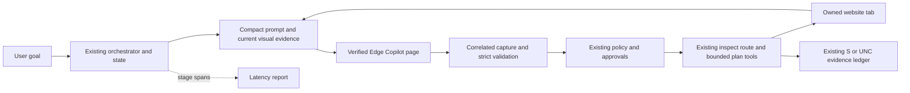
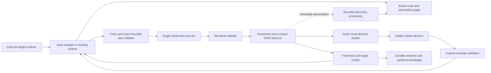
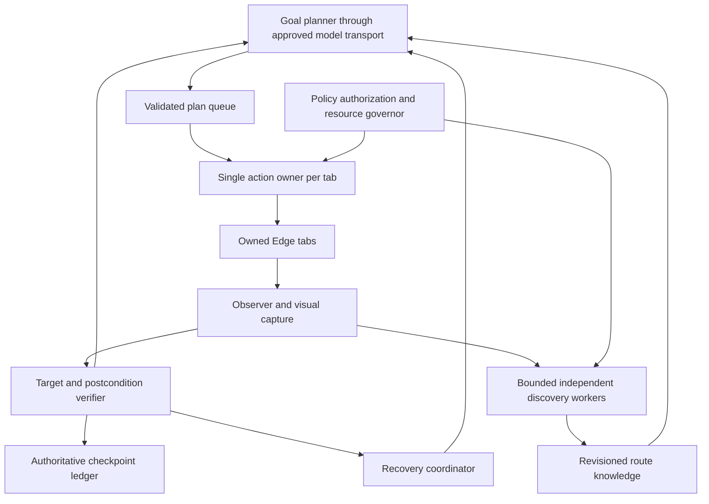
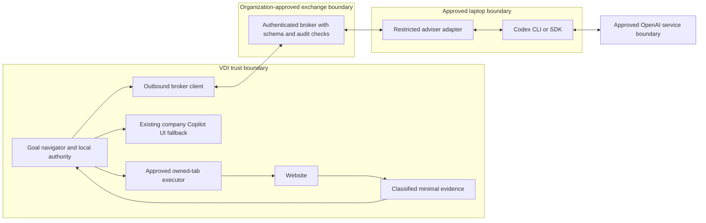

# Faster goal-directed website discovery and navigation

Technical proposal, prepared 15 October and finalized 16 October 2026. Source baseline: `b05854153f49b628f6d3e2df7d95715c387266c7`.

This is a source review and experiment design. No runtime code, browser session, VDI state, model selection, or security setting was changed. No new benchmark was executed. Numerical targets below are proposed acceptance thresholds or explicitly hypothetical arithmetic.

## 1. Executive summary

Build a **goal-directed visual navigation loop inside the VDI**, extending the existing orchestrator and browser tools. Discovery should supply the next useful move while navigation proceeds toward the target. A complete website crawl is not a prerequisite. Capture visual evidence at meaningful transitions; send the current view and a small set of observed navigation candidates to Copilot when another navigation decision is required. Execute predictable actions within a short, validated plan instead of asking Copilot to rediscover each action.

The largest concrete capability gap is in `browser.discover`: it accepts a title and exploration bounds, but no navigation goal or target-success contract. It tries eligible controls in DOM order, then unvisited links. Existing `browser.recon`/`browser.route` perform simple goal-word ranking, and `browser.plan` already executes bounded branches, loops, and assertions. Connect and deepen these capabilities before introducing a new agent framework.

The user's observation that visible Copilot response time is the longest step is credible but not yet isolated by project telemetry. Capture, PDF production, uploads, frontend buffering, protocol correction, and model generation must be timed separately where observable. A fast executor cannot eliminate time spent awaiting a required Copilot decision. Better visual decisions, fewer unnecessary decisions, concise valid responses, and a verified faster routine response mode are the principal experiments against that delay.

Recommended progression: **A to establish measurement, B as the target architecture, and selected local modules from C as load justifies them.** D, laptop Codex cooperation, is optional. It is initially most useful for generic engineering and analysis outside the live navigation path. A live cross-VDI channel needs explicit organizational permission and its own measured benefit.

The three changes to test first are: correlated latency tracing; a compact current-screen decision packet with concise schema-valid replies; and a goal-directed navigator that uses existing bounded plans and stops as soon as the target is verified.

## 2. Agreed requirements and evidence boundaries

The interview settled these requirements:

- Prioritize complex website discovery and precise targeted navigation.
- Discover and move together. Gather enough knowledge for the next move; reaching the target takes priority over complete page or website coverage.
- Use screenshots throughout navigation and discovery. The engineer chooses useful step boundaries by measured completion time and reliability.
- Optimize verified end-to-end task completion. Earlier partial text alone is not a successful optimization.
- Preserve approved site scope, existing authorization semantics, manual authentication/MFA boundaries, uncertainty handling, and recovery evidence.
- Compare VDI-contained runtime designs and conditional laptop cooperation.

**Chosen step rule:** a semantic step ends when a meaningful interface transition needs a new choice or when the target must be checked. Capture each meaningful resulting state. A new unfamiliar choice, failed assertion, conflicting evidence, or target verification requires fresh visual interpretation. Predictable micro-actions may run as one exact bounded plan when intermediate states need no new choice. Retain their action screenshots and present relevant intermediate evidence with the next decision. Do not hide an unknown branch inside a supposedly deterministic burst. Compare this rule against strict screenshot-and-Copilot review after every individual action; shrink bursts if first-attempt success falls.

“Inside the VDI” describes where orchestration, browser control, evidence processing, and storage run. The existing reasoning service is Microsoft 365 Copilot through its visible browser UI; this is not a claim that model inference is local or offline.

### Evidence register

| Type | Finding | Source and implication |
| --- | --- | --- |
| User observation | Screenshots were more useful than crawler text, and visible UI response/thinking appeared to be the longest step. | User's test report in this conversation; duration and causation remain unmeasured. Preserve visuals and measure the full path. |
| Current source | Startup/runtime uses the existing orchestrator and visible Edge Copilot, without a reasoning-model API. | [Architecture](../ARCHITECTURE.md), [browser adapter](../../copilot_agent/browser.py). API latency controls cannot simply be configured in this transport. |
| Current source | `browser.discover` has no `goal` or target predicate; selection tries eligible controls in DOM order, then frontier links. | [site_discovery.py](../../copilot_agent/site_discovery.py), lines 21–29 and 208–258. A target-directed controller would add capability rather than merely rename the crawler. |
| Current source | Reconnaissance/routing ranks observed routes by goal-token overlap. | [web_navigation.py](../../copilot_agent/web_navigation.py), lines 980–1013. Reuse this candidate source; do not invent executable routes. |
| Current source | `browser.plan` already has branches, loops, assertions, action/time limits, exact-plan identity, cancellation, and uncertainty handling. | [web_navigation.py](../../copilot_agent/web_navigation.py), lines 736–960. Improve its use and surrounding controller before replacing it. |
| Current source | Action wrappers take BEFORE/AFTER screenshots; plan transitions use the same wrapper. Images are merged into request-associated PDFs. | [automatic_visuals.py](../../copilot_agent/automatic_visuals.py), lines 43–95, 124–161, 288–337. Screenshot/PDF/lock/attachment overhead is a candidate to measure, not an established bottleneck. |
| Current source | Pending/latest visual PDFs are attached to outgoing exchanges; prior visuals may be repeated and must remain labeled as previous observations. | [orchestrator.py](../../copilot_agent/orchestrator.py), lines 945–974 and 1030–1032; [prompts.py](../../copilot_agent/prompts.py), around line 116. Measure repeated attachment work and stale-image confusion. |
| Current source | Independent read-only groups use a semaphore of four and reject duplicate browser tabs within a group. Attachment preparation already supports preloading. | [orchestrator.py](../../copilot_agent/orchestrator.py), lines 188–232 and 864–917. New parallelism should extend measured gaps, preserving ownership. |
| Current source | Response capture correlates request/user identity, observes generation state, requires a closed response and stable text, and does not replay an uncertain submission. | [browser.py](../../copilot_agent/browser.py), lines 1496–1669. Partial public previews cannot authorize execution. |
| Current source | Default capture polling is 0.5 seconds with three stable samples. Discovery settling checks at 0.4-second intervals. | [config.py](../../copilot_agent/config.py), lines 38–42; [site_discovery.py](../../copilot_agent/site_discovery.py), lines 49–66. These are settings/code, not measured delay distributions. |
| Current source | Interactive plan state is held on `browser._navigation_state`; call/submission persistence is separate. | [web_navigation.py](../../copilot_agent/web_navigation.py), lines 228–243; [state.py](../../copilot_agent/state.py). Existing resume tokens alone do not establish safe process-restart continuation. |
| Documented limit | Current instrumentation does not isolate Copilot UI wait duration or token usage. | [API_ANYTHING_INTEGRATION.md](../API_ANYTHING_INTEGRATION.md), Performance impact. Add spans before assigning a cause. |
| Historical documented measurement | A local GOV.UK package opened five pages in 2.378231 seconds and reached verified knowledge save in 3.334734 seconds. These intervals excluded Copilot generation and approval latency. | [Recorded acceptance](../LIVE_GOVUK_PACKAGE_ACCEPTANCE_20261013.md). This is a prior local tool-stage result, not a new result, an end-to-end baseline, or live S:/VDI proof. |

The requested six-file handoff was used as the architecture/graph entry point. Its manifest describes revision `af0afd151bde4cd635e94d046adc706aaaae7165`, with 277 eligible source files. The current source review used HEAD `b05854153f49b628f6d3e2df7d95715c387266c7`; its worktree was clean before these documentation files were added. Of 14 relevant files compared against that manifest, eight matched; orchestrator, web navigation, site discovery, prompts, tools, and graphical runtime differed and were treated as needing current-source inspection. Graphify AST edges establish navigation relationships, not runtime duration or inferred behavior.

No authenticated website, live Copilot account, current model entitlement, S:/UNC persistence operation, VDI graphics capability, or laptop–VDI communication policy was exercised in this review.

## 3. What “UI thinking time” means operationally

Measure the externally visible Copilot exchange, not private chain-of-thought. The service's internal inference time cannot be separated from its network/frontend buffering using the current browser UI alone.

Use correlated monotonic timestamps for:

1. User request accepted; prompt/state assembly begins.
2. Screenshot acquisition completes; image/PDF packaging completes; upload completes.
3. Send attempted; the exact request is proven committed in chat.
4. First useful request-correlated public response appears.
5. Generation-ending controls are observed; complete envelope becomes visible.
6. Capture returns; strict protocol validation succeeds.
7. Approval requested/resolved where applicable; tool dispatch begins.
8. Each action starts/ends; destination readiness and identity assertions pass.
9. Target evidence is captured; target is independently verified; completion evidence is persisted; the user receives the final result.

Record `run_id`, `goal_version`, `request_id`, `call_id`, `tab_id`, state epoch, policy-scope reference, and screenshot/artifact hashes. Keep raw business content out of general telemetry. UTC is useful for audit correlation; durations within a process use a monotonic clock. Across machines, use per-hop durations and acknowledgments rather than subtracting unsynchronized wall clocks.

The response interval is `committed request -> first useful output` and `committed request -> validated full envelope`. Separately measure `generation-end observed -> capture return` as a capture-tail proxy. Label the former **observed Copilot response time**: it includes service/model/transport/rendering effects. Missing generation controls or buffered public text are limitations, not permission to infer invisible milestones.

For a sequential path, task time is approximately setup plus repeated preparation, visual transport, Copilot response, validation/authorization, action, readiness, and recovery intervals. Once stages overlap, calculate the critical path and interval union; do not add inclusive child spans or overlapping work twice.

An illustrative upper bound explains prioritization: if observed Copilot waiting occupies 80% of task time, eliminating all other time would yield only 1.25 times the throughput for one task. This is hypothetical arithmetic, not a finding about this agent. Conversely, eliminating unnecessary Copilot decisions can matter greatly: twelve 45-second decisions plus 60 seconds of local work total 600 seconds; six such decisions plus 45 seconds of local work total 315 seconds. That scenario is possible only if six decisions really are avoidable without hiding required visual choices. Both figures are examples, not forecasts.

Microsoft documents Quick response and Think deeper as different speed/reasoning choices, with actual service availability varying. Discover and verify the choices in the account being benchmarked; do not infer its mode from the source default or promise a specific underlying model. [Microsoft Copilot Chat overview](https://learn.microsoft.com/en-us/copilot/overview).

## 4. Recommended execution contract

Introduce a **proposed, versioned** `browser.navigate_goal` tool/controller. This name is a design proposal, not an existing registered tool and not an argument to the current `browser.discover` schema. Keep the existing broad-discovery tool available for explicitly requested comprehensive work.

Its validated input should bind:

- Goal text and a stable goal version.
- Owned tab and approved application/origin/tenant/environment scope.
- Target contract: permitted route patterns, visible landmarks/content predicates, and transient task identity where needed.
- Explicit navigation-only/read-only effect class for the first implementation.
- Maximum time, actions, visited states, request/byte budget, cancellation behavior, and permitted checkpoint policy.
- Current observation epoch and evidence provenance.

The exact schema and policy need local implementation review before registration. A natural-language goal never grants a new domain, a guessed path, a customer identity, or a consequential effect.

Implement this as an **orchestrator-owned continuation**, rather than a tool recursively starting another Copilot exchange. A registered tool, if used, executes one bounded local slice and returns `needs_visual_decision`, `target_verified`, or an interrupted status with immutable observation evidence. The existing turn loop owns the next `_send`, fresh session/request correlation, validation and exact prepared-plan dispatch. While awaiting a model decision, release capture locks but retain the goal's tab reservation; independently process captured evidence without mutating that page. Revalidate its epoch and preconditions before executing the reply. This preserves one Copilot exchange owner and avoids nested tool/model dispatch or deadlocks around the exchange lock.

```text
while target not verified and authorized budget remains:
    acquire ownership of the current tab's observation/action transaction
    observe rendered state; capture current screenshot and compact structure
    reject mixed-epoch, wrong-tenant, unexpected-host or authentication evidence
    verify target with local predicates and fresh visual evidence
    if target verified: persist proof; cancel unrelated pending exploration; finish
    load fresh, scope-bound route hints and previously observed candidates
    rank candidate paths toward the goal; remember failed paths and visited states
    if a previously validated predictable segment is usable:
        validate its exact plan, preconditions and existing authorization
        execute its short actions with assertions and visual evidence
    else:
        send screenshot + goal + ranked observed candidates + last outcome
        await one complete, current, validated Copilot decision
        validate the proposed bounded plan against current epoch and policy
        execute it once
    on an unexpected screen, failed assertion or ambiguous effect:
        stop mutation; retain evidence; reconcile; request a revised decision
```

Discovery runs alongside navigation as processing of captured evidence or separately owned, separately authorized read work. The same mutable page has one owner at a time. A browser capture that scrolls or restores the page is a mutation for ownership purposes. Shared authentication can also create cross-tab coupling; start with offline evidence parsing and a single foreground tab, then prove independently owned reads are safe before enabling them. Crawl4AI session reuse is explicitly sequential, so one `session_id` must not serve competing actors. [Crawl4AI sessions](https://docs.crawl4ai.com/advanced/session-management/).

Proposed pilot defaults are at most three predictable actions or 15 seconds per local burst, with a separate whole-task deadline including model waits. These are starting experiment settings, not proven optimal values. A new visual choice can end a burst earlier. Repeated identical state/action pairs and no-progress cycles trigger a circuit breaker instead of continuing until a large crawl budget is exhausted.

## 5. Four competing architecture options

All diagrams show authority separately from untrusted observations. Browser/page content and model responses remain untrusted. The local orchestrator, policy, and authoritative ledger decide what runs.

### A. Minimal change to the existing agent



**Components and communication:** existing `Orchestrator`, `BrowserAdapter`, prompts, `browser.inspect/recon/route/plan`, visual collector, and state/knowledge storage. Add timing spans, concise routine response guidance, and selective use of existing short plans. Python calls and the existing verified Edge/CDP connection remain the transport.

**Data and control:** current screenshot and compact candidates enter one existing Copilot exchange. A fully validated reply requests existing tools; an approved short plan runs; results and fresh visuals continue the conversation. Independent work uses the existing bounded read group only when its rules hold.

**Trust/failure:** retain the exact request, approval, domain, ownership, and uncertainty checks. An incomplete screenshot or reply cannot become success. On failure, use the existing capture/reconciliation route; roll back by disabling new prompt/timing/selection flags.

**Strengths:** lowest migration risk and fastest evidence gathering; no new service or cross-boundary authority. **Disadvantages:** the broad discoverer remains weakly directed, browser exchange still serializes decisions, and prompt improvements may leave the main latency unchanged.

**Select when:** measurement is missing and quick, reviewable changes are needed. **Do not stop here when:** unknown-site discovery continues making irrelevant moves or visual transport is a large repeated cost.

### B. Visual-first hybrid navigator — recommended target



**Components and communication:** add goal-navigation, observation-packet, target-verification, and page-ownership modules around existing tools. Module boundaries are sufficient initially; a separate AI agent per role is unnecessary. Use the current Copilot UI and local typed calls. Background workers receive immutable observations, not unrestricted page handles.

**Data and control:** the navigator alternates targeted discovery and movement. A current screenshot is the principal page-state evidence, supported by observed controls, frame IDs and locators. Copilot chooses at unfamiliar/ambiguous states. A known segment executes locally with checkpoints. Target verification cancels unrelated discovery immediately.

**Trust/failure:** each packet binds tab, goal, tenant, state epoch and image hash. Evidence disagreement forces a settled recapture. The local executor owns all mutations and rejects stale plans. Stop on unexpected screen/authentication/scope changes; persist partial evidence and reconcile before a revised plan. Roll back by routing requests to A.

**Strengths:** fits the user's visual finding and target-first objective; lowers irrelevant exploration and repeated reasoning while retaining evidence. **Disadvantages:** coherent screenshot/DOM state, packet transport, and new tool contracts require careful implementation. Full vision decisions still incur Copilot latency.

**Select when:** complex, changing, authenticated websites are the main workload. **Do not select a screenshot-only variant when:** precise DOM/accessibility evidence is available and materially reduces incorrect clicks; keep that structured support.

### C. Multiple local components with bounded queues



**Components and communication:** planner, executor, observer, verifier, discovery workers, recovery, and resource governor use typed bounded queues inside one process first. Move CPU-heavy image/OCR work to a bounded worker process only if measurements show event-loop starvation. One strong planning role plus deterministic execution is the default; extra model-backed roles require an observed benefit.

**Data and control:** observation snapshots fan out to independent ranking, encoding and extraction jobs. The foreground action queue takes priority. Every result carries source epoch and goal version; results from old states become historical hints. Different tabs may support truly independent reads; no parallel mutation of one page or stateful shared workflow.

**Trust/failure:** a local authority gate validates queued plans again immediately before action. Queue overflow drops optional preparation, never authoritative outcomes or unresolved intents. Worker failure cancels speculative work; mutation stops when its observation/verification dependency fails. Restore from durable checkpoints with fresh browser reconciliation, not replay. Roll back to B by setting worker concurrency to one and disabling speculative queues.

**Strengths:** supports more simultaneous preparation and discovery without blocking navigation. **Disadvantages:** stale-state races, shared-session coupling, cancellation ordering, and resource contention increase complexity; more agents or models can increase latency.

**Select when:** traces show independent work and available CPU/memory/network headroom. **Do not select when:** Copilot UI wait dominates and there is little independent work, or the app shares state across tabs in ways that cannot be safely isolated.

### D. Laptop Codex adviser with a controlled VDI executor



**Components and communication:** the VDI remains execution authority. Laptop Codex can analyze approved minimal evidence, suggest route plans, inspect redacted timing logs, or generate reviewable implementation artifacts. Prefer an organization-operated HTTPS broker with mutually authenticated clients and scoped identities. The VDI initiates outbound connections; do not expose its CDP port or assume its loopback is the laptop's loopback. An approved ACL-restricted file exchange with immutable signed messages is an alternative only if that exact redirection/share is permitted.

**Data and control:** the broker carries structured advisory requests/results. Each message binds task/run/operation ID, goal version, tenant/origin scope, expected state epoch, sequence/nonce, expiry, payload hash and reply correlation. The VDI rejects stale, replayed, out-of-scope or malformed replies; existing policy and approvals apply to every requested effect. Codex receives no direct browser, shell, credential, or approval authority inside the VDI.

**Trust/failure:** network authentication/encryption, per-user ACLs, replay protection, schema/size/rate limits, DLP/classification, provenance and audit are required. Password masking does not remove ordinary customer data from screenshots. An OpenAI-backed Codex process on the laptop introduces an additional service/data boundary; “runs on laptop” does not mean local inference. Corporate policy must permit the exact content, accounts, processing and channel. Credentials remain in their own approved stores; manual sign-in/MFA stays manual. Broker or laptop failure expires pending advice and returns to B; an ambiguous local effect remains blocked regardless of adviser availability.

**Strengths:** can move approved engineering or analysis off the VDI and enable a separately measured reasoning path. **Disadvantages:** extra hops, data handling, identity administration, model cost, and policy burden can outweigh any compute benefit. No assumption of a permitted channel or faster model is justified here.

**Select when:** a permitted data path exists and matched benchmarks show a material net benefit after broker/transfer overhead. **Do not select when:** raw website/customer evidence cannot leave the VDI, no approved broker exists, or B already meets the latency target.

**No-channel fallback:** all live observation, planning, execution and evidence remain in B inside the VDI using its existing approved Copilot transport. Laptop Codex may investigate generic public/synthetic engineering examples without receiving VDI data or delivering runtime commands. There is no live dependency on the laptop and no clipboard, drive-redirection, host-screen or hidden tunnel workaround.

Official Codex documentation supports non-interactive execution with JSONL events and schema-constrained final results. This is a possible adviser interface, not proof that the user's laptop currently exposes it, has enterprise authorization, or may process FNZ content. [Official non-interactive documentation](https://learn.chatgpt.com/docs/non-interactive-mode).

## 6. Fourteen concrete improvement proposals

Each proposal identifies a bottleneck, mechanism, expected effect, components, complexity, risks, mitigations, rollback, dependencies, experiment and decision metrics. Effects are hypotheses until measured. A local-stage improvement is rejected if full-task outcomes deteriorate.

### P01. Correlated latency tracing before optimization

- **Bottleneck and mechanism:** current timings cannot isolate visual transport, observed Copilot wait, capture tail, action readiness or recovery. Add bounded monotonic spans to `_send`, `exchange`, visual acquisition/PDF production, plan actions, approval and target completion. Record bytes/pixels, state epochs and queue/lock waits.
- **Why and expected effect:** no intrinsic model speedup; prevents effort on a small span and exposes avoidable idle gaps. Proposed telemetry overhead budget: below 2% of median task time, measured against tracing disabled.
- **Components / complexity:** existing `state.event`, `BrowserAdapter`, visual collector and a local span report; **Low–Medium**.
- **Risks / mitigations:** logs can leak page contents or add shared-drive work. Store identifiers/hashes/counts in general metrics, retain raw images only as scoped task evidence, and batch non-authoritative metrics. Keep mandatory intent/outcome persistence synchronous.
- **Rollback:** disable optional performance tracing; retain existing authoritative audit events.
- **Dependencies:** stable correlation IDs and a permitted evidence destination on the resolved S:/UNC tree.
- **Proof of concept:** instrument one complex navigation workflow and three repeats without changing decision behavior; compare instrumented and uninstrumented resource/time results.
- **Confirm/reject:** account for at least 95% of the non-overlapped critical path with explicit unknowns; distinguish response wait from packaging/upload; reject excessive observer overhead or invented inference/token attribution.

### P02. Target-directed recurrent navigator with short plans

- **Bottleneck and mechanism:** generic discovery explores irrelevant controls; manual per-action planning repeats slow decisions. Add the versioned goal tool/controller described above, combining existing goal-ranked recon, observed route candidates, target predicates and `browser.plan`. Stop exploration immediately after target proof.
- **Why and expected effect:** fewer irrelevant states and fewer Copilot turns on predictable segments. A six-action route with only two genuine decision boundaries could use two navigation decisions rather than six; a route with six unfamiliar choices still needs six. Saved time is avoided turns times measured response latency, less new verification overhead.
- **Components / complexity:** proposed `goal_navigation.py`, `target_verifier.py`, typed controller state, registry/schema/guidance integration; **Medium–High**.
- **Risks / mitigations:** wrong target, looping, or a broad goal interpreted as permission. Use exact scope/identity binding, observed routes only, local assertions plus screenshots, action/time budgets and no-progress detection. Goal text is untrusted data for interpretation, never authority.
- **Rollback:** opt-in dispatch to the new controller; route back to current `browser.recon/plan/discover` on disable, retaining partial evidence.
- **Dependencies:** an observable target contract and an approved website session. Unknown/ambiguous targets must be clarified rather than guessed.
- **Proof of concept:** synthetic portal with several misleading menus, one nested target and one changed layout; compare generic exploration, strict visual action-by-action navigation, and bounded semantic steps.
- **Confirm/reject:** target completion time, correct first attempt, irrelevant states visited, full reasoning turns, false-target count and recovery. Reject any false target or a reduction in observed reliability.

### P03. Small current-screen visual packets and measured image transport

- **Bottleneck and mechanism:** repeated multi-page PDFs, duplicate imagery, upload/ingestion and ambiguous historical views may delay decisions. At each decision send one clearly labeled current overview, necessary readable closeups, compact observed candidates and prior-action outcome. Keep complete original captures in scoped evidence. Benchmark supported direct image attachments against the existing PDF path; do not assume either format is better understood.
- **Why and expected effect:** lower packaging/upload bytes and less irrelevant visual context, with the same meaningful-step coverage. Save at most the measured visual/transport/decision-overhead portion; no guaranteed inference reduction follows from fewer bytes.
- **Components / complexity:** `automatic_visuals.py`, `screenshot_evidence.py`, attachment planner and `prompts.py`; **Medium**.
- **Risks / mitigations:** compression/crops hide small controls; stale-image references confuse the model; PDFs may be attached without useful pixel interpretation. Keep an overview, dimensions/scroll/frame/epoch labels, legibility checks, full-quality recovery, and a synthetic perception calibration task. Never imply an old image is current.
- **Rollback:** retain the existing labeled full-resolution PDF mode as the default fallback. Missing mandatory current images pause the step instead of silently switching to text-only navigation.
- **Dependencies:** verify actual image/PDF support and attachment limits in the permitted Copilot UI; preserve the 20-file whole-message guard and source hash checks.
- **Proof of concept:** compare full PDF, current PNG/image mode if supported, and overview plus crop on identical small-text/menu/canvas cases. For deltas, retain a keyframe and bounding boxes; always include a current overview at decision boundaries. Test periodic full refresh and reconstruction after missing/out-of-order deltas.
- **Confirm/reject:** capture/PDF/upload spans, bytes/pixels, target success, control-identification accuracy and retries. Keep delta transport only if total time improves without losing context. CDP encoding controls and DXGI dirty regions are advanced acquisition experiments only if capture dominates; neither supplies visual semantics or lowers model reasoning by itself. [CDP Page definition](https://raw.githubusercontent.com/ChromeDevTools/devtools-protocol/master/pdl/domains/Page.pdl), [DXGI documentation](https://learn.microsoft.com/en-us/windows/win32/direct3ddxgi/desktop-dup-api).

### P04. Concise decisions within the unchanged response contract

- **Bottleneck and mechanism:** repeated narrative, broad tool deliberation and oversized state can lengthen responses and corrections. Use a routine navigation prompt containing goal, target predicate, current image, top observed candidates, last result, failed paths, and the next allowed decision. Ask for brief required summaries and one bounded plan while preserving every required field and marker.
- **Why and expected effect:** fewer output characters and correction turns; input reduction alone may have a smaller benefit. Hypothesis: shorter complete replies reduce observed response latency without increasing protocol errors. Quantify the effect from measured output size and elapsed time rather than claiming access to internal reasoning tokens.
- **Components / complexity:** `prompts.py`, guidance and compact-context projection; existing protocol validator unchanged; **Low–Medium**.
- **Risks / mitigations:** omitted constraints, illegible abbreviated actions, or protocol drift. Preserve authoritative scope/IDs/schema, evidence references, clear selectors, and necessary verification. Shorten field contents, not required keys or contracts. Trusted startup guidance remains integrity checked.
- **Rollback:** feature flag restores existing prompt generation; invalid replies keep the existing correction/reconciliation rules.
- **Dependencies:** prompts must keep screenshots and candidate evidence sufficient for difficult pages.
- **Proof of concept:** matched image/goal packets with normal versus concise required summaries; measure at least first-attempt validity and route quality as well as time.
- **Confirm/reject:** committed-request latency, generated characters, correction count, chosen-route correctness and task completion. Output size is a proxy, not tokens. Official API guidance supports testing shorter outputs and fewer requests, but its API heuristics are not measured gains for Copilot's UI. [OpenAI latency guidance](https://developers.openai.com/api/docs/guides/latency-optimization).

### P05. Event-driven readiness and response wakeups

- **Bottleneck and mechanism:** fixed polling and repeated broad state reads add latency and CPU; over-early captures add retries. Register relevant navigation/DOM/page events before the action; await a target landmark or actionability condition plus bounded visual stability. Use browser mutation/control events as wakeups for Copilot capture, with low-rate fallback polling.
- **Why and expected effect:** reduce readiness/capture-tail time and repeated snapshots. The maximum win is bounded by the measured polling/settling span; it cannot remove upstream response generation. Do not use global network-idle as the sole readiness signal for apps with persistent traffic.
- **Components / complexity:** `browser.py`, `site_discovery.settle`, plan waits, scoped event subscriptions and watchdogs; **Medium**.
- **Risks / mitigations:** lost events, hydration races, endless animation or incomplete model text. Subscribe before triggering; bind frame/loader/epoch; combine events with assertions, full envelope and generation checks; retain finite fallback intervals/deadlines. Never execute streamed previews.
- **Rollback:** switch to existing polling/settling logic; leave correlation/completeness checks intact.
- **Dependencies:** events must be available in the installed Playwright/Edge version and permissions must allow those observations.
- **Proof of concept:** delayed hydration, long-polling, immediate navigation and a missed-event fixture; vary readiness predicates without shortening safety timeouts blindly.
- **Confirm/reject:** event-to-ready latency, capture tail, evaluations/second, CPU, premature captures and missed completion. [Playwright actionability](https://playwright.dev/python/docs/actionability), [event handling](https://playwright.dev/python/docs/events).

### P06. Verified reusable navigation procedures

- **Bottleneck and mechanism:** recurring goals repeat discovery and reasoning. Store sanitized route methods with application/tenant/environment binding, successful source-call evidence, semantic locators, preconditions, expected page fingerprints and target predicates. Retrieve the smallest relevant procedure and perform a focused current-session route/locator check before reuse.
- **Why and expected effect:** warm navigation avoids broad exploration and can use a short known plan. Expected cold-start benefit is small; warm-turn savings equal discovery/planning calls actually avoided. A map never proves the current destination or authorizes navigation.
- **Components / complexity:** existing `site_knowledge`, ledger/views, route retrieval and plan compiler; **Medium**.
- **Risks / mitigations:** stale layouts, cross-tenant reuse, record-specific data in memory. Keep raw task evidence separate, strip secrets/record IDs/query data from reusable hints, bind exact namespaces, retain revisions and invalidate on mismatch. Preserve the public-static map's independent trust rules rather than treating all browser captures as trusted routes.
- **Rollback:** disable procedural reuse and do focused fresh inspection; retain history for diagnosis.
- **Dependencies:** successful current-session method evidence and working approved S:/UNC persistence.
- **Proof of concept:** repeated target navigation, then alter menu label/order and tenant identity. Confirm the method is rejected or repaired through a fresh decision when evidence conflicts.
- **Confirm/reject:** warm/cold task time, retrieval hit rate, live-precheck cost, stale-route rejection, incorrect identity and broad recon count.

### P07. Pipeline observation processing with mandatory decision preparation

- **Bottleneck and mechanism:** serial DOM extraction, image encoding, artifact indexing, route lookup and prompt preparation leave avoidable idle gaps. Capture a coherent page under ownership, then fan out immutable image/DOM processing. Prepare known-safe request-independent inputs while waiting for the next permitted stage; use existing attachment preloading where it genuinely applies.
- **Why and expected effect:** replace sequential preparation sums with the longest independent branch plus coordination. Copilot must still receive the mandatory current screenshot before submission; upload completion is not assumed. Speculation never clicks Send or mutates a page.
- **Components / complexity:** existing async orchestration/preload paths, bounded CPU worker and immutable observation packets; **Medium**.
- **Risks / mitigations:** stale packets, UI contention, task cancellation and PDF worker races. Bind goal/state/attachment hashes, retain the exchange lock, reject stale preparation, finish or quarantine cancelled writes, and give foreground observations priority.
- **Rollback:** execute the same stages serially; disable speculative preparation.
- **Dependencies:** traces show independent stages on the critical path and sufficient VDI resources.
- **Proof of concept:** compare serial versus DOM-plus-image processing and route retrieval fan-out on one unchanged page and under cancellation/navigation.
- **Confirm/reject:** preparation critical-path duration, queue delay, event-loop lag, stale-packet rejection and task time. Reject if CPU contention lengthens the Copilot or navigation path.

### P08. Bounded independent discovery with one page owner

- **Bottleneck and mechanism:** useful independent extraction/validation is serialized, or broad crawling competes with the target. Use a foreground-priority queue and a small background discovery queue. Start with immutable captured HTML/DOM analysis; allow independently owned approved tabs/reads only after proving they do not disturb shared application state.
- **Why and expected effect:** improve preparation throughput and make relevant candidates available earlier. Concurrency 2 or 4 is an experiment, not a speed multiplier. Cancel/deprioritize background branches as soon as the target is reached.
- **Components / complexity:** existing bounded read group plus per-tab ownership, scope-aware task queue, deduplication and resource governor; **Medium–High**.
- **Risks / mitigations:** conflicting clicks/scrolls, shared-session mutations, duplicate work, server load or VDI memory pressure. One page owner per observation/action transaction; explicit per-origin caps; no speculative forms/downloads/effects; no concurrent work on one Crawl4AI session; bounded queues and foreground resource reservations.
- **Rollback:** concurrency one; discard optional pending reads and keep committed results.
- **Dependencies:** authorized independent resources. A separately opened tab is not proof that the website's server-side session is independent.
- **Proof of concept:** 1/2/4-worker runs with independent pages, then a fixture with shared cross-tab state. Reject unsafe parallelism rather than adding retries around conflicts.
- **Confirm/reject:** successful useful states/minute, foreground p95, server requests, dedup hits, CPU/RSS and conflict count. [Crawl4AI dispatch and streaming](https://docs.crawl4ai.com/advanced/multi-url-crawling/).

### P09. Verified routine/deep response routing

- **Bottleneck and mechanism:** expensive reasoning may be used for a routine image-and-candidate choice. Compare verified available routine/quick response settings with deeper planning/recovery settings. Start in separate fresh benchmark sessions. Add dynamic switching only after proving the UI adapter can verify mode and maintain conversation/operation identity safely.
- **Why and expected effect:** lower median routine decision latency; escalation can recover difficult cases. Expected time is the routine-call cost plus escalation frequency times recovery cost, including any switching/new-chat overhead. A faster but frequently wrong mode can lose overall.
- **Components / complexity:** existing model discovery/selection, explicit routing policy, capability/entitlement verification and calibration set; **Medium**, **High** if separate persistent planner/executor model sessions are needed.
- **Risks / mitigations:** model fallback, weaker visual reasoning, switching latency and loss of context. Record observed mode/verification, preserve task binding, escalate on evidence disagreement, and treat explicit access-exhaustion/fallback as a reported condition. Confidence is calibrated on held-out cases, not accepted from a model's self-rating.
- **Rollback:** pin the existing explicitly selected verified setting for a fresh run; do not silently change an active session.
- **Dependencies:** available approved UI choices and live image/protocol capability. API reasoning-effort and cache settings are not exposed controls in this project.
- **Proof of concept:** compare routine and deeper settings on identical navigation/changed-layout tasks, then evaluate escalation on held-out tasks.
- **Confirm/reject:** end-to-end time, per-decision wait, first-attempt route accuracy, escalation/correction rate, fallback events and entitlement failures.

### P10. Local perception for routine checks and candidate preparation

- **Bottleneck and mechanism:** expensive full reasoning is repeated for known visual landmarks, OCR labels and screenshot-change detection. Evaluate an approved local OCR/visual classifier for candidate ranking and routine verification alongside DOM assertions. Copilot continues to interpret meaningful unfamiliar states and target evidence; a local score alone does not grant the next action.
- **Why and expected effect:** reduce structured-evidence assembly and avoid unnecessary full replanning on recognized states. Measure CPU/GPU inference time against the remote calls actually avoided; a local model that adds work without removing a decision is overhead.
- **Components / complexity:** optional signed/approved OCR or ONNX-style runtime, local model files, calibration data, deterministic fallback; **Medium–High**.
- **Risks / mitigations:** unreadable small text, false landmark matches, hidden downloads/telemetry and GPU contention. Keep full images, require independent predicates, calibrate thresholds, verify package/model provenance and permitted egress behavior, and reserve CPU/GPU budgets. “Local” is neither an organizational approval nor an automatic no-egress guarantee.
- **Rollback:** disable local perception; use existing visual/DOM evidence and Copilot decisions.
- **Dependencies:** approved dependencies and adequate VDI hardware; no assumption of GPU availability.
- **Proof of concept:** replay authorized synthetic screenshots with varied DPI, small text, modals and similar destinations; measure accuracy and inference time before a live shadow-only trial.
- **Confirm/reject:** false positives, missed changes, candidate-ranking accuracy, inference latency, resource contention and task-level benefit. Keep decision authority with the established controller until evidence justifies promotion.

### P11. Bounded working memory and selective retrieval

- **Bottleneck and mechanism:** growing context repeats old observations and loses the target. Maintain a compact current task record: goal/target, constraints, last verified state, pending work, failed paths, relevant procedure IDs and unresolved uncertainties. Send only relevant evidence references and recent deltas; archive the complete trajectory separately.
- **Why and expected effect:** bound repeated input/output and prevent full rediscovery. Measure whether turn latency remains stable as task length grows. Local result caching, procedural reuse and provider prompt caching are different mechanisms.
- **Components / complexity:** `state.context`, prompts, revisioned task working state and retrieval over the existing knowledge store; **Medium**.
- **Risks / mitigations:** summaries omit constraints or mix tenants. Keep authoritative policy and uncertainties outside lossy summaries; retain provenance and revision IDs, partition retrieval, and reconstruct from the audit log when needed.
- **Rollback:** use the existing context projection and explicit recent evidence; retained logs remain available.
- **Dependencies:** a working memory schema and exact ownership for updates, including steering messages changing the goal version.
- **Proof of concept:** 10/30/60-transition synthetic tasks with a changed user constraint midway; compare goal retention, payload sizes and per-turn latency.
- **Confirm/reject:** context bytes, irrelevant history, lost-constraint count, stale-goal action rejection and full task success. For an approved future API transport, stable-prefix prompt caching is a separate measurable option; it cannot be configured or its hit rate assumed in the current Copilot UI. [Official prompt-caching documentation](https://developers.openai.com/api/docs/guides/prompt-caching).

Working memory is the current goal and checkpoint; episodic memory is the retained trajectory/outcomes; procedural memory is sanitized proven navigation methods; the audit ledger is the authoritative intent/authorization/outcome history. These stores have different privacy, lifetime and execution-authority rules.

### P12. Durable checkpoints and bounded recovery instead of full restarts

- **Bottleneck and mechanism:** failed actions or interruptions force repeated discovery and expensive reasoning. Persist a goal-operation checkpoint after each verified semantic step, binding plan hash, tab provenance, state/target epoch, observed outcome and unresolved effect. Reconcile the actual browser before resuming. Extend persistence explicitly; do not treat existing in-memory plan tokens as durable restart proof.
- **Why and expected effect:** reduce recovery time and repeated model/tool calls. Clean-path latency may increase because of checkpoint I/O; optimize expected completion including failures and measure S:/UNC cost.
- **Components / complexity:** state/ledger integration, plan checkpoint schema, recovery coordinator and shared-storage readback; **Medium–High**.
- **Risks / mitigations:** replayed effects, stale checkpoint, crash between action and commit. Persist intent first; store uncertain outcome on interruption; reobserve the original owned state; retry only when nonexecution is proved. Quarantine unreconcilable effects. Back navigation is a new bounded action, not a universal rollback of server effects.
- **Rollback:** disable resume and stop with retained evidence, preserving existing uncertainty blocks; never delete or retroactively mark the effect unexecuted.
- **Dependencies:** reliable approved storage and browser ownership revalidation after process/session changes.
- **Proof of concept:** inject a process interruption before action, after action and before outcome commit in a synthetic navigation workflow; verify no duplicate execution and a fresh target proof after recovery.
- **Confirm/reject:** recovery success/rate/time, duplicate actions, checkpoint latency, uncertain-effect replay count and human interventions. A lower normal-path time does not compensate for unsafe recovery.

### P13. Direct public reads for supporting extraction and validation

- **Bottleneck and mechanism:** some supporting data reads need not consume UI reasoning/actions. Where the existing `PublicReader` and optional `operation.*` contracts permit it, use approved public GET/HEAD discovery or learned public read operations for independent route evidence and validation. Keep visible browser navigation for actual rendered target arrival.
- **Why and expected effect:** the underlying eligible read uses public HTTP without browser UI interaction or an internal model call. The existing agent still uses Copilot exchanges to request tools and incorporate their results; those exchanges are not eliminated by `operation.call`. Complete-task gain depends on which browser work is actually replaced and whether it is on the critical path. An orchestrator-side deterministic direct route would be a separate proposed integration, not an existing end-to-end zero-model path. This does not accelerate an authenticated interactive page merely because its API shape is known.
- **Components / complexity:** existing public discovery/operation modules and exact scope validation; **Low–Medium** for eligible public work, **not applicable** to unauthorized authenticated operations.
- **Risks / mitigations:** private-host/SSRF access, treating static data as a visual target, stale learned calls or credential export. Preserve pinned-public reader checks, method/scope limits, response validation and explicit opt-in. Do not copy cookies, reverse-engineer private authenticated calls into a bypass, or widen a public worker into a browser worker.
- **Rollback:** disable operation reuse and use the approved browser/read path; keep failed evidence and current destination checks.
- **Dependencies:** eligible public endpoints and enabled approved capability; `operation_reuse` is opt-in in the reviewed config.
- **Proof of concept:** public synthetic extraction plus a visible target check; separately demonstrate that internal/authenticated routes remain in the visible-browser path.
- **Confirm/reject:** supporting-read latency, UI calls avoided, response validation accuracy, blocked scope violations and verified browser arrival. [Current integration contract](../API_ANYTHING_INTEGRATION.md), [discovery limits](../DISCOVERY_NAVIGATION.md).

### P14. Optional laptop Codex adviser outside the action authority

- **Bottleneck and mechanism:** heavy generic planning, code/log analysis or alternative-path preparation competes for VDI resources or uses a slower permitted reasoning path. Start with public/synthetic engineering tasks. If expressly permitted, add D's brokered evidence/plan exchange, with the VDI validating every result.
- **Why and expected effect:** offload useful independent analysis or reduce decision time only if `transfer + broker queue + adviser inference + local validation` beats the existing alternative. It can also increase both latency and cost. No speed range is asserted before a permitted measurement.
- **Components / complexity:** optional CLI/SDK adviser, enterprise-approved broker, identity/ACL/DLP controls, signed typed messages, replay ledger and fallback; **High** for live cooperation.
- **Risks / mitigations:** data leakage, credential exposure, stale remote plans, command injection and unavailable laptop. Use minimum classified payload, no credential/SSO-state export, scoped identities and encryption, schema validation and local approvals. Never accept arbitrary shell or code execution as a broker command.
- **Rollback:** disable broker client and expire outstanding advice; continue B inside VDI. Uncertain local effects remain subject to local reconciliation.
- **Dependencies:** explicit corporate permission for the exact data, channel and model service; live endpoint availability is unverified.
- **Proof of concept:** synthetic messages only first, including wrong tenant/epoch, expiry, duplicate delivery and broker outage; then a separately permitted matched task comparison. Keep raw-screen transfer disabled unless specifically authorized.
- **Confirm/reject:** net end-to-end latency, transferred bytes/classifications, duplicates/stale replies rejected, availability, human interventions, security outcomes and service usage/cost where exposed.

## 7. Observation and control layer comparison

| Method | Preferred use | Limits and fallback |
| --- | --- | --- |
| Rendered screenshot / vision | Current layout, transient overlays, canvas, visual target recognition and ambiguity resolution. | Preserve throughout meaningful transitions. Pixels alone are weak for unique record identity, precise text or reliable locators; pair with structured evidence. |
| DOM and accessibility-style browser structure | Observed semantic controls, exact text/roles, iframe context, uniqueness and assertions. | Prefer for precise known web actions; verify rendered state visually. Closed shadow roots/canvas may need another method. The current custom structural snapshot is not a guarantee of a complete OS accessibility tree. |
| Playwright-style owned browser control | Repeatable navigation, auto-waiting locators, managed tabs and event-driven readiness. | Existing project foundation. Do not use forced clicks, unrelated profiles or ownership bypass as a speed shortcut. |
| Crawl4AI / extracted HTML | Discovery candidates, links, saved evidence and supporting extraction. | Useful input to target routing. Public manifest extraction and authenticated browser crawling are different authority paths; a crawl result does not establish visible target arrival. |
| Public HTTP/direct read operation | Eligible public supporting reads and static verification. | Fast for this subset; cannot stand in for authenticated rendering or browser navigation. Preserve the existing public reader's network policy. |
| Windows UI Automation inside VDI | Native app controls or browser-external dialogs when permitted. | Scope subscriptions; verify providers and manual auth boundaries. Host UIA does not imply access to controls inside Horizon. Events can be omitted, so fallback checks remain necessary. [Microsoft UIA events](https://learn.microsoft.com/en-us/windows/win32/winauto/uiauto-eventsforclients). |
| OS input / image-coordinate actions | Approved native/canvas fallback with no stronger semantic interface. | More sensitive to focus, DPI and window movement. Require visible-window binding, coordinate transforms, screenshot evidence and checkpoints. Keep host laptop control and in-VDI execution distinct. |
| Full desktop capture / DXGI | Conditional capture optimization for an approved native or remote-display workflow. | Current paired evidence is owned Edge page capture, not host/VDI synchronized desktop capture. DXGI support/performance in the actual VDI is unverified. |

Prefer semantic owned-browser actions for speed and precision while retaining screenshots as primary state feedback. Use native/accessibility/coordinate fallback only for surfaces that the browser cannot expose safely. Avoid a full desktop automation rewrite to optimize a problem that may mostly be Copilot response waiting.

For image changes, local visual diffs can identify dirty regions and avoid reprocessing unchanged pixels. They cannot establish business meaning. A crop/delta must identify its base image and coordinates; a missing base requires a full refresh. Keep an overview for every reasoning decision where surrounding context matters, and full imagery for layout/identity anomalies and final verification. No current Copilot UI delta-image API is assumed.

## 8. Reliability, authorization and recovery at higher speed

All proposed fast paths pass through the existing authority boundary. The first navigator is restricted to approved navigation/read-only observation. Destructive, financial, external-communication, credential, permission, code/package and irreversible effects retain their applicable exact scope/approval gates. A configured explicit session grant must be recorded accurately; a blanket inference from user intent or model confidence cannot expand it. Authentication/MFA is manual under the agreed loop contract.

Use one action owner per tab and goal-bound state epochs. Verify the current tenant/record transiently without storing personal identifiers in reusable knowledge. Recheck plan preconditions immediately before execution, and reject results from older goal versions. Visual/DOM disagreement or a missing mandatory image interrupts the step. Screenshots mask credential controls, but other private/customer data stays sensitive and needs its own storage/egress policy.

Persist submission and tool intent before effects, outcomes after observation, and target completion only after independent proof. Preserve idempotency using immutable call/operation IDs and argument hashes. Treat network timeout, failed click or lost tab as potentially successful effects until reconciled. Do not restart a whole task or resend a committed chat request merely because its capture failed.

Retry bounded read failures with finite backoff only when policy and evidence permit it. For mutation, retry only after evidence proves nonexecution. An unexpected popup, layout mismatch, login, scope change, or ambiguous target stops mutation and returns a compact recovery packet containing current screenshot, last verified checkpoint, failure category and unresolved effects. Resume requires a fresh validated plan or safe reconciliation of the original plan, never blind continuation.

A proposed pilot circuit breaker stops after two identical state/action cycles without progress, budget exhaustion, or repeated failure of the same prerequisite. Tune this from traces. Preserve useful completed discovery, cancel unrelated preparation after success, and give no completion credit to quarantined uncertain effects. Recovery and rollback can mean stop-and-preserve; arbitrary web effects are not generally reversible.

## 9. Benchmark design

### Workloads and independent ground truth

Use a synthetic portal/approved test environment with known target identities and controlled delays, then repeat permitted representative work in the VDI. Local synthetic results establish code behavior, not live Copilot, account, S:/UNC or production readiness. Use the same verified Edge ownership/profile, initial route, screen size/DPI, data state, permissions and target for paired runs.

| Category | Representative task | Verification and stress |
| --- | --- | --- |
| Complex discovery / precise navigation — primary | Reach a named section through misleading menus, nested panels, SPA transitions and an iframe. | Independent expected page/landmark/context; count irrelevant states and wrong branches. Include cold site knowledge and repeated known targets. |
| Simple repetitive workflow | Navigate between known report/list views using repeated safe sequences. | Exact destination assertions and first-attempt completion; evaluate plan bursts versus individual decisions. |
| Multi-page navigation | Follow a 4–8-transition observed route with tabs and pagination. | Final target and correct managed tab; no guessed unobserved destinations. |
| Form completion | Fill a synthetic test form with harmless values, stopping before consequential submission unless expressly authorized. | Field values and visible validation; effectful work is a separate benchmark lane, not the first navigation loop. |
| Extraction and validation | Extract a synthetic table and verify specified rows on a rendered destination. | Independent expected values; compare direct supporting public reads only where eligible. |
| Unexpected popup / changed layout | Reveal a dismissible benign modal or rename/reorder a navigation landmark. | Correct interruption, current screenshot, revised route and no unauthorized action. |
| Failed action / restart recovery | Inject a proven nonexecution, ambiguous timeout, lost tab or process interruption. | No duplicate effect, accurate uncertainty status, safe reconciliation and verified target if recoverable. |

Separate four kinds of warmth: site knowledge, active website authentication/session, browser startup/cache, and Copilot conversation/model context. Do not conflate them. Reset the browser to the same starting state; a warm target must not already be open and counted as successful navigation. Do not erase live user state to reset benchmarks; use dedicated authorized fixtures or test sessions.

### Variants and sampling

Baseline is the current pinned checkout with its actual visual/approval behavior. Compare A, B, and C as implementations become available; evaluate D only after its policy prerequisite. Use ablations for concise packets, strict per-action visual decisions versus semantic bursts, event waits, route reuse, response modes, and concurrency 1/2/4. Change one major factor at a time before evaluating combined designs.

Pilot each applicable workload with three matched repeats to locate large errors, then run at least 30 paired repetitions per primary cold/warm condition for finalists, spread across service times and representative targets. Randomize AB/BA order to reduce service/cache bias. Use a pilot variance estimate to plan further sample size. Report p95 descriptively until enough observations, for example 100 or more per condition, make it less unstable. No small run count proves a rare-error safety bound.

Pin code/configuration versions, record discovered/verified model choice and any automatic fallback, and preserve per-run resources, approval scope and sanitized evidence manifests. Do not switch a user's in-progress session to conduct a test. Include throttled, timed-out, failed and cancelled attempts in the run ledger. Never delete failed runs or report only successful timings.

### Required metrics and exact meanings

| Metric | Definition / collection |
| --- | --- |
| End-to-end completion time — primary | User submission accepted to verified target, durable completion evidence and returned final result. Include startup/approval waits when they belong to the chosen cold or warm condition; show their breakdown too. |
| Time to verified target | Accepted goal to independent target proof, distinct from final-report latency. |
| Time to first useful action | First action/evidence that advances this goal; status text and irrelevant exploratory clicks do not qualify. |
| First useful / complete reply latency | Committed Copilot request to first useful correlated public output and to full validated envelope. Internal hidden inference time remains unknown. |
| Full reasoning calls | Count committed visible Copilot requests, classifying initialization, planning, routine navigation, recovery and corrections. UI transport cannot count hidden provider-internal calls; label that limitation. For an approved instrumented API, count actual exposed invocations separately. |
| Screenshots / structure | Raw screenshots, distinct transmitted images/pages/pixels/bytes, visual decision packets, DOM/AX-style snapshots and recaptures. Repeated PDF upload count is separate from distinct image count. |
| Average action latency | Dispatch through action completion; also report readiness/verification and screenshot brackets separately, including p50/p95. |
| Idle/wait time | Annotated critical-path intervals: Copilot response, upload, readiness, approvals, locks/queues, storage, unexplained idle. Do not double count overlapping spans. |
| Successful actions per minute | Independently verified useful actions divided by elapsed task minutes. More irrelevant actions are not higher useful throughput. |
| Recovery rate/time | Recovered injected failures divided by eligible injected failures, plus recovery latency and repeat/duplicate counts. |
| Task success / first attempt | Independent correct target completion and completion without wrong turns, corrections or recovery; report both task and decision levels. |
| Incorrect actions / false targets | Wrong destination/context, unauthorized/ambiguous action, duplicate effect, and falsely reported completion as distinct categories. |
| Tokens / inference cost | Actual provider usage only when exposed. For current UI, mark unavailable; composer characters/UTF-8 bytes and image/attachment bytes are proxies, never invented tokens or currency. |
| CPU / memory / GPU / network | Sample process-tree CPU time/utilization, working set/private bytes, event-loop lag and relevant network bytes where permitted. Use validated Windows counters; GPU/VDI-engine metrics may be unavailable and should be labeled so. Compare tracing/capture overhead. |
| Human interventions | Count approval/authentication/correction/recovery interventions by category; include duration. Keep approval policy identical across compared variants. |
| Policy outcomes | Count forbidden proposals blocked, required gates enforced and actual unauthorized effects separately. A correct block is successful safety behavior, not a policy violation. |

Use independent fixture ground truth and an outcome verifier separate from the action planner. Do not let the model's completion claim grade itself. For failures, record time-to-success as censored at the fixed deadline and show a deadline-penalized completion score; successful-only latency is secondary so a fast failure cannot win.

Report paired median differences, bootstrap confidence intervals for time ratios and confidence intervals for success/error proportions. Correlated runs and service variability limit inference. Zero observed dangerous errors in a few runs does not establish zero risk. Require no observed regression in matched holdout cases, and state the statistical power/remaining uncertainty instead of claiming equal reliability from a small sample.

Suggested phase gate, selected as an engineering experiment criterion: at least **20% lower median end-to-end completion time**, no worse p95 in adequately sampled runs, no lower observed target success, no false target, no duplicate uncertain effect, and all required authorization gates enforced. Evaluate each primary workload separately rather than hiding regressions inside an average. Twenty percent is a proposed threshold, not a promised speedup or a user-approved statistical noninferiority margin.

Optional Playwright traces can help explain action waits and screenshots; isolate their overhead and sensitive artifact contents. They do not expose private reasoning. [Official trace viewer documentation](https://playwright.dev/python/docs/trace-viewer).

## 10. Priority by expected impact and implementation effort

Rank reflects this user's target-first, screenshot-informed workload and the static gaps found; telemetry can change it.

| Rank | Proposal | Expected impact if hypothesis holds | Effort |
| --- | --- | --- | --- |
| 1 | P01 correlated tracing | Essential attribution and fair baseline; direct speed gain is not claimed. | Low–Medium |
| 2 | P04 concise valid visual decisions | Directly tests the reported slow response interval and correction overhead. | Low–Medium |
| 3 | P02 target-directed recurrent navigator | High potential from avoiding irrelevant exploration and predictable per-action decisions. | Medium–High |
| 4 | P03 visual packet/transport | Potentially high if repeated PDFs/upload/context are material; preserves visual feedback. | Medium |
| 5 | P06 reusable verified procedures | High for recurrent navigation; limited cold-start benefit. | Medium |
| 6 | P05 event-driven readiness | Bounded local/capture-tail benefit; often simpler than new agents. | Medium |
| 7 | P09 verified routine/deep routing | Potentially high for slow routine turns; entitlement/quality dependent. | Medium–High |
| 8 | P07 pipeline preparation | Moderate when stage traces expose sequential independent work. | Medium |
| 9 | P12 durable recovery | High value on interruptions; may add clean-path I/O. | Medium–High |
| 10 | P11 bounded working memory | Prevents long-run drift and context growth. | Medium |
| 11 | P08 independent discovery workers | Throughput benefit only with safe independent work and headroom. | Medium–High |
| 12 | P13 direct public supporting reads | Large on the eligible subset, limited for authenticated visual arrival. | Low–Medium |
| 13 | P10 local perception | Conditional on accuracy, hardware, dependency approval and calls avoided. | Medium–High |
| 14 | P14 laptop Codex cooperation | Uncertain; policy/integration effort high. | High |

The first three experiments are **P01**, **P04 plus a minimal P03 packet**, and **P02**. They establish the bottleneck, test shorter visual decisions, and test whether target-directed execution removes real work. P09 is the next high-value experiment once actual account capabilities are verified; it should not replace measurement or be assumed safe from a model label alone.

## 11. Phased implementation roadmap

| Phase | Concrete work | Exit criteria |
| --- | --- | --- |
| Immediate experiments | Add opt-in spans; establish current baseline; calibrate image/PDF perception; compare concise current-screen packets and strict versus semantic-step decisions. | At least 95% critical-path attribution, tracing overhead within budget, valid image interpretation, no missing target/scope evidence, and matched pilot outcomes. Reject changes that only improve local microbenchmarks. |
| Short-term architecture | Implement B's versioned goal controller and target verifier around existing tools; add page ownership, observed candidate ranking, short plans, event readiness, targeted route reuse and no-progress stops. | Primary workload gate: proposed 20% median full-task improvement, reliability/authorization conditions above, cold/warm/stale-map cases reported, recoverable faults handled without replay. Live VDI and S:/UNC proof remain explicit acceptance work. |
| Advanced optimization | Add selected C queues/workers, local perception shadow mode, calibrated model routing, capture encoding/delta experiments and durable restart checkpoints. Evaluate D only after permission and synthetic channel validation. | Every added component wins an ablation after its full overhead, passes held-out safety/recovery cases, stays within resource/site budgets, and has a working feature-flag rollback. Disable components without net benefit. |

Commit runtime work in small independent changes: measurement; packet/contract guidance; goal-controller schema/dispatch; target verification/ownership; reuse/readiness; then optional parallelism. Keep the current path available for controlled comparison. Refresh the full-discovery handoff after substantive runtime architecture changes, using the project's established generation workflow; this documentation proposal alone does not claim an updated runtime graph.

## 12. Recommendation and unanswered validation questions

Recommend **B implemented incrementally from A**, keeping the current orchestrator as the single execution authority and adding a goal navigator, coherent visual decision packets, explicit target verification, short existing plans, bounded procedural reuse and event-driven readiness. Add C's independent processing only where traces show useful overlap. This is a focused extension of the current system, not a new fleet of model agents.

External Codex cooperation is **not yet justified as a required live navigation component**: no permitted channel, data handling authorization or net speed advantage has been established. Generic public/synthetic engineering assistance outside the runtime is immediately useful within its existing authorization; a live adviser remains a conditional architecture and experiment. The fully VDI-contained runtime option remains complete without it.

Validate these facts through scoped experiments rather than additional speculative design assumptions:

1. Actual p50/p95 Copilot response, screenshot/PDF/upload, capture-tail, readiness and S:/UNC persistence times.
2. Which current image/PDF delivery format the permitted Copilot session interprets most accurately, including small text and multi-page evidence.
3. The account's verified routine/deep model choices, visual/protocol performance, quotas and fallback behavior.
4. Which recurring targets have stable observable predicates and which require transient customer/context identity.
5. Safe boundaries between independent tabs and shared application/session state; iframe, popup, canvas and closed-shadow limitations.
6. How often the current generic discoverer takes irrelevant routes, and how much target-directed ranking actually saves.
7. Whether screenshot production, PDF rebuilding or repeated attachment upload is significant enough to justify a new transport mode.
8. Whether VDI CPU/memory/GPU/network headroom supports local inference or additional workers without harming foreground latency.
9. Exact process-restart persistence semantics and live original-tab reconciliation across interruptions.
10. Any organization-approved laptop–VDI exchange, permitted data classification/model processing, identity and audit requirements. Absence of permission keeps D disabled.

These are unresolved environment measurements and policy facts. They do not prevent preparing A/B experiments or a complete inside-VDI design.

## 13. Sources and review scope

Local sources are linked beside their findings. Supplemental browser/desktop/crawler source research is in [AGENT_SPEED_PRIMARY_SOURCES_20261015.md](AGENT_SPEED_PRIMARY_SOURCES_20261015.md); its ten public primary sources were opened during this review. Official OpenAI documentation was consulted for the optional Codex interface, latency principles and API caching boundaries. Official Microsoft documentation was consulted for Copilot response-mode distinctions.

Repository inspection and this report do not establish successful live execution. The only newly created artifacts are this proposal and its source note. The prior local acceptance figures are explicitly historical and exclude the reported UI reasoning interval. Proposed gains and acceptance gates remain hypotheses until the defined benchmark is run.
